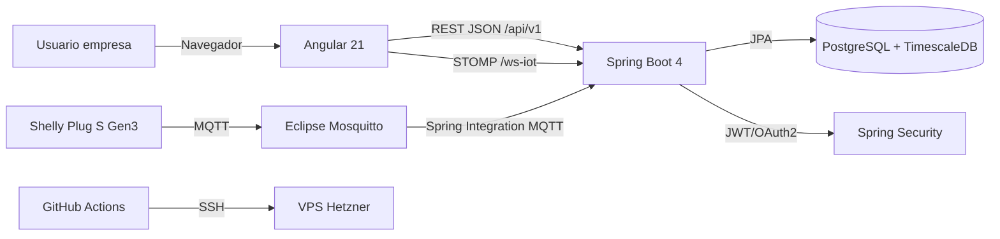
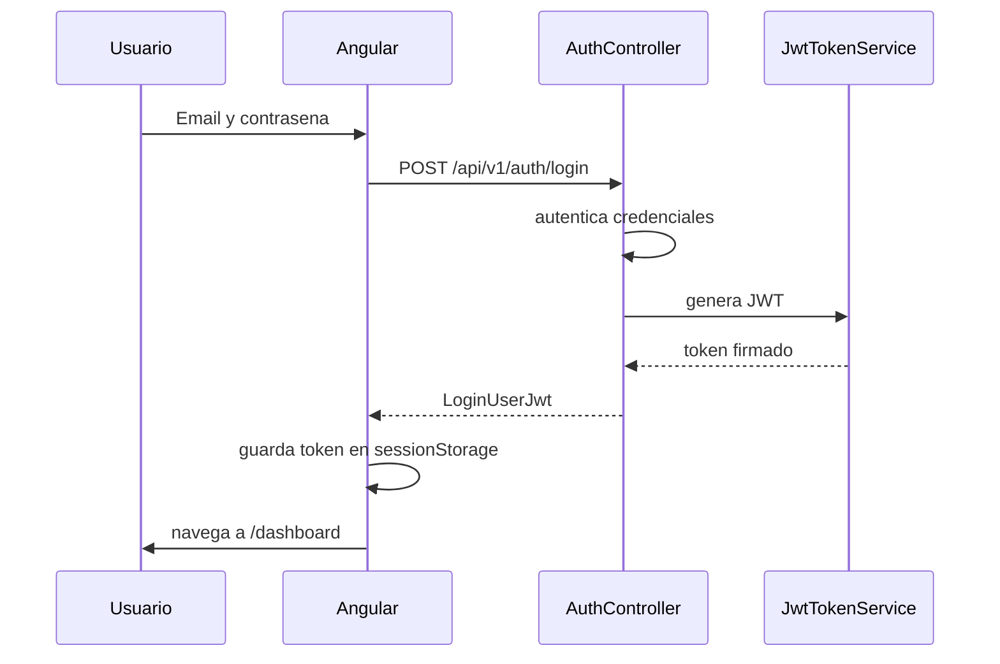
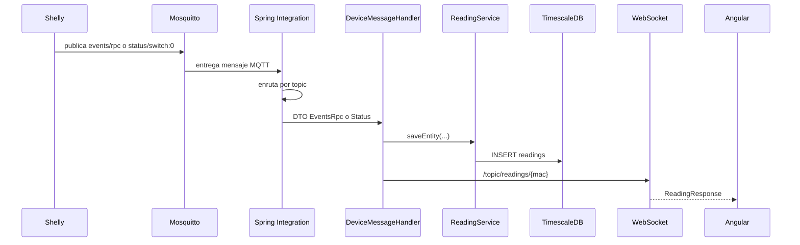
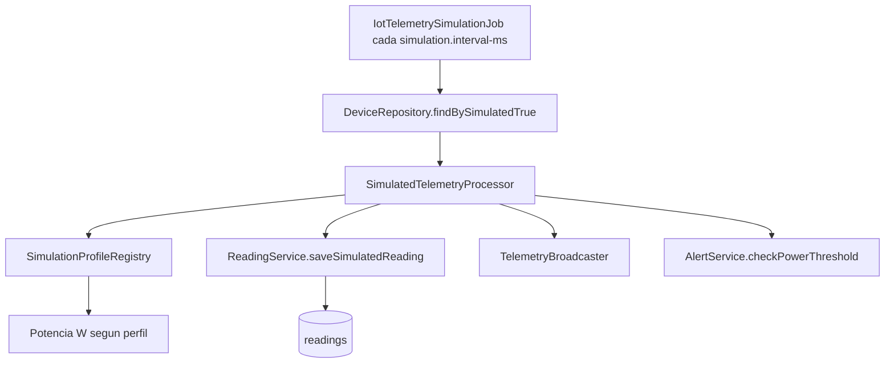
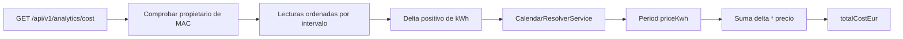
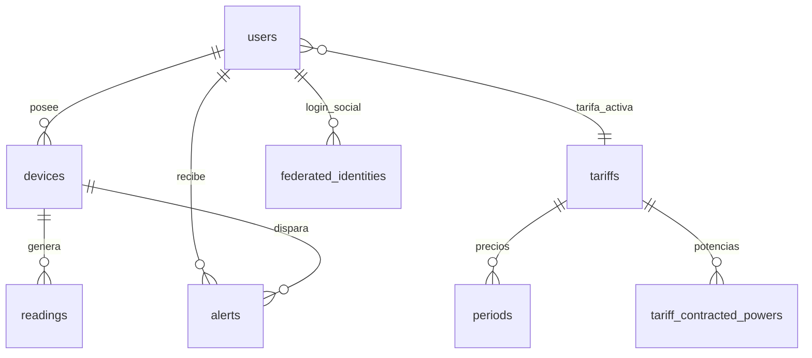

# Canvas documental - Arquitectura de Wattimizer

> Documento visual de apoyo para la memoria tecnica. Resume los flujos que despues se explican con detalle en `docs/memoria`.

## 1. Vista general

La idea basica es que el dispositivo no habla con Angular. El Shelly publica MQTT, el backend normaliza y guarda la lectura, y despues Angular recibe datos ya filtrados por REST o WebSocket.

## 2. Capas de la aplicacion

| Capa | Ficheros principales | Responsabilidad |
|---|---|---|
| UI Angular | `frontend/src/app/components/*` | Formularios, dashboard, navegacion y mensajes de usuario. |
| Estado Angular | `telemetry.store.ts`, `tariff.store.ts` | Datos compartidos y flujos reactivos. |
| API REST | `backend/.../controllers/*` | Entrada HTTP versionada bajo `/api/v1`. |
| Negocio | `backend/.../services/*` | Reglas de tarifas, dispositivos, lecturas, alertas y simulacion. |
| Persistencia | `entities/*`, `repositories/*` | Modelo relacional e hypertable de lecturas. |
| IoT | `MqttConfig`, `DeviceMessageHandler` | Entrada MQTT y transformacion a lecturas. |
| Despliegue | `docker-compose.yml`, `.github/workflows/deploy.yml` | Ejecucion productiva y CI/CD. |

## 3. Flujo de login

## 4. Flujo de telemetria real

Punto critico: `events/rpc` solo conserva bien la MAC si el dispositivo ya existe en la base de datos; para la demo fisica conviene sembrar o reclamar el Shelly antes.

## 5. Flujo de simuladores

Los simuladores no evitan la base de datos. Generan lecturas reales para que dashboard, costes y alertas se comporten igual que con hardware.

## 6. Flujo de calculo de coste

El backend calcula coste con energia acumulada, no solo con potencia instantanea. Asi se evitan errores por muestras irregulares.

## 7. Modelo de datos resumido

## 8. Lectura recomendada

1. `docs/memoria/memoria-final-daw.md` para la memoria principal.
2. `docs/memoria/anexo-a-backend-rest.md` para endpoints y DTOs.
3. `docs/memoria/anexo-b-frontend-angular.md` para componentes y reactividad.
4. `docs/memoria/anexo-c-telemetria-mqtt.md` para MQTT y simulacion.
5. `docs/memoria/anexo-d-timescaledb-analitica.md` para base de datos y consultas.
