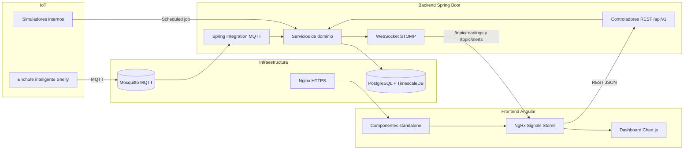
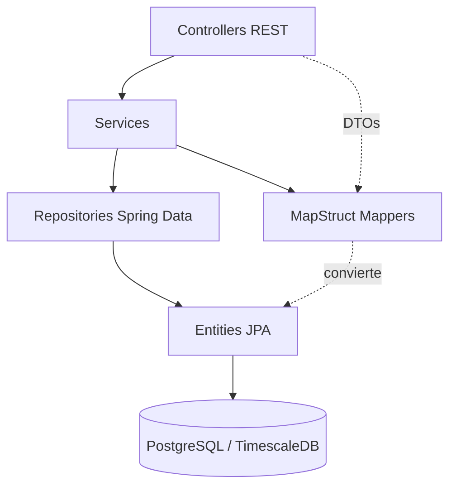
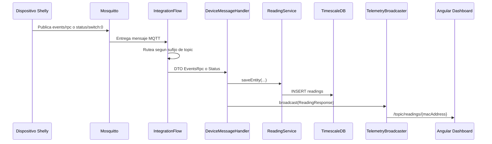
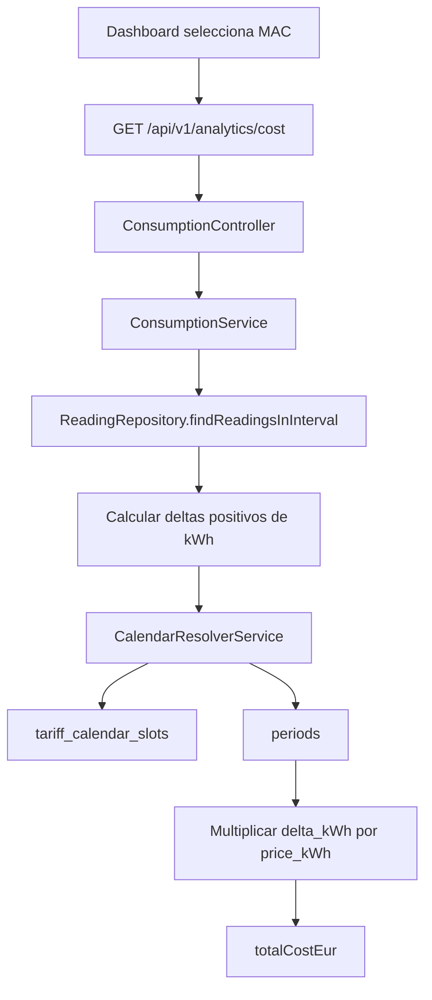
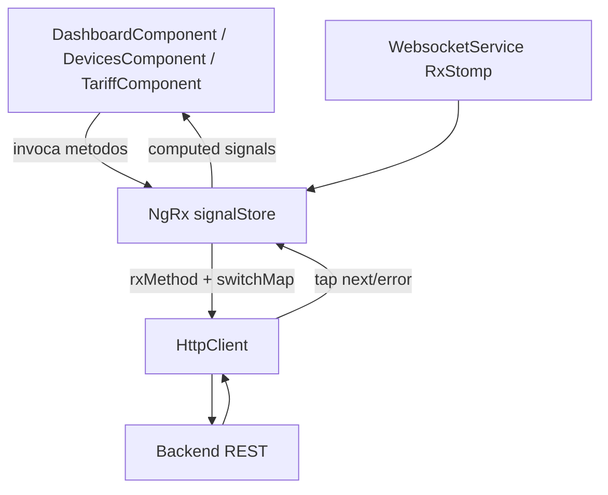
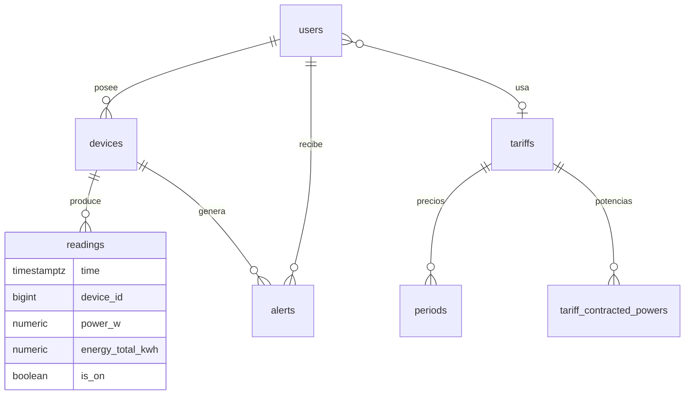

# Docs Canvas - Arquitectura de Wattimizer

> Documento visual de apoyo para la memoria DAW. Resume las piezas tecnicas principales y enlaza mentalmente backend, frontend, MQTT y TimescaleDB.

## 1. Mapa general

## 2. Capas de backend

### Lectura rapida

- **Controllers:** exponen endpoints, validan pertenencia basica y usan `Principal`.
- **Services:** concentran reglas: tarifas, costes, simulacion, alertas y borrado seguro.
- **Repositories:** contienen consultas JPA/JPQL.
- **Entities:** representan tablas reales.
- **DTOs:** evitan exponer entidades completas al frontend.

## 3. Flujo de telemetria real

## 4. Flujo de analitica economica

La aplicacion calcula coste a partir del odometro acumulado. No suma potencia instantanea directamente, porque la energia consumida se mide mejor como diferencia entre lecturas de kWh.

## 5. Flujo de estado Angular

### Stores

| Store | Estado principal | Uso |
| --- | --- | --- |
| `TelemetryStore` | dispositivos, MAC seleccionada, historial por MAC | Dashboard y gestion de dispositivos. |
| `TariffStore` | catalogo, tarifa privada, loading y errores | Pantalla de tarifas y metricas del dashboard. |

## 6. Modelo de datos resumido

## 7. Puntos clave para defender el proyecto

- La arquitectura separa **telemetria**, **negocio** y **presentacion**.
- TimescaleDB se usa donde tiene sentido: lecturas temporales.
- Las tarifas separan dos conceptos que suelen mezclarse: calendario regulatorio y precio contractual.
- El frontend no hace calculos criticos de coste; los solicita al backend.
- Los simuladores permiten probar el sistema aunque no haya hardware conectado.
- Las alertas se generan en backend, por lo que no dependen de que el usuario tenga abierta la pantalla.
