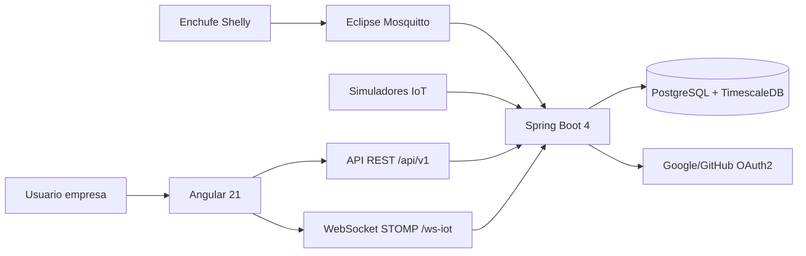
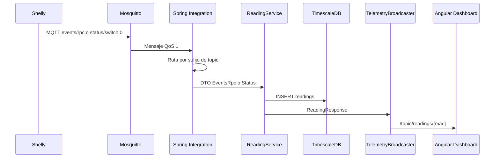
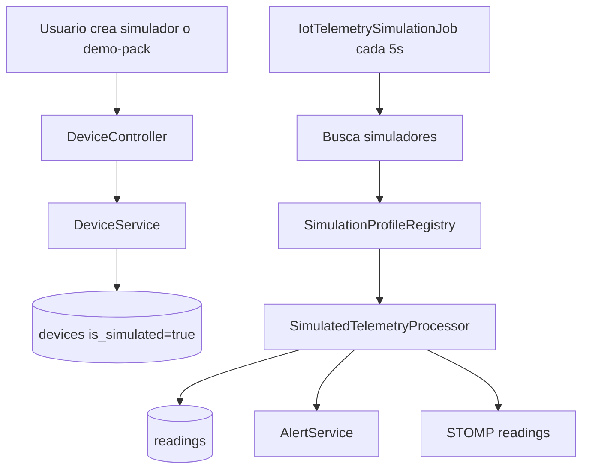
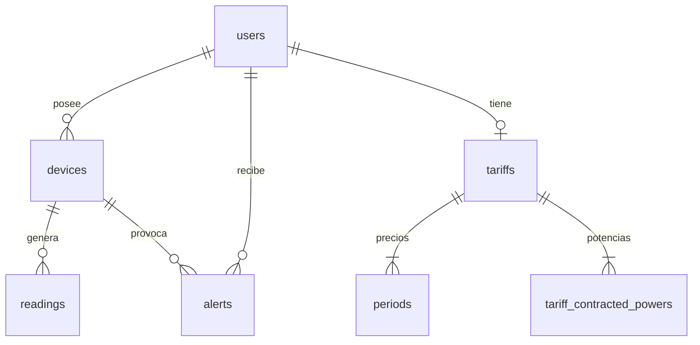
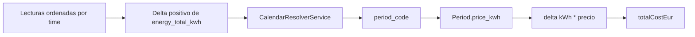

# Canvas documental: arquitectura de Wattimizer

Este documento resume visualmente la arquitectura para usarlo como apoyo de lectura junto a la memoria DAW. Los detalles completos estan en `docs/memoria/`.

## 1. Vista global

## 2. Capas de la aplicacion

| Capa | Elementos | Responsabilidad |
|---|---|---|
| Presentacion | Angular, PrimeNG, Chart.js | Formularios, graficas y navegacion. |
| Estado frontend | NgRx Signals, RxJS | Telemetria, tarifas, loading, errores y seleccion de MAC. |
| API | Controladores Spring MVC | Endpoints REST versionados. |
| Dominio | Servicios Spring | Reglas de dispositivos, tarifas, analitica y alertas. |
| Ingesta | Spring Integration MQTT | Entrada asincrona desde Shelly. |
| Tiempo real | STOMP | Lecturas y alertas hacia Angular. |
| Persistencia | JPA + TimescaleDB | Datos relacionales y serie temporal `readings`. |
| Operacion | Docker Compose, Nginx, GitHub Actions | Despliegue y publicacion en VPS. |

## 3. Flujo de telemetria

## 4. Flujo de simuladores

## 5. Modelo de datos resumido

## 6. Contratos REST principales

| Modulo | Endpoints clave |
|---|---|
| Auth | `POST /api/v1/auth/login`, `POST /api/v1/auth/register`, `POST /api/v1/auth/oauth/exchange` |
| Devices | `GET /api/v1/devices`, `POST /api/v1/devices/claim`, `POST /api/v1/devices/simulated`, `POST /api/v1/devices/simulated/demo-pack` |
| Readings | `GET /api/v1/readings/device/{mac}/recent`, `GET /api/v1/readings/latest/{mac}` |
| Analytics | `GET /api/v1/analytics/cost`, `GET /api/v1/analytics/ghost-consumption` |
| Tariffs | `GET /api/v1/tariffs`, `POST /api/v1/tariffs`, `POST /api/v1/users/me/tariff` |
| Alerts | `GET /api/v1/alerts`, `DELETE /api/v1/alerts/{id}` |

## 7. Secuencia de calculo economico

## 8. Decisiones importantes

- La telemetria no entra por REST, sino por MQTT o por el job de simulacion.
- Angular no hace polling continuo para la grafica; escucha STOMP despues de cargar un historico inicial.
- La tarifa privada se gestiona con `/api/v1/users/me/tariff`, sin `userId`, para evitar IDOR.
- TimescaleDB se usa para particionar `readings`; la analitica actual se calcula en Java.
- La simulacion esta activada por configuracion para facilitar demostraciones sin hardware.

## 9. Referencias internas

- Memoria principal: `docs/memoria/memoria-final-daw.md`
- Backend REST: `docs/memoria/anexo-a-backend-rest.md`
- Frontend Angular: `docs/memoria/anexo-b-frontend-angular.md`
- MQTT: `docs/memoria/anexo-c-telemetria-mqtt.md`
- TimescaleDB: `docs/memoria/anexo-d-timescaledb-analitica.md`
