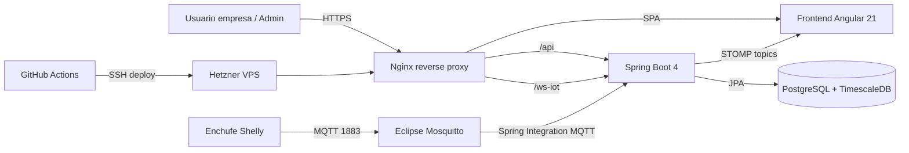
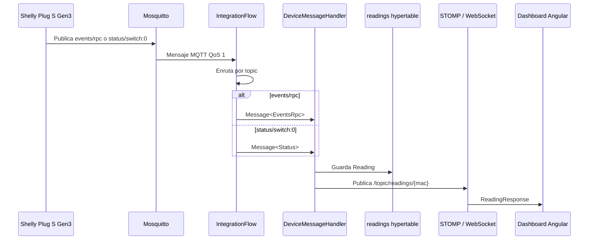
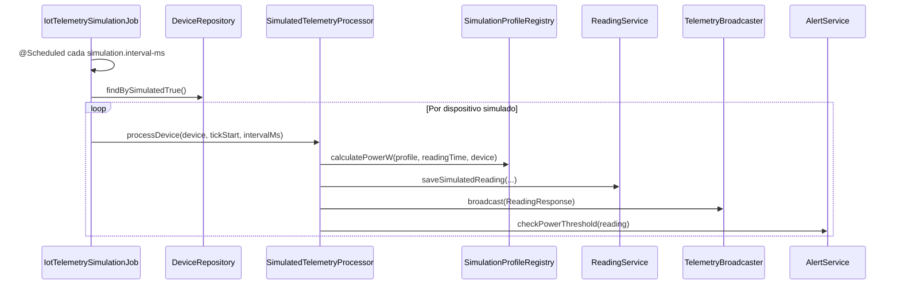
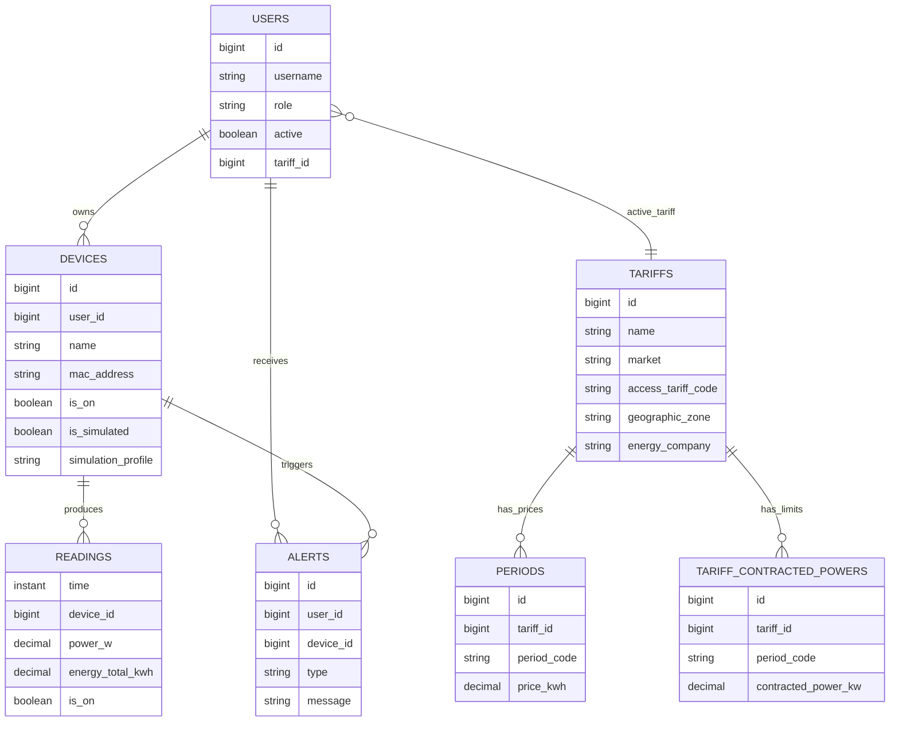
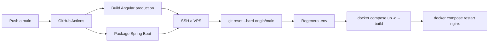

# Canvas documental — Arquitectura Wattimizer

Este documento complementa la memoria con diagramas Mermaid. No sustituye los anexos técnicos; sirve para explicar el sistema visualmente durante la defensa o en la memoria final.

## 1. Vista general



Lectura rápida:

- Angular no accede ni a la base de datos ni al broker MQTT.
- Spring Boot concentra seguridad, negocio, ingesta y emisión WebSocket.
- TimescaleDB se usa para `readings`, la tabla de serie temporal.
- Nginx es la entrada pública web.

## 2. Flujo MQTT físico



## 3. Flujo de simuladores



La transacción por dispositivo evita que un simulador roto frene el resto de la demostración.

## 4. Modelo de datos principal



`tariff_calendar_slots` se queda fuera del diagrama para no saturarlo: es una tabla global de calendario regulatorio y no pertenece a un usuario concreto.

## 5. Estado reactivo en Angular

```mermaid
flowchart TD
    Dashboard[DashboardComponent] --> TelemetryStore
    Devices[DevicesComponent] --> TelemetryStore
    TariffView[TariffComponent] --> TariffStore

    TelemetryStore -->|HTTP| DevicesApi[/api/v1/devices/]
    TelemetryStore -->|HTTP| RecentApi[/api/v1/readings/device/{mac}/recent/]
    TelemetryStore -->|STOMP| Topic[/topic/readings/{mac}/]

    TariffStore -->|HTTP| Catalog[/api/v1/tariffs/]
    TariffStore -->|HTTP| MyTariff[/api/v1/users/me/tariff/]

    TelemetryStore --> Chart[Chart.js]
    TariffStore --> Analytics[Coste y consumo fantasma]
```

Los componentes no guardan el estado global: invocan métodos del store y leen signals.

## 6. API REST resumida

| Área | Endpoint base | Controlador |
|---|---|---|
| Autenticación | `/api/v1/auth` | `AuthController` |
| Dispositivos | `/api/v1/devices` | `DeviceController` |
| Lecturas | `/api/v1/readings` | `ReadingController` |
| Analítica | `/api/v1/analytics` | `ConsumptionController` |
| Tarifas catálogo | `/api/v1/tariffs` | `TariffController` |
| Tarifa privada | `/api/v1/users/me/tariff` | `UserTariffController` |
| Alertas | `/api/v1/alerts` | `AlertController` |

## 7. Despliegue



El reinicio de Nginx evita 502 cuando Docker recrea backend o frontend y cambian las IPs internas.
