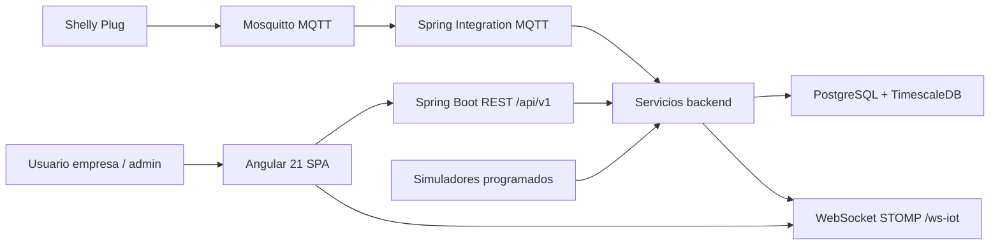
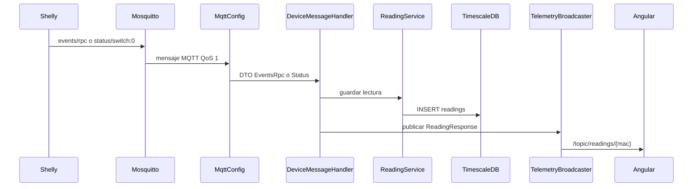
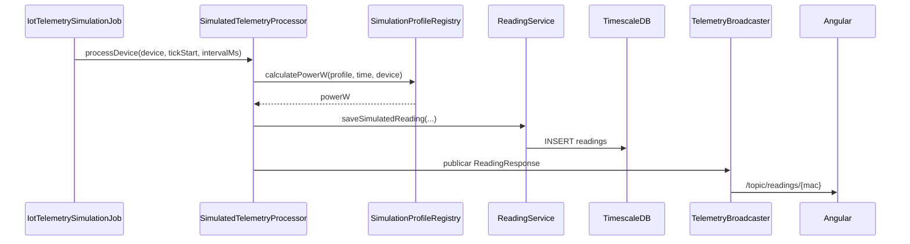
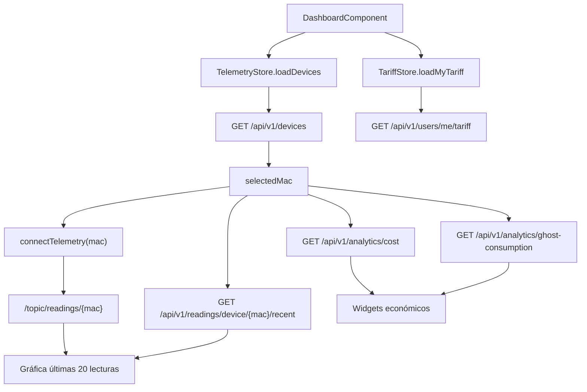

# Canvas documental: arquitectura de Wattimizer

## 1. Propósito

Este canvas resume visualmente la arquitectura técnica de Wattimizer. Está pensado como material de apoyo para la memoria final: no sustituye a los anexos, pero ayuda a entender de un vistazo cómo se conectan frontend, backend, MQTT, TimescaleDB y simuladores.

## 2. Vista general

## 3. Capas del sistema

| Capa | Tecnología | Responsabilidad |
| --- | --- | --- |
| Interfaz | Angular, PrimeNG, Tailwind | Pantallas, formularios, dashboard y navegación. |
| Estado frontend | NgRx Signals, RxJS | Dispositivos, telemetría, tarifa privada y flujos reactivos. |
| API | Spring Boot REST | Autenticación, dispositivos, lecturas, analítica, tarifas y alertas. |
| Seguridad | Spring Security, JWT, OAuth2 | Sesión stateless, roles y comprobación de propietario. |
| Ingesta IoT | Spring Integration MQTT, Paho | Recepción de mensajes Shelly. |
| Tiempo real | WebSocket STOMP | Lecturas y alertas hacia Angular. |
| Persistencia | TimescaleDB | Datos relacionales y lecturas temporales. |
| Despliegue | Docker Compose, Nginx | Orquestación y entrada pública. |

## 4. Flujo de telemetría física

## 5. Flujo de telemetría simulada

## 6. Flujo del dashboard

## 7. Mapa de endpoints por pantalla

| Pantalla | REST | Tiempo real |
| --- | --- | --- |
| Login | `POST /api/v1/auth/login` | No aplica |
| Registro | `POST /api/v1/auth/register` | No aplica |
| Dashboard | `GET /api/v1/devices`, `GET /api/v1/readings/device/{mac}/recent`, `GET /api/v1/analytics/cost`, `GET /api/v1/analytics/ghost-consumption` | `/topic/readings/{mac}` |
| Dispositivos | `POST /api/v1/devices/claim`, `POST /api/v1/devices/simulated`, `POST /api/v1/devices/simulated/demo-pack`, `PUT /api/v1/devices/{id}`, `DELETE /api/v1/devices/{id}` | No directo |
| Tarifas | `GET/POST/DELETE /api/v1/tariffs`, `GET/POST/DELETE /api/v1/users/me/tariff` | No aplica |
| Alertas | `GET /api/v1/alerts`, `DELETE /api/v1/alerts/{id}` | Backend publica `/topic/alerts/{username}` |

## 8. Decisiones arquitectónicas destacadas

### 8.1. REST para órdenes, MQTT para telemetría

El usuario gestiona dispositivos y tarifas por REST. Las lecturas, en cambio, entran por MQTT o por el job de simulación. Esta separación evita convertir la telemetría en simples formularios HTTP y representa mejor un escenario IoT real.

### 8.2. STOMP hacia Angular

El frontend no se conecta a MQTT. El backend traduce el mundo IoT a WebSocket STOMP, que es más natural para una aplicación web y funciona bien detrás de Nginx.

### 8.3. TimescaleDB para crecimiento temporal

`readings` se convierte en hypertable porque es la tabla que crecerá continuamente. El resto del modelo sigue siendo relacional normal.

### 8.4. Simuladores como soporte de demostración

Los simuladores permiten probar dashboard, analítica y alertas sin depender del Shelly físico. No sustituyen a MQTT, pero reutilizan la misma persistencia y el mismo canal STOMP de salida.

## 9. Lectura recomendada

1. `docs/memoria/memoria-final-daw.md` para la visión académica completa.
2. `docs/memoria/anexo-a-backend-rest.md` para endpoints y DTOs.
3. `docs/memoria/anexo-b-frontend-angular.md` para componentes, RxJS y NgRx Signals.
4. `docs/memoria/anexo-c-telemetria-mqtt.md` para ingesta asíncrona.
5. `docs/memoria/anexo-d-timescaledb-analitica.md` para base de datos y consultas analíticas.
