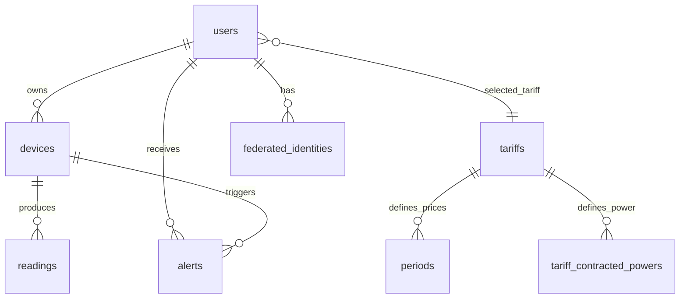

# Memoria técnica del proyecto DAW: Wattimizer

## 1. Introducción y justificación

### 1.1. Título del proyecto

**Wattimizer** es una plataforma web B2B orientada a la monitorización energética de pequeñas empresas mediante dispositivos IoT.

### 1.2. Descripción del problema

Muchas pymes conocen el importe de su factura eléctrica cuando el gasto ya se ha producido. El problema no está solo en consumir electricidad, sino en no saber cuándo se consume, qué equipos provocan picos de potencia y cuánto dinero supone mantener cargas encendidas fuera del horario productivo.

Wattimizer intenta resolver esa falta de visibilidad convirtiendo lecturas IoT de potencia y energía acumulada en información útil para la toma de decisiones. La aplicación registra datos de enchufes inteligentes Shelly o dispositivos simulados, los asocia a una tarifa eléctrica del usuario y muestra lecturas, coste estimado, consumo fantasma y alertas de maxímetro.

### 1.3. Objetivos

**Objetivo general**

Desarrollar una aplicación web que permita a una empresa registrar dispositivos de medición, visualizar telemetría eléctrica casi en tiempo real y estimar el impacto económico de su consumo.

**Objetivos específicos**

- Implementar autenticación con JWT y soporte de login social OAuth2.
- Gestionar dispositivos físicos por MAC y dispositivos simulados para demostraciones.
- Ingerir telemetría asíncrona desde MQTT mediante Spring Integration.
- Persistir lecturas temporales en PostgreSQL/TimescaleDB.
- Calcular coste energético usando periodos tarifarios `2.0TD`, `3.0TD`, `6.1TD` y `6.2TD`.
- Mostrar en Angular una gráfica en tiempo real alimentada por WebSocket STOMP.
- Generar alertas cuando la potencia registrada supera la potencia contratada del periodo aplicable.

### 1.4. Tipos de usuarios

| Usuario | Papel en la aplicación | Funciones principales |
|---|---|---|
| Usuario empresa (`ROLE_USER`) | Cliente que consulta su consumo | Alta de dispositivos, selección de tarifa privada, dashboard, alertas y costes. |
| Administrador (`ROLE_ADMIN`) | Gestor técnico de la plataforma | Mantiene el catálogo maestro de tarifas y puede crear usuarios administradores mediante secreto de cabecera. |
| Sistema IoT / simulador | Origen técnico de telemetría | Publica lecturas MQTT o genera lecturas simuladas periódicas. |

## 2. Fase 1: Análisis funcional

### 2.1. Mapa de funcionalidades

| Módulo | Funcionalidades |
|---|---|
| Autenticación | Registro, login clásico, login OAuth2, emisión de JWT y protección de rutas. |
| Dispositivos | Listado por usuario, vinculación por MAC, creación de simuladores, pack de demostración, edición, encendido/apagado lógico y borrado seguro. |
| Telemetría | Recepción MQTT, persistencia de lecturas, emisión STOMP, precarga de histórico reciente y gráfica en Angular. |
| Tarifas | Catálogo maestro, tarifa privada del usuario, precios por periodo y potencia contratada por periodo. |
| Analítica | Coste acumulado en intervalo y coste de consumo fantasma nocturno. |
| Alertas | Detección de sobrepotencia frente a contrato y descarte de alertas por usuario. |
| Despliegue | Docker Compose con backend, frontend, PostgreSQL/TimescaleDB, Mosquitto y Nginx. |

### 2.2. Historias de usuario

| ID | Historia | Criterios de aceptación | Prioridad |
|---|---|---|---|
| HU-01 | Como usuario, quiero registrarme e iniciar sesión para acceder a mi zona privada. | El registro valida email y contraseña; el login devuelve JWT; las rutas privadas rechazan peticiones sin token. | Imprescindible |
| HU-02 | Como usuario, quiero vincular un enchufe físico por MAC para consultar sus lecturas. | El formulario exige MAC de 12 caracteres hexadecimales; el backend asocia el dispositivo al `Principal`; no permite reclamar un dispositivo de otra cuenta. | Imprescindible |
| HU-03 | Como usuario, quiero crear simuladores para probar la aplicación sin hardware real. | Se selecciona perfil de consumo; el backend genera MAC `SIM...`; el job crea lecturas periódicas. | Imprescindible |
| HU-04 | Como usuario, quiero ver una gráfica de consumo activo en tiempo real. | El dashboard carga las últimas lecturas por REST y después escucha `/topic/readings/{macAddress}` por STOMP. | Imprescindible |
| HU-05 | Como usuario, quiero configurar mi tarifa para calcular costes. | Puede asignar una plantilla o editar su contrato privado; se validan periodos de energía y potencias. | Imprescindible |
| HU-06 | Como usuario, quiero ver mi gasto diario y consumo fantasma. | El dashboard llama a `/api/v1/analytics/cost` y `/api/v1/analytics/ghost-consumption` solo si existe tarifa privada. | Imprescindible |
| HU-07 | Como usuario, quiero recibir alertas por exceso de potencia. | Cada lectura resuelve el periodo tarifario, compara W contra kW contratados y crea alerta `OVERPOWER` si se supera el límite. | Imprescindible |
| HU-08 | Como administrador, quiero mantener el catálogo de tarifas. | Solo `ROLE_ADMIN` puede crear, actualizar o borrar tarifas de catálogo; los usuarios autenticados solo leen. | Opcional |
| HU-09 | Como usuario, quiero borrar dispositivos sin dejar datos colgando. | El servicio elimina primero lecturas y alertas asociadas, después borra el dispositivo. | Imprescindible |

### 2.3. Gestión del trabajo

- **Repositorio:** `https://github.com/joellmar/wattpath-app`.
- **Flujo de Git observado:** la rama principal contiene commits pequeños y descriptivos, por ejemplo `feat(devices): perfiles de simulacion de consumo y CRUD simulado`, `fix(simulators): borrado en cascada, telemetria por perfil y panel multi-dispositivo` y `fix(deploy): reiniciar nginx tras compose up para evitar 502`.
- **Kanban:** el repositorio no contiene una captura del tablero. Para la entrega académica conviene incorporar una imagen externa del tablero con columnas Backlog, Por hacer, En progreso, En revisión y Hecho.

### 2.4. Planificación inicial

| Fase | Historias relacionadas | Dificultad |
|---|---|---|
| Fase 1: autenticación | HU-01 | Media |
| Fase 2: dispositivos | HU-02, HU-03, HU-09 | Media-alta |
| Fase 3: telemetría | HU-04, HU-07 | Alta |
| Fase 4: tarifas y analítica | HU-05, HU-06, HU-08 | Alta |
| Fase 5: despliegue | Validación integral en Docker/Nginx | Media |

## 3. Fase 2: Diseño técnico

### 3.1. Diseño de la base de datos

El modelo combina tablas relacionales clásicas con una tabla temporal optimizada para lecturas:

- `users`: usuarios con rol, contraseña cifrada y tarifa activa.
- `federated_identities`: identidades OAuth2 externas.
- `devices`: equipos físicos o simulados asociados a usuario.
- `readings`: lecturas temporales con clave compuesta `(time, device_id)`.
- `alerts`: incidencias generadas a partir de lecturas.
- `tariffs`: contratos o plantillas de tarifa.
- `periods`: precio €/kWh por periodo `P1` a `P6`.
- `tariff_contracted_powers`: potencia contratada por periodo.
- `tariff_calendar_slots`: tabla regulatoria que resuelve zona, mes, día y hora a un periodo.



### 3.2. Arquitectura del sistema

| Capa | Tecnología | Responsabilidad |
|---|---|---|
| Frontend | Angular 21, TypeScript, PrimeNG, NgRx Signals, RxJS | Interfaz SPA, formularios, stores, gráfica y consumo de API. |
| Backend | Java 26, Spring Boot 4, Spring Security, Spring Data JPA, Spring Integration MQTT | API REST, seguridad, ingesta MQTT, persistencia y reglas de negocio. |
| Base de datos | PostgreSQL + TimescaleDB | Datos relacionales y lecturas temporales en hypertable. |
| Mensajería IoT | Mosquitto + MQTT | Recepción asíncrona de eventos Shelly. |
| Tiempo real | WebSocket STOMP | Publicación backend -> Angular de lecturas y alertas. |
| Despliegue | Docker Compose + Nginx | Orquestación de servicios y proxy HTTP/WebSocket. |

### 3.3. Diseño de interfaz

Las pantallas principales implementadas son:

- Login y registro.
- Callback OAuth2.
- Layout privado con navegación.
- Dashboard de telemetría y métricas económicas.
- Gestión de dispositivos físicos y simulados.
- Gestión de tarifas.
- Listado y descarte de alertas.

Los componentes usan controles de PrimeNG y formularios reactivos. La interfaz está orientada a un panel oscuro de administración, con mensajes de error temporales y validación visible en formularios.

### 3.4. Relación entre historias y diseño

| Historia | Tablas implicadas | Código principal |
|---|---|---|
| HU-01 | `users`, `federated_identities` | `AuthController`, `AuthRegistrationService`, `JwtTokenService`, `SecurityConfig`, `LoginComponent`, `RegisterComponent`. |
| HU-02 | `devices` | `DeviceController`, `DeviceService`, `DevicesComponent`, `TelemetryStore`. |
| HU-03 | `devices`, `readings` | `SimulationProperties`, `IotTelemetrySimulationJob`, `SimulatedTelemetryProcessor`, perfiles de `simulation/`. |
| HU-04 | `readings` | `ReadingController`, `TelemetryBroadcaster`, `WebsocketService`, `DashboardComponent`. |
| HU-05 | `tariffs`, `periods`, `tariff_contracted_powers`, `tariff_calendar_slots` | `TariffController`, `UserTariffController`, `TariffService`, `UserTariffService`, `TariffComponent`. |
| HU-06 | `readings`, `tariffs`, `periods`, `tariff_calendar_slots` | `ConsumptionController`, `ConsumptionService`, `CalendarResolverService`, `DashboardComponent`. |
| HU-07 | `alerts`, `readings`, `tariff_contracted_powers` | `AlertService`, `AlertController`, `AlertsComponent`. |

## 4. Fase 3: Implementación y desarrollo

### 4.1. Tecnologías utilizadas

- **Java:** 26.
- **Spring Boot:** 4.0.5.
- **MapStruct:** 1.6.3.
- **Angular:** 21.x.
- **TypeScript:** 5.9.x.
- **NgRx Signals:** 21.1.0.
- **RxJS:** 7.8.x.
- **PrimeNG:** 21.1.x.
- **Chart.js:** 4.5.x.
- **STOMP:** `@stomp/rx-stomp` 2.4.0 y `@stomp/stompjs` 7.3.0.
- **Base de datos:** PostgreSQL con extensión TimescaleDB.
- **MQTT:** Spring Integration MQTT + Eclipse Paho.

### 4.2. Desarrollo del backend

El backend se estructura en controladores REST, servicios de negocio, repositorios JPA, entidades y mappers. La seguridad es stateless: el JWT se valida antes de las rutas privadas y el usuario activo se obtiene mediante `Principal`.

Las decisiones más importantes son:

- Las operaciones multiusuario no aceptan `userId` en URL ni body para evitar IDOR.
- Las lecturas se identifican por tiempo y dispositivo, porque un dispositivo genera una serie temporal.
- Las tarifas privadas se clonan desde el catálogo para que el usuario pueda modificar precios sin mutar plantillas globales.
- El borrado de dispositivos elimina antes lecturas y alertas asociadas para evitar errores de FK.
- La ingesta MQTT y la simulación acaban en el mismo flujo funcional: guardar lectura, emitir STOMP y comprobar alerta.

### 4.3. Desarrollo del frontend

El frontend usa componentes standalone y lazy loading de rutas. La lógica compartida se concentra en servicios y stores:

- `AuthService`: login, registro e intercambio de ticket OAuth2.
- `SessionStorageService`: gestión de JWT en `sessionStorage` y lectura de claims.
- `TelemetryStore`: dispositivos, selección de MAC, histórico por dispositivo y stream STOMP.
- `TariffStore`: catálogo, tarifa privada, estados de carga y errores.
- `WebsocketService`: conexión a `/ws-iot` y suscripción a `/topic/readings/{mac}`.

La experiencia de usuario se basa en señales (`signal`, `computed`, `effect`) para que la vista reaccione a cambios de estado sin manejar manualmente toda la sincronización.

### 4.4. Control de versiones

El historial reciente muestra una evolución por cambios concretos:

- Perfiles de simulación y CRUD simulado.
- Pack de demostración con nueve simuladores.
- Panel multi-dispositivo con histórico por MAC.
- Borrado seguro de dispositivos.
- Correcciones de despliegue en Nginx y Docker.

## 5. Fase 4: Pruebas y despliegue

### 5.1. Plan de pruebas

| Prueba | Criterio validado | Resultado esperado |
|---|---|---|
| Registro con email inválido | HU-01 | El backend devuelve error de validación. |
| Login correcto | HU-01 | Se guarda JWT y se navega a dashboard. |
| Acceso a `/dashboard` sin token | HU-01 | El guard redirige a `/login`. |
| Vincular MAC física válida | HU-02 | Se crea o reclama dispositivo para el usuario actual. |
| Crear simulador | HU-03 | Se genera MAC `SIM...` y aparecen lecturas periódicas. |
| Cambiar dispositivo seleccionado | HU-04 | Se precarga histórico reciente y se cambia la suscripción STOMP. |
| Asignar tarifa de catálogo | HU-05 | Se clona la plantilla y se activa la analítica. |
| Calcular coste diario | HU-06 | El endpoint devuelve `totalCostEur` para el intervalo solicitado. |
| Superar potencia contratada | HU-07 | Se crea alerta `OVERPOWER` y se publica en `/topic/alerts/{username}`. |
| Borrar dispositivo con lecturas | HU-09 | Se eliminan lecturas/alertas y después el dispositivo. |

### 5.2. Manual de instalación

La guía detallada está en `docs/deployment/hetzner-production.md`. Para desarrollo local, el flujo técnico es:

```bash
cd backend
./mvnw spring-boot:run

cd ../frontend
npm install
npm start
```

La base de datos necesita crear tablas con Hibernate y después ejecutar los scripts:

```bash
backend/src/main/resources/db/dev-seed/00-extensions.sql
backend/src/main/resources/db/dev-seed/01-hypertable.sql
backend/src/main/resources/db/tariffs-td-schema.sql
backend/src/main/resources/db/seed-tariff-calendar-slots.sql
```

### 5.3. Despliegue

El despliegue de producción documentado usa Docker Compose en Hetzner. El stack incluye frontend, backend, TimescaleDB, broker MQTT Mosquitto y Nginx como proxy. Un cambio reciente reinicia Nginx después de `docker compose up` para evitar respuestas 502 por caché de IP internas antiguas.

## 6. Conclusiones y líneas futuras

### 6.1. Grado de cumplimiento

El MVP está cubierto: autenticación, dispositivos, telemetría, dashboard, tarifas, analítica, alertas y despliegue. Además, los simuladores permiten probar la aplicación sin depender siempre de hardware físico.

### 6.2. Dificultades

- Integrar lecturas temporales IoT con un modelo relacional sin perder propiedad por usuario.
- Traducir lecturas de energía acumulada a coste económico usando periodos tarifarios reales.
- Evitar que un usuario vea dispositivos o tarifas de otro usuario.
- Mantener la gráfica en tiempo real sin acumular memoria en el navegador.
- Resolver el borrado de dispositivos con lecturas y alertas ya existentes.

### 6.3. Mejoras futuras

- Añadir más modelos de dispositivos físicos y suscripciones MQTT dinámicas.
- Crear agregados continuos de TimescaleDB para analítica por hora, día y mes.
- Definir políticas de compresión y retención de lecturas antiguas.
- Incorporar notificaciones push o email para alertas críticas.
- Añadir una aplicación móvil o PWA.
- Exportar informes en PDF para justificar ahorros energéticos.

## 7. Bibliografía y recursos

- Documentación oficial de Spring Boot.
- Documentación oficial de Spring Security.
- Documentación de Spring Integration MQTT.
- Documentación de Angular.
- Documentación de NgRx Signals.
- Documentación de PrimeNG.
- Documentación de TimescaleDB.
- Circular CNMC 3/2020, usada como base del calendario tarifario.
