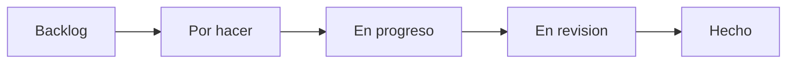
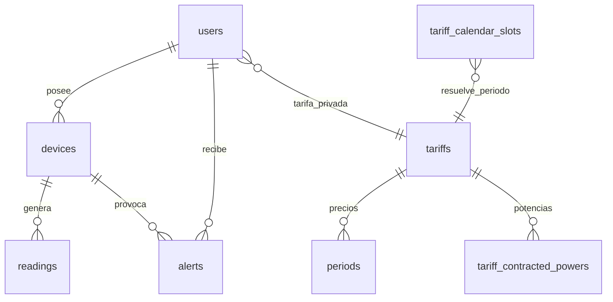
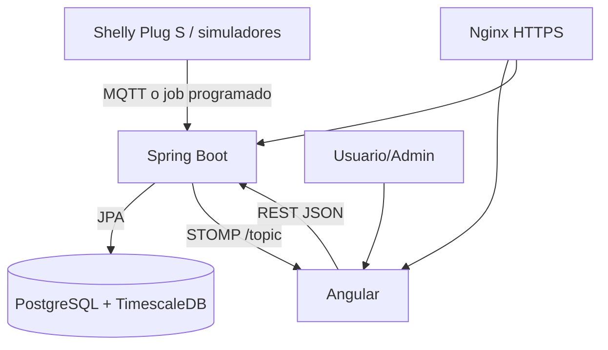

# Memoria tecnica del proyecto DAW: Wattimizer

## Indice de anexos tecnicos

- [Anexo A. Backend REST con Spring Boot](./anexo-a-backend-rest.md)
- [Anexo B. Frontend Angular, RxJS y NgRx Signals](./anexo-b-frontend-angular.md)
- [Anexo C. Ingesta de telemetria MQTT y simulacion IoT](./anexo-c-telemetria-mqtt.md)
- [Anexo D. TimescaleDB, modelo relacional y analitica energetica](./anexo-d-timescaledb-analitica.md)

## 1. Introduccion y justificacion

### 1.1. Titulo del proyecto

El proyecto se llama **Wattimizer**. Es una aplicacion web B2B orientada a que una pyme pueda ver su consumo electrico, traducirlo a euros y detectar picos o consumos improductivos antes de que se conviertan en coste real.

### 1.2. Descripcion del problema

Muchas pequenas empresas reciben la factura electrica como un resultado cerrado: saben cuanto han pagado al final del mes, pero no ven de forma clara que equipo ha consumido, en que franja horaria se ha producido el gasto ni si han superado una potencia contratada concreta. Esta falta de trazabilidad complica tomar decisiones sencillas, como apagar equipos en espera, ajustar una tarifa o detectar un pico puntual.

Wattimizer intenta resolver esa necesidad conectando datos IoT de enchufes inteligentes Shelly con contratos electricos reales de tarifas TD. La plataforma no se queda en mostrar vatios: guarda lecturas temporales, calcula coste por periodo, permite configurar potencias contratadas y genera alertas cuando una lectura supera el limite aplicable.

### 1.3. Objetivos

**Objetivo general**

Desarrollar una plataforma web de monitorizacion energetica para pymes que permita registrar dispositivos, recibir telemetria, consultar historicos, configurar tarifas y estimar el coste economico del consumo.

**Objetivos especificos**

- Implementar autenticacion con JWT, registro de usuarios y acceso OAuth2 con Google/GitHub.
- Permitir que cada usuario gestione sus propios dispositivos IoT sin ver datos de otras cuentas.
- Registrar lecturas de potencia y energia acumulada en una tabla preparada para series temporales.
- Integrar telemetria MQTT mediante Spring Integration para recibir mensajes de dispositivos Shelly.
- Anadir simuladores de consumo para poder probar la aplicacion sin depender siempre de hardware fisico.
- Configurar contratos electricos con peajes `2.0TD`, `3.0TD`, `6.1TD` y `6.2TD`.
- Calcular coste estimado y consumo fantasma a partir de lecturas y calendario tarifario.
- Emitir lecturas en tiempo real al frontend mediante WebSocket STOMP.
- Desplegar el sistema completo con Docker Compose, Nginx, Mosquitto y TimescaleDB.

### 1.4. Tipos de usuarios

| Tipo de usuario | Uso principal | Permisos principales |
| --- | --- | --- |
| Usuario empresa | Consulta dashboard, vincula dispositivos, gestiona su tarifa privada y revisa alertas. | Acceso autenticado a sus dispositivos, lecturas, alertas y contrato. |
| Administrador | Mantiene el catalogo maestro de tarifas y puede registrar usuarios administradores mediante clave interna. | Gestion del catalogo global de tarifas con `ROLE_ADMIN`. |
| Sistema IoT | Publica datos desde dispositivos fisicos o simulados. | No navega por la UI; alimenta lecturas mediante MQTT o job programado. |

## 2. Fase 1: Analisis funcional

### 2.1. Mapa de funcionalidades

| Modulo | Funcionalidades reales implementadas |
| --- | --- |
| Autenticacion | Login con JWT, registro, registro admin con cabecera privada, intercambio de ticket OAuth2. |
| Dispositivos | Listado por usuario, alta fisica por reclamacion, creacion simulada, pack demo, edicion, encendido/apagado logico y borrado seguro. |
| Telemetria | Ingesta MQTT, persistencia de lecturas, consulta de ultima lectura, historico reciente y busqueda por clave compuesta. |
| Dashboard | Grafica de potencia, seleccion multi-dispositivo, coste diario estimado y consumo fantasma. |
| Tarifas | Catalogo maestro, tarifa privada del usuario, periodos P1-P6, potencias contratadas y validacion normativa. |
| Alertas | Generacion de alertas de maximetro y descarte por usuario autenticado. |
| Despliegue | Contenedores para backend, frontend, TimescaleDB, Mosquitto y Nginx con certificados externos. |

### 2.2. Historias de usuario

| ID | Historia | Criterios de aceptacion | Prioridad |
| --- | --- | --- | --- |
| HU-01 | Como usuario, quiero registrarme e iniciar sesion para acceder a mi panel privado. | El registro crea una cuenta; el login devuelve JWT; las rutas privadas rechazan peticiones sin token. | Imprescindible |
| HU-02 | Como usuario, quiero vincular un dispositivo por MAC para consultar sus lecturas. | `POST /api/v1/devices/claim` asocia el dispositivo a mi cuenta o crea uno nuevo si no existe. | Imprescindible |
| HU-03 | Como usuario, quiero crear dispositivos simulados para probar el sistema sin hardware real. | La UI permite escoger perfil; el backend genera MAC `SIM...`; el job programado emite lecturas. | Imprescindible |
| HU-04 | Como usuario, quiero ver una grafica en tiempo real para seguir la potencia activa. | El dashboard carga lecturas recientes y se suscribe a `/topic/readings/{mac}` por STOMP. | Imprescindible |
| HU-05 | Como usuario, quiero configurar mi tarifa para calcular costes reales. | Puedo asignar una plantilla del catalogo o editar precios/potencias de mi contrato privado. | Imprescindible |
| HU-06 | Como usuario, quiero consultar coste diario y consumo fantasma. | El dashboard llama a `/api/v1/analytics/cost` y `/ghost-consumption` con MAC e intervalo. | Imprescindible |
| HU-07 | Como usuario, quiero recibir alertas si supero la potencia contratada. | Cada lectura comprueba el periodo tarifario y genera alerta `OVERPOWER` si procede. | Imprescindible |
| HU-08 | Como administrador, quiero mantener el catalogo maestro de tarifas. | Solo `ROLE_ADMIN` puede crear, actualizar o borrar tarifas de catalogo. | Opcional ampliado |
| HU-09 | Como usuario, quiero eliminar un dispositivo sin dejar datos huerfanos. | El borrado elimina primero lecturas y alertas asociadas y despues el dispositivo. | Imprescindible |

### 2.3. Gestion del trabajo

- **Repositorio:** <https://github.com/joellmar/wattpath-app>
- **Flujo Kanban documentado:** Backlog, Por hacer, En progreso, En revision y Hecho.
- **Flujo Git observado en el repositorio:** commits atomicos por funcionalidad o correccion (`feat`, `fix`, `docs`, `ci`) y ramas de trabajo generadas para documentacion o tareas concretas.



### 2.4. Planificacion inicial

| Fase | Historias asociadas | Dificultad estimada | Resultado |
| --- | --- | --- | --- |
| Analisis y seguridad | HU-01 | Media | Autenticacion JWT/OAuth2 y roles. |
| Modelo energetico | HU-05, HU-06, HU-07 | Alta | Tarifas TD, calendario regulatorio y calculos economicos. |
| IoT y telemetria | HU-02, HU-03, HU-04 | Alta | MQTT, WebSocket, simulacion y grafica en vivo. |
| Gestion operativa | HU-08, HU-09 | Media | CRUD de tarifas y dispositivos con borrado controlado. |
| Despliegue | Todas | Media | Docker Compose, Nginx, Mosquitto y TimescaleDB. |

## 3. Fase 2: Diseno tecnico

### 3.1. Diseno de la base de datos

El modelo combina tablas relacionales clasicas con una hypertable de TimescaleDB para lecturas temporales. La tabla `readings` usa clave compuesta formada por `time` y `device_id`, porque una lectura pertenece a un dispositivo concreto en un instante concreto.



Las tablas principales se explican con detalle en el [Anexo D](./anexo-d-timescaledb-analitica.md).

### 3.2. Arquitectura del sistema



- **Backend:** Java con Spring Boot, Spring Security, Spring Integration MQTT, JPA/Hibernate, MapStruct y WebSocket STOMP.
- **Frontend:** Angular con componentes standalone, PrimeNG, Chart.js, RxJS y NgRx Signals.
- **Comunicacion:** REST JSON para operaciones de negocio y STOMP sobre WebSocket para lecturas en tiempo real.
- **Persistencia:** PostgreSQL con extension TimescaleDB para preparar la tabla `readings` como serie temporal.

### 3.3. Diseno de interfaz

La interfaz se estructura en pantallas funcionales:

- **Login/registro:** acceso con credenciales y preparacion para OAuth2.
- **Dashboard:** seleccion de dispositivo, grafica de potencia, coste del dia y consumo fantasma.
- **Dispositivos:** alta fisica, alta simulada, pack demo, edicion y borrado.
- **Tarifas:** catalogo maestro para admin y contrato privado para usuario.
- **Alertas:** tabla de incidencias de maximetro con accion de descarte.

### 3.4. Relacion entre historias y diseno

| Historia | Tablas implicadas | Codigo principal |
| --- | --- | --- |
| HU-01 | `users`, `federated_identities` | `AuthController`, `SecurityConfig`, servicios OAuth2/JWT. |
| HU-02 | `devices` | `DeviceController`, `DeviceService`, `TelemetryStore`. |
| HU-03 | `devices`, `readings` | `IotTelemetrySimulationJob`, `SimulationProfileRegistry`, `DevicesComponent`. |
| HU-04 | `readings` | `ReadingController`, `TelemetryBroadcaster`, `WebsocketService`, `DashboardComponent`. |
| HU-05 | `tariffs`, `periods`, `tariff_contracted_powers`, `users` | `TariffController`, `UserTariffController`, `TariffComponent`. |
| HU-06 | `readings`, `tariff_calendar_slots`, `periods` | `ConsumptionController`, `ConsumptionService`, `CalendarResolverService`. |
| HU-07 | `alerts`, `readings`, `tariff_contracted_powers` | `AlertService`, `AlertController`, `AlertsComponent`. |
| HU-09 | `devices`, `readings`, `alerts` | `DeviceService.deleteById`. |

## 4. Fase 3: Implementacion y desarrollo

### 4.1. Tecnologias utilizadas

| Area | Tecnologia |
| --- | --- |
| Backend | Java 26, Spring Boot 4.0.5, Spring Security, Spring Data JPA, Spring Integration MQTT, WebSocket STOMP. |
| Frontend | Angular 21, TypeScript 5.9, RxJS 7.8, NgRx Signals 21, PrimeNG 21, Chart.js 4.5. |
| Base de datos | PostgreSQL 17 con TimescaleDB HA, scripts SQL de extension, seed y modelo tarifario. |
| Mensajeria IoT | Eclipse Mosquitto 2.1.2, Eclipse Paho MQTT client. |
| Despliegue | Docker Compose, Nginx, Certbot externo en host. |

### 4.2. Desarrollo del backend

El backend se organiza por capas: controladores REST, servicios de negocio, repositorios JPA, entidades y DTOs. La seguridad se basa en JWT stateless y roles. Las operaciones que dependen del usuario autenticado toman el propietario desde `Principal`, evitando enviar `userId` desde el cliente.

La gestion de errores se centraliza en `GlobalExceptionHandler`, que transforma excepciones de autenticacion, permisos, reglas de negocio e integridad en respuestas JSON uniformes.

### 4.3. Desarrollo del frontend

El frontend usa componentes standalone y stores con NgRx Signals. Esta decision reduce el acoplamiento entre componentes: el dashboard consume senales (`devices`, `selectedMac`, `currentReadings`) y no necesita saber como se cargan por HTTP o WebSocket.

RxJS se usa en dos puntos clave:

- `rxMethod` para encapsular operaciones asincronas de stores.
- `RxStomp.watch()` para recibir lecturas en tiempo real.

### 4.4. Control de versiones

El historial reciente muestra commits separados por intencion:

- `feat(devices)`: perfiles de simulacion y CRUD simulado.
- `feat(prod)`: simuladores activos en demo y pack de demostracion.
- `fix(simulators)`: borrado en cascada, telemetria por perfil y panel multi-dispositivo.
- `fix(deploy)`: reinicio de Nginx tras `compose up` para evitar errores 502.

Este flujo facilita explicar y revisar cada cambio, porque cada commit tiene una responsabilidad clara.

## 5. Fase 4: Pruebas y despliegue

### 5.1. Plan de pruebas

| Prueba | Entrada | Resultado esperado |
| --- | --- | --- |
| Login correcto | Usuario y contrasena validos | Respuesta `200` con JWT. |
| Login incorrecto | Credenciales no validas | Respuesta `401` con mensaje controlado. |
| Alta de dispositivo fisico | Nombre + MAC de 12 hexadecimales | Dispositivo vinculado al usuario autenticado. |
| Alta de simulador | Nombre + perfil | Dispositivo `SIM...` creado y generando lecturas. |
| Pack demo | Usuario autenticado | Se crea un simulador por perfil que aun no exista. |
| Dashboard sin tarifa | MAC seleccionada sin tarifa privada | Grafica activa, costes ocultos o en placeholder. |
| Dashboard con tarifa | MAC + tarifa + lecturas | Coste y consumo fantasma calculados por intervalo. |
| Borrado de dispositivo | Dispositivo con lecturas/alertas | Se eliminan dependencias y despues el dispositivo. |
| Alerta de maximetro | Lectura superior a potencia contratada | Alerta `OVERPOWER` persistida y emitida por STOMP. |

### 5.2. Manual de instalacion y uso

**Arranque local simplificado**

```bash
docker compose up -d timescaledb mosquitto
cd backend
./mvnw spring-boot:run
cd ../frontend
npm install
npm start
```

**Scripts de base de datos**

1. Arrancar backend una primera vez para que Hibernate cree tablas.
2. Ejecutar `backend/src/main/resources/db/dev-seed/00-extensions.sql`.
3. Ejecutar `backend/src/main/resources/db/dev-seed/01-hypertable.sql`.
4. Ejecutar scripts de usuarios, tarifas, dispositivos fisicos o simulados segun entorno.

**Uso basico**

1. Registrar o iniciar sesion.
2. Configurar tarifa privada desde la pantalla de tarifas.
3. Vincular un dispositivo fisico o crear simuladores.
4. Consultar dashboard, costes y alertas.

### 5.3. Despliegue

El despliegue de produccion se apoya en `docker-compose.yml`:

- `timescaledb`: base de datos interna, sin exponer puerto al host.
- `mosquitto`: broker MQTT, con puerto `1883` expuesto para el Shelly fisico.
- `backend`: API Spring Boot conectada a TimescaleDB y Mosquitto por red Docker.
- `frontend`: Angular compilado servido por Nginx interno.
- `nginx`: proxy inverso publico en puertos 80/443.

El README define el nombre comercial y el stack, y `docs/deployment/hetzner-production.md` conserva la guia operativa de produccion.

## 6. Conclusiones y lineas futuras

### 6.1. Grado de cumplimiento

El MVP esta cubierto en sus bloques principales: autenticacion, gestion de dispositivos, telemetria, historico, dashboard, tarifas, costes, alertas y despliegue. Ademas, los simuladores permiten ensenar la aplicacion aunque no haya hardware real conectado.

### 6.2. Dificultades tecnicas

- **Series temporales:** se resolvio separando la tabla `readings` y convirtiendola en hypertable mediante SQL, porque Hibernate no modela directamente TimescaleDB.
- **Tarifas TD:** se saco el calendario horario a `tariff_calendar_slots` para no mezclar horarios regulatorios con precios contractuales.
- **Tiempo real:** se decidio usar STOMP para enviar lecturas a Angular sin recargar la pagina.
- **Simulacion IoT:** se anadieron perfiles para probar costes, alertas y graficas sin depender siempre de un Shelly fisico.

### 6.3. Mejoras futuras

- Anadir compresion y politicas de retencion de TimescaleDB cuando el volumen de lecturas crezca.
- Crear agregados continuos para analitica por hora, dia o mes.
- Incorporar TLS en MQTT o VPN para evitar trafico en texto plano por `1883`.
- Ampliar el seed regulatorio a todas las zonas y peajes soportados por las entidades.
- Anadir notificaciones push o email para alertas criticas.
- Crear una aplicacion movil ligera para responsables de mantenimiento.

## 7. Bibliografia y recursos

- Documentacion oficial de Spring Boot, Spring Security y Spring Integration MQTT.
- Documentacion oficial de Angular, RxJS y NgRx Signals.
- Documentacion de TimescaleDB sobre hypertables.
- Documentacion de Eclipse Mosquitto y MQTT.
- Circular CNMC 3/2020 para estructura de peajes TD.
- Codigo fuente del repositorio `joellmar/wattpath-app`.
