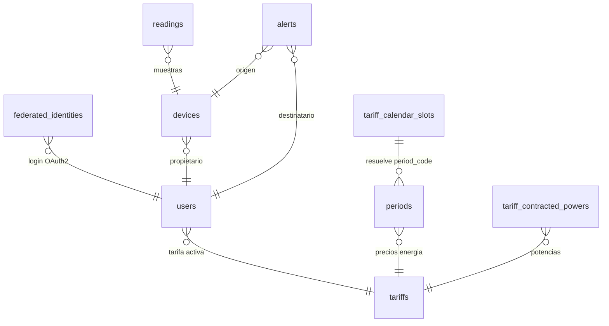
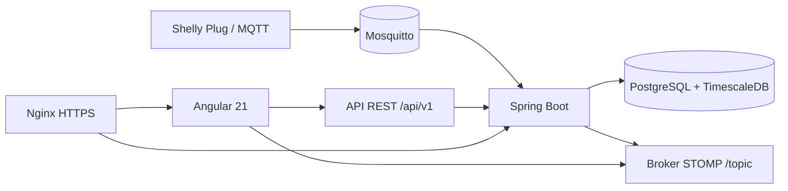

# Memoria tecnica del proyecto DAW: Wattimizer

## 1. Introduccion y justificacion

### 1.1. Titulo del proyecto

**Wattimizer** es una aplicacion web B2B para controlar consumo electrico, gasto energetico y alertas de potencia a partir de dispositivos IoT tipo Shelly Plug.

### 1.2. Descripcion del problema

Muchas pequenas empresas conocen su consumo electrico solo cuando llega la factura. Ese retraso impide detectar picos de potencia, consumos fantasma o equipos encendidos fuera de horario. En la practica, la pyme no puede relacionar una lectura tecnica en vatios con una consecuencia economica clara.

Wattimizer plantea una solucion web completa: registra lecturas de telemetria, las guarda como serie temporal, las asocia a una tarifa electrica y muestra en el panel metricas comprensibles para tomar decisiones. La aplicacion tambien incorpora simuladores para poder demostrar el sistema sin depender siempre de hardware fisico.

### 1.3. Objetivos

**Objetivo general**

Desarrollar una plataforma web que transforme telemetria electrica en informacion economica util para pymes, con visualizacion en tiempo real, calculo de coste y gestion de alertas.

**Objetivos especificos**

- Implementar una API REST segura con Spring Boot y JWT.
- Registrar usuarios normales y administradores, incluyendo autenticacion OAuth2 con Google y GitHub.
- Vincular dispositivos fisicos por direccion MAC y permitir dispositivos simulados de demostracion.
- Ingerir telemetria MQTT de forma asincrona mediante Spring Integration.
- Guardar lecturas en PostgreSQL/TimescaleDB usando una hypertable para series temporales.
- Calcular coste energetico y consumo fantasma usando la tarifa privada del usuario.
- Mostrar en Angular un dashboard reactivo con historico por dispositivo y actualizacion por WebSocket STOMP.
- Gestionar catalogo de tarifas, tarifa privada de usuario y alertas de maximetro.
- Automatizar despliegue en VPS Hetzner mediante GitHub Actions y Docker Compose.

### 1.4. Tipos de usuarios

| Tipo de usuario | Rol tecnico | Uso principal |
|---|---|---|
| Usuario empresa | `ROLE_USER` | Consulta dashboard, vincula dispositivos, configura su tarifa privada y revisa alertas. |
| Administrador | `ROLE_ADMIN` | Gestiona plantillas del catalogo de tarifas y puede usar el registro administrativo protegido por cabecera interna. |
| Dispositivo IoT | No inicia sesion HTTP | Publica mensajes MQTT que el backend transforma en lecturas. |
| Sistema de simulacion | Job programado backend | Genera telemetria sintetica para perfiles como horno, lavadora, nevera o consumo fantasma. |

## 2. Fase 1: Analisis funcional

### 2.1. Mapa de funcionalidades

| Modulo | Funcionalidades reales implementadas |
|---|---|
| Autenticacion | Login con JWT, registro, alta de administradores con secreto, OAuth2 Google/GitHub con ticket temporal. |
| Dispositivos | Listado por usuario, vinculacion por MAC, CRUD basico, baja segura con borrado previo de lecturas y alertas, alta de simuladores y pack demo. |
| Telemetria | Ingesta MQTT, persistencia de lecturas, consulta de ultima lectura, consulta de historico reciente y busqueda por clave compuesta. |
| Dashboard | Grafica de potencia en tiempo real, selector multi-dispositivo, precarga de historico reciente, coste diario y consumo fantasma. |
| Tarifas | Catalogo maestro, tarifa privada por usuario, validacion de periodos regulados y potencias contratadas. |
| Alertas | Deteccion de exceso de potencia contratada, listado por usuario y descarte de alertas. |
| Despliegue | Docker Compose con TimescaleDB, Mosquitto, backend, frontend y Nginx; deploy automatico a Hetzner desde `main`. |

### 2.2. Historias de usuario

| ID | Historia | Criterios de aceptacion | Prioridad |
|---|---|---|---|
| HU-01 | Como usuario, quiero registrarme con email y contrasena para acceder a la plataforma. | El backend valida email, longitud minima y confirmacion de contrasena. Si el email ya existe, devuelve error controlado. | MVP |
| HU-02 | Como usuario, quiero iniciar sesion para recibir un JWT y entrar al panel. | `POST /api/v1/auth/login` devuelve `LoginUserJwt`; Angular guarda el token en `sessionStorage`. | MVP |
| HU-03 | Como usuario, quiero iniciar sesion con Google o GitHub. | El backend crea o enlaza usuario federado y redirige al frontend con un ticket temporal que se intercambia por JWT. | MVP |
| HU-04 | Como usuario, quiero vincular un dispositivo fisico mediante MAC. | El formulario exige MAC de 12 caracteres hexadecimales y llama a `/api/v1/devices/claim`. | MVP |
| HU-05 | Como usuario, quiero ver mis dispositivos para elegir cual analizar. | El store carga `/api/v1/devices` y selecciona la primera MAC disponible si no habia seleccion previa. | MVP |
| HU-06 | Como usuario, quiero ver consumo en tiempo real. | Angular abre una suscripcion STOMP a `/topic/readings/{macAddress}` y actualiza la grafica manteniendo las ultimas 20 muestras. | MVP |
| HU-07 | Como usuario, quiero consultar coste y consumo fantasma del dia. | El dashboard llama a `/api/v1/analytics/cost` y `/api/v1/analytics/ghost-consumption` solo si existe tarifa privada. | MVP |
| HU-08 | Como usuario, quiero configurar mi tarifa electrica. | La tarifa privada se gestiona en `/api/v1/users/me/tariff`; no se pasa `userId` por path ni body. | MVP |
| HU-09 | Como administrador, quiero mantener el catalogo de tarifas. | Solo `ROLE_ADMIN` puede crear, actualizar o borrar en `/api/v1/tariffs`; cualquier usuario autenticado puede leer catalogo. | MVP |
| HU-10 | Como usuario, quiero recibir alertas si supero la potencia contratada. | `AlertService` resuelve periodo horario y potencia contratada antes de crear una alerta `OVERPOWER`. | MVP |
| HU-11 | Como usuario, quiero crear simuladores para probar la aplicacion sin hardware. | `/api/v1/devices/simulated` crea dispositivos con MAC `SIM...` y perfil seleccionado. | MVP |
| HU-12 | Como usuario, quiero un pack de demostracion. | `/api/v1/devices/simulated/demo-pack` crea como maximo un simulador por perfil, evitando duplicados. | Opcional ampliado |
| HU-13 | Como usuario, quiero eliminar un dispositivo sin romper la base de datos. | `DeviceService.deleteById` elimina primero lecturas y alertas asociadas y despues el dispositivo. | MVP |

### 2.3. Gestion del trabajo

- **Repositorio GitHub:** `https://github.com/joellmar/wattpath-app`
- **Flujo observado en Git:** commits pequenos por area (`feat(devices)`, `fix(simulators)`, `fix(deploy)`, `docs(deployment)`), con despliegue automatico en `main`.
- **Kanban:** la captura del tablero no esta versionada en el repositorio. Para la entrega academica debe adjuntarse como imagen externa con columnas Backlog, Por hacer, En progreso, En revision y Hecho.

### 2.4. Planificacion inicial

| Fase | Historias | Dificultad estimada | Resultado |
|---|---|---|---|
| Analisis y seguridad | HU-01, HU-02, HU-03 | Media | Login JWT, registro y OAuth2. |
| Dispositivos y telemetria | HU-04, HU-05, HU-06 | Alta | Vinculacion de dispositivos, MQTT, WebSocket y grafica. |
| Tarifas y analitica | HU-07, HU-08, HU-09 | Alta | Coste por periodo, consumo fantasma y catalogo regulado. |
| Alertas | HU-10 | Media | Alertas de maximetro persistidas y visibles por usuario. |
| Simulacion y demo | HU-11, HU-12 | Media | Simuladores por perfil y pack demo. |
| Despliegue | HU-13 y puesta en produccion | Alta | VPS, Docker Compose, Nginx, Certbot y GitHub Actions. |

## 3. Fase 2: Diseno tecnico

### 3.1. Diseno de la base de datos

El modelo mezcla entidades de negocio clasicas con una tabla de serie temporal. La tabla `readings` se crea con JPA y despues se convierte en hypertable mediante SQL.



El detalle de tablas, claves y consultas esta en [Anexo D: TimescaleDB y analitica](./anexo-d-timescaledb-analitica.md).

### 3.2. Arquitectura del sistema



- **Backend:** Spring Boot 4.0.5 con Java 26, Spring Security, JPA, MapStruct, Spring Integration MQTT y WebSocket STOMP.
- **Frontend:** Angular 21 con componentes standalone, formularios reactivos, PrimeNG, Chart.js, RxJS y NgRx Signals.
- **Base de datos:** PostgreSQL con extension TimescaleDB para la tabla `readings`.
- **Comunicacion:** REST JSON para operaciones de negocio, MQTT para ingesta IoT y STOMP para actualizacion en tiempo real.

### 3.3. Diseno de interfaz

Las pantallas principales deducidas del codigo Angular son:

- **Login y registro:** formularios reactivos con validacion de email, contrasena y mensajes temporales.
- **Layout privado:** menu con rutas protegidas por `authGuard`.
- **Dashboard:** selector de dispositivo, grafica de potencia, coste estimado y consumo fantasma.
- **Dispositivos:** formulario fisico/simulado, tabla, dialogos de detalle y edicion, boton de pack demo.
- **Tarifas:** catalogo, asignacion de plantilla, edicion de contrato privado y modo administrador.
- **Alertas:** tabla de incidencias y descarte de alertas.

### 3.4. Relacion entre historias y diseno

| Historia | Tablas principales | Codigo backend | Codigo frontend |
|---|---|---|---|
| HU-01/HU-02 | `users` | `AuthController`, `AuthRegistrationService`, `JwtValidatorFilter` | `LoginComponent`, `RegisterComponent`, `AuthService` |
| HU-03 | `users`, `federated_identities` | `OAuth2AuthenticationSuccessHandler`, `OAuth2LoginTicketService` | `OAuthCallbackComponent`, `AuthService` |
| HU-04/HU-05 | `devices` | `DeviceController`, `DeviceService` | `DevicesComponent`, `TelemetryStore` |
| HU-06 | `readings` | `MqttConfig`, `DeviceMessageHandler`, `TelemetryBroadcaster` | `WebsocketService`, `TelemetryStore`, `DashboardComponent` |
| HU-07 | `readings`, `periods`, `tariff_calendar_slots` | `ConsumptionController`, `ConsumptionService`, `CalendarResolverService` | `DashboardComponent` |
| HU-08/HU-09 | `tariffs`, `periods`, `tariff_contracted_powers`, `users` | `TariffController`, `UserTariffController`, `TariffService`, `UserTariffService` | `TariffComponent`, `TariffStore`, `TariffService` |
| HU-10 | `alerts` | `AlertService`, `AlertController` | `AlertsComponent` |
| HU-11/HU-12 | `devices`, `readings` | `IotTelemetrySimulationJob`, `SimulatedTelemetryProcessor`, calculadoras de perfil | `DevicesComponent`, `simulation-profile.interface.ts` |

## 4. Fase 3: Implementacion y desarrollo

### 4.1. Tecnologias utilizadas

| Area | Tecnologia | Version/configuracion observada |
|---|---|---|
| Backend | Spring Boot | 4.0.5 |
| Lenguaje backend | Java | 26 |
| Seguridad | Spring Security, JWT, OAuth2 Client | JWT con `jjwt` 0.12.5 |
| Persistencia | Spring Data JPA, Hibernate, MapStruct | MapStruct 1.6.3 |
| MQTT | Spring Integration MQTT, Eclipse Paho | Paho 1.2.5 |
| Frontend | Angular | 21.x |
| Estado frontend | NgRx Signals | 21.1.0 |
| UI | PrimeNG, Chart.js | PrimeNG 21.1.7, Chart.js 4.5.1 |
| Tiempo real | STOMP sobre WebSocket | `@stomp/rx-stomp` 2.4.0 |
| Base de datos | PostgreSQL + TimescaleDB | Imagen `timescale/timescaledb-ha:pg17` |
| Broker | Mosquitto | Imagen `eclipse-mosquitto:2.1.2-alpine` |
| Despliegue | Docker Compose, Nginx, GitHub Actions | VPS Hetzner con Certbot en host |

### 4.2. Desarrollo del backend

El backend separa controladores REST, servicios de negocio, repositorios JPA y mappers. La seguridad es stateless: el frontend envia `Authorization: Bearer <jwt>` y `JwtValidatorFilter` reconstruye la autenticacion en cada peticion. Las reglas sensibles no se dejan al cliente: por ejemplo, las operaciones sobre tarifa privada y lecturas toman el usuario desde `Principal`.

La gestion de errores se centraliza en `GlobalExceptionHandler`, que transforma excepciones de negocio en respuestas JSON con `status`, `error`, `message` y `timestamp`.

Los detalles de API estan en [Anexo A: Backend REST](./anexo-a-backend-rest.md).

### 4.3. Desarrollo del frontend

Angular usa componentes standalone y stores con NgRx Signals. La parte reactiva combina:

- `signal` para estado local de formularios, carga y mensajes.
- `computed` para derivar datos de vista como grafica, usuario visible o disponibilidad de tarifa.
- `effect` para reaccionar a cambios de estado, por ejemplo recargar analiticas cuando cambia la MAC.
- `rxMethod` para encapsular llamadas HTTP y flujos RxJS dentro de los stores.

El detalle esta en [Anexo B: Frontend Angular](./anexo-b-frontend-angular.md).

### 4.4. Control de versiones

Los cambios recientes revisados en Git muestran tres lineas principales:

- **Simulacion y CRUD de dispositivos:** perfiles sinteticos, creacion de simuladores, pack demo y validaciones de UI.
- **Panel multi-dispositivo y borrado seguro:** historico por MAC, precarga de lecturas recientes, borrado de `readings` y `alerts` antes de eliminar dispositivo.
- **Despliegue:** guia Hetzner ampliada y reinicio explicito de Nginx tras `docker compose up -d --build` para evitar errores 502 por resolucion interna de contenedores recreados.

## 5. Fase 4: Pruebas y despliegue

### 5.1. Plan de pruebas

| Prueba | Entrada | Resultado esperado |
|---|---|---|
| Login valido | Email y contrasena correctos | JWT recibido y navegacion a dashboard. |
| Login invalido | Credenciales incorrectas | HTTP 401 y mensaje de credenciales incorrectas. |
| Registro duplicado | Email ya existente | Error 400 con mensaje de cuenta ya registrada. |
| Vincular dispositivo | MAC valida y usuario autenticado | Dispositivo asociado al usuario actual. |
| Crear simulador | Nombre y perfil | Dispositivo `SIM...` creado y job genera lecturas. |
| Pack demo | Usuario sin todos los perfiles | Se crean los perfiles que falten, sin duplicar los existentes. |
| Dashboard tiempo real | MAC seleccionada | WebSocket escucha `/topic/readings/{macAddress}` y actualiza grafica. |
| Coste diario | MAC, `start`, `end`, tarifa privada | Respuesta con `totalCostEur` redondeado a 2 decimales. |
| Consumo fantasma | Intervalo nocturno | Respuesta con `ghostCostEur` calculado entre 00:00 y 05:59 hora local. |
| Borrar dispositivo | Dispositivo con lecturas/alertas | Se eliminan dependencias y despues el dispositivo. |
| Borrar alerta ajena | ID no perteneciente al usuario | Error 404 por borrado sin filas afectadas. |

### 5.2. Manual de instalacion y uso tecnico

Resumen para entorno local:

```bash
# Backend
cd backend
./mvnw spring-boot:run

# Frontend
cd frontend
npm install
npm start
```

Para un entorno completo con servicios:

```bash
docker compose up -d --build
```

Despues de que Hibernate cree las tablas, los scripts SQL relevantes son:

```bash
backend/src/main/resources/db/dev-seed/00-extensions.sql
backend/src/main/resources/db/dev-seed/01-hypertable.sql
backend/src/main/resources/db/tariffs-td-schema.sql
backend/src/main/resources/db/seed-tariff-calendar-slots.sql
```

No se deben documentar ni copiar valores reales de `.env`, secretos JWT, claves OAuth2 o credenciales MQTT.

### 5.3. Despliegue

El despliegue de produccion esta documentado en [Guia Hetzner](../deployment/hetzner-production.md). La infraestructura usa:

- VPS Hetzner Ubuntu 24.04.
- Docker Compose con `timescaledb`, `mosquitto`, `backend`, `frontend` y `nginx`.
- Certbot en el host para certificados TLS.
- GitHub Actions en push a `main`, con build de Angular, package Maven y despliegue por SSH.
- URL configurada en documentacion: `https://wattimizer.com`.

## 6. Conclusiones y lineas futuras

### 6.1. Grado de cumplimiento

El MVP funcional esta cubierto: autenticacion, dispositivos, telemetria, dashboard, tarifas, alertas, simulacion y despliegue. La solucion permite demostrar el flujo completo aunque no haya un enchufe fisico disponible, gracias a los perfiles simulados.

### 6.2. Dificultades tecnicas

- **Telemetria asincrona:** hubo que separar mensajes MQTT `events/rpc` y `status/switch:0` porque no tienen exactamente el mismo payload.
- **Series temporales:** Hibernate no crea hypertables, por lo que `readings` necesita un script SQL posterior.
- **Tarifas TD:** los horarios no se guardan dentro de `periods`; se resolvieron con `tariff_calendar_slots`.
- **Borrado de dispositivos:** se corrigio el flujo eliminando primero lecturas y alertas para evitar conflictos de integridad.
- **Nginx en Docker:** se anadio reinicio tras recrear contenedores para evitar 502 por IP interna obsoleta.

### 6.3. Mejoras futuras

- Generalizar la suscripcion MQTT para multiples dispositivos fisicos, no solo el topic fijo actual.
- Anadir politicas TimescaleDB de compresion, retencion y agregados continuos.
- Incorporar tests end-to-end del flujo login-dispositivo-dashboard.
- Permitir alertas configurables por usuario, no solo por potencia contratada.
- Crear una aplicacion movil o PWA para recibir avisos fuera del escritorio.
- Completar seeds regulatorios para Canarias, Ceuta, Melilla y peajes no cubiertos por los datos actuales.

## 7. Bibliografia y recursos

- Documentacion oficial de Spring Boot, Spring Security, Spring Data JPA y Spring Integration MQTT.
- Documentacion oficial de Angular, RxJS y NgRx Signals.
- Documentacion de TimescaleDB sobre hypertables.
- Documentacion de STOMP WebSocket en Spring.
- Circular CNMC 3/2020 como referencia de periodos tarifarios TD.
- Documentacion del proyecto versionada en `docs/deployment/hetzner-production.md` y guias locales del repositorio.

## Anexos tecnicos

- [Anexo A: Controladores REST de Spring Boot](./anexo-a-backend-rest.md)
- [Anexo B: Componentes, servicios y logica reactiva de Angular](./anexo-b-frontend-angular.md)
- [Anexo C: Ingesta de telemetria MQTT y simulacion IoT](./anexo-c-telemetria-mqtt.md)
- [Anexo D: TimescaleDB, tablas y consultas analiticas](./anexo-d-timescaledb-analitica.md)
