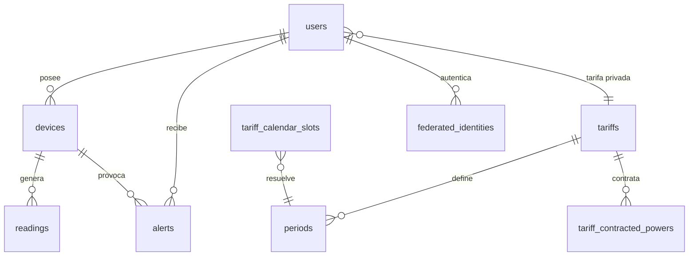
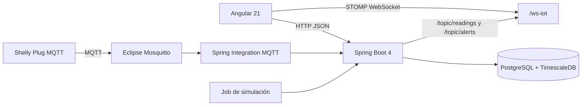

# Memoria técnica del proyecto Wattimizer

## 1. Introducción y justificación

### 1.1. Título del proyecto

**Wattimizer**.

### 1.2. Descripción del problema

Muchas pequeñas y medianas empresas conocen el importe final de su factura eléctrica, pero no tienen una visión clara de cuándo, dónde y por qué se produce el consumo. Esta falta de información dificulta detectar consumos fantasma durante horas de cierre, picos de potencia que pueden provocar alertas de maxímetro o hábitos de uso poco eficientes.

Wattimizer plantea una solución web B2B que combina dispositivos IoT tipo Shelly, una API REST desarrollada con Spring Boot, un panel Angular y una base de datos TimescaleDB para almacenar lecturas de consumo en forma de serie temporal. La aplicación traduce las mediciones eléctricas en información comprensible para negocio: potencia instantánea, histórico reciente, coste estimado en euros y alertas asociadas a la tarifa contratada.

La intención del proyecto no es solo mostrar lecturas técnicas, sino convertirlas en decisiones útiles: saber si un local consume fuera de horario, comparar dispositivos, probar el sistema con simuladores y configurar tarifas TD del mercado español.

### 1.3. Objetivos

#### Objetivo general

Desarrollar una aplicación web que permita monitorizar consumo eléctrico de dispositivos IoT, calcular impacto económico según tarifas configuradas y mostrar datos en tiempo real a usuarios autenticados.

#### Objetivos específicos

- Implementar autenticación mediante JWT, registro tradicional y acceso OAuth2.
- Permitir la vinculación de dispositivos físicos mediante dirección MAC.
- Incorporar dispositivos simulados para poder demostrar el sistema sin depender siempre de hardware real.
- Ingerir telemetría MQTT procedente de enchufes Shelly mediante Spring Integration.
- Persistir lecturas eléctricas en PostgreSQL con TimescaleDB usando la tabla `readings` como hypertable.
- Exponer endpoints REST para dispositivos, lecturas, alertas, tarifas y analítica de consumo.
- Construir un frontend Angular con estado reactivo basado en signals, RxJS y stores de NgRx Signals.
- Mostrar telemetría en tiempo real mediante WebSocket STOMP.
- Calcular coste energético y consumo fantasma dentro de una ventana temporal seleccionada.
- Documentar la arquitectura, la API y el modelo de datos para que el proyecto pueda mantenerse y ampliarse.

### 1.4. Tipos de usuarios

| Usuario | Descripción | Funciones principales |
| --- | --- | --- |
| Usuario empresa | Cuenta autenticada que gestiona sus propios dispositivos y tarifa. | Consultar dashboard, vincular dispositivos, crear simuladores, revisar alertas y asignar tarifa privada. |
| Administrador | Usuario con rol `ROLE_ADMIN`. | Mantener el catálogo maestro de tarifas y acceder a operaciones administrativas protegidas. |
| Sistema IoT | Dispositivo físico o simulador que genera lecturas. | Enviar telemetría eléctrica que termina persistida en `readings`. |

## 2. Fase 1: Análisis funcional

### 2.1. Mapa de funcionalidades

| Módulo | Funcionalidades |
| --- | --- |
| Autenticación | Login, registro, registro de administrador con cabecera privada, OAuth2 con Google/GitHub y emisión de JWT. |
| Dispositivos | Listado, alta heredada, vinculación por MAC, creación de simuladores, pack de demostración, edición, encendido/apagado lógico y eliminación segura. |
| Telemetría | Recepción MQTT, simulación periódica, persistencia de lecturas, difusión por WebSocket y precarga de histórico reciente. |
| Dashboard | Selector de medidor activo, gráfica de potencia, coste diario estimado y consumo fantasma. |
| Tarifas | Catálogo maestro, tarifa privada por usuario, periodos P1-P6, potencias contratadas y zona geográfica. |
| Alertas | Detección de exceso de potencia frente a contrato, listado y descarte de alertas. |
| Analítica | Cálculo de coste por intervalo y coste de consumo fantasma entre las 00:00 y las 05:59 de la zona local del contrato. |
| Despliegue | Docker Compose con frontend, backend, TimescaleDB, Mosquitto y Nginx. |

### 2.2. Historias de usuario

| Código | Historia | Criterios de aceptación | Prioridad |
| --- | --- | --- | --- |
| HU-01 | Como usuario empresa, quiero iniciar sesión para acceder a mis datos energéticos. | `POST /api/v1/auth/login` devuelve JWT válido; las rutas internas de Angular quedan protegidas por `authGuard`. | Imprescindible |
| HU-02 | Como usuario empresa, quiero registrar mi cuenta para usar la plataforma. | `POST /api/v1/auth/register` crea el usuario y devuelve `201 Created`. | Imprescindible |
| HU-03 | Como usuario empresa, quiero vincular un dispositivo por MAC para asociar el consumo a mi cuenta. | `POST /api/v1/devices/claim` crea o reclama el dispositivo si está libre o pertenece a `SYSTEM`. | Imprescindible |
| HU-04 | Como usuario empresa, quiero ver lecturas en tiempo real para saber el consumo actual. | Angular se suscribe a `/topic/readings/{macAddress}` y actualiza la gráfica con las últimas 20 lecturas. | Imprescindible |
| HU-05 | Como usuario empresa, quiero consultar el coste estimado de energía para valorar el gasto diario. | `GET /api/v1/analytics/cost` devuelve `totalCostEur` si el usuario tiene tarifa configurada. | Imprescindible |
| HU-06 | Como usuario empresa, quiero detectar consumo fantasma fuera de horario para encontrar pérdidas. | `GET /api/v1/analytics/ghost-consumption` calcula coste entre las 00:00 y las 05:59. | Imprescindible |
| HU-07 | Como usuario empresa, quiero crear simuladores para probar la aplicación sin hardware físico. | `POST /api/v1/devices/simulated` crea un dispositivo con perfil de consumo estable. | Imprescindible |
| HU-08 | Como usuario empresa, quiero cargar un pack demo para enseñar rápidamente todos los perfiles. | `POST /api/v1/devices/simulated/demo-pack` crea los perfiles que falten para el usuario. | Opcional |
| HU-09 | Como administrador, quiero mantener el catálogo de tarifas para que los usuarios puedan partir de plantillas. | Los endpoints de escritura de `/api/v1/tariffs` exigen `ROLE_ADMIN`. | Imprescindible |
| HU-10 | Como usuario empresa, quiero asignar mi tarifa privada para personalizar los cálculos. | `POST /api/v1/users/me/tariff` guarda tarifa sin aceptar `userId` en el cuerpo. | Imprescindible |
| HU-11 | Como usuario empresa, quiero eliminar un dispositivo sin dejar datos huérfanos. | `DeviceService.deleteById` borra lecturas y alertas asociadas antes de eliminar el dispositivo. | Imprescindible |
| HU-12 | Como usuario empresa, quiero revisar alertas de potencia para actuar ante excesos. | `GET /api/v1/alerts` lista alertas del usuario y `DELETE /api/v1/alerts/{id}` las descarta de forma autorizada. | Opcional |

### 2.3. Gestión del trabajo

- **Repositorio:** `https://github.com/joellmar/wattpath-app`
- **Flujo observado en Git:** los commits recientes siguen una convención descriptiva (`feat`, `fix`, `docs`, `ci`) y agrupan cambios por intención. Por ejemplo:
  - `feat(devices): perfiles de simulacion de consumo y CRUD simulado`
  - `feat(prod): activar simuladores en demo y pack de demostracion`
  - `fix(simulators): borrado en cascada, telemetria por perfil y panel multi-dispositivo`
  - `fix(deploy): reiniciar nginx tras compose up para evitar 502`

#### Tablero Kanban

La planificación del proyecto se puede representar con estas columnas, alineadas con el flujo usado en un proyecto DAW:

| Backlog | Por hacer | En progreso | En revisión | Hecho |
| --- | --- | --- | --- | --- |
| Mejoras futuras, OAuth, analítica avanzada | Historias priorizadas del sprint | Desarrollo de backend, frontend o despliegue | Pruebas, revisión de endpoints y documentación | Funciones integradas en `main` |

### 2.4. Planificación inicial

| Fase | Historias asociadas | Dificultad | Resultado esperado |
| --- | --- | --- | --- |
| Fase 1: Autenticación y estructura | HU-01, HU-02 | Media | Acceso seguro con JWT y rutas Angular protegidas. |
| Fase 2: Dispositivos e IoT | HU-03, HU-04 | Alta | Dispositivos vinculados y lecturas recibidas desde MQTT/WebSocket. |
| Fase 3: Tarifas y analítica | HU-05, HU-06, HU-09, HU-10 | Alta | Costes energéticos calculados con tarifa configurada. |
| Fase 4: Simulación y demostración | HU-07, HU-08 | Media | Datos realistas sin depender de hardware físico. |
| Fase 5: Alertas y limpieza | HU-11, HU-12 | Media | Alertas gestionables y borrado sin datos huérfanos. |
| Fase 6: Despliegue | Todas | Alta | Stack en contenedores con Nginx como puerta de entrada. |

## 3. Fase 2: Diseño técnico

### 3.1. Diseño de la base de datos

El modelo combina tablas transaccionales tradicionales con una tabla de serie temporal:



El anexo específico de TimescaleDB detalla tablas, claves y consultas: [Anexo D](./anexo-d-timescaledb-analitica.md).

### 3.2. Arquitectura del sistema



| Capa | Tecnología | Papel en el proyecto |
| --- | --- | --- |
| Backend | Java 26, Spring Boot 4.0.5, Spring Security, JPA, MapStruct | API REST, seguridad, negocio, ingesta MQTT, WebSocket y persistencia. |
| Frontend | Angular 21, PrimeNG 21, Tailwind, NgRx Signals, RxJS | Interfaz SPA, formularios, estado reactivo y visualización de datos. |
| Base de datos | PostgreSQL con TimescaleDB | Datos relacionales y lecturas eléctricas como serie temporal. |
| Mensajería IoT | Eclipse Mosquitto, Spring Integration MQTT, Eclipse Paho | Recepción asíncrona de eventos de enchufe inteligente. |
| Despliegue | Docker Compose y Nginx | Orquestación de servicios y proxy HTTPS/HTTP. |

### 3.3. Diseño de interfaz

Las pantallas principales implementadas en Angular son:

- **Login y registro:** formularios públicos para credenciales y alta de cuenta.
- **Layout principal:** cabecera y navegación lateral con módulos Dashboard, Dispositivos, Tarifas y Alertas.
- **Dashboard:** selector de medidor, gráfica de potencia, coste real y consumo fantasma.
- **Dispositivos:** formulario para dispositivo físico o simulado, tabla de dispositivos, edición, detalle y pack demo.
- **Tarifas:** mantenimiento de catálogo y tarifa propia con periodos y potencias.
- **Alertas:** tabla de eventos de exceso de potencia y acción para descartarlos.

### 3.4. Relación entre historias y diseño

| Historia | Tablas principales | Código backend | Código frontend |
| --- | --- | --- | --- |
| HU-01, HU-02 | `users`, `federated_identities` | `AuthController`, `UserProviderDetailsManager`, `JwtTokenService` | `LoginComponent`, `RegisterComponent`, `OAuthCallbackComponent`, `authGuard` |
| HU-03 | `devices` | `DeviceController`, `DeviceService.claimOrRegisterDevice` | `DevicesComponent`, `TelemetryStore` |
| HU-04 | `readings`, `devices` | `MqttConfig`, `DeviceMessageHandler`, `TelemetryBroadcaster` | `DashboardComponent`, `WebsocketService`, `TelemetryStore` |
| HU-05, HU-06 | `readings`, `tariffs`, `periods`, `tariff_calendar_slots` | `ConsumptionController`, `ConsumptionService`, `CalendarResolverService` | `DashboardComponent`, `TariffStore` |
| HU-07, HU-08 | `devices`, `readings` | `IotTelemetrySimulationJob`, `SimulatedTelemetryProcessor`, `SimulationProfileRegistry` | `DevicesComponent`, `simulation-profile.interface.ts` |
| HU-09, HU-10 | `tariffs`, `periods`, `tariff_contracted_powers`, `users` | `TariffController`, `UserTariffController`, `TariffService`, `UserTariffService` | `TariffComponent`, `TariffService`, `TariffStore` |
| HU-11, HU-12 | `devices`, `readings`, `alerts` | `DeviceService.deleteById`, `AlertController`, `AlertService` | `DevicesComponent`, `AlertsComponent` |

## 4. Fase 3: Implementación y desarrollo

### 4.1. Tecnologías utilizadas

| Área | Tecnología y versión declarada |
| --- | --- |
| Backend | Spring Boot `4.0.5`, Java `26`, MapStruct `1.6.3`, JJWT `0.12.5`, Eclipse Paho `1.2.5` |
| Frontend | Angular `21.x`, TypeScript `~5.9.2`, RxJS `~7.8.0`, NgRx Signals `21.1.0`, PrimeNG `21.1.7`, Chart.js `4.5.1` |
| Base de datos | TimescaleDB sobre PostgreSQL, imagen `timescale/timescaledb-ha:pg17` |
| Broker MQTT | Eclipse Mosquitto `2.1.2-alpine` |
| Proxy | Nginx Alpine |
| Calidad frontend | Biome `2.4.16`, Vitest `4.0.8` |

### 4.2. Desarrollo del backend

El backend se organiza alrededor de controladores REST, servicios de negocio y repositorios JPA. Spring Security protege por defecto todas las rutas salvo autenticación, OAuth y handshake WebSocket. Los endpoints de catálogo de tarifas permiten lectura autenticada y escritura solo a administradores.

Los puntos más importantes están documentados en:

- [Anexo A - Controladores REST y DTOs](./anexo-a-backend-rest.md)
- [Anexo C - Telemetría MQTT y simulación](./anexo-c-telemetria-mqtt.md)
- [Anexo D - TimescaleDB y analítica](./anexo-d-timescaledb-analitica.md)

### 4.3. Desarrollo del frontend

El frontend usa componentes standalone, rutas cargadas bajo demanda y estado reactivo con signals. La decisión de usar `TelemetryStore` evita que la gráfica dependa de estado local disperso y permite conservar históricos por MAC cuando el usuario cambia de medidor.

La parte Angular está desarrollada en detalle en [Anexo B - Frontend Angular](./anexo-b-frontend-angular.md).

### 4.4. Control de versiones

El historial reciente muestra una separación razonable entre funcionalidad, correcciones, despliegue y documentación:

- Las ramas automáticas de documentación generan commits `docs`.
- Las mejoras de producto usan `feat`.
- Las correcciones de comportamiento o despliegue usan `fix`.
- Los ajustes de CI se identifican con `ci`.

Este estilo facilita revisar qué parte del sistema se tocó en cada cambio y reduce el riesgo de mezclar decisiones de despliegue con cambios funcionales.

## 5. Fase 4: Pruebas y despliegue

### 5.1. Plan de pruebas

| Prueba | Resultado esperado | Cobertura funcional |
| --- | --- | --- |
| Login con credenciales válidas | Devuelve JWT y permite entrar al layout protegido. | HU-01 |
| Acceso a ruta interna sin JWT | Redirección a login mediante `authGuard`. | HU-01 |
| Vincular MAC libre | `POST /devices/claim` crea/asocia dispositivo al usuario. | HU-03 |
| Crear simulador | Se genera MAC `SIM...`, perfil y lecturas periódicas. | HU-07 |
| Crear pack demo | Se crean solo perfiles que el usuario aún no tenga. | HU-08 |
| Cambiar medidor en dashboard | Se precarga histórico reciente y cambia la suscripción WebSocket. | HU-04 |
| Calcular coste sin tarifa | Dashboard muestra estado sin tarifa y no fuerza métricas. | HU-05 |
| Guardar tarifa privada | `TariffStore.hasMyTariff` pasa a verdadero y se habilitan métricas. | HU-10 |
| Eliminar dispositivo con lecturas | Se borran lecturas y alertas antes del dispositivo. | HU-11 |
| Descartar alerta propia | `DELETE /alerts/{id}` devuelve `204 No Content`. | HU-12 |

### 5.2. Manual de instalación

#### Desarrollo local

1. Levantar servicios necesarios con Docker o una instalación local equivalente de PostgreSQL/TimescaleDB y Mosquitto.
2. Configurar variables de entorno de base de datos, MQTT, JWT y OAuth según `docker-compose.yml` y `backend/src/main/resources/application.properties`.
3. Backend:

```bash
cd backend
./mvnw spring-boot:run
```

4. Frontend:

```bash
cd frontend
npm install
npm start
```

5. Abrir Angular en `http://localhost:4200`. El proxy de desarrollo debe redirigir `/api` y `/ws-iot` hacia el backend.

#### Base de datos

Después de que Hibernate cree las tablas, se ejecutan los scripts de referencia:

```bash
backend/src/main/resources/db/dev-seed/00-extensions.sql
backend/src/main/resources/db/dev-seed/01-hypertable.sql
backend/src/main/resources/db/tariffs-td-schema.sql
backend/src/main/resources/db/seed-tariff-calendar-slots.sql
```

La hypertable `readings` debe convertirse cuando aún esté vacía o usando `migrate_data => true` si ya contiene filas.

### 5.3. Despliegue

El despliegue se describe para un servidor con Docker Compose:

- `timescaledb`: base de datos interna.
- `mosquitto`: broker MQTT, con puerto `1883` expuesto para hardware físico.
- `backend`: API Spring Boot, conectada a base de datos y broker por red interna.
- `frontend`: Angular compilado y servido por Nginx interno.
- `nginx`: proxy inverso externo en puertos `80` y `443`.

La guía operativa ampliada se encuentra en `docs/deployment/hetzner-production.md`.

## 6. Conclusiones y líneas futuras

### 6.1. Grado de cumplimiento

El MVP cubre autenticación, gestión de dispositivos, telemetría real y simulada, dashboard reactivo, tarifas, analítica básica, alertas y despliegue en contenedores. Los cambios recientes refuerzan la parte de demostración con perfiles simulados y pack demo, lo que facilita defender el proyecto aunque no haya hardware físico disponible durante la presentación.

### 6.2. Dificultades encontradas

- **Telemetría asíncrona:** se resuelve con Spring Integration MQTT, separando topics `events/rpc` y `status/switch:0`.
- **Datos en tiempo real:** se evita el refresco manual usando STOMP WebSocket hacia Angular.
- **Series temporales:** se usa TimescaleDB sobre la tabla `readings`, manteniendo JPA para las consultas de aplicación.
- **Tarifas españolas:** se separa el contrato económico (`periods`, `contracted_powers`) del calendario regulatorio (`tariff_calendar_slots`).
- **Demo sin hardware:** se incorporan simuladores con perfiles de consumo y un job programado.
- **Borrado seguro:** se eliminan lecturas y alertas antes de borrar un dispositivo para evitar referencias huérfanas.

### 6.3. Mejoras futuras

- Hacer configurable el topic MQTT en lugar de dejarlo fijado a un único Shelly.
- Añadir consultas nativas con `time_bucket` para agregados horarios, diarios o mensuales.
- Definir políticas TimescaleDB de compresión y retención para producción.
- Proteger WebSocket con autenticación STOMP si se necesita endurecer el canal en entornos multiempresa.
- Centralizar en `TelemetryStore` todas las mutaciones de dispositivos para reducir duplicación con `DevicesComponent`.
- Añadir una app móvil o PWA para revisar alertas fuera del escritorio.

## 7. Bibliografía y recursos

- Documentación oficial de Spring Boot.
- Documentación oficial de Spring Security.
- Documentación de Spring Integration MQTT.
- Documentación de Angular.
- Documentación de NgRx Signals.
- Documentación de RxJS.
- Documentación de TimescaleDB.
- Documentación de Eclipse Mosquitto.
- Documentación de PrimeNG.
- Repositorio del proyecto: `https://github.com/joellmar/wattpath-app`
