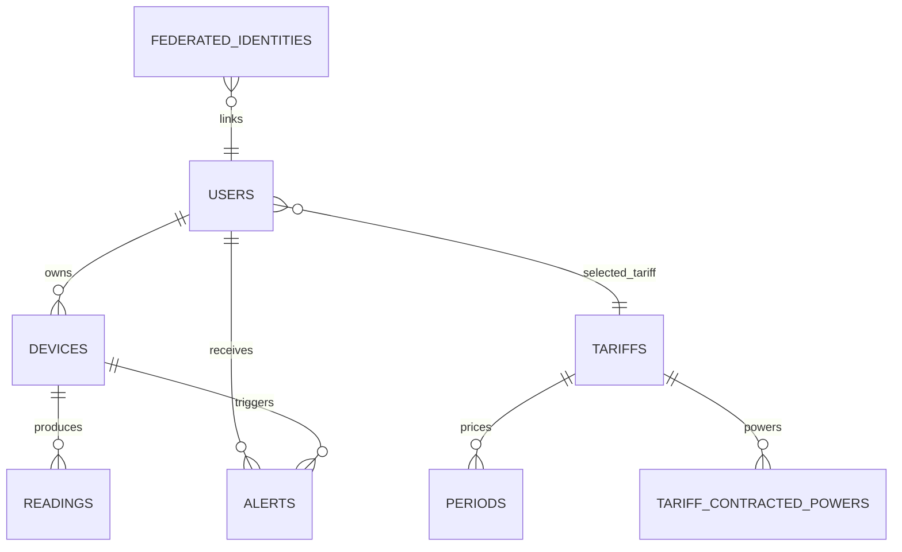
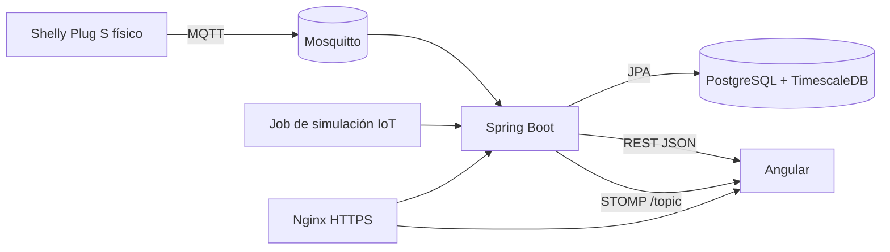

# Memoria técnica del proyecto Wattimizer

Este documento sirve como índice principal de los anexos técnicos de Wattimizer. La redacción está orientada a una memoria final de Desarrollo de Aplicaciones Web y se apoya en el código real del repositorio: backend Spring Boot, frontend Angular, ingesta MQTT y almacenamiento analítico en TimescaleDB.

## 1. Introducción y justificación

### 1.1. Título del proyecto

**Wattimizer**: plataforma web B2B para monitorizar consumo eléctrico, traducirlo a coste económico y detectar hábitos de consumo ineficientes.

### 1.2. Descripción del problema

Muchas pequeñas empresas conocen el importe final de su factura eléctrica, pero no tienen una visión clara de cuándo, dónde y por qué se produce el consumo. Esto dificulta detectar consumos fantasma, picos de potencia o dispositivos que permanecen encendidos fuera del horario útil.

Wattimizer responde a esa necesidad conectando enchufes inteligentes Shelly o dispositivos simulados con una aplicación web. La plataforma recibe lecturas de potencia por MQTT, las guarda como serie temporal y permite cruzarlas con tarifas eléctricas reales para estimar costes diarios.

### 1.3. Objetivos

**Objetivo general**

Desarrollar una aplicación web capaz de registrar telemetría eléctrica en tiempo real, mostrarla de forma comprensible y calcular métricas económicas asociadas al contrato energético de cada usuario.

**Objetivos específicos**

- Implementar autenticación con JWT y registro de usuarios.
- Exponer una API REST protegida para gestionar dispositivos, lecturas, alertas y tarifas.
- Recibir telemetría MQTT de dispositivos Shelly mediante Spring Integration.
- Persistir lecturas energéticas en PostgreSQL con TimescaleDB para trabajar con datos temporales.
- Construir un frontend Angular con formularios reactivos, NgRx Signals y WebSocket STOMP.
- Añadir simuladores IoT para probar la plataforma sin depender siempre de hardware físico.
- Documentar instalación, pruebas y despliegue para que otro desarrollador pueda reproducir el proyecto.

### 1.4. Tipos de usuarios

| Usuario | Uso principal | Permisos relevantes |
|---|---|---|
| Usuario empresa (`ROLE_USER`) | Consulta panel, vincula dispositivos, configura su tarifa y revisa alertas. | Puede operar sobre sus propios dispositivos, lecturas y tarifa privada. |
| Administrador (`ROLE_ADMIN`) | Mantiene el catálogo maestro de tarifas y puede usar las funciones normales de usuario. | Puede crear, editar y eliminar plantillas globales de tarifa. |
| Sistema IoT | Envía lecturas al backend por MQTT. | No usa REST; publica mensajes MQTT en topics Shelly. |

## 2. Fase 1: análisis funcional

### 2.1. Mapa de funcionalidades

| Módulo | Funcionalidades implementadas |
|---|---|
| Autenticación | Login, registro, registro admin con cabecera secreta, intercambio de ticket OAuth por JWT. |
| Dispositivos | Listado, vinculación por MAC, alta simulada, pack de demostración, edición, encendido/apagado lógico y borrado seguro. |
| Telemetría | Ingesta MQTT, almacenamiento de lecturas, consulta de últimas lecturas y streaming STOMP hacia Angular. |
| Analítica energética | Coste acumulado por periodo, consumo fantasma de 00:00 a 05:59 y cálculo basado en delta de kWh. |
| Tarifas | Catálogo maestro, tarifa privada del usuario, periodos P1-P6, potencias contratadas y zona geográfica. |
| Alertas | Generación por umbral de potencia, listado y borrado por usuario. |
| Simulación | Perfiles de consumo sintético: horno, lavadora, televisor, ventilador, PC, nevera, standby, carga alta y onda de prueba. |

### 2.2. Historias de usuario principales

| Historia | Criterios de aceptación | Prioridad |
|---|---|---|
| Como usuario, quiero iniciar sesión para acceder a mis datos energéticos. | El backend devuelve un JWT válido; Angular lo usa en peticiones protegidas. | Imprescindible |
| Como usuario, quiero vincular un enchufe por MAC para asociarlo a mi cuenta. | La MAC pasa validación, el dispositivo queda asignado al usuario autenticado y aparece en el panel. | Imprescindible |
| Como usuario, quiero ver la potencia en tiempo real para saber qué consume cada equipo. | El gráfico se actualiza por WebSocket al seleccionar una MAC. | Imprescindible |
| Como usuario, quiero asignar una tarifa para convertir kWh en euros. | Se puede elegir una plantilla y guardar una copia privada editable. | Imprescindible |
| Como usuario, quiero detectar consumo fantasma nocturno. | El dashboard consulta `/api/v1/analytics/ghost-consumption` y muestra el coste estimado. | Imprescindible |
| Como administrador, quiero mantener el catálogo de tarifas. | Solo `ROLE_ADMIN` puede crear, editar o eliminar tarifas del catálogo. | Imprescindible |
| Como desarrollador/demo, quiero crear simuladores para probar sin hardware. | El usuario puede crear dispositivos simulados o un pack completo de demo. | Opcional con valor alto |
| Como usuario, quiero eliminar un dispositivo y limpiar sus datos asociados. | El backend borra lecturas y alertas antes de eliminar el dispositivo. | Imprescindible |

### 2.3. Gestión del trabajo

- **Repositorio:** `https://github.com/joellmar/wattpath-app`
- **Flujo usado en el repositorio:** commits descriptivos por funcionalidad y corrección, por ejemplo:
  - `feat(devices): perfiles de simulacion de consumo y CRUD simulado`
  - `feat(prod): activar simuladores en demo y pack de demostracion`
  - `fix(simulators): borrado en cascada, telemetria por perfil y panel multi-dispositivo`
  - `fix(deploy): reiniciar nginx tras compose up para evitar 502`
- **Kanban:** la memoria puede incluir una captura externa del tablero con columnas `Backlog`, `Por hacer`, `En progreso`, `En revisión` y `Hecho`.

### 2.4. Planificación inicial

| Fase | Historias asociadas | Dificultad |
|---|---|---|
| Autenticación y base | Login, registro, roles, seguridad JWT. | Media |
| IoT y datos temporales | MQTT, `readings`, hypertable TimescaleDB. | Alta |
| Panel frontend | Dashboard, dispositivos, WebSocket, gráficos. | Alta |
| Tarifas y analítica | Tarifas TD, calendario, coste por kWh, consumo fantasma. | Alta |
| Simulación y demo | Perfiles sintéticos y pack de demostración. | Media |
| Despliegue | Docker Compose, Nginx, Certbot, GitHub Actions. | Alta |

## 3. Fase 2: diseño técnico

### 3.1. Diseño de base de datos

El modelo combina tablas relacionales normales con una tabla temporal optimizada:



La tabla `readings` tiene clave primaria compuesta por `time` y `device_id`, y se convierte en hypertable mediante `SELECT create_hypertable('readings', 'time');`.

Más detalle en [Anexo D: TimescaleDB y analítica](./anexo-d-timescaledb-analitica.md).

### 3.2. Arquitectura del sistema



- **Backend:** Java 26, Spring Boot 4.0.5, Spring Security, JPA, MapStruct, Spring Integration MQTT y WebSocket STOMP.
- **Frontend:** Angular 21, TypeScript 5.9, PrimeNG, Chart.js, RxJS 7.8 y NgRx Signals.
- **Comunicación:** REST JSON para operaciones de negocio y WebSocket STOMP para telemetría en vivo.
- **Base de datos:** PostgreSQL 17 con TimescaleDB para lecturas energéticas.
- **Mensajería IoT:** Mosquitto MQTT con topics Shelly.

### 3.3. Diseño de interfaz

Las pantallas principales están organizadas en rutas hijas protegidas por `authGuard`:

| Ruta | Componente | Función |
|---|---|---|
| `/dashboard` | `DashboardComponent` | Gráfico de potencia, coste diario y consumo fantasma. |
| `/devices` | `DevicesComponent` | Alta física, simuladores, edición y borrado de dispositivos. |
| `/tariffs` | `TariffComponent` | Catálogo de tarifas y contrato privado del usuario. |
| `/alerts` | `AlertsComponent` | Consulta y limpieza de alertas. |

### 3.4. Relación entre historias y diseño

| Historia | Tablas | Código principal |
|---|---|---|
| Login y registro | `users`, `federated_identities` | `AuthController`, `SecurityConfig`, `AuthService` |
| Vincular dispositivo | `devices` | `DeviceController`, `DeviceService`, `TelemetryStore`, `DevicesComponent` |
| Telemetría en tiempo real | `readings`, `devices` | `MqttConfig`, `DeviceMessageHandler`, `TelemetryBroadcaster`, `WebsocketService` |
| Coste energético | `readings`, `tariffs`, `periods`, `tariff_calendar_slots` | `ConsumptionController`, `ConsumptionService`, `CalendarResolverService` |
| Tarifas del usuario | `tariffs`, `periods`, `tariff_contracted_powers`, `users` | `UserTariffController`, `UserTariffService`, `TariffStore`, `TariffComponent` |
| Alertas | `alerts`, `devices`, `users` | `AlertService`, `AlertController`, `AlertsComponent` |

## 4. Fase 3: implementación y desarrollo

### 4.1. Tecnologías utilizadas

| Capa | Tecnología |
|---|---|
| Backend | Spring Boot 4.0.5, Java 26, Maven, Spring Security, JPA, MapStruct |
| Frontend | Angular 21, TypeScript 5.9, PrimeNG 21, NgRx Signals 21, RxJS 7.8 |
| IoT | MQTT, Eclipse Paho, Spring Integration MQTT, Mosquitto |
| Datos | PostgreSQL, TimescaleDB, Hibernate |
| Despliegue | Docker Compose, Nginx, Certbot, GitHub Actions |
| Tests | JUnit 5, Mockito, Vitest, Angular TestBed |

### 4.2. Desarrollo del backend

El backend está organizado por controladores REST, servicios de negocio, repositorios JPA, entidades y DTOs. Los controladores delegan la lógica en servicios para mantener separada la validación HTTP de las reglas de negocio.

Puntos destacados:

- Seguridad stateless con JWT.
- Filtro CORS parametrizable por entorno.
- Permisos de catálogo de tarifas mediante `@PreAuthorize("hasRole('ADMIN')")`.
- Operaciones multitenant basadas en `Principal`, evitando recibir `userId` en el cuerpo de la petición.
- Gestión global de errores con `GlobalExceptionHandler`.

Ver [Anexo A: API REST Spring Boot](./anexo-a-backend-rest.md).

### 4.3. Desarrollo del frontend

Angular usa componentes standalone y rutas lazy. La lógica compartida se concentra en stores de NgRx Signals:

- `TelemetryStore`: dispositivos, MAC seleccionada, historial de lecturas por MAC y conexión STOMP.
- `TariffStore`: catálogo global, tarifa privada del usuario y estados de carga/error.

Ver [Anexo B: Frontend Angular](./anexo-b-frontend-angular.md).

### 4.4. Control de versiones

El repositorio refleja un flujo incremental: primero se incorporaron CRUD y perfiles simulados, después el pack de demostración, y finalmente correcciones sobre borrado en cascada, telemetría por perfil y panel multi-dispositivo. Los commits son útiles para rastrear decisiones técnicas sin mezclar cambios no relacionados.

## 5. Fase 4: pruebas y despliegue

### 5.1. Plan de pruebas

| Prueba | Qué valida | Evidencia en código |
|---|---|---|
| Coste fantasma por zona horaria | Canarias y Península no comparten siempre la misma hora local. | `ConsumptionServiceTest` |
| Validación de tarifas 2.0TD, 3.0TD y 6.xTD | Periodos obligatorios y orden de potencias. | `TariffServiceTest` |
| Clonado de tarifa privada | La plantilla global no se modifica al asignarla a un usuario. | `UserTariffServiceTest` |
| Simuladores | MAC sintética, perfil asignado y pack de demo sin duplicados. | `DeviceServiceTest` |
| Borrado seguro | Lecturas y alertas se eliminan antes que el dispositivo. | `DeviceServiceTest` |
| Formularios Angular | Alta física/simulada y estructura dinámica de tarifas. | `devices.component.spec.ts`, `tariff.component.spec.ts` |
| Servicio de tarifas Angular | Métodos REST y conversión de `204` a `null`. | `tariff.service.spec.ts` |

### 5.2. Manual de instalación resumido

Backend:

```bash
cd backend
./mvnw test
./mvnw spring-boot:run
```

Frontend:

```bash
cd frontend
npm install
npm run lint
npm test
npm start
```

Infraestructura local:

```bash
docker compose up -d timescaledb mosquitto
```

Después de que Hibernate cree las tablas, se ejecutan los scripts SQL de `backend/src/main/resources/db/`, especialmente `00-extensions.sql`, `01-hypertable.sql`, `tariffs-td-schema.sql` y los seeds de desarrollo.

### 5.3. Despliegue

El despliegue de producción está documentado en `docs/deployment/hetzner-production.md`:

- VPS Hetzner con Ubuntu 24.04.
- Docker Compose para TimescaleDB, Mosquitto, backend, frontend y Nginx.
- Certbot nativo en el host.
- Dominio `wattimizer.com`.
- Variables de entorno para credenciales, CORS, OAuth2 y simulación.

## 6. Conclusiones y líneas futuras

### 6.1. Grado de cumplimiento

El MVP queda cubierto: autenticación, dispositivos, telemetría, visualización, tarifas, costes, alertas, simulación y despliegue. La aplicación ya permite demostrar el flujo completo desde una lectura MQTT o simulada hasta el dashboard del usuario.

### 6.2. Dificultades

- **Series temporales:** Hibernate crea tablas normales, por eso TimescaleDB requiere un script posterior para convertir `readings` en hypertable.
- **Tarifas eléctricas:** la tarifa no depende solo de la hora; también influyen zona, mes, tipo de día y peaje de acceso.
- **Tiempo real:** REST no basta para pintar la gráfica al instante, por eso se incorporó WebSocket STOMP.
- **Demo sin hardware:** se añadieron simuladores para poder enseñar la aplicación aunque el enchufe físico no esté disponible.
- **Borrado con datos asociados:** se resolvió eliminando lecturas y alertas antes de borrar el dispositivo.

### 6.3. Mejoras futuras

- Añadir agregaciones con `time_bucket` y continuous aggregates cuando el volumen de lecturas crezca.
- Incorporar políticas de retención y compresión de TimescaleDB.
- Crear más reglas de alerta configurables por usuario.
- Añadir exportación CSV/PDF de informes energéticos.
- Implementar una app móvil o notificaciones push.
- Sustituir MQTT sin TLS por TLS/8883 o VPN en producción cuando el hardware lo permita.

## 7. Bibliografía y recursos

- Documentación oficial de Spring Boot, Spring Security y Spring Integration.
- Documentación oficial de Angular, RxJS y NgRx Signals.
- Documentación de TimescaleDB para hypertables.
- Documentación de Eclipse Mosquitto y Shelly Plug S Gen 3.
- Circular CNMC 3/2020 como referencia de periodos tarifarios TD.

## Anexos técnicos

- [Anexo A: API REST Spring Boot](./anexo-a-backend-rest.md)
- [Anexo B: Frontend Angular](./anexo-b-frontend-angular.md)
- [Anexo C: Telemetría MQTT con Spring Integration](./anexo-c-telemetria-mqtt.md)
- [Anexo D: TimescaleDB y consultas analíticas](./anexo-d-timescaledb-analitica.md)
