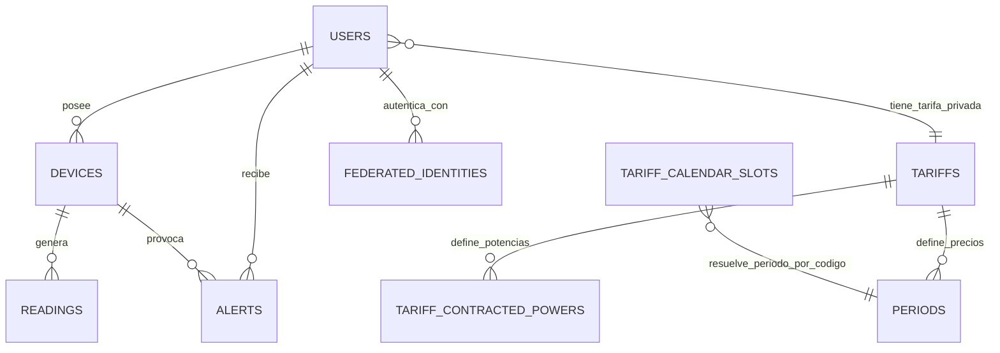

# Memoria final del proyecto DAW: Wattimizer

## 1. Introduccion y justificacion

### 1.1. Titulo del proyecto

**Wattimizer** es una aplicacion web de monitorizacion energetica orientada a pequenas empresas. El nombre une la idea de consumo electrico medido en vatios con la optimizacion del gasto, que es el objetivo principal de la plataforma.

### 1.2. Descripcion del problema

Muchas pymes reciben la factura electrica como un resultado cerrado al final del mes, pero no tienen una forma sencilla de saber que equipos estan consumiendo mas, cuando se producen los picos de potencia o cuanto dinero se esta perdiendo durante horas de baja actividad. En la practica, esto provoca tres problemas:

- Se detectan tarde los consumos anormales.
- No se relaciona el consumo en kWh con el coste real en euros.
- No hay datos suficientes para ajustar la tarifa contratada o justificar decisiones de ahorro.

Wattimizer aborda este problema conectando dispositivos IoT tipo Shelly Plug S con una aplicacion web. El backend recibe telemetria por MQTT, la persiste como serie temporal en TimescaleDB y calcula costes usando las tarifas configuradas por el usuario. El frontend muestra el consumo activo, el gasto diario y el consumo fantasma nocturno en una interfaz pensada para administradores no tecnicos.

### 1.3. Objetivos

#### Objetivo general

Desarrollar una plataforma web que permita registrar dispositivos de medicion electrica, recibir lecturas de consumo en tiempo real y traducir esos datos a informacion economica util para la toma de decisiones.

#### Objetivos especificos

- Implementar una API REST segura con Spring Boot para autenticacion, dispositivos, lecturas, alertas, tarifas y analitica.
- Integrar Spring Integration MQTT para recibir mensajes del enchufe Shelly y transformarlos en entidades persistentes.
- Usar PostgreSQL con TimescaleDB para almacenar lecturas temporales en la hypertable `readings`.
- Crear una interfaz Angular con formularios reactivos, NgRx Signals y WebSocket STOMP para visualizar telemetria en vivo.
- Permitir el uso de simuladores de consumo para probar la aplicacion sin depender de hardware fisico.
- Calcular coste energetico y consumo fantasma a partir de las lecturas y de la tarifa privada del usuario.
- Desplegar el sistema con Docker Compose, Nginx, Mosquitto, backend, frontend y TimescaleDB.

### 1.4. Tipos de usuarios

| Usuario | Rol tecnico | Uso principal |
| --- | --- | --- |
| Administrador de empresa | `ROLE_USER` o `ROLE_ADMIN` segun cuenta | Consulta dashboard, registra dispositivos, configura su tarifa y revisa alertas. |
| Administrador del sistema | `ROLE_ADMIN` | Mantiene el catalogo maestro de tarifas y puede crear plantillas globales. |
| Dispositivo IoT | Cliente MQTT | Publica lecturas en Mosquitto para que el backend las ingiera. |
| Simulador interno | Job programado Spring | Genera lecturas sinteticas para modo demo y pruebas sin Shelly fisico. |

## 2. Fase 1: Analisis funcional

### 2.1. Mapa de funcionalidades

| Modulo | Funcionalidades implementadas | Archivos principales |
| --- | --- | --- |
| Autenticacion | Registro, login con JWT, OAuth2 con Google/GitHub mediante ticket temporal, registro de administrador con cabecera privada. | `AuthController.java`, `SecurityConfig.java`, `AuthService.ts`, `SessionStorageService.ts` |
| Dispositivos IoT | Alta fisica por MAC, reclamacion de dispositivo, edicion, apagado logico, borrado seguro, alta simulada y pack demo. | `DeviceController.java`, `DeviceService.java`, `DevicesComponent` |
| Telemetria | Recepcion MQTT, persistencia de lecturas, historial reciente, emision WebSocket por MAC. | `MqttConfig.java`, `DeviceMessageHandler.java`, `ReadingService.java`, `TelemetryStore` |
| Analitica energetica | Calculo de coste diario y coste de consumo fantasma de 00:00 a 05:59. | `ConsumptionController.java`, `ConsumptionService.java`, `DashboardComponent` |
| Tarifas | Catalogo maestro, tarifa privada por usuario, clonacion de plantillas, precios por periodo y potencias contratadas. | `TariffController.java`, `UserTariffController.java`, `TariffStore`, `TariffComponent` |
| Alertas | Generacion de alertas de maximetro y consulta/borrado por usuario. | `AlertService.java`, `AlertController.java`, `AlertsComponent` |
| Despliegue | Docker Compose con TimescaleDB, Mosquitto, backend, frontend y Nginx. | `docker-compose.yml`, `docs/deployment/hetzner-production.md` |

### 2.2. Historias de usuario

| ID | Historia de usuario | Criterios de aceptacion | Prioridad |
| --- | --- | --- | --- |
| HU-01 | Como usuario, quiero registrarme e iniciar sesion para acceder a mi panel privado. | El login devuelve JWT; el frontend guarda el token en `sessionStorage`; las rutas internas usan `authGuard`. | MVP |
| HU-02 | Como usuario, quiero vincular un enchufe por MAC para asociar lecturas reales a mi cuenta. | `POST /api/v1/devices/claim` acepta `name` y `macAddress`; el dispositivo queda asociado al `Principal`. | MVP |
| HU-03 | Como usuario, quiero ver mis dispositivos para seleccionar el medidor activo. | `GET /api/v1/devices` devuelve solo dispositivos del usuario; el dashboard usa `selectedMac`. | MVP |
| HU-04 | Como usuario, quiero visualizar el consumo en tiempo real. | El backend publica en `/topic/readings/{macAddress}`; Angular se suscribe con `RxStomp`; la grafica mantiene las ultimas 20 lecturas. | MVP |
| HU-05 | Como usuario, quiero configurar mi tarifa para ver costes economicos. | `GET/POST/DELETE /api/v1/users/me/tariff` gestiona una tarifa privada sin aceptar `userId` externo. | MVP |
| HU-06 | Como usuario, quiero ver el coste acumulado del dia y el coste fantasma nocturno. | El dashboard llama a `/api/v1/analytics/cost` y `/api/v1/analytics/ghost-consumption` cuando hay tarifa asignada. | MVP |
| HU-07 | Como administrador, quiero mantener un catalogo de tarifas reutilizables. | Solo `ROLE_ADMIN` puede crear, modificar o borrar tarifas globales en `/api/v1/tariffs`. | MVP |
| HU-08 | Como usuario, quiero recibir alertas cuando la potencia supere lo contratado. | `AlertService` compara `powerW` contra `contracted_power_kw` del periodo aplicable y crea alerta `OVERPOWER`. | MVP |
| HU-09 | Como usuario, quiero borrar dispositivos sin dejar datos bloqueantes. | `DeviceService.deleteById` borra lecturas y alertas antes de eliminar el dispositivo. | MVP |
| HU-10 | Como usuario de demo, quiero crear simuladores de consumo. | `POST /api/v1/devices/simulated` crea MAC sintetica `SIM#########`; el job genera telemetria si `simulation.enabled=true`. | MVP |
| HU-11 | Como usuario de demo, quiero anadir un pack completo de simuladores. | `POST /api/v1/devices/simulated/demo-pack` crea los perfiles que falten y no duplica perfiles ya existentes. | Opcional |
| HU-12 | Como usuario, quiero autenticarme con OAuth2. | El backend redirige al callback del frontend con un ticket; Angular lo intercambia en `/api/v1/auth/oauth/exchange`. | Opcional |

### 2.3. Gestion del trabajo

- **Repositorio:** `https://github.com/joellmar/wattpath-app`
- **Rama documentada:** la rama actual contiene los cambios recientes de simuladores, modo demo, borrado en cascada y panel multi-dispositivo.
- **Kanban:** el trabajo se organiza con un flujo simple de cinco columnas. En la entrega academica este diagrama cumple la misma funcion explicativa que una captura estatica del tablero, pero queda versionado junto al codigo.


### 2.4. Planificacion inicial

| Fase | Historias relacionadas | Dificultad estimada | Resultado |
| --- | --- | --- | --- |
| Fase 1: Autenticacion y base | HU-01, HU-12 | Media | Usuarios, JWT, OAuth2 y rutas protegidas. |
| Fase 2: Dispositivos | HU-02, HU-03, HU-09 | Media | Inventario IoT, asociacion por usuario y borrado seguro. |
| Fase 3: Telemetria | HU-04 | Alta | MQTT, persistencia temporal y WebSocket. |
| Fase 4: Tarifas y analitica | HU-05, HU-06, HU-07 | Alta | Modelo tarifario, calendario regulatorio y calculo de costes. |
| Fase 5: Alertas y demo | HU-08, HU-10, HU-11 | Media | Maximetro, simuladores y pack de demostracion. |
| Fase 6: Despliegue | Todas | Media | Compose, Nginx, HTTPS y entorno de produccion. |

## 3. Fase 2: Diseno tecnico

### 3.1. Diseno de la base de datos

#### Diagrama E/R simplificado



#### Modelo relacional

| Tabla | Claves y campos principales | Intencion |
| --- | --- | --- |
| `users` | `id`, `username`, `password`, `role`, `active`, `tariff_id` | Cuenta local y rol de seguridad. |
| `federated_identities` | `id`, `user_id`, `provider`, `provider_subject`, `email_at_login` | Relacion entre cuenta local y proveedor OAuth2. |
| `devices` | `id`, `user_id`, `name`, `mac_address`, `is_on`, `is_simulated`, `simulation_profile` | Inventario de medidores fisicos y simulados. |
| `readings` | PK compuesta `time` + `device_id`, `power_w`, `energy_total_kwh`, `is_on` | Serie temporal de telemetria. Es hypertable de TimescaleDB particionada por `time`. |
| `alerts` | `id`, `user_id`, `device_id`, `type`, `message` | Alertas generadas al superar potencia contratada. |
| `tariffs` | `id`, `name`, `market`, `access_tariff_code`, `geographic_zone`, `energy_company` | Tarifa de catalogo o clon privado asignado a un usuario. |
| `periods` | `id`, `tariff_id`, `period_code`, `price_kwh` | Precio de energia en EUR/kWh por periodo P1-P6. |
| `tariff_contracted_powers` | `id`, `tariff_id`, `period_code`, `contracted_power_kw` | Potencia contratada por periodo. |
| `tariff_calendar_slots` | `access_tariff_code`, `geographic_zone`, `month_number`, `day_type`, `period_code`, `start_time`, `end_time` | Tabla regulatoria para resolver que periodo aplica en cada instante local. |

### 3.2. Arquitectura del sistema

```mermaid
flowchart LR
    Shelly[Shelly Plug / MQTT] --> Mosquitto[(Mosquitto)]
    Mosquitto --> Spring[Spring Boot API]
    Spring --> Timescale[(PostgreSQL + TimescaleDB)]
    Spring --> WS[STOMP /topic/readings/{mac}]
    Angular[Angular 21] -->|REST JSON| Spring
    Angular -->|WebSocket STOMP| WS
    Nginx[Nginx HTTPS] --> Angular
    Nginx --> Spring
```

- **Backend:** Java 26 con Spring Boot 4.0.5, Spring MVC, Spring Security, Spring Data JPA, Spring Integration MQTT y WebSocket STOMP.
- **Frontend:** Angular 21, TypeScript 5.9, RxJS 7.8, NgRx Signals, PrimeNG 21 y Chart.js.
- **Base de datos:** PostgreSQL 17 con TimescaleDB para la tabla `readings`.
- **Mensajeria IoT:** Eclipse Mosquitto como broker MQTT.
- **Comunicacion:** REST JSON para operaciones de negocio y STOMP sobre WebSocket para telemetria en vivo.

### 3.3. Diseno de interfaz

| Pantalla | Funcion | Decisiones de interfaz |
| --- | --- | --- |
| Login / Registro | Entrada al sistema. | Formularios reactivos, mensajes temporales y redireccion segun token. |
| Dashboard | Consumo y costes. | Selector de medidor, grafica de ultimas 20 lecturas, tarjetas de gasto diario y consumo fantasma. |
| Dispositivos | Inventario IoT. | Formulario que cambia validadores segun dispositivo fisico/simulado, tabla con acciones y dialogos de detalle/edicion. |
| Tarifas | Catalogo y tarifa propia. | Formulario de periodos segun peaje, bloqueo de campos estructurales al editar contrato privado. |
| Alertas | Riesgos detectados. | Listado por usuario y borrado individual. |

#### Wireframes funcionales

Los bocetos se representan en texto para dejar claro que elementos contiene cada pantalla antes del acabado visual con PrimeNG y Tailwind.

```text
Dashboard
+------------------------------------------------------+
| Panel de telemetria                     Medidor [v]  |
+------------------------------------------------------+
| Grafica consumo activo (ultimas 20 lecturas) | Coste |
|                                               | Fant. |
+------------------------------------------------------+
```

```text
Dispositivos
+---------------------------+--------------------------+
| Registrar o vincular      | Inventario de equipos    |
| - Fisico / Simulado       | Nombre | MAC | Estado    |
| - Nombre                  | Acciones: ver/editar/... |
| - MAC o perfil            |                          |
+---------------------------+--------------------------+
```

```text
Tarifas
+------------------------------------------------------+
| Catalogo maestro / Mi tarifa                         |
| Periodos energia: P1..P6                             |
| Potencias contratadas: P1 <= P2 <= ... <= P6         |
| Acciones: asignar, editar, desvincular               |
+------------------------------------------------------+
```

### 3.4. Relacion entre historias y diseno

| Historia | Tablas implicadas | Codigo principal |
| --- | --- | --- |
| HU-01 | `users`, `federated_identities` | `AuthController`, `SecurityConfig`, `AuthService`, `httpInterceptor` |
| HU-02/HU-03 | `devices` | `DeviceController`, `DeviceService`, `TelemetryStore`, `DevicesComponent` |
| HU-04 | `readings`, `devices` | `MqttConfig`, `DeviceMessageHandler`, `ReadingService`, `TelemetryBroadcaster`, `WebsocketService` |
| HU-05/HU-07 | `tariffs`, `periods`, `tariff_contracted_powers`, `users` | `TariffService`, `UserTariffService`, `TariffStore`, `TariffComponent` |
| HU-06 | `readings`, `tariffs`, `periods`, `tariff_calendar_slots` | `ConsumptionService`, `CalendarResolverService`, `DashboardComponent` |
| HU-08 | `alerts`, `readings`, `tariff_contracted_powers` | `AlertService`, `AlertController`, `AlertsComponent` |
| HU-09 | `devices`, `readings`, `alerts` | `DeviceService.deleteById`, `ReadingRepository.deleteAllByDeviceMacAddress`, `AlertRepository.deleteByDeviceId` |
| HU-10/HU-11 | `devices`, `readings` | `SimulationProfileRegistry`, `IotTelemetrySimulationJob`, `SimulatedTelemetryProcessor` |

## 4. Fase 3: Implementacion y desarrollo

### 4.1. Tecnologias utilizadas

| Area | Tecnologia | Version o referencia en el repo |
| --- | --- | --- |
| Backend | Spring Boot | `4.0.5` en `backend/pom.xml` |
| Lenguaje backend | Java | `26` en `backend/pom.xml` |
| Persistencia | Spring Data JPA + Hibernate | Dependencias Spring Boot |
| Seguridad | Spring Security, JWT, OAuth2 Client | `SecurityConfig.java`, `jjwt 0.12.5` |
| MQTT | Spring Integration MQTT + Eclipse Paho | `spring-integration-mqtt`, `org.eclipse.paho.client.mqttv3 1.2.5` |
| Frontend | Angular | dependencias `@angular/* ^21.x` |
| Estado frontend | NgRx Signals | `@ngrx/signals ^21.1.0` |
| Tiempo real | STOMP WebSocket | `@stomp/rx-stomp ^2.4.0` |
| UI | PrimeNG, Chart.js | `primeng ^21.1.7`, `chart.js ^4.5.1` |
| BD | TimescaleDB sobre PostgreSQL | imagen `timescale/timescaledb-ha:pg17` |
| Despliegue | Docker Compose + Nginx + Mosquitto | `docker-compose.yml` |

### 4.2. Desarrollo del backend

El backend se estructura en controladores REST, servicios de negocio, repositorios JPA, entidades y mappers MapStruct. La seguridad es stateless: el frontend envia `Authorization: Bearer <jwt>` en las rutas `/api/v1` protegidas, y Spring Security permite solo las rutas publicas de autenticacion, OAuth2 y WebSocket.

La decision importante es que el propietario de los recursos se resuelve desde `Principal` siempre que el dato sea multitenant. Por ejemplo, la tarifa privada usa `/api/v1/users/me/tariff` y no acepta `userId`; dispositivos, lecturas y analitica validan que la MAC pertenezca al usuario antes de devolver datos.

Los controladores REST se documentan con detalle en el [Anexo A](./anexo-a-backend-rest.md).

### 4.3. Desarrollo del frontend

Angular se ha organizado por pantallas standalone y servicios. El estado compartido se concentra en dos stores:

- `TelemetryStore`: dispositivos, MAC seleccionada, historico por MAC y conexion STOMP.
- `TariffStore`: catalogo maestro, tarifa privada y estados de carga/error.

Las pantallas usan `signal`, `computed` y `effect` para que la interfaz reaccione al estado sin tener que recalcular manualmente la vista. El anexo de frontend explica los flujos de RxJS y NgRx con mas detalle: [Anexo B](./anexo-b-frontend-angular.md).

### 4.4. Control de versiones

El historial reciente muestra commits separados por responsabilidad:

- `feat(devices): perfiles de simulacion de consumo y CRUD simulado`
- `feat(prod): activar simuladores en demo y pack de demostracion`
- `fix(simulators): borrado en cascada, telemetria por perfil y panel multi-dispositivo`
- `fix(deploy): reiniciar nginx tras compose up para evitar 502`

Esta separacion ayuda a revisar los cambios por modulo: primero modelo y API de simuladores, despues modo demo, despues correcciones de datos asociados y finalmente despliegue.

## 5. Fase 4: Pruebas y despliegue

### 5.1. Plan de pruebas

| Prueba | Archivo o flujo | Resultado esperado |
| --- | --- | --- |
| Alta simulada asigna propietario y perfil | `DeviceServiceTest.createSimulatedDeviceAssignsOwnerProfileAndSyntheticMac` | MAC `SIM...`, `simulated=true`, perfil persistido. |
| Pack demo no duplica perfiles | `DeviceServiceTest.createDemoSimulatorPackSkipsProfilesAlreadyOwnedByUser` | Crea solo perfiles que faltan. |
| Borrado seguro de dispositivo | `DeviceServiceTest.deleteByIdRemovesReadingsAndAlertsBeforeDevice` | Elimina lecturas y alertas antes del dispositivo. |
| Simulacion tolera fallos parciales | `IotTelemetrySimulationJobTest.publishSimulatedTelemetryContinuesWhenOneDeviceFails` | Un fallo en un dispositivo no detiene el resto del tick. |
| Alta fisica desde Angular | `devices.component.spec.ts` | Envia `POST /api/v1/devices/claim` con nombre y MAC. |
| Alta simulada desde Angular | `devices.component.spec.ts` | Envia `POST /api/v1/devices/simulated` con perfil. |
| Tarifas | `TariffServiceTest`, `UserTariffServiceTest`, `tariff.component.spec.ts` | Valida periodos, potencias y tarifa privada. |
| Consumo y coste | `ConsumptionServiceTest` | Calcula deltas positivos y coste segun periodo. |

### 5.2. Manual de instalacion y uso

#### Instalacion local para desarrollo

```bash
# Backend
cd backend
./mvnw spring-boot:run

# Frontend
cd frontend
npm install
npm start
```

Para desarrollo completo con base de datos y broker MQTT se usa Docker Compose. Las variables reales se definen fuera del repositorio a partir de `.env.example`.

```bash
cp .env.example .env
docker compose up -d --build
```

Despues de que Hibernate cree las tablas, en un entorno de desarrollo nuevo se ejecutan los scripts SQL:

1. `backend/src/main/resources/db/dev-seed/00-extensions.sql`
2. `backend/src/main/resources/db/dev-seed/01-hypertable.sql`
3. `backend/src/main/resources/db/tariffs-td-schema.sql`
4. `backend/src/main/resources/db/seed-tariff-calendar-slots.sql`
5. Seeds de usuarios y dispositivos segun necesidad.

#### Uso basico

1. Registrarse o iniciar sesion.
2. Configurar una tarifa desde `Tarifas`.
3. Registrar un dispositivo fisico por MAC o crear simuladores desde `Dispositivos`.
4. Entrar al `Dashboard` y seleccionar el medidor activo.
5. Revisar costes, grafica de consumo y alertas.

### 5.3. Despliegue

El despliegue actual esta preparado para un VPS con Docker Compose:

- `timescaledb`: base de datos interna sin puerto publico.
- `mosquitto`: broker MQTT con puerto `1883` expuesto para el Shelly fisico.
- `backend`: Spring Boot accesible desde Nginx.
- `frontend`: Angular compilado servido por un Nginx interno.
- `nginx`: proxy inverso publico en `80` y `443`.

La guia operativa se encuentra en `docs/deployment/hetzner-production.md`. La configuracion de produccion usa dominios `wattimizer.com` y `www.wattimizer.com` como origen CORS permitido.

## 6. Conclusiones y lineas futuras

### 6.1. Grado de cumplimiento

El MVP queda cubierto en los puntos principales: autenticacion, gestion de dispositivos, ingesta de telemetria, visualizacion en tiempo real, tarifas, calculo de costes, alertas y despliegue. Ademas, se ha incorporado un modo demo con simuladores, que facilita la defensa del proyecto aunque no haya un enchufe fisico disponible en ese momento.

### 6.2. Dificultades encontradas

- **Telemetria asincrona:** fue necesario separar mensajes `events/rpc` y `status/switch:0` para no mezclar payloads distintos del Shelly.
- **Series temporales:** `readings` no puede ser una tabla normal si se quiere escalar; por eso se convierte en hypertable con TimescaleDB.
- **Tarifas reguladas:** los horarios no se guardan dentro de `periods`; se normalizan en `tariff_calendar_slots` para separar precio contractual y calendario regulatorio.
- **Multi-dispositivo:** el dashboard tuvo que pasar de una lectura global a historiales por MAC para no mezclar graficas.
- **Borrado de dispositivos:** se corrigio eliminando primero lecturas y alertas asociadas antes de borrar el dispositivo.

### 6.3. Mejoras futuras

- Soportar mas modelos de medidores y no solo el topic Shelly configurado actualmente.
- Anadir politicas TimescaleDB de compresion, retencion y agregados continuos.
- Crear informes PDF mensuales por empresa.
- Incorporar prediccion de consumo con datos historicos.
- Anadir una app movil o notificaciones push para alertas criticas.
- Completar seeds regulatorios para mas zonas y peajes.

## 7. Bibliografia y recursos

- Documentacion oficial de Spring Boot, Spring Security, Spring Data JPA y Spring Integration MQTT.
- Documentacion oficial de Angular, RxJS y NgRx Signals.
- Documentacion de TimescaleDB sobre hypertables.
- Documentacion de Eclipse Mosquitto.
- Circular CNMC 3/2020 para periodos tarifarios de acceso.
- Documentacion de PrimeNG, Chart.js y STOMP.

## Anexos tecnicos

- [Anexo A: Controladores REST de Spring Boot](./anexo-a-backend-rest.md)
- [Anexo B: Frontend Angular, RxJS y NgRx Signals](./anexo-b-frontend-angular.md)
- [Anexo C: Ingesta asincrona MQTT y simuladores](./anexo-c-telemetria-mqtt.md)
- [Anexo D: TimescaleDB, modelo relacional y consultas analiticas](./anexo-d-timescaledb-analitica.md)
