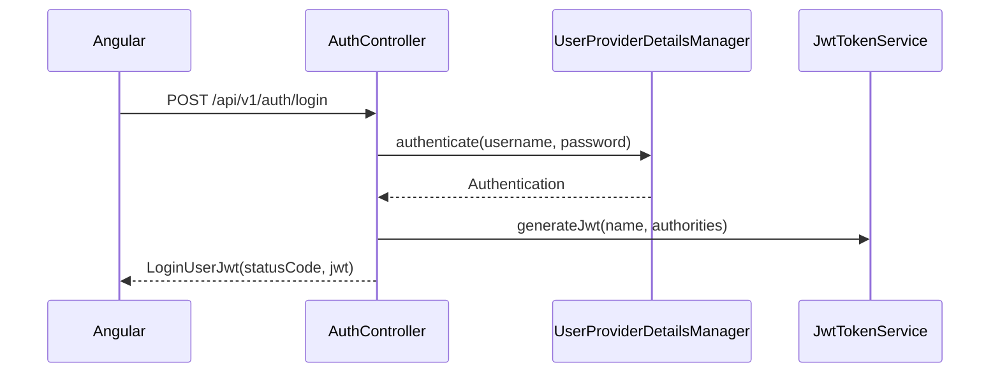
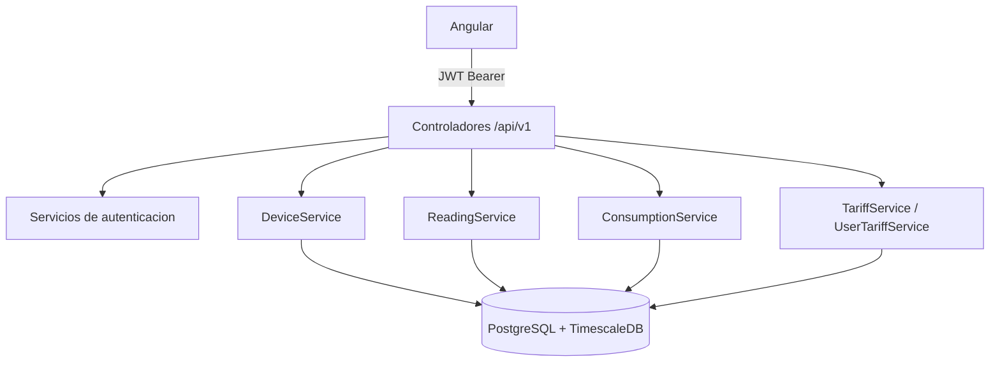

# Anexo A - Controladores REST y DTOs del backend

## 1. Alcance del anexo

Este anexo documenta los controladores REST reales del backend Spring Boot de Wattimizer. La información se ha extraído de `backend/src/main/java/com/joselumartos/jwtauthbackenddemo/controllers`, de los DTOs de `dtos` y de los servicios llamados por cada endpoint.

El backend usa JSON como formato principal de intercambio. La autenticación se basa en JWT y se aplica de forma global desde `SecurityConfig`, dejando públicas solo las rutas de autenticación, OAuth2 y el handshake WebSocket.

## 2. Seguridad aplicada a la API

Archivo principal: `backend/src/main/java/com/joselumartos/jwtauthbackenddemo/config/SecurityConfig.java`.

| Regla | Comportamiento |
| --- | --- |
| Sesión | `SessionCreationPolicy.STATELESS`, por lo que cada petición debe identificarse con JWT si la ruta no es pública. |
| CSRF | Desactivado porque la API trabaja como backend REST para SPA. |
| CORS | Se carga desde `app.cors.allowed-origins` y en producción desde `APP_CORS_ALLOWED_ORIGINS`. |
| JWT | `JwtValidatorFilter` se ejecuta antes de `BasicAuthenticationFilter`. |
| Rutas públicas | `/api/v1/auth/login`, `/api/v1/auth/register`, `/api/v1/auth/register/admin`, `/api/v1/auth/oauth/exchange`, `/oauth2/authorization/**`, `/login/oauth2/code/**`, `/ws-iot/**`. |
| Tarifas | `GET /api/v1/tariffs/**` requiere usuario autenticado; las escrituras requieren `ROLE_ADMIN`. |
| Resto de API | Requiere autenticación. |

## 3. DTOs principales

### 3.1. Autenticación

```java
public record LoginUser(String username, String password) { }
public record LoginUserJwt(String statusCode, String jwt) {}
public record RegisterRequest(String username, String password, String confirmPassword, Long tariffId) {}
public record OAuthTicketExchangeRequest(String ticket) {}
```

La API devuelve el JWT dentro del cuerpo de `LoginUserJwt`. Angular lo guarda en `sessionStorage` mediante `SessionStorageService`.

### 3.2. Dispositivos

```java
public record DeviceDto(
        Long id,
        String username,
        String name,
        String macAddress,
        Boolean isOn,
        Boolean simulated,
        SimulationProfile simulationProfile
) {}
```

```java
public record CreateSimulatedDeviceRequest(
        String name,
        SimulationProfile simulationProfile
) {}
```

`DeviceDto` representa tanto dispositivos físicos como simulados. En simulados, `simulationProfile` indica el patrón de consumo usado por el job de telemetría.

### 3.3. Lecturas

```java
public record ReadingResponse(
        Instant time,
        String macAddress,
        BigDecimal powerW,
        BigDecimal energyTotalKwh,
        Boolean isOn
) {}
```

Este DTO es la salida usada por REST y WebSocket. El campo `energyTotalKwh` funciona como odómetro acumulado, lo que permite calcular costes mediante deltas entre lecturas consecutivas.

### 3.4. Tarifas

```java
public record TariffDto(
        Long id,
        String name,
        String market,
        String accessTariffCode,
        String geographicZone,
        String energyCompany,
        List<PeriodDto> periods,
        List<TariffContractedPowerDto> contractedPowers
) {}
```

```java
public record PeriodDto(Long id, String periodCode, BigDecimal priceKwh) { }
public record TariffContractedPowerDto(Long id, String periodCode, BigDecimal contractedPowerKw) { }
public record UserTariffRequest(Long templateTariffId, TariffDto contract) {}
```

El contrato de tarifa separa:

- **Precio de energía:** `PeriodDto.priceKwh`.
- **Potencia contratada:** `TariffContractedPowerDto.contractedPowerKw`.
- **Calendario regulatorio:** se resuelve fuera del DTO, mediante `tariff_calendar_slots`.

### 3.5. Alertas y errores

```java
public record AlertDto(
        Long id,
        String macAddress,
        String username,
        String type,
        String message,
        LocalDateTime createdAt
) { }
```

`GlobalExceptionHandler` devuelve `ErrorResponse` con estado, error, mensaje y marca temporal cuando se produce una excepción controlada.

## 4. Controlador de autenticación

Archivo: `AuthController.java`.

Ruta base: `/api/v1/auth`.

| Método | Endpoint | Entrada | Salida | Lógica |
| --- | --- | --- | --- | --- |
| `POST` | `/login` | `LoginUser` | `LoginUserJwt` | Autentica con `UserProviderDetailsManager` y genera JWT con `JwtTokenService`. |
| `POST` | `/register` | `RegisterRequest` | `201 Created` sin cuerpo | Crea usuario estándar mediante `AuthRegistrationService.registerUser`. |
| `POST` | `/register/admin` | `RegisterRequest` + cabecera `X-Wattimizer-Admin-Secret` | `201 Created` sin cuerpo | Compara la cabecera con `app.admin.secret` antes de crear administrador. |
| `POST` | `/oauth/exchange` | `OAuthTicketExchangeRequest` | `LoginUserJwt` | Canjea un ticket OAuth de un solo uso mediante `OAuth2LoginTicketService.consumeTicket`. |

### Flujo de login tradicional



## 5. Controlador de dispositivos

Archivo: `DeviceController.java`.

Ruta base: `/api/v1/devices`.

| Método | Endpoint | Parámetros | Entrada | Salida | Servicio |
| --- | --- | --- | --- | --- | --- |
| `GET` | `/api/v1/devices` | `Principal` | Sin cuerpo | `List<DeviceDto>` | `DeviceService.listByUsername` |
| `GET` | `/api/v1/devices/{id}` | `id`, `Principal` | Sin cuerpo | `DeviceDto` o `403` | `DeviceService.findById` |
| `POST` | `/api/v1/devices` | Sin `Principal` en firma | `DeviceDto` | `201 DeviceDto` | `DeviceService.save` |
| `POST` | `/api/v1/devices/claim` | `Principal` | `DeviceDto` con `macAddress` y `name` | `DeviceDto` | `DeviceService.claimOrRegisterDevice` |
| `POST` | `/api/v1/devices/simulated/demo-pack` | `Principal` | Sin cuerpo útil | `201 List<DeviceDto>` | `DeviceService.createDemoSimulatorPack` |
| `POST` | `/api/v1/devices/simulated` | `Principal` | `CreateSimulatedDeviceRequest` | `201 DeviceDto` | `DeviceService.createSimulatedDevice` |
| `PUT` | `/api/v1/devices/{id}` | `id`, `Principal` | `DeviceDto` | `DeviceDto` | `DeviceService.updateDevice` |
| `DELETE` | `/api/v1/devices/{id}` | `id`, `Principal` | Sin cuerpo | `204 No Content` | `DeviceService.deleteById` |

### Decisiones importantes

- El flujo normal para usuarios es `POST /api/v1/devices/claim`, porque asocia la MAC al usuario autenticado.
- `POST /api/v1/devices` existe, pero el controlador no recibe `Principal`; por eso no es el flujo más seguro para alta de usuario final.
- `DeviceService.deleteById` elimina lecturas y alertas antes de borrar el dispositivo:

```java
readingRepository.deleteAllByDeviceMacAddress(macAddress);
alertRepository.deleteByDeviceId(id);
deviceRepository.delete(device);
```

La razón es evitar que queden filas dependientes de un dispositivo que ya no existe.

### Perfiles de simulación

Los valores persistidos proceden de `SimulationProfile`:

```java
SINE_WAVE, OVEN, WASHING_MACHINE, TELEVISION, FAN,
DESKTOP_PC, FRIDGE, STANDBY, CONSTANT_HIGH_LOAD
```

## 6. Controlador de lecturas

Archivo: `ReadingController.java`.

Ruta base: `/api/v1/readings`.

| Método | Endpoint | Parámetros | Salida | Uso |
| --- | --- | --- | --- | --- |
| `GET` | `/api/v1/readings` | `Principal` | `List<ReadingResponse>` | Devuelve lecturas visibles para el usuario. |
| `GET` | `/api/v1/readings/latest/{macAddress}` | `macAddress`, `Principal` | `ReadingResponse` | Devuelve la última lectura de un dispositivo autorizado. |
| `GET` | `/api/v1/readings/device/{macAddress}/recent` | `macAddress`, `seconds` con valor por defecto `120`, `Principal` | `List<ReadingResponse>` | Precarga el histórico reciente usado por el dashboard. |
| `GET` | `/api/v1/readings/search` | `time`, `macAddress`, `Principal` | `ReadingResponse` | Busca una lectura por clave compuesta lógica. |
| `DELETE` | `/api/v1/readings/search` | `time`, `macAddress`, `Principal` | `204 No Content` | Borra una lectura concreta si pertenece al usuario. |

Antes de consultar o borrar por MAC, el controlador comprueba que el dispositivo pertenece al usuario autenticado. Esta validación evita que un usuario pueda leer series temporales de otra empresa.

## 7. Controlador de analítica de consumo

Archivo: `ConsumptionController.java`.

Ruta base: `/api/v1/analytics`.

| Método | Endpoint | Parámetros obligatorios | Salida | Servicio |
| --- | --- | --- | --- | --- |
| `GET` | `/api/v1/analytics/cost` | `macAddress`, `start`, `end` | `macAddress`, `totalCostEur`, `start`, `end` | `ConsumptionService.calculateCostInPeriod` |
| `GET` | `/api/v1/analytics/ghost-consumption` | `macAddress`, `start`, `end` | `macAddress`, `ghostCostEur`, `start`, `end` | `ConsumptionService.calculateGhostCost` |

Los parámetros `start` y `end` se interpretan como `Instant` en formato ISO-8601. Antes del cálculo se comprueba la propiedad del dispositivo.

La lógica no calcula coste a partir de potencia instantánea aislada, sino de la diferencia positiva entre lecturas acumuladas de `energyTotalKwh`. Esta decisión reduce errores cuando la frecuencia de muestreo no es exacta.

## 8. Controlador de tarifas

Archivo: `TariffController.java`.

Ruta base: `/api/v1/tariffs`.

| Método | Endpoint | Entrada | Salida | Permisos |
| --- | --- | --- | --- | --- |
| `GET` | `/api/v1/tariffs` | Sin cuerpo | `List<TariffDto>` | Usuario autenticado |
| `GET` | `/api/v1/tariffs/{id}` | `id` | `TariffDto` | Usuario autenticado |
| `POST` | `/api/v1/tariffs` | `TariffDto` | `201 TariffDto` | `ROLE_ADMIN` |
| `POST` | `/api/v1/tariffs/{id}` | `TariffDto` | `TariffDto` | `ROLE_ADMIN` |
| `DELETE` | `/api/v1/tariffs/{id}` | `id` | `204 No Content` | `ROLE_ADMIN` |

La actualización usa `POST /{id}` y no `PUT`. El frontend lo respeta en `TariffService.updateCatalogTariff`.

## 9. Controlador de tarifa privada del usuario

Archivo: `UserTariffController.java`.

Ruta base: `/api/v1/users/me/tariff`.

| Método | Endpoint | Entrada | Salida | Decisión de diseño |
| --- | --- | --- | --- | --- |
| `GET` | `/api/v1/users/me/tariff` | `Principal` | `200 TariffDto` o `204 No Content` | Si el usuario no tiene tarifa, no se devuelve objeto vacío. |
| `POST` | `/api/v1/users/me/tariff` | `UserTariffRequest` | `TariffDto` | El propietario se obtiene del JWT, no del body. |
| `DELETE` | `/api/v1/users/me/tariff` | `Principal` | `204 No Content` | Desvincula la tarifa privada del usuario actual. |

Esta API evita IDOR porque no acepta `userId` ni en ruta ni en cuerpo. El usuario afectado siempre es el del `Principal`.

## 10. Controlador de alertas

Archivo: `AlertController.java`.

Ruta base: `/api/v1/alerts`.

| Método | Endpoint | Parámetros | Salida | Servicio |
| --- | --- | --- | --- | --- |
| `GET` | `/api/v1/alerts` | `Principal` | `List<AlertDto>` | `AlertService.listByUsername` |
| `DELETE` | `/api/v1/alerts/{id}` | `id`, `Principal` | `204 No Content` | `AlertService.deleteAlertForUser` |

El borrado comprueba usuario en el servicio. Si no se elimina ninguna fila, el controlador lanza `EntityNotFoundException` con el mensaje `Alert not found or unauthorized to delete`.

## 11. Flujo REST principal



## 12. Resumen técnico

La API está diseñada con controladores finos y servicios que concentran la lógica real. Las decisiones más importantes son:

- El usuario propietario se obtiene del JWT siempre que el recurso sea personal.
- Los dispositivos se identifican funcionalmente por MAC, aunque internamente tengan `id`.
- Las lecturas se exponen como DTOs simples y reutilizables por REST y WebSocket.
- Las tarifas privadas evitan recibir `userId`, reduciendo riesgo de acceso horizontal.
- Las operaciones de escritura del catálogo quedan reservadas a administradores.
- El borrado de dispositivos limpia lecturas y alertas asociadas para mantener coherencia de datos.
