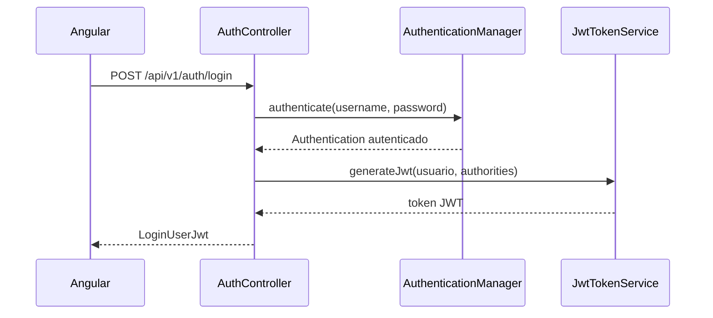

# Anexo A. Controladores REST de Spring Boot

Este anexo documenta los controladores REST reales del backend de Wattimizer. Todos se encuentran en `backend/src/main/java/com/joselumartos/jwtauthbackenddemo/controllers`.

## 1. Seguridad de la API

La seguridad se configura en `SecurityConfig.java`.

| Ruta | Acceso |
| --- | --- |
| `/api/v1/auth/login` | Publico |
| `/api/v1/auth/register` | Publico |
| `/api/v1/auth/register/admin` | Publico, pero exige cabecera `X-Wattimizer-Admin-Secret` |
| `/api/v1/auth/oauth/exchange` | Publico, usa un ticket temporal como credencial |
| `/oauth2/authorization/**` y `/login/oauth2/code/**` | Publico para OAuth2 |
| `/ws-iot/**` | Publico para handshake WebSocket |
| `GET /api/v1/tariffs/**` | Usuario autenticado |
| Mutaciones en `/api/v1/tariffs/**` | `ROLE_ADMIN` |
| Resto de `/api/v1/**` | Usuario autenticado con JWT |

El frontend anade el JWT mediante `httpInterceptor.ts` solo para rutas `/api/v1` que no son publicas de autenticacion. Esto evita enviar token al login, registro y canje OAuth2.

## 2. DTOs principales

### 2.1. Autenticacion

```java
public record LoginUser(String username, String password) {}
public record RegisterRequest(String username, String password, String confirmPassword, Long tariffId) {}
public record LoginUserJwt(String statusCode, String jwt) {}
public record OAuthTicketExchangeRequest(String ticket) {}
```

### 2.2. Dispositivos

```java
public record DeviceDto(
    Long id,
    String username,
    String name,
    String macAddress,
    Boolean isOn,
    Boolean simulated,
    SimulationProfile simulationProfile
) {}

public record CreateSimulatedDeviceRequest(
    String name,
    SimulationProfile simulationProfile
) {}
```

`SimulationProfile` acepta los valores:

- `SINE_WAVE`
- `OVEN`
- `WASHING_MACHINE`
- `TELEVISION`
- `FAN`
- `DESKTOP_PC`
- `FRIDGE`
- `STANDBY`
- `CONSTANT_HIGH_LOAD`

### 2.3. Lecturas

```java
public record ReadingResponse(
    Instant time,
    String macAddress,
    BigDecimal powerW,
    BigDecimal energyTotalKwh,
    Boolean isOn
) {}
```

Los mensajes MQTT se transforman desde estos DTOs:

```java
public record EventsRpc(String source, Params params) {}
public record Params(Double timestamp, Switch switchData) {}
public record Switch(ActiveEnergy activeEnergy, Double activePower) {}
public record Status(Boolean output, Double activePower, ActiveEnergy activeEnergy) {}
public record ActiveEnergy(Double total) {}
```

El valor `ActiveEnergy.total` llega en Wh desde Shelly y se convierte a kWh en los mappers antes de persistirse.

### 2.4. Tarifas

```java
public record TariffDto(
    Long id,
    String name,
    String market,
    String accessTariffCode,
    String geographicZone,
    String energyCompany,
    List<PeriodDto> periods,
    List<TariffContractedPowerDto> contractedPowers
) {}

public record PeriodDto(Long id, String periodCode, BigDecimal priceKwh) {}
public record TariffContractedPowerDto(Long id, String periodCode, BigDecimal contractedPowerKw) {}
public record UserTariffRequest(Long templateTariffId, TariffDto contract) {}
```

La tarifa privada del usuario no recibe `userId`; el propietario se obtiene siempre desde `Principal`.

### 2.5. Alertas y errores

```java
public record AlertDto(
    Long id,
    String macAddress,
    String username,
    String type,
    String message,
    LocalDateTime createdAt
) {}

public record ErrorResponse(
    int status,
    String error,
    String message,
    LocalDateTime timestamp
) {}
```

## 3. `AuthController`

Ruta base: `/api/v1/auth`.

| Metodo | Endpoint | Entrada | Salida | Logica |
| --- | --- | --- | --- | --- |
| `POST` | `/login` | `LoginUser` | `LoginUserJwt` | Autentica con `UserProviderDetailsManager`; si la autenticacion es valida, genera JWT con `JwtTokenService`. |
| `POST` | `/register` | `RegisterRequest` | `201 Created` | Registra usuario normal mediante `AuthRegistrationService`. |
| `POST` | `/register/admin` | `RegisterRequest` + cabecera `X-Wattimizer-Admin-Secret` | `201 Created` | Compara la cabecera con `app.admin.secret`; si coincide, crea usuario administrador. |
| `POST` | `/oauth/exchange` | `OAuthTicketExchangeRequest` | `LoginUserJwt` | Consume un ticket OAuth2 de un solo uso y devuelve JWT propio de la aplicacion. |

### Flujo de login clasico



## 4. `DeviceController`

Ruta base: `/api/v1/devices`.

| Metodo | Endpoint | Parametros | Body | Respuesta | Observaciones |
| --- | --- | --- | --- | --- | --- |
| `GET` | `/` | `Principal` | - | `List<DeviceDto>` | Devuelve dispositivos del usuario autenticado. |
| `GET` | `/{id}` | `id`, `Principal` | - | `DeviceDto` o `403` | Comprueba que `device.username()` coincida con el usuario de sesion. |
| `POST` | `/` | - | `DeviceDto` | `201 DeviceDto` | Guarda el DTO directamente. Es un endpoint heredado; para alta de usuario se usa preferentemente `/claim`. |
| `POST` | `/claim` | `Principal` | `DeviceDto` con `macAddress` y `name` | `DeviceDto` | Reclama o registra un dispositivo fisico y lo asigna al usuario autenticado. |
| `POST` | `/simulated/demo-pack` | `Principal` | `{}` | `201 List<DeviceDto>` | Crea un simulador por perfil que el usuario aun no tenga. |
| `POST` | `/simulated` | `Principal` | `CreateSimulatedDeviceRequest` | `201 DeviceDto` | Crea dispositivo simulado con MAC sintetica `SIM#########`. |
| `PUT` | `/{id}` | `id`, `Principal` | `DeviceDto` | `DeviceDto` | Actualiza nombre, estado `isOn` y perfil si el dispositivo es simulado. |
| `DELETE` | `/{id}` | `id`, `Principal` | - | `204 No Content` | Verifica propietario y elimina lecturas y alertas asociadas antes del dispositivo. |

### Decisiones de negocio

- `claimOrRegisterDevice` permite asociar un dispositivo sin propietario o con usuario `SYSTEM`.
- Si el dispositivo pertenece a otro usuario real, lanza `IllegalStateException`.
- `createDemoSimulatorPack` evita duplicados por perfil, no por nombre.
- `deleteById` borra primero:
  1. `readings` por MAC.
  2. `alerts` por `device_id`.
  3. `devices`.

Esta ultima decision corrige el problema de claves foraneas al borrar dispositivos con historico.

## 5. `ReadingController`

Ruta base: `/api/v1/readings`.

| Metodo | Endpoint | Parametros | Respuesta | Uso |
| --- | --- | --- | --- | --- |
| `GET` | `/` | `Principal` | `List<ReadingResponse>` | Lista lecturas del usuario autenticado. |
| `GET` | `/latest/{macAddress}` | `macAddress`, `Principal` | `ReadingResponse` | Devuelve la lectura mas reciente de una MAC del usuario. |
| `GET` | `/device/{macAddress}/recent` | `macAddress`, `seconds` opcional, `Principal` | `List<ReadingResponse>` | Devuelve lecturas recientes ordenadas por tiempo ascendente. Por defecto usa 120 segundos. |
| `GET` | `/search` | `time`, `macAddress`, `Principal` | `ReadingResponse` | Busca una lectura por clave compuesta logica: instante + MAC. |
| `DELETE` | `/search` | `time`, `macAddress`, `Principal` | `204 No Content` | Elimina una lectura concreta tras comprobar propietario del dispositivo. |

El controlador no confia en la MAC recibida sin comprobarla. Antes de buscar lecturas llama a `deviceService.findByMacAddress(macAddress)` y valida que el dispositivo pertenece al `Principal`.

## 6. `ConsumptionController`

Ruta base: `/api/v1/analytics`.

| Metodo | Endpoint | Query params | Respuesta | Servicio |
| --- | --- | --- | --- | --- |
| `GET` | `/cost` | `macAddress`, `start`, `end` | `{ macAddress, totalCostEur, start, end }` | `ConsumptionService.calculateCostInPeriod` |
| `GET` | `/ghost-consumption` | `macAddress`, `start`, `end` | `{ macAddress, ghostCostEur, start, end }` | `ConsumptionService.calculateGhostCost` |

`start` y `end` usan formato ISO date-time y se reciben como `Instant`.

### Logica de coste

El servicio trabaja con lecturas acumuladas (`energyTotalKwh`). Para cada par de lecturas consecutivas:

1. Calcula delta positivo de kWh.
2. Resuelve el periodo tarifario aplicable con `CalendarResolverService`.
3. Multiplica `deltaKwh * priceKwh`.
4. Redondea el total a dos decimales.

El consumo fantasma usa la misma logica, pero solo entre las 00:00 y las 05:59 de la zona local del contrato.

## 7. `TariffController`

Ruta base: `/api/v1/tariffs`.

| Metodo | Endpoint | Body | Respuesta | Seguridad |
| --- | --- | --- | --- | --- |
| `GET` | `/` | - | `List<TariffDto>` | Usuario autenticado |
| `GET` | `/{id}` | - | `TariffDto` | Usuario autenticado |
| `POST` | `/` | `TariffDto` | `201 TariffDto` | `ROLE_ADMIN` |
| `POST` | `/{id}` | `TariffDto` | `TariffDto` | `ROLE_ADMIN` |
| `DELETE` | `/{id}` | - | `204 No Content` | `ROLE_ADMIN` |

El update usa `POST /{id}` en lugar de `PUT`, porque asi esta implementado actualmente en el backend y en `TariffService.updateCatalogTariff`.

### Validaciones de tarifa

`TariffService.validateTariffContract` comprueba:

- `accessTariffCode` obligatorio.
- `geographicZone` obligatoria.
- Precios de energia positivos.
- Potencias contratadas positivas.
- Para `2.0TD`: energia `P1-P3` y potencia `P1-P2`.
- Para `3.0TD`, `6.1TD` y `6.2TD`: energia y potencia `P1-P6`.
- En peajes de seis periodos: potencia no decreciente `P1 <= P2 <= ... <= P6`.

## 8. `UserTariffController`

Ruta base: `/api/v1/users/me/tariff`.

| Metodo | Endpoint | Body | Respuesta | Funcion |
| --- | --- | --- | --- | --- |
| `GET` | `/` | - | `200 TariffDto` o `204 No Content` | Devuelve la tarifa privada del usuario autenticado. |
| `POST` | `/` | `UserTariffRequest` | `200 TariffDto` | Asigna, clona o actualiza tarifa privada. |
| `DELETE` | `/` | - | `204 No Content` | Desvincula y elimina la tarifa privada del usuario. |

### Modos de `UserTariffRequest`

| `templateTariffId` | `contract` | Resultado |
| --- | --- | --- |
| Con valor | `null` | Clona la plantilla del catalogo. |
| Con valor | Con valor | Clona plantilla y aplica overrides del contrato. |
| `null` | Con valor sin `id` | Crea primera tarifa privada desde datos directos. |
| `null` | Con valor con `id` | Actualiza la tarifa privada existente si pertenece al usuario. |

La plantilla global nunca se modifica al asignarla a un usuario. El servicio crea un clon profundo con periodos y potencias nuevos.

## 9. `AlertController`

Ruta base: `/api/v1/alerts`.

| Metodo | Endpoint | Parametros | Respuesta | Funcion |
| --- | --- | --- | --- | --- |
| `GET` | `/` | `Principal` | `List<AlertDto>` | Lista alertas del usuario autenticado. |
| `DELETE` | `/{id}` | `id`, `Principal` | `204 No Content` | Borra una alerta solo si pertenece al usuario. |

La generacion de alertas no ocurre en el controlador, sino en `AlertService.checkPowerThreshold`, llamado despues de persistir una lectura real o simulada.

## 10. Gestion de errores

`GlobalExceptionHandler` normaliza errores en `ErrorResponse`.

| Excepcion | HTTP | Mensaje |
| --- | --- | --- |
| `EntityNotFoundException` | `404` | Recurso no encontrado. |
| `BadCredentialsException` | `401` | Credenciales incorrectas. |
| `UsernameNotFoundException` | `401` | Usuario no localizado. |
| `ForbiddenException` | `403` | Acceso denegado. |
| `IllegalStateException` | `400` | Regla de negocio incumplida. |
| `DataIntegrityViolationException` por `users_username_key` | `400` | Email ya registrado. |
| `DataIntegrityViolationException` por FK de lecturas/alertas | `409` | No se puede eliminar dispositivo con datos asociados. |
| `Exception` generica | `500` | Error interno de procesamiento. |

Aunque ahora `DeviceService.deleteById` elimina lecturas y alertas antes del dispositivo, el handler mantiene el `409` defensivo para carreras o datos heredados.
