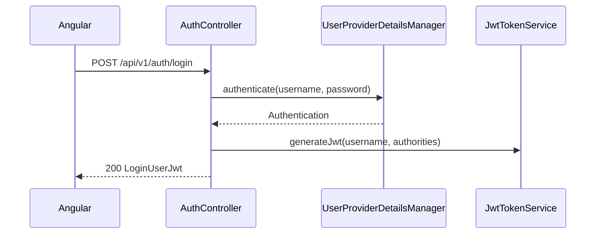
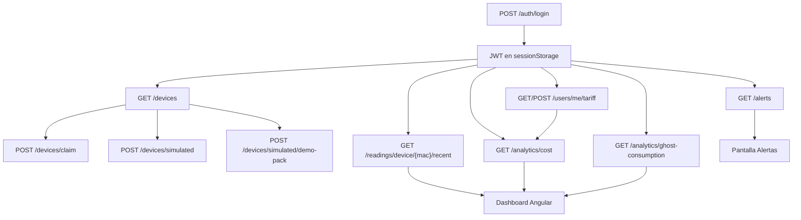

# Anexo A. Backend REST Spring Boot

## 1. Alcance del anexo

Este anexo documenta la capa REST real del backend de Wattimizer. El código analizado está en:

- `backend/src/main/java/com/joselumartos/jwtauthbackenddemo/controllers`
- `backend/src/main/java/com/joselumartos/jwtauthbackenddemo/dtos`
- `backend/src/main/java/com/joselumartos/jwtauthbackenddemo/services`
- `backend/src/main/java/com/joselumartos/jwtauthbackenddemo/entities`

La API está versionada bajo `/api/v1`. Los controladores comentados `DeviceCommandController`, `DeviceStateController` y `ReactiveDeviceStateController` no se consideran parte activa de la API porque sus mappings no están expuestos.

## 2. Seguridad de la API

La seguridad se define en `SecurityConfig` y `JwtValidatorFilter`.

| Elemento | Decisión implementada |
| --- | --- |
| Sesión | `SessionCreationPolicy.STATELESS`; cada petición debe autenticarse con JWT salvo rutas públicas. |
| CSRF | Deshabilitado porque la API se consume como REST stateless. |
| CORS | Orígenes leídos desde `app.cors.allowed-origins`, sobrescribibles con `APP_CORS_ALLOWED_ORIGINS`. |
| JWT | El token viaja en `Authorization: Bearer <token>`. |
| OAuth2 | Google/GitHub redirigen al frontend con un ticket temporal que Angular intercambia por JWT. |
| WebSocket | `/ws-iot/**` queda permitido para permitir la conexión STOMP. |

### 2.1. Reglas de autorización

| Ruta | Acceso |
| --- | --- |
| `/api/v1/auth/login` | Pública |
| `/api/v1/auth/register` | Pública |
| `/api/v1/auth/register/admin` | Pública, pero exige cabecera `X-Wattimizer-Admin-Secret` |
| `/api/v1/auth/oauth/exchange` | Pública, el ticket temporal actúa como credencial |
| `/oauth2/authorization/**` | Pública |
| `/login/oauth2/code/**` | Pública |
| `/ws-iot/**` | Pública |
| `GET /api/v1/tariffs/**` | Usuario autenticado |
| Resto de `/api/v1/tariffs/**` | `ROLE_ADMIN` |
| `/admin/**` | `ROLE_ADMIN` |
| Cualquier otra ruta | Usuario autenticado |

### 2.2. Comprobación de propietario

La API combina seguridad declarativa con comprobaciones manuales:

- En rutas de usuario, el propietario se obtiene de `Principal.getName()`.
- En lecturas, analítica y borrado de dispositivos se compara el username del dispositivo con el usuario autenticado.
- Si un recurso pertenece a otro usuario, varios controladores devuelven `403 Forbidden` sin cuerpo.

Hay una excepción importante: `POST /api/v1/devices` crea el dispositivo a partir del `DeviceDto` recibido y no usa `Principal`. Para usuarios reales, el flujo recomendado es `POST /api/v1/devices/claim`, porque asigna la propiedad desde el token.

## 3. DTOs principales

| DTO | Campos principales | Uso |
| --- | --- | --- |
| `LoginUser` | `username`, `password` | Entrada de login. |
| `LoginUserJwt` | `statusCode`, `jwt` | Respuesta de login y OAuth exchange. |
| `RegisterRequest` | Email, contraseña, confirmación y tarifa opcional | Registro normal o admin. |
| `OAuthTicketExchangeRequest` | `ticket` | Intercambio de ticket OAuth2 por JWT. |
| `DeviceDto` | `id`, `username`, `name`, `macAddress`, `isOn`, `simulated`, `simulationProfile` | Lectura y escritura de dispositivos. |
| `CreateSimulatedDeviceRequest` | `name`, `simulationProfile` | Creación de simulador. |
| `ReadingResponse` | `time`, `macAddress`, `powerW`, `energyTotalKwh`, `isOn` | Exposición de lecturas por REST y STOMP. |
| `AlertDto` | Datos de alerta, usuario y dispositivo | Listado de alertas. |
| `TariffDto` | Datos de tarifa, periodos y potencias contratadas | Catálogo y tarifa privada. |
| `PeriodDto` | `periodCode`, `priceKwh` | Precio energético por periodo. |
| `TariffContractedPowerDto` | `periodCode`, `contractedPowerKw` | Potencia contratada por periodo. |
| `UserTariffRequest` | `templateTariffId`, `contract` | Crear o actualizar tarifa privada. |
| `ErrorResponse` | `status`, `error`, `message`, `timestamp` | Respuestas de error centralizadas. |

## 4. Inventario de controladores REST

### 4.1. `AuthController` — `/api/v1/auth`

| Método | Ruta | Entrada | Salida | HTTP |
| --- | --- | --- | --- | --- |
| `POST` | `/login` | `LoginUser` | `LoginUserJwt` | `200 OK` |
| `POST` | `/register` | `RegisterRequest` | Sin cuerpo | `201 Created` |
| `POST` | `/register/admin` | `RegisterRequest` + header `X-Wattimizer-Admin-Secret` | Sin cuerpo | `201 Created` o `403` |
| `POST` | `/oauth/exchange` | `OAuthTicketExchangeRequest` | `LoginUserJwt` | `200 OK` |

#### Flujo de login

La intención es que el frontend solo tenga que guardar el JWT y enviarlo después en las llamadas protegidas. El registro de administrador se mantiene público a nivel de filtro, pero protegido por secreto de cabecera para poder crear el primer administrador sin panel interno.

### 4.2. `DeviceController` — `/api/v1/devices`

| Método | Ruta | Entrada | Salida | Comportamiento |
| --- | --- | --- | --- | --- |
| `GET` | `/` | `Principal` | `List<DeviceDto>` | Lista dispositivos del usuario autenticado. |
| `GET` | `/{id}` | Path `id` + `Principal` | `DeviceDto` | Devuelve detalle si el dispositivo pertenece al usuario. |
| `POST` | `/` | `DeviceDto` | `DeviceDto` | Crea dispositivo con datos del DTO. |
| `POST` | `/claim` | `DeviceDto` con `macAddress` y `name` | `DeviceDto` | Reclama o registra dispositivo para el usuario autenticado. |
| `POST` | `/simulated` | `CreateSimulatedDeviceRequest` | `DeviceDto` | Crea simulador con MAC `SIM...`. |
| `POST` | `/simulated/demo-pack` | `Principal` | `List<DeviceDto>` | Crea un simulador por perfil no existente para el usuario. |
| `PUT` | `/{id}` | Path `id`, `DeviceDto`, `Principal` | `DeviceDto` | Actualiza nombre, estado y perfil si es simulado. |
| `DELETE` | `/{id}` | Path `id`, `Principal` | Sin cuerpo | Borra lecturas, alertas y dispositivo. |

#### Reglas de negocio de dispositivos

- `claimOrRegisterDevice` permite asociar un equipo sin propietario, un equipo de `SYSTEM` o un equipo del mismo usuario.
- Si el dispositivo está vinculado a otra cuenta, lanza `IllegalStateException` y se responde con `400 Bad Request`.
- Los simuladores generan MAC única con prefijo `SIM` y nueve dígitos.
- El pack demo no duplica perfiles ya existentes en la cuenta.
- Antes de eliminar un dispositivo, `DeviceService.deleteById` borra lecturas por MAC y alertas por `deviceId`.

#### Perfiles de simulación

| Perfil | Intención |
| --- | --- |
| `SINE_WAVE` | Carga oscilante de prueba. |
| `OVEN` | Picos y ciclos de horno. |
| `WASHING_MACHINE` | Fases de lavadora. |
| `TELEVISION` | Consumo moderado estable. |
| `FAN` | Ventilador. |
| `DESKTOP_PC` | Equipo informático. |
| `FRIDGE` | Ciclos de compresor. |
| `STANDBY` | Consumo fantasma. |
| `CONSTANT_HIGH_LOAD` | Carga alta constante para probar alertas. |

### 4.3. `ReadingController` — `/api/v1/readings`

| Método | Ruta | Parámetros | Salida | Comportamiento |
| --- | --- | --- | --- | --- |
| `GET` | `/` | `Principal` | `List<ReadingResponse>` | Lista lecturas de dispositivos del usuario. |
| `GET` | `/latest/{macAddress}` | Path `macAddress` | `ReadingResponse` | Última lectura de una MAC propia. |
| `GET` | `/device/{macAddress}/recent` | Path `macAddress`, query `seconds` por defecto `120` | `List<ReadingResponse>` | Lecturas recientes ordenadas por tiempo. |
| `GET` | `/search` | Query `time`, `macAddress` | `ReadingResponse` | Busca por clave compuesta. |
| `DELETE` | `/search` | Query `time`, `macAddress` | Sin cuerpo | Borra una lectura concreta. |

No existe endpoint REST para crear lecturas manualmente. Las lecturas se guardan desde MQTT o desde el job de simulación. Esta decisión mantiene separada la entrada de telemetría real del uso normal de la API por parte del frontend.

### 4.4. `ConsumptionController` — `/api/v1/analytics`

| Método | Ruta | Query params | Respuesta |
| --- | --- | --- | --- |
| `GET` | `/cost` | `macAddress`, `start`, `end` como `Instant` ISO | `macAddress`, `totalCostEur`, `start`, `end` |
| `GET` | `/ghost-consumption` | `macAddress`, `start`, `end` como `Instant` ISO | `macAddress`, `ghostCostEur`, `start`, `end` |

El controlador no calcula directamente. Valida que el dispositivo pertenece al usuario y delega en `ConsumptionService`.

#### Cálculo de coste

1. Se cargan lecturas del intervalo con `ReadingRepository.findReadingsInInterval`.
2. Se recorren lecturas consecutivas.
3. Se calcula el delta positivo de `energyTotalKwh`.
4. Se resuelve el periodo tarifario aplicable en el instante de la lectura.
5. Se multiplica el delta kWh por el precio del periodo.

El consumo fantasma usa la misma base, pero solo cuenta tramos cuya hora local está entre las 00:00 y las 05:59.

### 4.5. `AlertController` — `/api/v1/alerts`

| Método | Ruta | Entrada | Salida | Comportamiento |
| --- | --- | --- | --- | --- |
| `GET` | `/` | `Principal` | `List<AlertDto>` | Lista alertas del usuario autenticado. |
| `DELETE` | `/{id}` | Path `id`, `Principal` | Sin cuerpo | Borra una alerta si pertenece al usuario. |

Las alertas no se crean por REST. Se generan automáticamente en `AlertService.checkPowerThreshold` después de recibir una lectura.

### 4.6. `TariffController` — `/api/v1/tariffs`

| Método | Ruta | Entrada | Salida | Acceso |
| --- | --- | --- | --- | --- |
| `GET` | `/` | Sin cuerpo | `List<TariffDto>` | Autenticado |
| `GET` | `/{id}` | Path `id` | `TariffDto` | Autenticado |
| `POST` | `/` | `TariffDto` | `TariffDto` | `ROLE_ADMIN` |
| `POST` | `/{id}` | Path `id`, `TariffDto` | `TariffDto` | `ROLE_ADMIN` |
| `DELETE` | `/{id}` | Path `id` | Sin cuerpo | `ROLE_ADMIN` |

La actualización usa `POST /{id}` en lugar de `PUT`. El frontend lo respeta en `TariffService.updateCatalogTariff`.

### 4.7. `UserTariffController` — `/api/v1/users/me/tariff`

| Método | Ruta | Entrada | Salida |
| --- | --- | --- | --- |
| `GET` | `/` | `Principal` | `200 TariffDto` o `204 No Content` |
| `POST` | `/` | `Principal`, `UserTariffRequest` | `TariffDto` |
| `DELETE` | `/` | `Principal` | `204 No Content` |

Este controlador está diseñado para evitar IDOR: no acepta `userId` ni en path ni en body. El usuario siempre se deduce del JWT.

## 5. Gestión de errores

| Excepción | HTTP | Mensaje |
| --- | --- | --- |
| `EntityNotFoundException` | 404 | Mensaje del recurso no encontrado. |
| `BadCredentialsException` | 401 | Credenciales incorrectas. |
| `IllegalStateException` | 400 | Regla de negocio incumplida. |
| `UsernameNotFoundException` | 401 | Usuario no localizado. |
| `ForbiddenException` | 403 | Acceso denegado. |
| `DataIntegrityViolationException` por email duplicado | 400 | Cuenta ya registrada. |
| `DataIntegrityViolationException` por FK en lecturas/alertas | 409 | No se puede eliminar el dispositivo por dependencias. |
| Cualquier otra excepción | 500 | Error interno genérico. |

Un detalle relevante es que `DeviceService.createSimulatedDevice` lanza `IllegalArgumentException` si falta perfil o el nombre no cumple mínimo de longitud. Como no hay handler específico, ese caso cae actualmente en el handler genérico de `Exception` y se devuelve 500. Conviene corregirlo en una mejora futura, pero la documentación refleja el comportamiento real.

## 6. Flujo REST principal

## 7. Valor arquitectónico

La API no está planteada como un CRUD genérico. Cada controlador representa una parte del dominio:

- `DeviceController` gestiona el inventario energético.
- `ReadingController` expone series temporales ya procesadas.
- `ConsumptionController` convierte telemetría en información económica.
- `TariffController` y `UserTariffController` separan catálogo global y contrato privado.
- `AlertController` cierra el ciclo de control con incidencias accionables.

Esta separación ayuda a mantener el proyecto entendible y facilita que el frontend consuma endpoints concretos sin conocer detalles internos de MQTT, TimescaleDB o cálculo tarifario.
