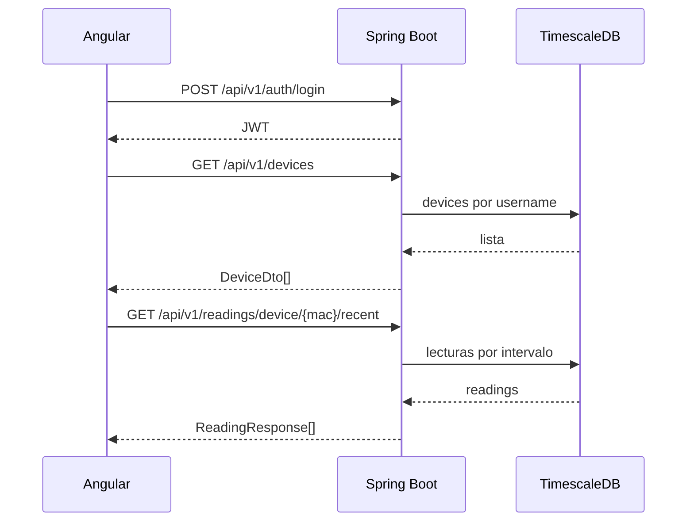

# Anexo A. Backend REST con Spring Boot

## 1. Vision general

El backend de Wattimizer esta implementado con **Spring Boot 4.0.5** y expone una API REST bajo el prefijo `/api/v1`. La aplicacion usa Spring Security en modo stateless: el cliente envia un JWT y los controladores obtienen el usuario autenticado mediante `Principal`.

Esta decision es importante porque evita un problema habitual en aplicaciones multiusuario: aceptar `userId` desde el frontend. En Wattimizer, cuando una operacion pertenece a un usuario, el propietario se deduce del token y no del cuerpo de la peticion.

## 2. Seguridad y gestion de errores

### 2.1. Configuracion de seguridad

La clase `SecurityConfig` define estas reglas:

| Ruta | Acceso |
| --- | --- |
| `/api/v1/auth/login` | Publico |
| `/api/v1/auth/register` | Publico |
| `/api/v1/auth/register/admin` | Publico, pero protegido por cabecera interna |
| `/api/v1/auth/oauth/exchange` | Publico |
| `/oauth2/authorization/**` y `/login/oauth2/code/**` | Publico para OAuth2 |
| `/ws-iot/**` | Publico para handshake WebSocket |
| `GET /api/v1/tariffs/**` | Usuario autenticado |
| Escritura en `/api/v1/tariffs/**` | Solo `ROLE_ADMIN` |
| Resto de rutas | Usuario autenticado |

La sesion HTTP se desactiva (`SessionCreationPolicy.STATELESS`) y el filtro `JwtValidatorFilter` valida el token antes de la autenticacion basica.

### 2.2. Formato de error

`GlobalExceptionHandler` devuelve un DTO uniforme:

```java
public record ErrorResponse(
    int status,
    String error,
    String message,
    LocalDateTime timestamp
) {}
```

Las excepciones relevantes se convierten asi:

| Excepcion | Codigo HTTP | Uso |
| --- | --- | --- |
| `EntityNotFoundException` | 404 | Recurso inexistente o no localizado. |
| `BadCredentialsException` | 401 | Credenciales no validas. |
| `UsernameNotFoundException` | 401 | Usuario inexistente en contexto de seguridad. |
| `ForbiddenException` | 403 | Acceso denegado. |
| `IllegalStateException` | 400 | Regla de negocio incumplida. |
| `DataIntegrityViolationException` | 400, 409 o 500 | Conflictos de unicidad, claves foraneas o error interno. |

## 3. Controlador de autenticacion

Archivo: `backend/src/main/java/.../controllers/AuthController.java`

Base path: `/api/v1/auth`

| Metodo | Endpoint | Entrada | Salida | Descripcion |
| --- | --- | --- | --- | --- |
| `POST` | `/login` | `LoginUser` | `LoginUserJwt` | Autentica usuario y devuelve JWT. |
| `POST` | `/register` | `RegisterRequest` | `201 Created` sin cuerpo | Registra usuario normal. |
| `POST` | `/register/admin` | `RegisterRequest` + cabecera `X-Wattimizer-Admin-Secret` | `201 Created` | Registra administrador si la cabecera coincide con `app.admin.secret`. |
| `POST` | `/oauth/exchange` | `OAuthTicketExchangeRequest` | `LoginUserJwt` | Intercambia un ticket OAuth2 de un solo uso por JWT. |

### DTOs de autenticacion

```java
public record LoginUser(String username, String password) {}

public record LoginUserJwt(String statusCode, String jwt) {}

public record RegisterRequest(
    String username,
    String password,
    String confirmPassword,
    Long tariffId
) {}

public record OAuthTicketExchangeRequest(String ticket) {}
```

## 4. Controlador de dispositivos

Archivo: `DeviceController.java`

Base path: `/api/v1/devices`

| Metodo | Endpoint | Parametros | Body | Respuesta | Descripcion |
| --- | --- | --- | --- | --- | --- |
| `GET` | `/` | `Principal` | - | `List<DeviceDto>` | Lista dispositivos del usuario autenticado. |
| `GET` | `/{id}` | `id`, `Principal` | - | `DeviceDto` o `403` | Recupera un dispositivo si pertenece al usuario. |
| `POST` | `/` | - | `DeviceDto` | `201 DeviceDto` | Crea dispositivo directamente. Es una excepcion de propiedad; para uso normal se recomienda `claim`. |
| `POST` | `/claim` | `Principal` | `DeviceDto` con `macAddress` y `name` | `DeviceDto` | Reclama un dispositivo existente o registra uno nuevo para el usuario. |
| `POST` | `/simulated/demo-pack` | `Principal` | `{}` | `201 List<DeviceDto>` | Crea un simulador por cada perfil que el usuario aun no tenga. |
| `POST` | `/simulated` | `Principal` | `CreateSimulatedDeviceRequest` | `201 DeviceDto` | Crea un dispositivo virtual con perfil de consumo. |
| `PUT` | `/{id}` | `id`, `Principal` | `DeviceDto` | `DeviceDto` | Actualiza nombre, estado y perfil simulado si procede. |
| `DELETE` | `/{id}` | `id`, `Principal` | - | `204 No Content` | Elimina dispositivo tras borrar lecturas y alertas asociadas. |

### DTOs de dispositivos

```java
public record DeviceDto(
    Long id,
    String username,
    String name,
    String macAddress,
    Boolean isOn,
    Boolean simulated,
    SimulationProfile simulationProfile
) {}

public record CreateSimulatedDeviceRequest(
    String name,
    SimulationProfile simulationProfile
) {}
```

### Perfiles simulados

`SimulationProfile` se persiste como texto para que sea estable en base de datos:

```java
SINE_WAVE, OVEN, WASHING_MACHINE, TELEVISION, FAN,
DESKTOP_PC, FRIDGE, STANDBY, CONSTANT_HIGH_LOAD
```

El metodo `DeviceService.createDemoSimulatorPack()` recorre todos los perfiles y evita duplicados por usuario. Asi se consigue un entorno de demostracion completo sin crear varias veces el mismo perfil.

## 5. Controlador de lecturas

Archivo: `ReadingController.java`

Base path: `/api/v1/readings`

| Metodo | Endpoint | Parametros | Respuesta | Descripcion |
| --- | --- | --- | --- | --- |
| `GET` | `/` | `Principal` | `List<ReadingResponse>` | Lista lecturas de dispositivos del usuario. |
| `GET` | `/latest/{macAddress}` | `macAddress`, `Principal` | `ReadingResponse` | Devuelve la ultima lectura de una MAC si pertenece al usuario. |
| `GET` | `/device/{macAddress}/recent` | `macAddress`, `seconds` opcional, `Principal` | `List<ReadingResponse>` | Devuelve lecturas del intervalo reciente. Por defecto usa 120 segundos. |
| `GET` | `/search` | `time`, `macAddress`, `Principal` | `ReadingResponse` | Busca una lectura por clave compuesta. |
| `DELETE` | `/search` | `time`, `macAddress`, `Principal` | `204 No Content` | Borra una lectura concreta si pertenece al usuario. |

### DTO de salida

```java
public record ReadingResponse(
    Instant time,
    String macAddress,
    BigDecimal powerW,
    BigDecimal energyTotalKwh,
    Boolean isOn
) {}
```

La clave real de una lectura no es un `id` numerico, sino la combinacion `time + device_id`. Por eso los endpoints de busqueda y borrado reciben `time` y `macAddress`.

## 6. Controlador de analitica

Archivo: `ConsumptionController.java`

Base path: `/api/v1/analytics`

| Metodo | Endpoint | Parametros | Respuesta | Descripcion |
| --- | --- | --- | --- | --- |
| `GET` | `/cost` | `macAddress`, `start`, `end`, `Principal` | Mapa JSON con `totalCostEur` | Calcula el coste de energia en un intervalo. |
| `GET` | `/ghost-consumption` | `macAddress`, `start`, `end`, `Principal` | Mapa JSON con `ghostCostEur` | Calcula coste en ventana 00:00-05:59 local. |

Ejemplo de salida de coste:

```json
{
  "macAddress": "9070694d3590",
  "totalCostEur": 1.23,
  "start": "2026-11-07T00:00:00Z",
  "end": "2026-11-07T21:59:00Z"
}
```

El servicio no calcula el coste con potencia instantanea, sino con el delta positivo de `energyTotalKwh` entre lecturas consecutivas. Esta decision es mas estable porque usa el contador acumulado del dispositivo o del simulador.

## 7. Controladores de tarifas

### 7.1. Catalogo maestro

Archivo: `TariffController.java`

Base path: `/api/v1/tariffs`

| Metodo | Endpoint | Seguridad | Body | Respuesta | Descripcion |
| --- | --- | --- | --- | --- | --- |
| `GET` | `/` | Autenticado | - | `List<TariffDto>` | Lista plantillas del catalogo. |
| `GET` | `/{id}` | Autenticado | - | `TariffDto` | Recupera una tarifa por id. |
| `POST` | `/` | `ROLE_ADMIN` | `TariffDto` | `201 TariffDto` | Crea plantilla de catalogo. |
| `POST` | `/{id}` | `ROLE_ADMIN` | `TariffDto` | `TariffDto` | Actualiza plantilla. El backend usa `POST` en vez de `PUT`. |
| `DELETE` | `/{id}` | `ROLE_ADMIN` | - | `204 No Content` | Borra plantilla si no esta asignada a usuarios. |

### 7.2. Tarifa privada del usuario

Archivo: `UserTariffController.java`

Base path: `/api/v1/users/me/tariff`

| Metodo | Endpoint | Body | Respuesta | Descripcion |
| --- | --- | --- | --- | --- |
| `GET` | `/` | - | `200 TariffDto` o `204 No Content` | Recupera contrato privado del usuario. |
| `POST` | `/` | `UserTariffRequest` | `200 TariffDto` | Asigna plantilla o guarda contrato privado. |
| `DELETE` | `/` | - | `204 No Content` | Desvincula tarifa privada. |

### DTOs de tarifas

```java
public record TariffDto(
    Long id,
    String name,
    String market,
    String accessTariffCode,
    String geographicZone,
    String energyCompany,
    List<PeriodDto> periods,
    List<TariffContractedPowerDto> contractedPowers
) {}

public record PeriodDto(
    Long id,
    String periodCode,
    BigDecimal priceKwh
) {}

public record TariffContractedPowerDto(
    Long id,
    String periodCode,
    BigDecimal contractedPowerKw
) {}

public record UserTariffRequest(
    Long templateTariffId,
    TariffDto contract
) {}
```

### Validaciones de negocio

`TariffService.validateTariffContract()` comprueba:

- `accessTariffCode` obligatorio.
- `geographicZone` obligatoria.
- Precios `priceKwh` mayores que cero.
- Potencias `contractedPowerKw` mayores que cero.
- Para `2.0TD`: energia P1-P3 y potencia P1-P2.
- Para `3.0TD`, `6.1TD` y `6.2TD`: energia y potencia P1-P6.
- En tarifas de seis periodos: potencia ordenada `P1 <= P2 <= ... <= P6`.

## 8. Controlador de alertas

Archivo: `AlertController.java`

Base path: `/api/v1/alerts`

| Metodo | Endpoint | Parametros | Respuesta | Descripcion |
| --- | --- | --- | --- | --- |
| `GET` | `/` | `Principal` | `List<AlertDto>` | Lista alertas del usuario. |
| `DELETE` | `/{id}` | `id`, `Principal` | `204 No Content` | Elimina una alerta si pertenece al usuario. |

DTO:

```java
public record AlertDto(
    Long id,
    String macAddress,
    String username,
    String type,
    String message,
    LocalDateTime createdAt
) {}
```

Las alertas actuales son de tipo `OVERPOWER`. Se generan en `AlertService.checkPowerThreshold()` cuando la potencia de una lectura supera la potencia contratada para el periodo tarifario aplicable.

## 9. Flujo REST principal



## 10. Observaciones tecnicas

- `DeviceCommandController`, `DeviceStateController` y `ReactiveDeviceStateController` aparecen comentados. No forman parte de la API activa.
- El endpoint `POST /api/v1/devices` existe, pero el flujo recomendado de usuario es `POST /api/v1/devices/claim`, porque asigna propietario desde `Principal`.
- Las rutas de tarifas separan catalogo global y contrato privado. Asi un usuario puede modificar sus precios sin alterar las plantillas comunes.
- La API devuelve `204` en `GET /api/v1/users/me/tariff` cuando el usuario no tiene tarifa. Angular lo transforma a `null`.
