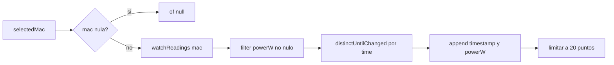
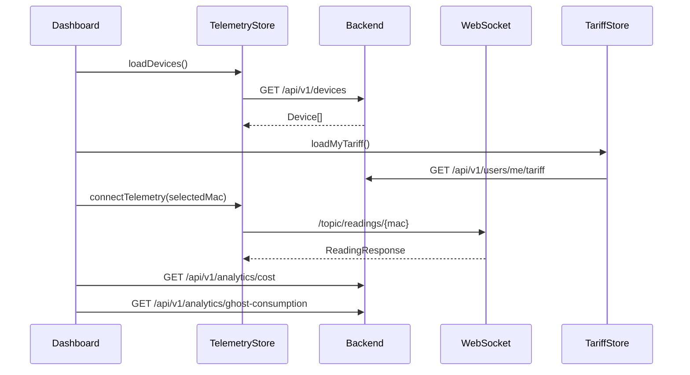

# Anexo B. Frontend Angular, RxJS y NgRx Signals

Este anexo documenta la parte frontend real de Wattimizer, ubicada en `frontend/src/app`. La aplicacion usa Angular standalone components, servicios inyectables, interceptores HTTP, NgRx Signals y RxJS.

## 1. Estructura general

| Carpeta | Responsabilidad |
| --- | --- |
| `components/` | Pantallas y componentes principales: login, registro, dashboard, dispositivos, tarifas, alertas y layout. |
| `services/` | Comunicacion con backend, WebSocket STOMP y gestion de sesion. |
| `store/` | Estado compartido con NgRx Signals. |
| `interfaces/` | Tipos TypeScript simetricos con los DTOs Java. |
| `guards/` | Proteccion de rutas autenticadas. |
| `interceptors/` | Insercion de cabeceras comunes y JWT. |

## 2. Rutas y proteccion de navegacion

El archivo `app.routes.ts` define tres rutas publicas:

- `/login`
- `/register`
- `/auth/oauth/callback`

El resto de pantallas viven dentro de `MainLayoutComponent` y estan protegidas por:

```ts
canActivate: [authGuard],
canActivateChild: [authGuard],
```

`auth.guard.ts` consulta `SessionStorageService.isLoggedIn()`. Si no hay token valido, devuelve un `UrlTree` a `/login`.

## 3. Gestion de sesion e interceptor HTTP

### 3.1. `SessionStorageService`

`SessionStorageService` guarda el token en `sessionStorage` bajo la clave `auth_token`.

Funciones principales:

| Metodo | Uso |
| --- | --- |
| `saveToken(token)` | Guarda el JWT despues de login o OAuth2. |
| `getToken()` | Lo usa el interceptor antes de cada peticion protegida. |
| `logout()` | Borra solo el token, respetando otros datos del navegador. |
| `isLoggedIn()` | Decodifica el JWT y comprueba `exp`. |
| `getAuthorities()` | Lee roles serializados en el claim `authorities`. |
| `hasRole(role)` | Permite condicionar UI para `ROLE_ADMIN` o `ROLE_USER`. |
| `getUsername()` | Extrae el usuario del token. |

### 3.2. `httpInterceptor`

El interceptor tiene dos responsabilidades:

1. Anadir `X-Requested-With: XMLHttpRequest` a todas las peticiones.
2. Anadir `Authorization: Bearer <token>` a rutas `/api/v1`, excepto login, registro y canje OAuth2.

Tambien captura `401`: borra la sesion y redirige a `/login`. Esto evita que el usuario siga navegando con un token caducado.

## 4. Servicios HTTP

### 4.1. `AuthService`

| Metodo | Endpoint | Entrada | Salida |
| --- | --- | --- | --- |
| `authentication(user)` | `POST /api/v1/auth/login` | `LoginUser` | `LoginUserJwt` |
| `register(user)` | `POST /api/v1/auth/register` | `RegisterRequest` | `void` |
| `exchangeOAuthTicket(ticket)` | `POST /api/v1/auth/oauth/exchange` | `{ ticket }` | `LoginUserJwt` |

El servicio no guarda el token por si mismo. Esa decision se deja a los componentes `LoginComponent` y `OAuthCallbackComponent`, porque son los que controlan la navegacion despues de autenticar.

### 4.2. `TariffService`

`TariffService` separa claramente dos areas:

- Catalogo maestro: `/api/v1/tariffs`
- Tarifa privada del usuario: `/api/v1/users/me/tariff`

| Metodo | Endpoint | Observacion |
| --- | --- | --- |
| `getCatalog()` | `GET /api/v1/tariffs` | Devuelve plantillas globales. |
| `getById(id)` | `GET /api/v1/tariffs/{id}` | Consulta una tarifa concreta. |
| `createCatalogTariff(payload)` | `POST /api/v1/tariffs` | Requiere `ROLE_ADMIN`. |
| `updateCatalogTariff(id, payload)` | `POST /api/v1/tariffs/{id}` | El backend actual usa `POST`, no `PUT`. |
| `deleteCatalogTariff(id)` | `DELETE /api/v1/tariffs/{id}` | Requiere `ROLE_ADMIN`. |
| `getMyTariff()` | `GET /api/v1/users/me/tariff` | Mapea `204` a `null`. |
| `saveMyTariff(payload)` | `POST /api/v1/users/me/tariff` | Clona/asigna/actualiza tarifa privada. |
| `unlinkMyTariff()` | `DELETE /api/v1/users/me/tariff` | Quita la tarifa privada. |

El tratamiento de `204` es importante porque Angular no debe mostrar error si el usuario todavia no tiene tarifa; simplemente debe desactivar las metricas de coste.

### 4.3. `WebsocketService`

`WebsocketService` encapsula `RxStomp`.

```ts
const protocol = window.location.protocol === "https:" ? "wss:" : "ws:";
const wsUrl = `${protocol}//${window.location.host}/ws-iot`;
```

La suscripcion real se hace por MAC:

```ts
watchReadings(macAddress: string): Observable<ReadingResponse> {
  const destination = `/topic/readings/${macAddress}`;
  return this.rxStomp
    .watch(destination)
    .pipe(map((message) => JSON.parse(message.body) as ReadingResponse));
}
```

Esta decision evita que el frontend reciba lecturas de todos los dispositivos y tenga que filtrarlas en cliente.

## 5. `TelemetryStore`

Archivo: `frontend/src/app/store/telemetry.store.ts`.

### 5.1. Estado

```ts
const initialState: TelemetryState = {
  devices: [],
  selectedMac: null,
  historicalReadings: {},
  isLoadingDevices: false,
};
```

`historicalReadings` es un diccionario por MAC:

```ts
{
  [mac: string]: {
    timestamps: string[];
    powerW: number[];
  }
}
```

Esta estructura se introdujo para soportar panel multi-dispositivo sin mezclar lecturas de medidores distintos.

### 5.2. Selector computado

`currentReadings` depende de `selectedMac`. Si hay MAC seleccionada, devuelve el historico de esa MAC; si no, devuelve arrays vacios.

Esto simplifica el dashboard: la grafica no necesita saber como esta organizado todo el historico, solo consume el historico activo.

### 5.3. Carga inicial de lecturas recientes

Cuando se selecciona una MAC, `loadRecentReadings(mac)` llama a:

```http
GET /api/v1/readings/device/{macAddress}/recent?seconds=120
```

Despues:

- descarta respuesta vacia;
- limita a las ultimas 20 lecturas;
- guarda `timestamps` y `powerW` bajo la MAC correspondiente.

### 5.4. Metodos con `rxMethod`

| Metodo | Endpoint o flujo | Efecto en estado |
| --- | --- | --- |
| `loadDevices()` | `GET /api/v1/devices` | Carga dispositivos, selecciona primera MAC si no habia seleccion previa. |
| `claimDevice(payload)` | `POST /api/v1/devices/claim` | Anade dispositivo fisico a `devices`. |
| `createSimulatedDevice(payload)` | `POST /api/v1/devices/simulated` | Anade simulador a `devices`. |
| `addDevice(newDevice)` | `POST /api/v1/devices` | Endpoint heredado de alta directa. |
| `updateDevice(updatedDevice)` | `PUT /api/v1/devices/{id}` | Sustituye el dispositivo modificado en memoria. |
| `deleteDevice(deviceId)` | `DELETE /api/v1/devices/{id}` | Elimina de la lista y recoloca `selectedMac`. |
| `connectTelemetry(mac)` | `WebsocketService.watchReadings(mac)` | Alimenta la grafica en vivo. |
| `reset()` | Sin HTTP | Vuelve al estado inicial al cerrar sesion. |

### 5.5. Flujo RxJS de telemetria en vivo



Operadores usados:

- `distinctUntilChanged()`: evita reconectar si la MAC no cambia.
- `switchMap()`: cancela la suscripcion anterior cuando se selecciona otro medidor.
- `filter()`: evita pintar lecturas incompletas.
- `distinctUntilChanged((prev, curr) => prev.time === curr.time)`: elimina duplicados exactos.
- `tap()`: actualiza estado con `patchState`.

## 6. `TariffStore`

Archivo: `frontend/src/app/store/tariff.store.ts`.

### 6.1. Estado

```ts
interface TariffState {
  catalog: TariffResponse[];
  myTariff: TariffResponse | null;
  isLoadingCatalog: boolean;
  isLoadingMyTariff: boolean;
  errorMessage: string | null;
}
```

### 6.2. Selectores

| Selector | Uso |
| --- | --- |
| `hasMyTariff` | Habilita o bloquea metricas economicas en dashboard. |
| `isCatalogEmpty` | Muestra estado vacio en pantalla de tarifas. |

### 6.3. Metodos principales

| Metodo | Funcion |
| --- | --- |
| `loadCatalog()` | Recupera plantillas globales. |
| `loadMyTariff()` | Recupera tarifa privada, aceptando `null`. |
| `saveMyTariff(payload)` | Guarda tarifa privada y actualiza `myTariff`. |
| `unlinkMyTariff()` | Borra tarifa privada localmente tras confirmacion del backend. |
| `refreshAfterCatalogMutation()` | Recarga catalogo despues de cambios administrativos. |
| `setCatalogTariff`, `addToCatalog`, `removeFromCatalog` | Mutaciones sincronas despues de respuestas del backend. |
| `patchMyTariff` | Actualiza tarifa privada desde un componente cuando se usa el servicio directo. |
| `reset()` | Limpieza al cerrar sesion. |

El store usa `catchError(() => EMPTY)` para cortar flujos fallidos despues de guardar el mensaje de error en estado. Asi se evita que un error HTTP rompa la cadena reactiva.

## 7. Componentes principales

### 7.1. `DashboardComponent`

Archivos:

- `components/dashboard/dashboard.component.ts`
- `components/dashboard/dashboard.html`

Responsabilidades:

- Cargar dispositivos con `TelemetryStore.loadDevices()`.
- Cargar tarifa privada con `TariffStore.loadMyTariff()`.
- Conectar WebSocket a la MAC seleccionada.
- Solicitar analiticas si el usuario tiene tarifa.
- Construir datos de Chart.js a partir de signals.

Flujo principal:



El coste se calcula desde el inicio del dia local del navegador hasta `now`. Si no hay tarifa, el dashboard muestra placeholders y un mensaje para ir a configurar la tarifa.

### 7.2. `DevicesComponent`

Archivos:

- `components/devices/devices.component.ts`
- `components/devices/devices.html`

El formulario de alta tiene un selector de tipo:

- `physical`: exige MAC con regex `^[0-9A-Fa-f]{12}$`.
- `simulated`: deshabilita MAC y exige `simulationProfile`.

Endpoints usados directamente:

| Accion UI | Endpoint |
| --- | --- |
| Registrar fisico | `POST /api/v1/devices/claim` |
| Crear simulado | `POST /api/v1/devices/simulated` |
| Anadir pack demo | `POST /api/v1/devices/simulated/demo-pack` |
| Eliminar dispositivo | `DELETE /api/v1/devices/{id}` |
| Conmutar estado | `PUT /api/v1/devices/{id}` |
| Editar nombre/perfil | `PUT /api/v1/devices/{id}` |

Aunque `TelemetryStore` tambien tiene metodos para dispositivos, este componente usa `HttpClient` directo en varias acciones para controlar mensajes de exito/error y loaders locales.

### 7.3. `TariffComponent`

Archivo: `components/tariff/tariff.component.ts`.

Este componente construye un formulario reactivo tipado para tarifas. La clave esta en que los arrays de periodos dependen del peaje:

| Peaje | Periodos energia | Periodos potencia |
| --- | --- | --- |
| `2.0TD` | `P1`, `P2`, `P3` | `P1`, `P2` |
| `3.0TD` | `P1` a `P6` | `P1` a `P6` |
| `6.1TD` | `P1` a `P6` | `P1` a `P6` |
| `6.2TD` | `P1` a `P6` | `P1` a `P6` |

El validador `ascendingPowerValidator` comprueba que las potencias contratadas no bajen de un periodo al siguiente.

Decision importante: al editar la tarifa privada del usuario se deshabilitan campos estructurales (`name`, `market`, `accessTariffCode`, `geographicZone`, `energyCompany`). El usuario modifica precios y potencias, pero no cambia la estructura base del contrato desde ese modo.

### 7.4. `AlertsComponent`

El componente carga:

```http
GET /api/v1/alerts
```

y borra con:

```http
DELETE /api/v1/alerts/{id}
```

Usa signals locales para lista, loading, error y mensaje de exito. Los mensajes se limpian con `effect()` y temporizadores.

## 8. Interfaces TypeScript y simetria con backend

| Interface | DTO Java equivalente |
| --- | --- |
| `Device` | `DeviceDto` |
| `ClaimDeviceRequest` | Uso parcial de `DeviceDto` en `/claim` |
| `CreateSimulatedDeviceRequest` | `CreateSimulatedDeviceRequest` |
| `ReadingResponse` | `ReadingResponse` |
| `TariffRequest` / `TariffResponse` | `TariffDto` |
| `UserTariffRequest` | `UserTariffRequest` |
| `Alert` | `AlertDto` |

Esta simetria reduce errores de integracion porque los nombres de campos en TypeScript coinciden con los records de Java.

## 9. Pruebas frontend existentes

| Archivo | Cobertura principal |
| --- | --- |
| `devices.component.spec.ts` | Validaciones de alta fisica/simulada y endpoints enviados. |
| `dashboard.component.spec.ts` | Construccion y comportamiento del dashboard. |
| `tariff.component.spec.ts` | Formulario de tarifas y comportamiento de pantalla. |
| `tariff.service.spec.ts` | Servicio HTTP de tarifas. |
| `session-storage.service.spec.ts` | Guardado, lectura y validacion de token. |
| `app.spec.ts` | Arranque basico de la aplicacion. |

Estas pruebas son utiles porque validan la parte mas sensible de Angular: que el formulario mande exactamente el endpoint y payload que espera el backend.
