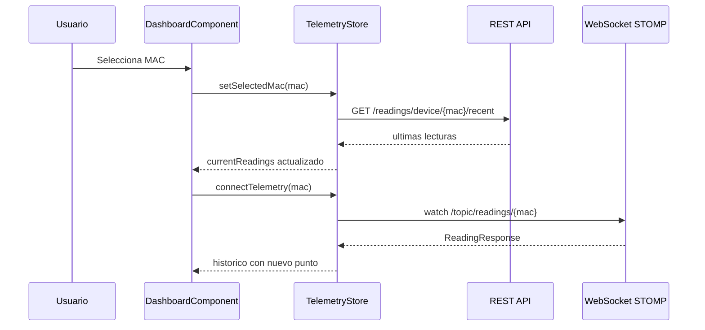

# Anexo B. Frontend Angular, RxJS y NgRx Signals

## 1. Vision general del frontend

El frontend esta desarrollado con **Angular 21** usando componentes standalone. La interfaz se apoya en PrimeNG para componentes visuales y Chart.js para la grafica principal de potencia.

La gestion de estado se divide en dos stores con **NgRx Signals**:

- `TelemetryStore`: dispositivos, MAC seleccionada, historico reciente y WebSocket.
- `TariffStore`: catalogo de tarifas, tarifa privada del usuario y estados de carga/error.

Esta division evita que el dashboard tenga que conocer todos los detalles de HTTP, STOMP o estructura de formularios. Los componentes consumen senales y ejecutan metodos del store.

## 2. Estructura principal

| Elemento | Archivo | Responsabilidad |
| --- | --- | --- |
| Dashboard | `components/dashboard/dashboard.component.ts` | Grafica, selector multi-dispositivo, coste diario y consumo fantasma. |
| Dispositivos | `components/devices/devices.component.ts` | Alta fisica, simuladores, pack demo, edicion, encendido/apagado y borrado. |
| Tarifas | `components/tariff/tariff.component.ts` | Catalogo admin y tarifa privada de usuario. |
| Alertas | `components/alerts/alerts.component.ts` | Lista y descarte de alertas. |
| Autenticacion | `services/auth.service.ts` | Login, registro e intercambio OAuth2. |
| Telemetria | `store/telemetry.store.ts` | Estado reactivo de dispositivos y lecturas. |
| Tarifas | `store/tariff.store.ts` | Estado reactivo de catalogo y contrato privado. |
| WebSocket | `services/websocket.service.ts` | Conexion STOMP a `/ws-iot`. |

## 3. Servicios Angular

### 3.1. AuthService

Archivo: `frontend/src/app/services/auth.service.ts`

| Metodo | Endpoint | Devuelve | Uso |
| --- | --- | --- | --- |
| `authentication(user)` | `POST /api/v1/auth/login` | `Observable<LoginUserJwt>` | Inicio de sesion con JWT. |
| `register(user)` | `POST /api/v1/auth/register` | `Observable<void>` | Registro de usuario normal. |
| `exchangeOAuthTicket(ticket)` | `POST /api/v1/auth/oauth/exchange` | `Observable<LoginUserJwt>` | Convierte ticket OAuth2 en JWT. |

El servicio no guarda directamente el token. Su responsabilidad se limita a llamar a la API y devolver el observable para que el flujo de autenticacion decida como persistir la sesion.

### 3.2. TariffService

Archivo: `frontend/src/app/services/tariff.service.ts`

El servicio separa dos familias de endpoints:

**Catalogo maestro**

```ts
getCatalog(): Observable<TariffResponse[]>
getById(id: number): Observable<TariffResponse>
createCatalogTariff(payload: TariffRequest): Observable<TariffResponse>
updateCatalogTariff(id: number, payload: TariffRequest): Observable<TariffResponse>
deleteCatalogTariff(id: number): Observable<void>
```

**Tarifa privada**

```ts
getMyTariff(): Observable<TariffResponse | null>
saveMyTariff(payload: UserTariffRequest): Observable<TariffResponse>
unlinkMyTariff(): Observable<void>
```

La decision mas importante esta en `getMyTariff()`: el backend puede devolver `204 No Content` cuando el usuario no tiene tarifa. Angular convierte ese caso en `null` para que los componentes puedan usar una condicion sencilla (`hasMyTariff`).

### 3.3. WebsocketService

Archivo: `frontend/src/app/services/websocket.service.ts`

```ts
watchReadings(macAddress: string): Observable<ReadingResponse>
```

El servicio crea una instancia de `RxStomp` y calcula la URL segun el protocolo actual:

- `ws://` si la pagina esta en HTTP.
- `wss://` si la pagina esta en HTTPS.

La ruta final es `/ws-iot`, que coincide con `StompWebSocketConfig` en el backend. Cada dispositivo se escucha en:

```text
/topic/readings/{macAddress}
```

## 4. TelemetryStore

Archivo: `frontend/src/app/store/telemetry.store.ts`

### 4.1. Estado

```ts
interface TelemetryState {
  devices: Device[];
  selectedMac: string | null;
  historicalReadings: {
    [mac: string]: {
      timestamps: string[];
      powerW: number[];
    };
  };
  isLoadingDevices: boolean;
}
```

El historico se guarda por MAC. Esto permite cambiar de dispositivo sin mezclar lecturas de enchufes distintos.

### 4.2. Selector calculado

```ts
currentReadings: computed(() => {
  const mac = state.selectedMac();
  return mac
    ? (state.historicalReadings()[mac] ?? { timestamps: [], powerW: [] })
    : { timestamps: [], powerW: [] };
})
```

Este computed permite que el dashboard no filtre manualmente. Si hay una MAC seleccionada, devuelve su serie; si no, devuelve arrays vacios seguros para Chart.js.

### 4.3. Metodos reactivos

| Metodo | Tipo | Funcion |
| --- | --- | --- |
| `setSelectedMac(mac)` | Sincrono | Cambia la MAC y carga lecturas recientes. |
| `loadRecentReadings(mac)` | HTTP directo | Consulta `/api/v1/readings/device/{mac}/recent?seconds=120`. |
| `loadDevices` | `rxMethod<void>` | Carga dispositivos y selecciona la primera MAC si no habia seleccion previa. |
| `claimDevice` | `rxMethod<ClaimDeviceRequest>` | Reclama un dispositivo fisico. |
| `createSimulatedDevice` | `rxMethod<CreateSimulatedDeviceRequest>` | Crea simulador por perfil. |
| `addDevice` | `rxMethod<{name, macAddress}>` | Alta directa de dispositivo. |
| `updateDevice` | `rxMethod<Device>` | Actualiza dispositivo. |
| `deleteDevice` | `rxMethod<number>` | Elimina dispositivo y ajusta `selectedMac`. |
| `connectTelemetry` | `rxMethod<string \| null>` | Suscripcion WebSocket reactiva por MAC. |
| `reset` | Sincrono | Limpia estado al cerrar sesion. |

### 4.4. Uso de RxJS en telemetria

El metodo mas importante es `connectTelemetry`:

```ts
connectTelemetry: rxMethod<string | null>(
  pipe(
    distinctUntilChanged(),
    switchMap((mac) => {
      if (!mac) return of(null);
      return wsService.watchReadings(mac).pipe(
        filter((r) => (r.powerW as number | null | undefined) != null),
        distinctUntilChanged((prev, curr) => prev.time === curr.time),
        tap({ next: (reading) => { /* actualiza historico */ } }),
      );
    }),
  ),
)
```

La logica tiene tres decisiones importantes:

1. `distinctUntilChanged()` evita reconectar al mismo topic si la MAC no cambia.
2. `switchMap()` cancela la suscripcion anterior al cambiar de dispositivo.
3. El segundo `distinctUntilChanged()` deduplica lecturas con el mismo timestamp, util cuando el backend puede emitir desde canales distintos.

El store limita la grafica a 20 puntos. No es un limite de base de datos, sino una decision de UX para mantener el dashboard legible.

## 5. TariffStore

Archivo: `frontend/src/app/store/tariff.store.ts`

### 5.1. Estado

```ts
interface TariffState {
  catalog: TariffResponse[];
  myTariff: TariffResponse | null;
  isLoadingCatalog: boolean;
  isLoadingMyTariff: boolean;
  errorMessage: string | null;
}
```

### 5.2. Computed signals

| Computed | Significado |
| --- | --- |
| `hasMyTariff` | `true` si el usuario tiene tarifa privada. |
| `isCatalogEmpty` | `true` si el catalogo no contiene plantillas. |

### 5.3. Metodos

| Metodo | Funcion |
| --- | --- |
| `loadCatalog` | Carga plantillas globales. |
| `loadMyTariff` | Carga contrato privado o `null`. |
| `saveMyTariff` | Guarda contrato privado desde plantilla o payload directo. |
| `unlinkMyTariff` | Desvincula tarifa privada. |
| `refreshAfterCatalogMutation` | Recarga catalogo tras mutacion admin. |
| `setCatalogTariff`, `addToCatalog`, `removeFromCatalog` | Actualizaciones sincronas para no recargar toda la pagina. |
| `patchMyTariff` | Actualiza tarifa privada tras guardar formulario. |
| `reset` | Limpia estado al cerrar sesion. |

Los metodos HTTP usan `catchError(() => EMPTY)` en varios casos. Esto evita que un error cierre el flujo del store y permite reflejar el problema en `errorMessage`.

## 6. DashboardComponent

Archivo: `frontend/src/app/components/dashboard/dashboard.component.ts`

### 6.1. Datos consumidos

El dashboard inyecta:

```ts
readonly store = inject(TelemetryStore);
readonly tariffStore = inject(TariffStore);
```

Usa senales del store:

- `devices`
- `selectedMac`
- `currentReadings`
- `hasMyTariff`

### 6.2. Grafica

La grafica usa Chart.js. Los datos se construyen con computed signals:

```ts
readonly powerW = computed(() => this.historicalData().powerW);
readonly formattedTime = computed(() =>
  this.timestamps().map((ts) =>
    new Date(ts).toLocaleTimeString("es-ES", TIME_OPTIONS),
  ),
);
```

`chartData` depende de `powerW` y `formattedTime`, por lo que Angular recalcula la grafica cuando llega una lectura nueva.

### 6.3. Efectos

El constructor contiene tres `effect()`:

1. Ocultar errores de analitica tras 8 segundos.
2. Cargar historico, conectar WebSocket y calcular metricas al cambiar la MAC.
3. Resetear metricas si no hay tarifa, o recalcularlas cuando se configura una tarifa.

### 6.4. Analitica

`loadAnalyticsMetrics(macAddress)` calcula el inicio del dia local y llama a:

- `GET /api/v1/analytics/cost`
- `GET /api/v1/analytics/ghost-consumption`

Solo se ejecuta si hay tarifa privada. Esta decision evita pedir costes cuando el backend no tiene precios para convertir kWh en euros.

## 7. DevicesComponent

Archivo: `frontend/src/app/components/devices/devices.component.ts`

### 7.1. Formulario de alta

El formulario permite dos tipos:

- `physical`: requiere MAC de 12 caracteres hexadecimales.
- `simulated`: desactiva MAC y exige `simulationProfile`.

La funcion `applyDeviceKindValidators(kind)` cambia validadores segun el tipo seleccionado. Esto evita mostrar campos irrelevantes: un simulador no necesita MAC manual porque el backend genera una con prefijo `SIM`.

### 7.2. Operaciones principales

| Accion UI | Endpoint |
| --- | --- |
| Registrar fisico | `POST /api/v1/devices/claim` |
| Crear simulador | `POST /api/v1/devices/simulated` |
| Crear pack demo | `POST /api/v1/devices/simulated/demo-pack` |
| Eliminar | `DELETE /api/v1/devices/{id}` |
| Encender/apagar | `PUT /api/v1/devices/{id}` |
| Editar nombre/perfil | `PUT /api/v1/devices/{id}` |

Los mensajes de exito y error se guardan en signals y se limpian con `effect()` y `setTimeout`. Esto mantiene la UI reactiva sin depender de variables globales.

## 8. TariffComponent

Archivo: `frontend/src/app/components/tariff/tariff.component.ts`

### 8.1. Formulario reactivo tipado

El formulario modela directamente el DTO del backend:

```ts
readonly tariffForm = this.fb.group({
  id: this.fb.control<number | null>(null),
  name: ["", [Validators.required, Validators.minLength(3)]],
  market: ["libre", Validators.required],
  accessTariffCode: this.fb.control<AccessTariffCode>("2.0TD", Validators.required),
  geographicZone: this.fb.control("PENINSULA", Validators.required),
  energyCompany: ["", Validators.required],
  periods: this.fb.array<FormGroup<PeriodFormGroup>>([], Validators.required),
  contractedPowers: this.fb.array<FormGroup<ContractedPowerFormGroup>>(
    [],
    [Validators.required, ascendingPowerValidator],
  ),
});
```

### 8.2. Periodos por peaje

El componente define los periodos exigidos por cada peaje:

| Peaje | Energia | Potencia |
| --- | --- | --- |
| `2.0TD` | P1, P2, P3 | P1, P2 |
| `3.0TD` | P1-P6 | P1-P6 |
| `6.1TD` | P1-P6 | P1-P6 |
| `6.2TD` | P1-P6 | P1-P6 |

Cuando cambia `accessTariffCode`, `rebuildPeriodArrays()` reconstruye los arrays de precios y potencias. Al cargar una tarifa existente se usa `{ emitEvent: false }` para evitar que el cambio de peaje dispare esa reconstruccion y borre los valores reales.

### 8.3. Modo admin y modo usuario

El componente diferencia dos contextos:

- **Catalogo admin:** crear, editar y borrar plantillas globales.
- **Tarifa privada:** asignar plantilla, editar precios/potencias propios y desvincular.

En modo tarifa privada se desactivan campos estructurales (`name`, `market`, `accessTariffCode`, `geographicZone`, `energyCompany`) para que el usuario solo modifique precios y potencias. El motivo es mantener coherencia con la plantilla que ha elegido.

## 9. AlertsComponent

Archivo: `frontend/src/app/components/alerts/alerts.component.ts`

El componente es sencillo:

- Carga alertas con `GET /api/v1/alerts`.
- Guarda la lista en `alertsList`.
- Descarta una alerta con `DELETE /api/v1/alerts/{id}`.

La autorizacion no se comprueba en el cliente. El backend elimina solo si la alerta pertenece al usuario (`deleteByIdAndUserUsername`).

## 10. Flujo reactivo completo



## 11. DTOs TypeScript principales

```ts
export interface Device {
  id: number;
  username: string;
  name: string;
  macAddress: string;
  isOn: boolean;
  simulated: boolean;
  simulationProfile: SimulationProfile | null;
}

export interface ReadingResponse {
  time: string | number;
  macAddress: string;
  powerW: number;
  energyTotalKwh: number;
  isOn: boolean;
}

export interface UserTariffRequest {
  templateTariffId: number | null;
  contract: TariffRequest | null;
}
```

## 12. Observaciones tecnicas

- El frontend no usa SSE; las actualizaciones en vivo se realizan por STOMP sobre WebSocket.
- `DeviceService` contiene un `httpResource` para `/api/v1/devices`, pero el flujo activo de la aplicacion se concentra en `TelemetryStore`.
- La grafica no consulta toda la hypertable: pide una ventana reciente y mantiene los ultimos 20 puntos en memoria.
- El usuario puede trabajar sin tarifa configurada; en ese caso hay telemetria, pero las metricas economicas quedan desactivadas.
