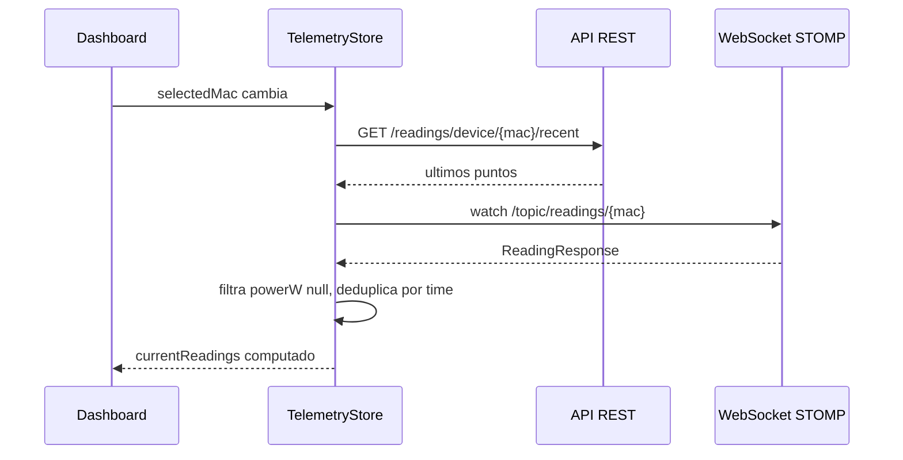
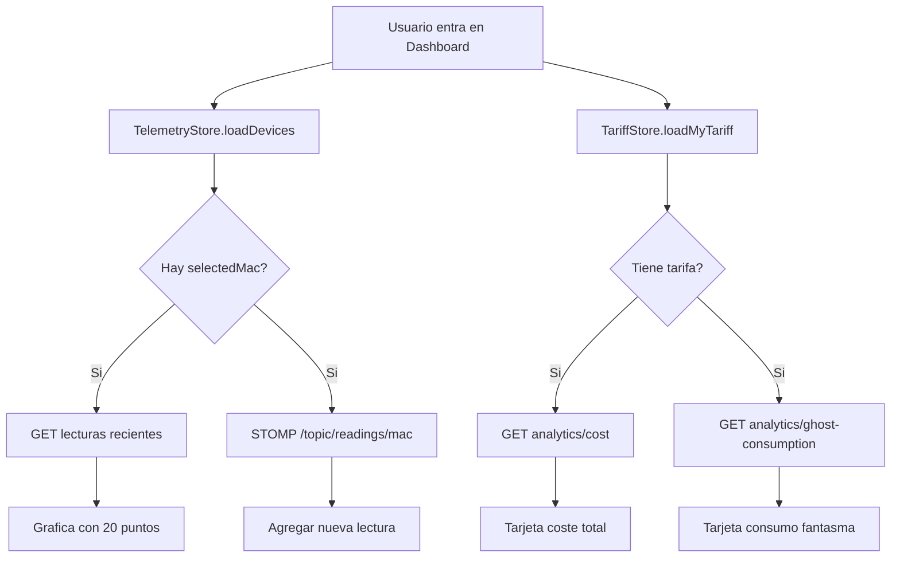

# Anexo B: Componentes, servicios y estado Angular

Este anexo describe el frontend de Wattimizer. La aplicacion esta construida con Angular 21, componentes standalone, rutas con carga perezosa, PrimeNG para la interfaz, Chart.js para graficas y NgRx Signals para el estado principal.

## 1. Estructura general

Directorio base: `frontend/src/app`.

| Carpeta | Contenido |
|---|---|
| `components/` | Pantallas principales: login, registro, dashboard, dispositivos, tarifas, alertas, layout y callback OAuth. |
| `services/` | Servicios de autenticacion, tarifas, WebSocket y sesion. |
| `store/` | Stores de NgRx Signals: `TelemetryStore` y `TariffStore`. |
| `interfaces/` | Contratos TypeScript equivalentes a DTOs Java. |
| `guards/` | `auth.guard.ts`, proteccion de rutas privadas. |
| `interceptors/` | Interceptor HTTP para JWT y control de errores 401. |

La configuracion global de Angular vive en `app.config.ts` y las rutas en `app.routes.ts`.

## 2. Rutas y componentes

| Ruta | Componente | Funcion |
|---|---|---|
| `/login` | `LoginComponent` | Formulario de acceso y botones OAuth2. |
| `/register` | `RegisterComponent` | Alta de cuenta de usuario. |
| `/auth/oauth/callback` | `OAuthCallbackComponent` | Intercambia el ticket OAuth por JWT. |
| `/dashboard` | `DashboardComponent` | Grafica de potencia, selector de medidor y analiticas. |
| `/devices` | `DevicesComponent` | Alta fisica/simulada, demo-pack, edicion y borrado. |
| `/tariffs` | `TariffComponent` | Catalogo admin y tarifa privada del usuario. |
| `/alerts` | `AlertsComponent` | Listado y descarte de alertas. |

Las rutas privadas cuelgan de `MainLayoutComponent`, que aplica `canActivate` y `canActivateChild` con `authGuard`. Esto significa que no solo se comprueba el acceso al entrar al layout, sino tambien al navegar entre secciones internas.

## 3. Gestion de sesion

### `SessionStorageService`

Archivo: `services/session-storage.service.ts`

Guarda el JWT en `sessionStorage` con la clave `auth_token`. Se usa `jwt-decode` para:

- Comprobar si el token existe.
- Validar `exp` antes de considerar la sesion activa.
- Leer roles desde el claim `authorities`, que llega como cadena separada por comas.
- Obtener el nombre de usuario para mostrar informacion de sesion.

La decision de usar `sessionStorage` reduce el riesgo de que una sesion quede persistida indefinidamente en un equipo compartido. Al cerrar sesion se borra solo la clave del token, no todo el almacenamiento del navegador.

### Interceptor HTTP

Archivo: `interceptors/http.interceptor.ts`

Responsabilidades:

1. Anade `X-Requested-With: XMLHttpRequest`.
2. Adjunta `Authorization: Bearer <token>` a rutas `/api/v1`, excepto login, registro y OAuth exchange.
3. Ante un `401`, ejecuta logout y redirige a `/login`.

Este interceptor evita repetir la logica de autorizacion en cada servicio Angular.

## 4. Servicios Angular

### `AuthService`

Archivo: `services/auth.service.ts`

| Metodo | Endpoint | Descripcion |
|---|---|---|
| `authentication(user)` | `POST /api/v1/auth/login` | Envia credenciales y recibe `LoginUserJwt`. |
| `register(user)` | `POST /api/v1/auth/register` | Registra usuario normal. |
| `exchangeOAuthTicket(ticket)` | `POST /api/v1/auth/oauth/exchange` | Cambia ticket temporal por JWT. |

### `TariffService`

Archivo: `services/tariff.service.ts`

Gestiona tanto el catalogo maestro como la tarifa privada del usuario.

| Metodo | Endpoint | Nota |
|---|---|---|
| `getCatalog()` | `GET /api/v1/tariffs` | Devuelve plantillas del catalogo. |
| `getById(id)` | `GET /api/v1/tariffs/{id}` | Consulta una tarifa concreta. |
| `createCatalogTariff(payload)` | `POST /api/v1/tariffs` | Solo admin. |
| `updateCatalogTariff(id, payload)` | `POST /api/v1/tariffs/{id}` | El backend actualiza con POST, no con PUT. |
| `deleteCatalogTariff(id)` | `DELETE /api/v1/tariffs/{id}` | Solo admin. |
| `getMyTariff()` | `GET /api/v1/users/me/tariff` | Mapea `204 No Content` a `null`. |
| `saveMyTariff(payload)` | `POST /api/v1/users/me/tariff` | Guarda tarifa privada. |
| `unlinkMyTariff()` | `DELETE /api/v1/users/me/tariff` | Desvincula la tarifa del usuario. |

La conversion de `204` a `null` es importante porque simplifica la UI: el componente puede preguntar si `myTariff` existe sin tratar excepciones.

### `WebsocketService`

Archivo: `services/websocket.service.ts`

Usa `@stomp/rx-stomp` para conectarse al mismo host desde el que se sirve Angular:

```ts
const protocol = window.location.protocol === "https:" ? "wss:" : "ws:";
const wsUrl = `${protocol}//${window.location.host}/ws-iot`;
```

El servicio expone:

```ts
watchReadings(macAddress: string): Observable<ReadingResponse>
```

Internamente se suscribe a `/topic/readings/{macAddress}` y parsea el cuerpo JSON como `ReadingResponse`. El uso de `ws` o `wss` segun el protocolo actual permite que el mismo codigo funcione en local y produccion con HTTPS.

### `DeviceService`

Archivo: `services/device.service.ts`

Define un `httpResource<Device[]>` hacia `/api/v1/devices`, pero el codigo actual no lo usa de forma principal. La gestion real de dispositivos esta en `TelemetryStore` y, en varios casos, directamente en `DevicesComponent`. Esta duplicidad es una deuda tecnica pequena: funciona, pero convendria unificarla si el proyecto creciera.

## 5. Estado con NgRx Signals

### `TelemetryStore`

Archivo: `store/telemetry.store.ts`

Estado inicial:

```ts
const initialState: TelemetryState = {
  devices: [],
  selectedMac: null,
  historicalReadings: {},
  isLoadingDevices: false,
};
```

`historicalReadings` se indexa por MAC. Esta decision permite cambiar de dispositivo sin mezclar puntos de graficas distintas.

#### Computed signals

| Computed | Funcion |
|---|---|
| `currentReadings` | Devuelve timestamps y potencia de la MAC seleccionada. Si no hay MAC, devuelve arrays vacios. |

#### Metodos principales

| Metodo | Tipo | Comportamiento |
|---|---|---|
| `setSelectedMac(mac)` | Sincrono | Actualiza la MAC y carga historial reciente. |
| `loadRecentReadings(mac)` | HTTP directo | Pide `/api/v1/readings/device/{mac}/recent?seconds=120` y conserva los ultimos 20 puntos. |
| `loadDevices` | `rxMethod<void>` | Carga `/api/v1/devices`; selecciona la primera MAC si no habia una elegida. |
| `claimDevice` | `rxMethod<ClaimDeviceRequest>` | Reclama un dispositivo fisico y lo agrega al estado. |
| `createSimulatedDevice` | `rxMethod<CreateSimulatedDeviceRequest>` | Crea simulador y lo agrega al estado. |
| `addDevice` | `rxMethod` | Alta directa legacy de dispositivo. |
| `updateDevice` | `rxMethod<Device>` | Actualiza dispositivo en backend y sustituye el elemento en memoria. |
| `deleteDevice` | `rxMethod<number>` | Borra dispositivo y recalcula `selectedMac`. |
| `connectTelemetry` | `rxMethod<string \| null>` | Escucha lecturas STOMP segun la MAC seleccionada. |
| `reset` | Sincrono | Devuelve el estado al inicial al cerrar sesion. |

#### Flujo RxJS de telemetria



Operadores utilizados:

- `switchMap`: cancela el flujo anterior cuando cambia la MAC.
- `distinctUntilChanged`: evita reconexiones si la MAC no cambia.
- `filter`: descarta lecturas sin `powerW`.
- `tap`: aplica efectos sobre el estado con `patchState`.
- `of(null)`: mantiene el pipeline vivo cuando no hay MAC seleccionada.

La grafica se limita a 20 puntos para que el dashboard siga siendo legible y no crezca indefinidamente en memoria.

### `TariffStore`

Archivo: `store/tariff.store.ts`

Estado:

```ts
interface TariffState {
  catalog: TariffResponse[];
  myTariff: TariffResponse | null;
  isLoadingCatalog: boolean;
  isLoadingMyTariff: boolean;
  errorMessage: string | null;
}
```

#### Computed signals

| Computed | Funcion |
|---|---|
| `hasMyTariff` | Indica si el usuario tiene tarifa privada. |
| `isCatalogEmpty` | Indica si el catalogo esta vacio. |

#### Metodos

| Metodo | Comportamiento |
|---|---|
| `loadCatalog` | Carga el catalogo maestro. |
| `loadMyTariff` | Carga la tarifa del usuario, con `null` si no existe. |
| `saveMyTariff` | Guarda tarifa privada mediante `UserTariffRequest`. |
| `unlinkMyTariff` | Desvincula la tarifa. |
| `refreshAfterCatalogMutation` | Recarga catalogo tras mutaciones. |
| `setCatalogTariff`, `addToCatalog`, `removeFromCatalog` | Mutaciones sincronas tras respuestas admin. |
| `patchMyTariff` | Actualiza la tarifa privada en memoria. |
| `clearError`, `reset` | Limpieza de errores y estado. |

El store usa `catchError(() => EMPTY)` para cortar el flujo cuando falla una peticion sin romper la suscripcion del `rxMethod`.

## 6. Componentes principales

### `DashboardComponent`

Archivo: `components/dashboard/dashboard.component.ts`

Responsabilidades:

- Cargar dispositivos con `TelemetryStore.loadDevices`.
- Cargar tarifa privada con `TariffStore.loadMyTariff`.
- Reaccionar a `selectedMac` para cargar historial y conectar WebSocket.
- Mostrar grafica de potencia activa con PrimeNG Chart/Chart.js.
- Calcular coste diario y consumo fantasma si el usuario tiene tarifa.

Analiticas consumidas:

| Endpoint | Estado local |
|---|---|
| `GET /api/v1/analytics/cost` | `totalCostEur` |
| `GET /api/v1/analytics/ghost-consumption` | `ghostCostEur` |

El rango se calcula desde el inicio del dia local hasta el momento actual. Esto hace que el dashboard sea una vista diaria, no un historico completo.

### `DevicesComponent`

Archivo: `components/devices/devices.component.ts`

Permite trabajar con dispositivos fisicos y simulados. El formulario tiene un selector `deviceKind`:

- `physical`: exige MAC con patron de 12 caracteres hexadecimales.
- `simulated`: desactiva el campo MAC y exige `simulationProfile`.

Flujos principales:

| Accion | Endpoint |
|---|---|
| Reclamar fisico | `POST /api/v1/devices/claim` |
| Crear simulado | `POST /api/v1/devices/simulated` |
| Crear demo-pack | `POST /api/v1/devices/simulated/demo-pack` |
| Cambiar estado | `PUT /api/v1/devices/{id}` |
| Editar nombre/perfil | `PUT /api/v1/devices/{id}` |
| Borrar | `DELETE /api/v1/devices/{id}` |

Los mensajes de exito y error se limpian con `effect()` y temporizadores. Esto evita que las alertas visuales queden fijas despues de una operacion.

### `TariffComponent`

Archivo: `components/tariff/tariff.component.ts`

Es el componente mas complejo del frontend. Gestiona dos casos:

1. Catalogo maestro para administradores.
2. Tarifa privada para cualquier usuario autenticado.

Define periodos segun peaje:

```ts
const ENERGY_PERIODS = {
  "2.0TD": ["P1", "P2", "P3"],
  "3.0TD": ["P1", "P2", "P3", "P4", "P5", "P6"],
  "6.1TD": ["P1", "P2", "P3", "P4", "P5", "P6"],
  "6.2TD": ["P1", "P2", "P3", "P4", "P5", "P6"],
};
```

La potencia contratada tiene un validador propio, `ascendingPowerValidator`, que impide que una potencia posterior sea menor que la anterior. Esta regla replica la validacion del backend para dar feedback antes de enviar el formulario.

Decision importante: al cargar una tarifa existente, se usa `{ emitEvent: false }` para evitar que `accessTariffCode.valueChanges` reconstruya los arrays y borre los valores reales cargados desde backend.

### `AlertsComponent`

Archivo: `components/alerts/alerts.component.ts`

Estado local con signals:

- `alertsList`
- `isLoading`
- `errorMessage`
- `successMessage`

Consume:

- `GET /api/v1/alerts`
- `DELETE /api/v1/alerts/{id}`

No usa store global porque el listado de alertas es una pantalla sencilla y no se comparte con otros componentes salvo el posible aviso en tiempo real del backend.

### `MainLayoutComponent`

El layout autenticado contiene navegacion y salida de sesion. Al hacer logout:

- Se limpia el token.
- Se reinician stores para evitar datos cacheados de otro usuario.
- Se navega a `/login`.

Esta limpieza es relevante en equipos compartidos o durante pruebas con varias cuentas.

## 7. Interfaces TypeScript

| Archivo | Relacion con backend |
|---|---|
| `device.interface.ts` | Simetrico con `DeviceDto` y `CreateSimulatedDeviceRequest`. |
| `reading-response.interface.ts` | Simetrico con `ReadingResponse`. |
| `telemetry-state.interface.ts` | Estado interno del dashboard. |
| `tariff-request.interface.ts` | Simetrico con `TariffDto`, `PeriodDto`, `TariffContractedPowerDto` y `UserTariffRequest`. |
| `energy-cost-response.interface.ts` | Respuesta de `/analytics/cost`. |
| `ghost-cost-response.interface.ts` | Respuesta de `/analytics/ghost-consumption`. |
| `simulation-profile.interface.ts` | Union TypeScript equivalente a `SimulationProfile` Java. |
| `alert.interface.ts` | Simetrico con `AlertDto`. |
| `login-user.interface.ts`, `login-user-jwt.interface.ts`, `register-request.interface.ts` | Contratos de autenticacion. |

## 8. Flujo de datos del dashboard



## 9. Decisiones y deudas tecnicas

- El estado de telemetria se centraliza en `TelemetryStore`, pero `DevicesComponent` todavia hace varias llamadas HTTP directas. Funciona, aunque una capa unica de servicio/store simplificaria mantenimiento.
- `DeviceService` existe con `httpResource`, pero no es el camino principal de la aplicacion actual.
- `TariffComponent` combina store y llamadas directas a `TariffService` para poder controlar mensajes de exito/error con precision.
- `AlertsComponent` y las analiticas del dashboard usan signals locales porque no necesitan estado compartido amplio.
- El WebSocket solo documenta lecturas en frontend. El backend tambien puede emitir alertas por STOMP, pero la pantalla de alertas actual refresca por REST.

## 10. Relacion con historias de usuario

| Historia | Componente / servicio |
|---|---|
| Login y registro | `LoginComponent`, `RegisterComponent`, `AuthService`, `SessionStorageService` |
| Dispositivos fisicos | `DevicesComponent`, `TelemetryStore` |
| Simuladores | `DevicesComponent`, `simulation-profile.interface.ts` |
| Dashboard tiempo real | `DashboardComponent`, `TelemetryStore`, `WebsocketService` |
| Tarifas | `TariffComponent`, `TariffStore`, `TariffService` |
| Alertas | `AlertsComponent` |
| Seguridad de rutas | `auth.guard.ts`, `http.interceptor.ts`, `MainLayoutComponent` |
