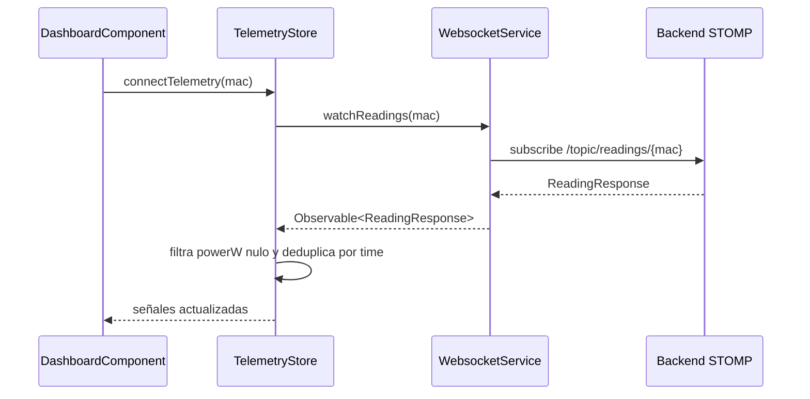

# Anexo B. Componentes y servicios de Angular

El frontend está desarrollado con Angular 21, componentes standalone, PrimeNG para UI, Chart.js para gráficas y NgRx Signals para estado de aplicación. La comunicación con el backend se hace por REST y WebSocket STOMP.

## B.1. Configuración general

`app.config.ts` registra:

- `provideRouter(routes)` para navegación.
- `provideHttpClient(withInterceptors([httpInterceptor]))` para añadir cabeceras comunes.
- `provideAnimationsAsync()` para PrimeNG.
- `providePrimeNG()` con preset Aura personalizado para mejorar contraste en modo oscuro.

Las rutas se cargan de forma diferida en `app.routes.ts`:

| Ruta | Componente | Protección |
|---|---|---|
| `/login` | `LoginComponent` | Pública |
| `/register` | `RegisterComponent` | Pública |
| `/auth/oauth/callback` | `OAuthCallbackComponent` | Pública |
| `/dashboard` | `DashboardComponent` | `authGuard` |
| `/devices` | `DevicesComponent` | `authGuard` |
| `/tariffs` | `TariffComponent` | `authGuard` |
| `/alerts` | `AlertsComponent` | `authGuard` |

`MainLayoutComponent` contiene el chasis privado. En logout desconecta el flujo de telemetría, resetea stores, borra el JWT y redirige a `/login`.

## B.2. Interceptor y sesión

### `SessionStorageService`

Responsabilidades:

- Guardar el JWT en `sessionStorage` bajo la clave `auth_token`.
- Comprobar si el token existe y no ha caducado.
- Leer `username` y `authorities` del JWT con `jwt-decode`.
- Borrar solo la clave de sesión al cerrar sesión.

Esta decisión evita usar `localStorage`, por lo que el token desaparece al cerrar la pestaña o sesión del navegador.

### `httpInterceptor`

El interceptor añade siempre:

```http
X-Requested-With: XMLHttpRequest
```

Y añade `Authorization: Bearer <token>` a rutas que contienen `/api/v1`, excepto:

- `/api/v1/auth/login`
- `/api/v1/auth/register`
- `/api/v1/auth/oauth/exchange`

Si el backend devuelve `401`, borra la sesión y navega a `/login`.

## B.3. Servicios HTTP

### `AuthService`

| Método | Endpoint backend | Uso |
|---|---|---|
| `authentication(user)` | `POST /api/v1/auth/login` | Login clásico con email y contraseña. |
| `register(user)` | `POST /api/v1/auth/register` | Registro de usuario normal. |
| `exchangeOAuthTicket(ticket)` | `POST /api/v1/auth/oauth/exchange` | Convierte ticket OAuth2 en JWT. |

El servicio devuelve `Observable`, por lo que los componentes deciden cómo mostrar carga, error y navegación.

### `DeviceService`

Define un `httpResource<Device[]>` sobre `/api/v1/devices`. En el estado actual del proyecto, la mayor parte de operaciones de dispositivos se ejecutan directamente desde `TelemetryStore` o `DevicesComponent`, pero este recurso deja preparada una lectura reactiva declarativa.

### `TariffService`

| Método | Endpoint | Comentario |
|---|---|---|
| `getCatalog()` | `GET /api/v1/tariffs` | Catálogo maestro. |
| `getById(id)` | `GET /api/v1/tariffs/{id}` | Detalle de tarifa. |
| `createCatalogTariff(payload)` | `POST /api/v1/tariffs` | Solo admin. |
| `updateCatalogTariff(id, payload)` | `POST /api/v1/tariffs/{id}` | Se adapta al backend, que usa `POST` para actualizar. |
| `deleteCatalogTariff(id)` | `DELETE /api/v1/tariffs/{id}` | Solo admin. |
| `getMyTariff()` | `GET /api/v1/users/me/tariff` | Convierte respuesta `204` a `null`. |
| `saveMyTariff(payload)` | `POST /api/v1/users/me/tariff` | Crea, clona o actualiza contrato privado. |
| `unlinkMyTariff()` | `DELETE /api/v1/users/me/tariff` | Desvincula tarifa privada. |

`getMyTariff()` usa `observe: "response"` porque el backend puede responder `204 No Content`. Se transforma a `null` para que la vista trabaje con un estado claro.

### `WebsocketService`

Inicializa `RxStomp` en el constructor:

- Usa `wss://` si la página carga por HTTPS y `ws://` en local.
- Conecta a `/ws-iot`.
- Configura `heartbeatOutgoing` a 20 segundos.
- Reintenta conexión cada 5 segundos.

El método principal es:

```ts
watchReadings(macAddress: string): Observable<ReadingResponse>
```

Internamente escucha `/topic/readings/{macAddress}` y parsea el JSON del mensaje STOMP.

## B.4. Store de telemetría: `TelemetryStore`

`TelemetryStore` centraliza dispositivos, selección activa e histórico por MAC.

### Estado

```ts
interface TelemetryState {
  devices: Device[];
  selectedMac: string | null;
  historicalReadings: {
    [mac: string]: {
      timestamps: string[];
      powerW: number[];
    };
  };
  isLoadingDevices: boolean;
}
```

### Selectores

`currentReadings` es un `computed` que devuelve el histórico de la MAC seleccionada. Si no hay selección, devuelve arrays vacíos. Esta decisión simplifica el dashboard porque no necesita comprobar nulos antes de pintar la gráfica.

### Métodos REST

| Método del store | Endpoint | Efecto en estado |
|---|---|---|
| `loadDevices` | `GET /api/v1/devices` | Carga dispositivos y selecciona la primera MAC si no había selección. |
| `loadRecentReadings(mac)` | `GET /api/v1/readings/device/{mac}/recent?seconds=120` | Precarga hasta 20 puntos recientes de esa MAC. |
| `claimDevice` | `POST /api/v1/devices/claim` | Añade dispositivo físico a la lista local. |
| `createSimulatedDevice` | `POST /api/v1/devices/simulated` | Añade simulador a la lista local. |
| `addDevice` | `POST /api/v1/devices` | Alta directa de dispositivo; se mantiene por compatibilidad con código anterior. |
| `updateDevice` | `PUT /api/v1/devices/{id}` | Sustituye el dispositivo actualizado en el array. |
| `deleteDevice` | `DELETE /api/v1/devices/{id}` | Elimina del array y reajusta `selectedMac`. |

### Lógica RxJS

El store usa `rxMethod` para conectar llamadas asíncronas con señales.

El flujo de WebSocket es:



Decisiones importantes:

- `distinctUntilChanged()` evita reconectar si la MAC no cambia.
- `switchMap()` cierra la suscripción anterior al seleccionar otro dispositivo.
- `filter()` descarta lecturas sin `powerW`.
- Otro `distinctUntilChanged()` deduplica lecturas con el mismo timestamp.
- El histórico se limita a 20 puntos para que la gráfica sea estable y no crezca sin límite en memoria.

## B.5. Store de tarifas: `TariffStore`

### Estado

```ts
interface TariffState {
  catalog: TariffResponse[];
  myTariff: TariffResponse | null;
  isLoadingCatalog: boolean;
  isLoadingMyTariff: boolean;
  errorMessage: string | null;
}
```

### Selectores

- `hasMyTariff`: `true` si el usuario tiene contrato activo.
- `isCatalogEmpty`: `true` si no hay plantillas de catálogo.

### Métodos principales

| Método | Acción |
|---|---|
| `loadCatalog` | Carga plantillas globales. |
| `loadMyTariff` | Carga contrato privado o `null`. |
| `saveMyTariff` | Guarda contrato privado desde plantilla o payload. |
| `unlinkMyTariff` | Desvincula tarifa del usuario. |
| `refreshAfterCatalogMutation` | Recarga catálogo tras cambios de admin. |
| `reset` | Limpia estado en logout. |
| `setCatalogTariff`, `addToCatalog`, `removeFromCatalog`, `patchMyTariff` | Actualizaciones locales tras respuestas del servidor. |

El patrón general es `tap()` para activar estados de carga, `switchMap()` para ejecutar la petición y `catchError(() => EMPTY)` para cerrar el flujo sin romper el store.

## B.6. Componentes principales

### `LoginComponent`

- Formulario reactivo con email obligatorio y contraseña mínima de 4 caracteres.
- Envía `LoginUser` a `AuthService.authentication`.
- Al recibir JWT, lo guarda y navega a `/dashboard`.
- Permite iniciar OAuth2 redirigiendo a `/oauth2/authorization/google` o `/oauth2/authorization/github`.

### `RegisterComponent`

- Formulario reactivo con email, password y confirmación.
- Validador de grupo `passwordMatchValidator`.
- Envía `RegisterRequest` al backend.
- Al completar registro, navega a `/login`.

### `OAuthCallbackComponent`

- Lee `ticket` de la query string.
- Si no existe, muestra error.
- Si existe, llama a `exchangeOAuthTicket`.
- Guarda JWT y navega a `/dashboard`.

### `DashboardComponent`

Responsabilidades:

- Cargar dispositivos y tarifa privada al construir el componente.
- Mostrar selector de medidor activo.
- Convertir timestamps a hora española legible.
- Pintar gráfica de potencia activa con Chart.js.
- Consultar coste diario y consumo fantasma si existe tarifa.

Flujo de datos:

```mermaid
flowchart LR
    Devices[GET /api/v1/devices] --> Store[TelemetryStore]
    Recent[GET /api/v1/readings/device/{mac}/recent] --> Store
    STOMP[/topic/readings/{mac}] --> Store
    Store --> Chart[Gráfica de potencia]
    Tariff[GET /api/v1/users/me/tariff] --> TariffStore
    TariffStore --> Analytics{hay tarifa?}
    Analytics -->|sí| Cost[GET /api/v1/analytics/cost]
    Analytics -->|sí| Ghost[GET /api/v1/analytics/ghost-consumption]
```

El componente usa varios `effect()`:

- Uno limpia automáticamente errores de analítica.
- Otro reacciona a cambios de `selectedMac` para cargar histórico, conectar WebSocket y recalcular métricas.
- Otro reacciona a cambios de tarifa para bloquear o activar analítica.

### `DevicesComponent`

Gestiona el inventario IoT. Incluye:

- Formulario para dispositivo físico o simulado.
- Validación de MAC física con regex `^[0-9A-Fa-f]{12}$`.
- Selector de perfil para simulador.
- Botón para crear pack de demostración.
- Tabla de dispositivos.
- Diálogos de detalle y edición.
- Acción de encendido/apagado lógico mediante `PUT /api/v1/devices/{id}`.

La diferencia entre físico y simulado se implementa modificando validadores:

- Si es físico, `macAddress` es obligatorio y `simulationProfile` se desactiva.
- Si es simulado, `macAddress` se desactiva y `simulationProfile` pasa a ser obligatorio.

### `TariffComponent`

Es el componente más complejo porque representa reglas regulatorias en el formulario.

Constantes locales:

- `ENERGY_PERIODS`: `2.0TD` usa `P1-P3`; el resto usa `P1-P6`.
- `POWER_PERIODS`: `2.0TD` usa `P1-P2`; el resto usa `P1-P6`.

Validaciones:

- `priceKwh` mayor que `0.0001`.
- `contractedPowerKw` mayor que `0.001`.
- `ascendingPowerValidator` obliga a que las potencias de seis periodos estén en orden ascendente.

Modos de trabajo:

| Modo | Usuario | Operación |
|---|---|---|
| Catálogo nuevo | Admin | Crear plantilla global. |
| Catálogo edición | Admin | Actualizar plantilla global. |
| Asignación | Usuario/Admin | Clonar plantilla como tarifa privada. |
| Edición privada | Usuario/Admin | Editar precios y potencias del contrato propio. |
| Desvinculación | Usuario/Admin | Eliminar contrato privado y desactivar métricas. |

Cuando se edita la tarifa privada se bloquean campos estructurales como peaje, zona o comercializadora. Solo se modifican precios y potencias, lo que evita cambiar la naturaleza del contrato desde una edición rápida.

### `AlertsComponent`

- Carga alertas con `GET /api/v1/alerts`.
- Las guarda en una señal `alertsList`.
- Permite descartar una alerta con `DELETE /api/v1/alerts/{id}`.
- Muestra mensajes temporales de éxito o error.

## B.7. Interfaces TypeScript

Las interfaces del frontend reproducen los DTOs Java para evitar traducciones ambiguas.

### Dispositivo

```ts
export interface Device {
  id: number;
  username: string;
  name: string;
  macAddress: string;
  isOn: boolean;
  simulated: boolean;
  simulationProfile: SimulationProfile | null;
}
```

### Lectura

```ts
export interface ReadingResponse {
  time: string | number;
  macAddress: string;
  powerW: number;
  energyTotalKwh: number;
  isOn: boolean;
}
```

### Tarifa

```ts
export interface TariffRequest {
  id: number | null;
  name: string;
  market: string;
  accessTariffCode: AccessTariffCode;
  geographicZone: GeographicZone;
  energyCompany: string;
  periods: PeriodRequest[];
  contractedPowers: TariffContractedPowerRequest[];
}
```

## B.8. Decisiones de experiencia de usuario

- Los errores visibles se borran automáticamente tras unos segundos para no bloquear la pantalla.
- El dashboard muestra métricas económicas solo si el usuario tiene tarifa.
- El gráfico usa una ventana corta de 20 puntos para priorizar lectura rápida sobre histórico completo.
- El selector de medidor controla tanto la gráfica como las consultas analíticas.
- En logout se resetean los stores para impedir que otro usuario vea datos cacheados.
