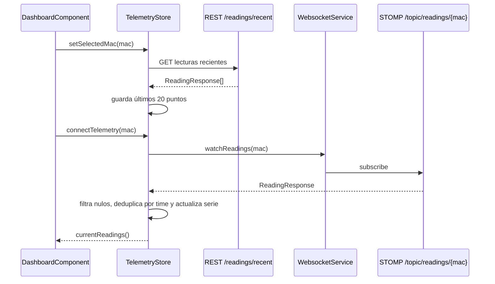

# Anexo B: Frontend Angular, RxJS y NgRx Signals

Este anexo documenta la parte Angular situada en `frontend/src/app`. El frontend está construido con componentes standalone, rutas lazy, formularios reactivos, servicios HTTP y stores de NgRx Signals.

## 1. Estructura general

| Carpeta | Responsabilidad |
|---|---|
| `components/` | Pantallas principales: login, registro, dashboard, dispositivos, tarifas, alertas y layout. |
| `services/` | Acceso a API REST, sesión, WebSocket STOMP y recursos HTTP auxiliares. |
| `store/` | Estado global reactivo con NgRx Signals. |
| `interfaces/` | Tipos TypeScript equivalentes a los DTOs del backend. |
| `guards/` | Protección de rutas autenticadas. |
| `interceptors/` | Inyección del JWT en peticiones HTTP. |

La navegación se define en `app.routes.ts`. Las rutas públicas son `/login`, `/register` y `/auth/oauth/callback`. El resto cuelga del layout principal y se protege con `authGuard`.

```typescript
{
  path: "",
  loadComponent: () => import("./components/main-layout/main-layout.component"),
  canActivate: [authGuard],
  canActivateChild: [authGuard],
  children: [
    { path: "dashboard", loadComponent: () => import("./components/dashboard/dashboard.component") },
    { path: "devices", loadComponent: () => import("./components/devices/devices.component") },
    { path: "tariffs", loadComponent: () => import("./components/tariff/tariff.component") },
    { path: "alerts", loadComponent: () => import("./components/alerts/alerts.component") }
  ]
}
```

La decisión de usar lazy loading en componentes standalone reduce carga inicial y mantiene cada pantalla separada.

## 2. Servicios Angular

### 2.1. `AuthService`

Archivo: `services/auth.service.ts`

Métodos:

| Método | Endpoint | Uso |
|---|---|---|
| `authentication(user)` | `POST /api/v1/auth/login` | Devuelve `LoginUserJwt`. |
| `register(user)` | `POST /api/v1/auth/register` | Registra usuario normal. |
| `exchangeOAuthTicket(ticket)` | `POST /api/v1/auth/oauth/exchange` | Cambia el ticket OAuth por JWT. |

El servicio no guarda directamente el token. Esa responsabilidad se separa en `SessionStorageService`, lo que evita mezclar transporte HTTP con persistencia local de sesión.

### 2.2. `TariffService`

Archivo: `services/tariff.service.ts`

Este servicio encapsula el catálogo maestro y la tarifa privada del usuario:

| Método | Endpoint | Detalle |
|---|---|---|
| `getCatalog()` | `GET /api/v1/tariffs` | Lista plantillas globales. |
| `getById(id)` | `GET /api/v1/tariffs/{id}` | Consulta tarifa concreta. |
| `createCatalogTariff(payload)` | `POST /api/v1/tariffs` | Alta admin. |
| `updateCatalogTariff(id, payload)` | `POST /api/v1/tariffs/{id}` | Actualización admin. |
| `deleteCatalogTariff(id)` | `DELETE /api/v1/tariffs/{id}` | Borrado admin. |
| `getMyTariff()` | `GET /api/v1/users/me/tariff` | Convierte `204` o body nulo a `null`. |
| `saveMyTariff(payload)` | `POST /api/v1/users/me/tariff` | Guarda tarifa privada. |
| `unlinkMyTariff()` | `DELETE /api/v1/users/me/tariff` | Desvincula tarifa privada. |

La transformación más importante es esta:

```typescript
getMyTariff(): Observable<TariffResponse | null> {
  return this.http
    .get<TariffResponse | null>(this.myTariffUrl, { observe: "response" })
    .pipe(
      map((res) => res.status === 204 || res.body === null ? null : res.body),
      catchError(() => EMPTY),
    );
}
```

Se usa porque el backend responde `204 No Content` cuando el usuario no tiene tarifa. En Angular conviene convertir ese caso a `null` para que las pantallas puedan decidir de forma simple si muestran el banner de configuración.

### 2.3. `WebsocketService`

Archivo: `services/websocket.service.ts`

El servicio abre una conexión STOMP hacia `/ws-iot`. La URL cambia automáticamente entre `ws://` y `wss://` según el protocolo de la página.

```typescript
watchReadings(macAddress: string): Observable<ReadingResponse> {
  const destination = `/topic/readings/${macAddress}`;

  return this.rxStomp
    .watch(destination)
    .pipe(map((message) => JSON.parse(message.body) as ReadingResponse));
}
```

Cada dispositivo tiene su propio topic. Esto evita que el dashboard procese lecturas de dispositivos que el usuario no ha seleccionado.

## 3. Estado reactivo con NgRx Signals

### 3.1. `TelemetryStore`

Archivo: `store/telemetry.store.ts`

Estado:

```typescript
interface TelemetryState {
  devices: Device[];
  selectedMac: string | null;
  historicalReadings: {
    [mac: string]: {
      timestamps: string[];
      powerW: number[];
    };
  };
  isLoadingDevices: boolean;
}
```

El selector principal es `currentReadings`, calculado a partir de `selectedMac`:

```typescript
currentReadings: computed(() => {
  const mac = state.selectedMac();
  return mac
    ? (state.historicalReadings()[mac] ?? { timestamps: [], powerW: [] })
    : { timestamps: [], powerW: [] };
})
```

Así el dashboard no necesita filtrar manualmente: siempre recibe el historial de la MAC activa.

Métodos relevantes:

| Método | Tipo | Uso |
|---|---|---|
| `setSelectedMac(mac)` | síncrono | Cambia la MAC activa y carga lecturas recientes. |
| `loadDevices` | `rxMethod<void>` | Recupera `/api/v1/devices` y selecciona la primera MAC si no hay otra. |
| `claimDevice` | `rxMethod<ClaimDeviceRequest>` | Vincula dispositivo físico. |
| `createSimulatedDevice` | `rxMethod<CreateSimulatedDeviceRequest>` | Crea dispositivo simulado. |
| `addDevice` | `rxMethod<{ name; macAddress }>` | Alta directa de dispositivo. |
| `updateDevice` | `rxMethod<Device>` | Actualiza dispositivo en la lista local. |
| `deleteDevice` | `rxMethod<number>` | Elimina dispositivo y reajusta `selectedMac`. |
| `connectTelemetry` | `rxMethod<string | null>` | Suscribe WebSocket según la MAC seleccionada. |
| `reset` | síncrono | Limpia estado al cerrar sesión. |

Flujo reactivo de telemetría:



En `connectTelemetry` se aplican tres decisiones:

- `distinctUntilChanged()` evita reconectar si la MAC no cambia.
- `filter()` descarta lecturas sin `powerW`, porque romperían la línea del gráfico.
- Otro `distinctUntilChanged()` deduplica por `time`, útil si el backend emite una lectura equivalente desde dos ramas MQTT.

### 3.2. `TariffStore`

Archivo: `store/tariff.store.ts`

Estado:

```typescript
interface TariffState {
  catalog: TariffResponse[];
  myTariff: TariffResponse | null;
  isLoadingCatalog: boolean;
  isLoadingMyTariff: boolean;
  errorMessage: string | null;
}
```

Selectores:

- `hasMyTariff`: `true` si el usuario tiene contrato energético activo.
- `isCatalogEmpty`: `true` si no se han cargado plantillas.

Métodos:

| Método | Uso |
|---|---|
| `loadCatalog` | Carga catálogo maestro. |
| `loadMyTariff` | Carga tarifa privada. |
| `saveMyTariff` | Guarda contrato del usuario. |
| `unlinkMyTariff` | Desvincula contrato privado. |
| `refreshAfterCatalogMutation` | Recarga catálogo tras alta/edición/borrado admin. |
| `setCatalogTariff`, `addToCatalog`, `removeFromCatalog` | Ajustes locales sin recargar toda la pantalla. |
| `patchMyTariff` | Actualiza tarifa privada después de editar. |
| `clearError` | Limpia estado de error. |

Los métodos asíncronos usan `rxMethod` con `switchMap`. Esto encaja bien con pantallas donde el usuario puede lanzar una acción nueva antes de que termine la anterior, porque se prioriza la petición más reciente.

## 4. Componentes principales

### 4.1. `DashboardComponent`

Archivo: `components/dashboard/dashboard.component.ts`

Responsabilidades:

- Cargar dispositivos del usuario.
- Cargar la tarifa privada.
- Mostrar gráfica de potencia con Chart.js.
- Consultar coste diario y consumo fantasma.
- Cambiar de dispositivo mediante `selectedMac`.

El componente no mantiene el historial completo en local; lo consume desde `TelemetryStore`. Sus señales derivadas preparan los datos visuales:

```typescript
readonly powerW = computed(() => this.historicalData().powerW);
readonly formattedTime = computed(() =>
  this.timestamps().map((ts) =>
    new Date(ts).toLocaleTimeString("es-ES", TIME_OPTIONS),
  ),
);
```

Las analíticas se consultan solo si hay una tarifa configurada:

```typescript
if (this.hasMyTariff()) {
  this.loadAnalyticsMetrics(mac);
}
```

Esto evita mostrar costes engañosos cuando el usuario aún no ha elegido contrato.

### 4.2. `DevicesComponent`

Archivo: `components/devices/devices.component.ts`

Gestiona dos modos de alta:

| Modo | Validación | Endpoint |
|---|---|---|
| Físico | Nombre mínimo 3 caracteres y MAC de 12 hexadecimales. | `POST /api/v1/devices/claim` |
| Simulado | Nombre mínimo 3 caracteres y perfil obligatorio. | `POST /api/v1/devices/simulated` |

El método `applyDeviceKindValidators` cambia validadores según el tipo de dispositivo. Si el usuario elige un simulador, el campo MAC se desactiva porque la MAC la genera el backend para evitar colisiones.

También permite:

- Crear un pack de demostración con `POST /api/v1/devices/simulated/demo-pack`.
- Borrar dispositivos con `DELETE /api/v1/devices/{id}`.
- Alternar `isOn` mediante `PUT /api/v1/devices/{id}`.
- Editar nombre y perfil de simulación si el dispositivo es simulado.

### 4.3. `TariffComponent`

Archivo: `components/tariff/tariff.component.ts`

Usa formularios reactivos tipados para representar la tarifa:

- Datos generales: nombre, mercado, peaje, zona y comercializadora.
- `periods`: array de precios `€/kWh`.
- `contractedPowers`: array de potencias contratadas `kW`.

El componente reconstruye arrays al cambiar el peaje:

| Peaje | Periodos de energía | Periodos de potencia |
|---|---|---|
| `2.0TD` | `P1`, `P2`, `P3` | `P1`, `P2` |
| `3.0TD` | `P1` a `P6` | `P1` a `P6` |
| `6.1TD` | `P1` a `P6` | `P1` a `P6` |
| `6.2TD` | `P1` a `P6` | `P1` a `P6` |

La validación `ascendingPowerValidator` impide que una potencia posterior sea menor que la anterior. Esta regla reproduce en frontend la misma idea que valida el backend, mejorando la experiencia porque el usuario ve el error antes de enviar.

Cuando se edita la tarifa privada, los campos estructurales se deshabilitan y solo se permite cambiar precios y potencias:

```typescript
private disableStructuralFields(): void {
  this.tariffForm.controls.name.disable({ emitEvent: false });
  this.tariffForm.controls.market.disable({ emitEvent: false });
  this.tariffForm.controls.accessTariffCode.disable({ emitEvent: false });
  this.tariffForm.controls.geographicZone.disable({ emitEvent: false });
  this.tariffForm.controls.energyCompany.disable({ emitEvent: false });
}
```

El `{ emitEvent: false }` es importante porque `enable()` y `disable()` disparan `valueChanges`; si no se evita, se reconstruirían los arrays y se perderían los valores cargados.

### 4.4. `AlertsComponent`

Archivo: `components/alerts/alerts.component.ts`

Carga alertas con `GET /api/v1/alerts` y permite borrarlas con `DELETE /api/v1/alerts/{id}`. Usa señales locales para:

- `alertsList`
- `isLoading`
- `successMessage`
- `errorMessage`

Los mensajes se limpian automáticamente con `effect()` y `setTimeout`, siguiendo el mismo patrón usado en dispositivos y tarifas.

## 5. Interfaces TypeScript y correspondencia con DTOs

| Interfaz TypeScript | DTO Java equivalente | Uso |
|---|---|---|
| `Device` | `DeviceDto` | Dispositivos físicos y simulados. |
| `ClaimDeviceRequest` | `DeviceDto` parcial | Vinculación por MAC. |
| `CreateSimulatedDeviceRequest` | `CreateSimulatedDeviceRequest` | Alta de simulador. |
| `ReadingResponse` | `ReadingResponse` | Lecturas de potencia. |
| `TariffRequest` / `TariffResponse` | `TariffDto` | Tarifas del catálogo y privadas. |
| `UserTariffRequest` | `UserTariffRequest` | Asignación de tarifa privada. |
| `EnergyCostResponse` | `Map<String,Object>` de `ConsumptionController` | Coste total. |
| `GhostCostResponse` | `Map<String,Object>` de `ConsumptionController` | Coste fantasma. |

Mantener estas interfaces sincronizadas con los records Java reduce errores de integración, porque el compilador TypeScript avisa cuando un componente usa un campo que no forma parte del contrato.

## 6. Experiencia de usuario

La aplicación evita cargar al usuario con datos técnicos:

- El dashboard muestra vatios, euros y estado de configuración de tarifa.
- La pantalla de dispositivos separa claramente equipos físicos y simulados.
- Los formularios de tarifa generan los periodos necesarios según el peaje elegido.
- Los mensajes de éxito/error desaparecen solos para no ensuciar la interfaz.
- El pack de demo permite probar la aplicación aunque no haya un Shelly físico conectado.

## 7. Pruebas frontend

Tests localizados:

| Test | Qué comprueba |
|---|---|
| `tariff.service.spec.ts` | Endpoints del servicio de tarifas y conversión `204 -> null`. |
| `session-storage.service.spec.ts` | Lectura de roles y username desde JWT. |
| `dashboard.component.spec.ts` | Estado inicial de métricas y banner cuando no hay tarifa. |
| `devices.component.spec.ts` | Validación de alta física/simulada y payload enviado. |
| `tariff.component.spec.ts` | Reconstrucción de periodos por peaje y rol admin/user. |

Estas pruebas no sustituyen a pruebas end-to-end, pero protegen la lógica más sensible de formularios y servicios.
