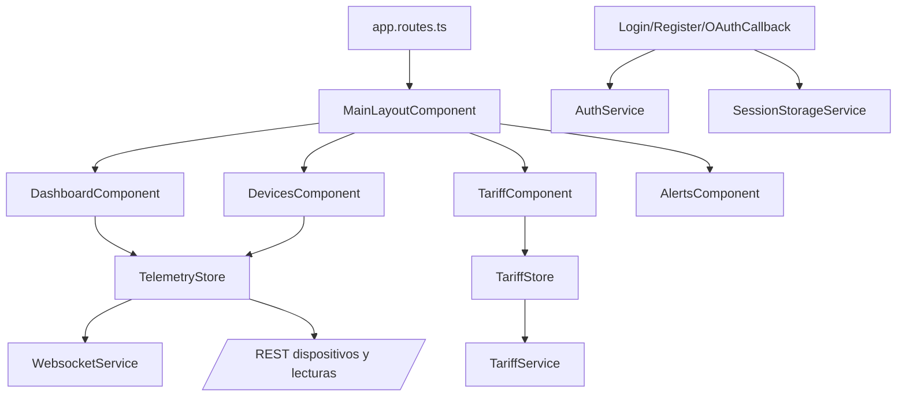
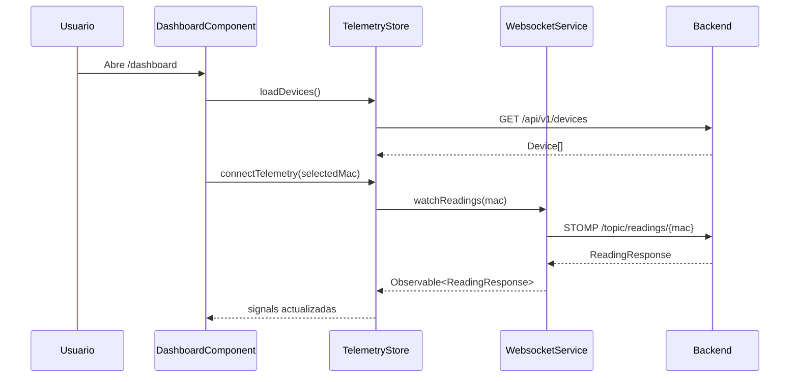

# Anexo B - Frontend Angular, RxJS y NgRx Signals

## 1. Vision general

El frontend de Wattimizer esta construido con Angular 21 y componentes standalone. La aplicacion no usa modulos Angular clasicos; cada pantalla declara sus imports y se carga de forma diferida desde `app.routes.ts`.

La separacion principal es:

- **Componentes:** gestionan formularios, eventos de usuario y representacion visual.
- **Servicios:** encapsulan llamadas HTTP, WebSocket y sesion.
- **Stores NgRx Signals:** mantienen estado compartido y derivado.
- **Interfaces TypeScript:** replican los DTOs que devuelve Spring Boot.



## 2. Rutas y proteccion de navegacion

Archivo: `frontend/src/app/app.routes.ts`.

| Ruta | Componente | Proteccion |
|---|---|---|
| `/login` | `LoginComponent` | Publica |
| `/register` | `RegisterComponent` | Publica |
| `/auth/oauth/callback` | `OAuthCallbackComponent` | Publica |
| `/dashboard` | `DashboardComponent` | `authGuard` |
| `/devices` | `DevicesComponent` | `authGuard` |
| `/tariffs` | `TariffComponent` | `authGuard` |
| `/alerts` | `AlertsComponent` | `authGuard` |

`MainLayoutComponent` protege las rutas hijas con `canActivate` y `canActivateChild`. Esto evita que un usuario entre directamente por URL a una ruta privada con un token caducado.

## 3. Gestion de sesion e interceptor HTTP

### 3.1. `SessionStorageService`

Archivo: `frontend/src/app/services/session-storage.service.ts`.

Responsabilidades:

- guardar el JWT en `sessionStorage`;
- recuperar el token para las peticiones HTTP;
- comprobar expiracion leyendo el claim `exp`;
- extraer roles desde `authorities`;
- obtener el `username` para mostrarlo en la interfaz;
- borrar solo la clave `auth_token` al cerrar sesion.

El servicio usa `DOCUMENT` para acceder a `window` de forma segura. Esto evita acoplar todo el codigo directamente al objeto global, lo cual es util para tests.

### 3.2. `httpInterceptor`

Archivo: `frontend/src/app/interceptors/http.interceptor.ts`.

El interceptor anade:

```http
X-Requested-With: XMLHttpRequest
Authorization: Bearer <jwt>
```

La cabecera `Authorization` solo se aplica a rutas `/api/v1` que no sean publicas de autenticacion. Si el backend responde `401`, el interceptor borra el token y navega a `/login`.

## 4. Stores reactivos con NgRx Signals

### 4.1. `TelemetryStore`

Archivo: `frontend/src/app/store/telemetry.store.ts`.

Estado:

```ts
interface TelemetryState {
  devices: Device[];
  selectedMac: string | null;
  historicalReadings: {
    [mac: string]: {
      timestamps: string[];
      powerW: number[];
    };
  };
  isLoadingDevices: boolean;
}
```

Computed principal:

```ts
currentReadings = computed(() => {
  const mac = selectedMac();
  return mac
    ? historicalReadings()[mac] ?? { timestamps: [], powerW: [] }
    : { timestamps: [], powerW: [] };
});
```

La decision importante es guardar el historial por MAC. Asi, cambiar entre dispositivos no mezcla lecturas y permite mantener una pequena cache local por equipo.

Metodos principales:

| Metodo | Tipo | Funcion |
|---|---|---|
| `setSelectedMac(mac)` | Sincrono | Cambia dispositivo activo y carga historial reciente. |
| `loadRecentReadings(mac)` | HTTP imperativo | Recupera ultimos 120 segundos y conserva maximo 20 puntos. |
| `loadDevices` | `rxMethod<void>` | Carga dispositivos del usuario y selecciona el primero si no habia seleccion. |
| `claimDevice` | `rxMethod<ClaimDeviceRequest>` | Vincula dispositivo fisico por MAC. |
| `createSimulatedDevice` | `rxMethod<CreateSimulatedDeviceRequest>` | Crea simulador y actualiza lista local. |
| `addDevice` | `rxMethod<{name; macAddress}>` | Alta directa por `POST /api/v1/devices`. |
| `updateDevice` | `rxMethod<Device>` | Actualiza nombre, estado y perfil simulado. |
| `deleteDevice` | `rxMethod<number>` | Borra dispositivo y ajusta `selectedMac`. |
| `connectTelemetry` | `rxMethod<string | null>` | Se suscribe al WebSocket del dispositivo seleccionado. |
| `reset` | Sincrono | Limpia estado al cerrar sesion. |

#### RxJS dentro de `connectTelemetry`

```ts
connectTelemetry: rxMethod<string | null>(
  pipe(
    distinctUntilChanged(),
    switchMap((mac) => {
      if (!mac) return of(null);
      return wsService.watchReadings(mac).pipe(
        filter((r) => (r.powerW as number | null | undefined) != null),
        distinctUntilChanged((prev, curr) => prev.time === curr.time),
        tap({ next: (reading) => { /* patchState */ } }),
      );
    }),
  ),
)
```

Decisiones:

- `distinctUntilChanged()` evita reabrir la suscripcion si la MAC no cambia.
- `switchMap()` cancela el flujo anterior cuando el usuario selecciona otro dispositivo.
- `filter()` elimina lecturas sin potencia para no romper la grafica.
- `distinctUntilChanged((prev, curr) => prev.time === curr.time)` evita duplicados cuando llegan mensajes equivalentes por distintos canales.
- El historial se limita a 20 puntos para que Chart.js mantenga una grafica legible.

### 4.2. `TariffStore`

Archivo: `frontend/src/app/store/tariff.store.ts`.

Estado:

```ts
interface TariffState {
  catalog: TariffResponse[];
  myTariff: TariffResponse | null;
  isLoadingCatalog: boolean;
  isLoadingMyTariff: boolean;
  errorMessage: string | null;
}
```

Computed:

- `hasMyTariff`: indica si el usuario puede calcular costes.
- `isCatalogEmpty`: permite mostrar estados vacios.

Metodos HTTP:

| Metodo | Endpoint | Funcion |
|---|---|---|
| `loadCatalog` | `GET /api/v1/tariffs` | Carga plantillas globales. |
| `loadMyTariff` | `GET /api/v1/users/me/tariff` | Carga tarifa privada o `null` si hay `204`. |
| `saveMyTariff` | `POST /api/v1/users/me/tariff` | Guarda contrato privado. |
| `unlinkMyTariff` | `DELETE /api/v1/users/me/tariff` | Desvincula tarifa. |
| `refreshAfterCatalogMutation` | `GET /api/v1/tariffs` | Recarga catalogo tras cambios admin. |

Cada flujo usa `switchMap` para enlazar la llamada HTTP y `catchError(() => EMPTY)` para cortar el stream cuando hay error, dejando el mensaje en el estado.

## 5. Servicios Angular

### 5.1. `AuthService`

Archivo: `frontend/src/app/services/auth.service.ts`.

| Metodo | Endpoint | Uso |
|---|---|---|
| `authentication(user)` | `POST /api/v1/auth/login` | Login clasico. |
| `register(user)` | `POST /api/v1/auth/register` | Registro de usuario. |
| `exchangeOAuthTicket(ticket)` | `POST /api/v1/auth/oauth/exchange` | Convierte ticket OAuth2 en JWT. |

### 5.2. `TariffService`

Archivo: `frontend/src/app/services/tariff.service.ts`.

El servicio separa claramente catalogo maestro y tarifa privada:

- `catalogUrl = "/api/v1/tariffs"`
- `myTariffUrl = "/api/v1/users/me/tariff"`

Detalle relevante: `getMyTariff()` usa `observe: "response"` porque el backend devuelve `204 No Content` cuando el usuario aun no tiene tarifa. El servicio mapea ese caso a `null`.

### 5.3. `WebsocketService`

Archivo: `frontend/src/app/services/websocket.service.ts`.

Configura `RxStomp` contra:

```ts
const wsUrl = `${protocol}//${window.location.host}/ws-iot`;
```

Esto hace que en local use `ws://` y en produccion `wss://` automaticamente. La suscripcion de lectura se realiza en:

```ts
watchReadings(macAddress: string): Observable<ReadingResponse> {
  const destination = `/topic/readings/${macAddress}`;
  return this.rxStomp
    .watch(destination)
    .pipe(map((message) => JSON.parse(message.body) as ReadingResponse));
}
```

### 5.4. `DeviceService`

Archivo: `frontend/src/app/services/device.service.ts`.

Define un `httpResource<Device[]>` hacia `/api/v1/devices`. Actualmente convive con `TelemetryStore`, que concentra la logica principal de estado de dispositivos.

## 6. Componentes principales

### 6.1. `DashboardComponent`

Archivo: `frontend/src/app/components/dashboard/dashboard.component.ts`.

Responsabilidades:

- cargar dispositivos y tarifa privada al entrar;
- seleccionar MAC activa;
- conectar el WebSocket mediante `TelemetryStore.connectTelemetry`;
- mostrar grafica Chart.js con potencia activa;
- pedir analiticas de coste y consumo fantasma para el dia actual;
- mostrar aviso si el usuario no tiene tarifa configurada.

Flujo de datos:



La grafica deriva de `store.currentReadings`, no de variables locales del componente. Esto mantiene la fuente de verdad en el store.

### 6.2. `DevicesComponent`

Archivo: `frontend/src/app/components/devices/devices.component.ts`.

Gestiona dos tipos de alta:

- **Fisico:** exige `macAddress` con expresion regular `^[0-9A-Fa-f]{12}$` y llama a `/api/v1/devices/claim`.
- **Simulado:** deshabilita el campo MAC, obliga a elegir `simulationProfile` y llama a `/api/v1/devices/simulated`.

La funcion `applyDeviceKindValidators` cambia validadores segun el tipo seleccionado. Es una decision necesaria porque un simulador no debe pedir MAC manual, ya que el backend la genera para evitar colisiones.

Tambien permite:

- crear pack demo con `/api/v1/devices/simulated/demo-pack`;
- borrar dispositivos;
- alternar `isOn`;
- editar nombre y perfil de simulacion.

### 6.3. `TariffComponent`

Archivo: `frontend/src/app/components/tariff/tariff.component.ts`.

Es el componente con mas logica de formulario. Usa `FormArray` para representar:

- precios de energia (`periods`);
- potencias contratadas (`contractedPowers`).

Periodos por peaje:

```ts
const ENERGY_PERIODS = {
  "2.0TD": ["P1", "P2", "P3"],
  "3.0TD": ["P1", "P2", "P3", "P4", "P5", "P6"],
  "6.1TD": ["P1", "P2", "P3", "P4", "P5", "P6"],
  "6.2TD": ["P1", "P2", "P3", "P4", "P5", "P6"],
};
```

La validacion `ascendingPowerValidator` impone que las potencias no bajen de un periodo al siguiente. Esta regla tambien existe en backend, pero repetirla en frontend mejora la experiencia de usuario porque el error aparece antes de enviar.

Decision importante: al editar la tarifa privada del usuario, se deshabilitan los campos estructurales (`name`, `market`, `accessTariffCode`, `geographicZone`, `energyCompany`). Asi el usuario modifica precios y potencias sin cambiar la naturaleza del contrato clonado.

### 6.4. `AlertsComponent`

Archivo: `frontend/src/app/components/alerts/alerts.component.ts`.

Carga `GET /api/v1/alerts` al construirse y permite descartar incidencias con `DELETE /api/v1/alerts/{id}`. Usa signals locales para lista, carga y mensajes. No necesita store global porque las alertas se consultan en una pantalla concreta y no se comparten con otros componentes.

### 6.5. `LoginComponent`

Archivo: `frontend/src/app/components/login/login.component.ts`.

Usa formulario reactivo con:

- email requerido;
- password requerido y minimo 4 caracteres en login.

Al autenticar:

1. llama a `AuthService.authentication`;
2. guarda `response.jwt`;
3. navega a `/dashboard`.

Tambien inicia OAuth2 cambiando `window.location.href` a `/oauth2/authorization/google` o `/oauth2/authorization/github`.

### 6.6. `RegisterComponent`

Archivo: `frontend/src/app/components/register/register.component.ts`.

Valida:

- email requerido y con formato;
- contrasena minimo 6 caracteres;
- confirmacion de contrasena;
- coincidencia entre `password` y `confirmPassword`.

El validador `passwordMatchValidator` opera sobre todo el `FormGroup`, porque necesita comparar dos controles.

### 6.7. `OAuthCallbackComponent`

Archivo: `frontend/src/app/components/oauth-callback/oauth-callback.component.ts`.

Lee `ticket` desde la query string. Si existe, llama a `AuthService.exchangeOAuthTicket`. Si la respuesta es correcta, guarda el JWT y navega al dashboard. Si no hay ticket o ha caducado, muestra un error y ofrece volver al login.

### 6.8. `MainLayoutComponent`

Archivo: `frontend/src/app/components/main-layout/main-layout.component.ts`.

En logout:

1. llama a `telemetryStore.connectTelemetry(null)` para cerrar el flujo activo;
2. resetea `TelemetryStore` y `TariffStore`;
3. borra el JWT;
4. navega a `/login` con `replaceUrl`.

Esta limpieza evita que un segundo usuario vea datos cacheados del anterior.

## 7. Interfaces TypeScript y equivalencia con DTOs

| Interface | DTO backend equivalente | Uso |
|---|---|---|
| `Device` | `DeviceDto` | Dispositivos fisicos y simulados. |
| `CreateSimulatedDeviceRequest` | `CreateSimulatedDeviceRequest` | Alta de simuladores. |
| `ReadingResponse` | `ReadingResponse` | Grafica y WebSocket. |
| `TariffRequest` / `TariffResponse` | `TariffDto` | Catalogo y tarifa privada. |
| `UserTariffRequest` | `UserTariffRequest` | Asignacion o edicion de tarifa del usuario. |
| `EnergyCostResponse` | `Map` de `/analytics/cost` | Widget de coste. |
| `GhostCostResponse` | `Map` de `/analytics/ghost-consumption` | Widget de consumo fantasma. |
| `Alert` | `AlertDto` | Listado de alertas. |

## 8. Experiencia de usuario

La UX esta orientada a que el usuario empresarial no tenga que entender la telemetria cruda:

- se muestran vatios y euros, no payloads MQTT;
- los formularios de tarifa crean automaticamente los periodos segun peaje;
- si no hay tarifa, el dashboard no calcula costes y guia al usuario a configurarla;
- los mensajes de exito y error se limpian solos tras unos segundos;
- los simuladores permiten probar graficas, costes y alertas sin enchufe fisico.
