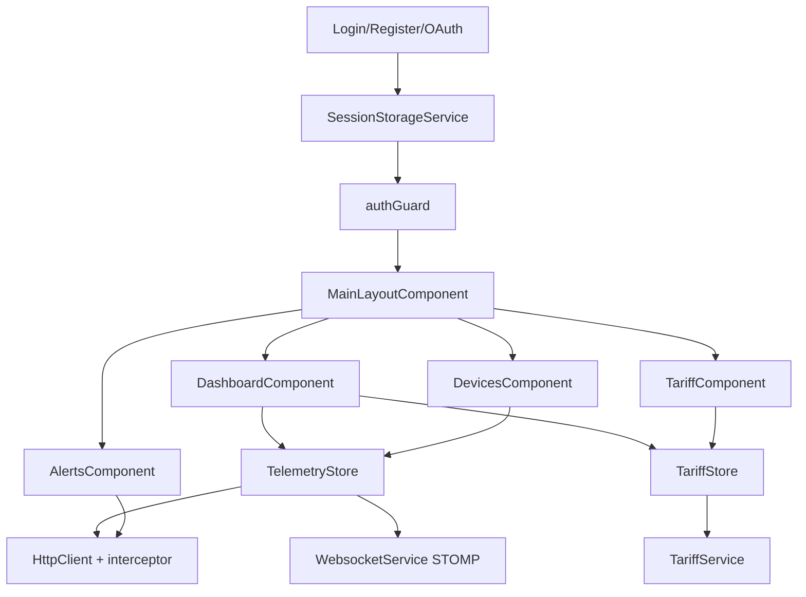

# Anexo B - Frontend Angular, componentes, servicios y estado reactivo

## 1. Alcance del anexo

Este anexo describe el frontend Angular de Wattimizer situado en `frontend/src/app`. Se centra en los componentes reales, servicios HTTP, stores con NgRx Signals y flujos RxJS que conectan la interfaz con el backend.

El frontend está construido con Angular standalone, por lo que no hay módulos clásicos de Angular para cada funcionalidad. Las pantallas se cargan mediante rutas y cada componente declara sus propios imports.

## 2. Tecnologías declaradas

Archivo: `frontend/package.json`.

| Tecnología | Versión declarada | Uso en el proyecto |
| --- | --- | --- |
| Angular | `^21.1.0` | Framework principal de la SPA. |
| TypeScript | `~5.9.2` | Lenguaje del frontend. |
| RxJS | `~7.8.0` | Flujos asíncronos HTTP y WebSocket. |
| NgRx Signals | `^21.1.0` | Stores reactivos sin reducers clásicos. |
| PrimeNG | `^21.1.7` | Componentes visuales: tablas, botones, selects, diálogos y mensajes. |
| Chart.js | `^4.5.1` | Gráfica de potencia en el dashboard. |
| `@stomp/rx-stomp` | `^2.4.0` | Cliente STOMP sobre WebSocket. |
| Biome | `2.4.16` | Lint y formato. |
| Vitest | `^4.0.8` | Pruebas unitarias del frontend. |

## 3. Configuración global

### 3.1. `app.config.ts`

El archivo `app.config.ts` define proveedores globales:

- `provideRouter(routes)` para el enrutamiento.
- `provideHttpClient(withInterceptors([httpInterceptor]))` para añadir el interceptor JWT.
- `provideAnimationsAsync()` para PrimeNG.
- `providePrimeNG()` con el preset visual `WattimizerPreset`.

El preset modifica colores de `p-message` y `p-toast` en modo oscuro. La razón es práctica: el tema Aura por defecto usa transparencias demasiado suaves y los mensajes pierden contraste sobre fondos oscuros.

### 3.2. `app.routes.ts`

Rutas principales:

| Ruta | Componente | Protección |
| --- | --- | --- |
| `/login` | `LoginComponent` | Pública |
| `/register` | `RegisterComponent` | Pública |
| `/auth/oauth/callback` | `OAuthCallbackComponent` | Pública |
| `/dashboard` | `DashboardComponent` dentro de `MainLayoutComponent` | `authGuard` |
| `/devices` | `DevicesComponent` dentro de `MainLayoutComponent` | `authGuard` |
| `/tariffs` | `TariffComponent` dentro de `MainLayoutComponent` | `authGuard` |
| `/alerts` | `AlertsComponent` dentro de `MainLayoutComponent` | `authGuard` |

El `authGuard` se aplica en `canActivate` y `canActivateChild`. Así se valida tanto la entrada inicial al layout como la navegación interna entre páginas protegidas.

## 4. Componentes principales

| Componente | Archivo | Responsabilidad |
| --- | --- | --- |
| `App` | `app.ts` | Shell mínimo con `router-outlet`. |
| `MainLayoutComponent` | `components/main-layout/main-layout.component.ts` | Estructura autenticada, navegación y cierre de sesión. |
| `DashboardComponent` | `components/dashboard/dashboard.component.ts` | Panel multi-dispositivo con gráfica, coste diario y consumo fantasma. |
| `DevicesComponent` | `components/devices/devices.component.ts` | Alta física, alta simulada, pack demo, edición, detalle, ON/OFF y borrado. |
| `TariffComponent` | `components/tariff/tariff.component.ts` | Gestión del catálogo y tarifa privada del usuario. |
| `AlertsComponent` | `components/alerts/alerts.component.ts` | Listado y descarte de alertas. |
| `LoginComponent` | `components/login/login.component.ts` | Login tradicional. |
| `RegisterComponent` | `components/register/register.component.ts` | Registro de usuario. |
| `OAuthCallbackComponent` | `components/oauth-callback/oauth-callback.component.ts` | Canje de ticket OAuth por JWT. |

## 5. Servicios Angular

### 5.1. `AuthService`

Archivo: `services/auth.service.ts`.

Usa `/api/v1/auth` como ruta base. Sus responsabilidades son:

- Login con usuario y contraseña.
- Registro de cuenta.
- Canje de ticket OAuth mediante `/api/v1/auth/oauth/exchange`.

La persistencia del token no se hace aquí directamente, sino desde la capa que consume el servicio y `SessionStorageService`.

### 5.2. `TariffService`

Archivo: `services/tariff.service.ts`.

| Método | Endpoint | Tipo |
| --- | --- | --- |
| `getCatalog()` | `GET /api/v1/tariffs` | `Observable<TariffResponse[]>` |
| `getById(id)` | `GET /api/v1/tariffs/{id}` | `Observable<TariffResponse>` |
| `createCatalogTariff(payload)` | `POST /api/v1/tariffs` | `Observable<TariffResponse>` |
| `updateCatalogTariff(id, payload)` | `POST /api/v1/tariffs/{id}` | `Observable<TariffResponse>` |
| `deleteCatalogTariff(id)` | `DELETE /api/v1/tariffs/{id}` | `Observable<void>` |
| `getMyTariff()` | `GET /api/v1/users/me/tariff` | `Observable<TariffResponse \| null>` |
| `saveMyTariff(payload)` | `POST /api/v1/users/me/tariff` | `Observable<TariffResponse>` |
| `unlinkMyTariff()` | `DELETE /api/v1/users/me/tariff` | `Observable<void>` |

Una decisión importante es que `getMyTariff()` observa la respuesta completa. Si el backend devuelve `204 No Content`, el servicio lo transforma en `null`. Así el resto del frontend no tiene que distinguir entre cuerpo vacío y tarifa ausente.

### 5.3. `WebsocketService`

Archivo: `services/websocket.service.ts`.

El servicio crea un cliente `RxStomp` al construirse:

```ts
const protocol = window.location.protocol === "https:" ? "wss:" : "ws:";
const wsUrl = `${protocol}//${window.location.host}/ws-iot`;
```

Configuración relevante:

- `heartbeatOutgoing: 20000`
- `reconnectDelay: 5000`
- destino por dispositivo: `/topic/readings/{macAddress}`

El método principal es:

```ts
watchReadings(macAddress: string): Observable<ReadingResponse>
```

Devuelve un observable que parsea cada mensaje STOMP a `ReadingResponse`.

### 5.4. `SessionStorageService`

Gestiona el JWT en `sessionStorage`, comprueba expiración y extrae roles del payload. Es la base del `authGuard` y del interceptor HTTP.

### 5.5. `DeviceService`

Existe `services/device.service.ts` con `httpResource<Device[]>` hacia `/api/v1/devices`. En la rama actual no es la capa principal de dispositivos, porque `TelemetryStore` y `DevicesComponent` hacen la mayoría de llamadas HTTP.

## 6. Interceptor y guard de autenticación

### 6.1. `http.interceptor.ts`

El interceptor añade `Authorization: Bearer <token>` a rutas `/api/v1`, salvo login, registro y canje OAuth. También añade `X-Requested-With`.

Si recibe `401`, limpia sesión y redirige a `/login`. La intención es evitar que una sesión expirada deje al usuario dentro de una pantalla con datos antiguos.

### 6.2. `auth.guard.ts`

El guard se basa en `SessionStorageService.isLoggedIn()`. Si el JWT no existe o está expirado, bloquea navegación y envía al login.

## 7. Store de telemetría

Archivo: `store/telemetry.store.ts`.

### 7.1. Estado

```ts
const initialState: TelemetryState = {
  devices: [],
  selectedMac: null,
  historicalReadings: {},
  isLoadingDevices: false,
};
```

`historicalReadings` es un mapa por MAC. Esta decisión permite que el usuario cambie de dispositivo sin perder inmediatamente los puntos ya cargados de otro medidor.

### 7.2. Selector computado

```ts
currentReadings: computed(() => {
  const mac = state.selectedMac();
  return mac
    ? (state.historicalReadings()[mac] ?? { timestamps: [], powerW: [] })
    : { timestamps: [], powerW: [] };
})
```

`DashboardComponent` consume `currentReadings` y no necesita conocer la estructura completa del mapa interno.

### 7.3. Métodos HTTP con `rxMethod`

| Método | Endpoint | Operación |
| --- | --- | --- |
| `loadDevices` | `GET /api/v1/devices` | Carga dispositivos y selecciona primera MAC si no había una seleccionada. |
| `claimDevice` | `POST /api/v1/devices/claim` | Reclama o vincula un dispositivo físico. |
| `createSimulatedDevice` | `POST /api/v1/devices/simulated` | Crea simulador con perfil. |
| `addDevice` | `POST /api/v1/devices` | Alta heredada de dispositivo. |
| `updateDevice` | `PUT /api/v1/devices/{id}` | Actualiza nombre, estado y perfil si es simulado. |
| `deleteDevice` | `DELETE /api/v1/devices/{id}` | Elimina dispositivo y recoloca `selectedMac`. |

### 7.4. Precarga de histórico reciente

`loadRecentReadings(mac)` llama a:

```text
GET /api/v1/readings/device/{macAddress}/recent?seconds=120
```

Después limita la serie a 20 puntos. Esto evita que la gráfica arranque vacía cuando el usuario cambia de medidor y ya existen lecturas recientes en base de datos.

### 7.5. Conexión WebSocket reactiva

```ts
connectTelemetry: rxMethod<string | null>(
  pipe(
    distinctUntilChanged(),
    switchMap((mac) => {
      if (!mac) return of(null);
      return wsService.watchReadings(mac).pipe(
        filter((r) => (r.powerW as number | null | undefined) != null),
        distinctUntilChanged((prev, curr) => prev.time === curr.time),
        tap({ next: (reading) => { /* actualiza histórico */ } }),
      );
    }),
  ),
)
```

La elección de `switchMap` es clave: cuando cambia la MAC seleccionada, se cancela la suscripción anterior y se abre una nueva. De esta forma el dashboard escucha solo el dispositivo activo.

También se filtran lecturas sin `powerW` para evitar huecos en la gráfica y se deduplican mensajes por `time`.

## 8. Store de tarifas

Archivo: `store/tariff.store.ts`.

### 8.1. Estado

```ts
interface TariffState {
  catalog: TariffResponse[];
  myTariff: TariffResponse | null;
  isLoadingCatalog: boolean;
  isLoadingMyTariff: boolean;
  errorMessage: string | null;
}
```

### 8.2. Computed signals

- `hasMyTariff`: verdadero cuando `myTariff !== null`.
- `isCatalogEmpty`: verdadero cuando el catálogo no tiene tarifas.

`DashboardComponent` usa `hasMyTariff` para decidir si debe lanzar analíticas. Así no se llama a `/api/v1/analytics/cost` cuando aún no hay contrato eléctrico.

### 8.3. Métodos reactivos

| Método | Propósito |
| --- | --- |
| `loadCatalog` | Carga catálogo global de tarifas. |
| `loadMyTariff` | Carga tarifa privada; acepta `null` cuando el backend devuelve `204`. |
| `saveMyTariff` | Guarda o actualiza la tarifa del usuario. |
| `unlinkMyTariff` | Desvincula la tarifa privada. |
| `refreshAfterCatalogMutation` | Recarga catálogo tras alta, edición o borrado. |
| `reset` | Limpia estado al cerrar sesión. |

Los flujos usan `catchError(() => EMPTY)` para cortar el observable sin romper la interfaz. A la vez, actualizan `errorMessage` para informar al usuario.

## 9. Dashboard y flujo de datos

Archivo: `components/dashboard/dashboard.component.ts`.

### 9.1. Inicio del componente

En el constructor se ejecutan:

```ts
this.store.loadDevices();
this.tariffStore.loadMyTariff();
```

Después, un `effect()` observa la MAC seleccionada:

1. Carga lecturas recientes.
2. Conecta la telemetría STOMP.
3. Si hay tarifa privada, carga métricas de coste.

### 9.2. Analítica diaria

El dashboard construye una ventana desde el inicio del día hasta el instante actual:

```ts
const startOfToday = new Date(now.getFullYear(), now.getMonth(), now.getDate(), 0, 0, 0, 0);
```

Con esa ventana llama a:

- `GET /api/v1/analytics/cost`
- `GET /api/v1/analytics/ghost-consumption`

La interfaz muestra `-- €` cuando no hay datos o tarifa.

### 9.3. Gráfica

La gráfica usa `ChartModule` de PrimeNG y datos derivados de signals:

- Eje X: `timestamps` formateados a hora española.
- Eje Y: `powerW`.
- Límite visual sugerido: `500 W`.
- Animación corta de `250 ms`.

## 10. Gestión de dispositivos

Archivo: `components/devices/devices.component.ts`.

### 10.1. Formulario de alta

El formulario distingue dos tipos:

| Tipo | Campos obligatorios | Endpoint |
| --- | --- | --- |
| Físico | `name`, `macAddress` con regex `^[0-9A-Fa-f]{12}$` | `POST /api/v1/devices/claim` |
| Simulado | `name`, `simulationProfile` | `POST /api/v1/devices/simulated` |

Cuando se elige simulador, el control de MAC se desactiva. La razón es que el backend genera una MAC `SIM...` única para evitar conflictos.

### 10.2. Pack demo

`addDemoPack()` llama a:

```text
POST /api/v1/devices/simulated/demo-pack
```

Si el backend devuelve lista vacía, el componente informa de que el usuario ya tenía todos los perfiles.

### 10.3. Edición y borrado

- `toggleDeviceStatus(device)` invierte `isOn` y hace `PUT /api/v1/devices/{id}`.
- `saveDeviceEdit()` actualiza nombre y, solo si el dispositivo es simulado, el perfil.
- `onDelete(id)` confirma en navegador y ejecuta `DELETE /api/v1/devices/{id}`.

## 11. Tarifas

Archivo principal: `components/tariff/tariff.component.ts`.

Aunque la lógica visual es extensa, su idea base es separar:

- Catálogo maestro, que solo administra `ROLE_ADMIN`.
- Tarifa privada del usuario autenticado.
- Periodos de energía P1-P6.
- Potencias contratadas P1-P6.
- Zona geográfica y peaje de acceso.

El servicio respeta que el backend actual actualiza catálogo con `POST /api/v1/tariffs/{id}`.

## 12. Alertas

Archivo: `components/alerts/alerts.component.ts`.

Operaciones:

- `GET /api/v1/alerts` para cargar la tabla.
- `DELETE /api/v1/alerts/{id}` para descartar una alerta.

El estado es local con signals (`alerts`, `isLoading`, `errorMessage`, `successMessage`). No se ha creado store separado porque la pantalla no comparte ese estado con otros componentes.

## 13. Flujo completo frontend



## 14. Decisiones de diseño destacables

- El dashboard no guarda datos de telemetría por su cuenta; delega en `TelemetryStore`.
- El histórico se indexa por MAC para soportar panel multi-dispositivo.
- `switchMap` se usa para cancelar suscripciones STOMP anteriores al cambiar de medidor.
- `TariffStore.hasMyTariff` evita llamadas de analítica cuando no hay contrato configurado.
- El logout limpia stores para que un segundo usuario no vea datos cacheados del anterior.
- La capa de dispositivos tiene cierta duplicación entre `DevicesComponent` y `TelemetryStore`; centralizar esas mutaciones sería una mejora razonable.
