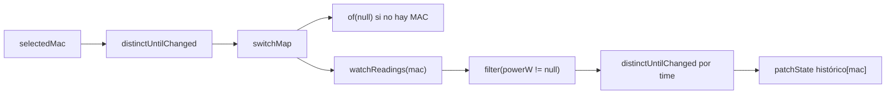
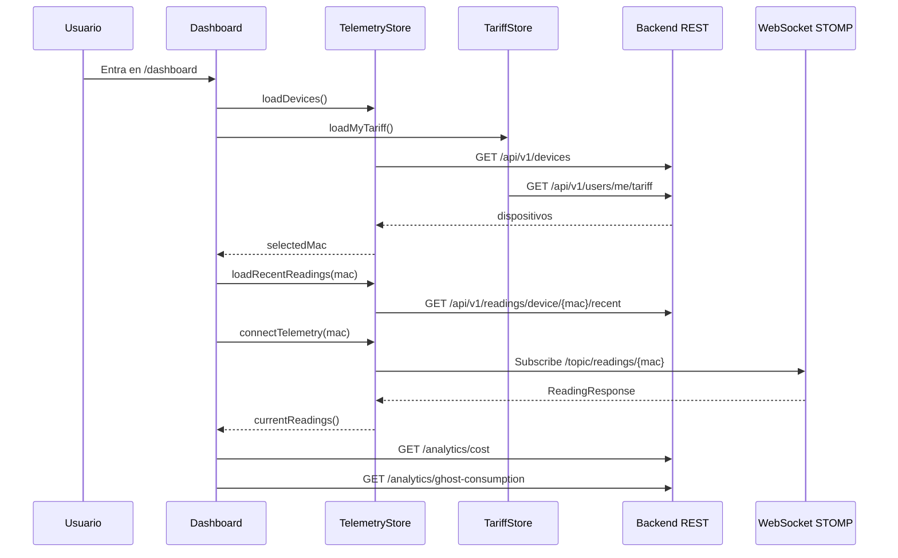

# Anexo B. Frontend Angular, RxJS y NgRx Signals

## 1. Alcance del anexo

Este anexo documenta la aplicación Angular situada en `frontend/src/app`. El frontend está construido con Angular 21, componentes standalone, PrimeNG, Tailwind, RxJS y NgRx Signals.

La función principal del frontend es convertir los datos técnicos del backend en una experiencia usable: login, registro, gestión de dispositivos, dashboard de consumo, configuración de tarifas y revisión de alertas.

## 2. Estructura general

| Archivo / directorio | Responsabilidad |
| --- | --- |
| `app.ts`, `app.html` | Componente raíz con `RouterOutlet`. |
| `app.config.ts` | Proveedores globales: router, HTTP interceptor, animaciones y tema PrimeNG. |
| `app.routes.ts` | Rutas públicas y privadas con lazy loading. |
| `guards/auth.guard.ts` | Protección de rutas según JWT guardado. |
| `interceptors/http.interceptor.ts` | Inserción de cabeceras y gestión global de 401. |
| `services` | Clientes HTTP, sesión y WebSocket. |
| `store` | Estado global con NgRx Signals. |
| `components` | Pantallas principales de la aplicación. |
| `interfaces` | Modelos TypeScript usados por servicios, stores y componentes. |

## 3. Enrutamiento y protección de sesión

Las rutas están definidas en `app.routes.ts`.

| Ruta | Componente | Acceso |
| --- | --- | --- |
| `/login` | `LoginComponent` | Pública |
| `/register` | `RegisterComponent` | Pública |
| `/auth/oauth/callback` | `OAuthCallbackComponent` | Pública |
| `/dashboard` | `DashboardComponent` dentro de `MainLayoutComponent` | Protegida |
| `/devices` | `DevicesComponent` dentro de `MainLayoutComponent` | Protegida |
| `/tariffs` | `TariffComponent` dentro de `MainLayoutComponent` | Protegida |
| `/alerts` | `AlertsComponent` dentro de `MainLayoutComponent` | Protegida |

La ruta raíz carga `MainLayoutComponent` y aplica `canActivate` y `canActivateChild`. Esta doble protección hace que no solo se valide la entrada inicial al área privada, sino también cada navegación interna si el token ya ha caducado.

## 4. Autenticación en frontend

### 4.1. `SessionStorageService`

Aunque el fichero no contiene lógica de negocio visual, es central para la seguridad del cliente:

- Guarda el JWT en `sessionStorage` con la clave `auth_token`.
- Decodifica el token con `jwt-decode`.
- Comprueba `exp` para saber si la sesión sigue vigente.
- Expone helpers como `getUsername`, `getAuthorities` y `hasRole`.

La decisión de usar `sessionStorage` en vez de `localStorage` reduce la persistencia del token cuando se cierra la pestaña, aunque sigue siendo un almacenamiento accesible desde JavaScript.

### 4.2. `authGuard`

`auth.guard.ts` consulta `SessionStorageService.isLoggedIn()`. Si devuelve `true`, permite la navegación. Si no, devuelve un `UrlTree` hacia `/login`.

Este patrón evita duplicar comprobaciones en cada componente. Los componentes privados pueden asumir que hay una sesión válida al cargarse.

### 4.3. `httpInterceptor`

El interceptor añade dos comportamientos transversales:

1. Añade siempre `X-Requested-With: XMLHttpRequest`.
2. Añade `Authorization: Bearer <token>` a peticiones `/api/v1`, excepto:
   - `/api/v1/auth/login`
   - `/api/v1/auth/register`
   - `/api/v1/auth/oauth/exchange`

Si el backend responde `401`, limpia la sesión y redirige a `/login`. Esto evita que el usuario siga usando una interfaz aparentemente activa cuando el token ya no sirve.

## 5. Servicios HTTP y tiempo real

### 5.1. `AuthService`

Archivo: `frontend/src/app/services/auth.service.ts`

| Método | Endpoint | Uso |
| --- | --- | --- |
| `authentication(user)` | `POST /api/v1/auth/login` | Login clásico con email y contraseña. |
| `register(user)` | `POST /api/v1/auth/register` | Registro de usuario. |
| `exchangeOAuthTicket(ticket)` | `POST /api/v1/auth/oauth/exchange` | Intercambia ticket OAuth2 por JWT. |

### 5.2. `TariffService`

Archivo: `frontend/src/app/services/tariff.service.ts`

| Método | Endpoint | Observación |
| --- | --- | --- |
| `getCatalog` | `GET /api/v1/tariffs` | Catálogo global. |
| `getById` | `GET /api/v1/tariffs/{id}` | Detalle de tarifa. |
| `createCatalogTariff` | `POST /api/v1/tariffs` | Solo admin en backend. |
| `updateCatalogTariff` | `POST /api/v1/tariffs/{id}` | El backend actual actualiza con POST, no PUT. |
| `deleteCatalogTariff` | `DELETE /api/v1/tariffs/{id}` | Solo admin. |
| `getMyTariff` | `GET /api/v1/users/me/tariff` | Mapea `204 No Content` a `null`. |
| `saveMyTariff` | `POST /api/v1/users/me/tariff` | Crea o actualiza tarifa privada. |
| `unlinkMyTariff` | `DELETE /api/v1/users/me/tariff` | Desvincula tarifa privada. |

### 5.3. `WebsocketService`

Archivo: `frontend/src/app/services/websocket.service.ts`

El servicio configura `RxStomp` con la URL:

```ts
const protocol = window.location.protocol === "https:" ? "wss:" : "ws:";
const wsUrl = `${protocol}//${window.location.host}/ws-iot`;
```

Esto permite usar el mismo código en desarrollo y producción. En producción, Nginx reenvía `/ws-iot` al backend; en desarrollo lo hace `proxy.conf.json`.

El método principal es:

```ts
watchReadings(macAddress: string): Observable<ReadingResponse> {
  const destination = `/topic/readings/${macAddress}`;
  return this.rxStomp
    .watch(destination)
    .pipe(map((message) => JSON.parse(message.body) as ReadingResponse));
}
```

La idea es que el componente no conozca detalles de STOMP. Solo recibe un `Observable<ReadingResponse>`.

## 6. Estado global con NgRx Signals

### 6.1. `TelemetryStore`

Archivo: `frontend/src/app/store/telemetry.store.ts`

#### Estado

| Campo | Tipo | Uso |
| --- | --- | --- |
| `devices` | `Device[]` | Dispositivos del usuario autenticado. |
| `selectedMac` | `string \| null` | Medidor activo en el dashboard. |
| `historicalReadings` | `Record<mac, { timestamps, powerW }>` | Histórico de gráfica separado por MAC. |
| `isLoadingDevices` | `boolean` | Estado de carga de dispositivos. |

#### Computed signal

`currentReadings` lee `selectedMac` y devuelve el histórico de esa MAC. Si no hay selección, devuelve arrays vacíos.

Esta decisión es importante para el panel multi-dispositivo: cambiar de medidor no mezcla lecturas, porque cada MAC tiene su propio histórico.

#### Métodos principales

| Método | Tipo | Lógica |
| --- | --- | --- |
| `setSelectedMac` | Síncrono | Cambia la MAC activa y precarga histórico reciente. |
| `loadRecentReadings` | HTTP directo | Carga `/api/v1/readings/device/{mac}/recent?seconds=120` y conserva las últimas 20 muestras. |
| `loadDevices` | `rxMethod<void>` | Carga `/api/v1/devices`, rellena lista y selecciona la primera MAC si no había una. |
| `claimDevice` | `rxMethod<ClaimDeviceRequest>` | Llama a `/api/v1/devices/claim`. |
| `createSimulatedDevice` | `rxMethod<CreateSimulatedDeviceRequest>` | Llama a `/api/v1/devices/simulated`. |
| `addDevice` | `rxMethod` | Llama a `POST /api/v1/devices`. |
| `updateDevice` | `rxMethod<Device>` | Llama a `PUT /api/v1/devices/{id}`. |
| `deleteDevice` | `rxMethod<number>` | Borra dispositivo y reajusta `selectedMac`. |
| `connectTelemetry` | `rxMethod<string \| null>` | Suscripción STOMP reactiva por MAC. |
| `reset` | Síncrono | Limpia estado al cerrar sesión. |

#### Flujo RxJS de `connectTelemetry`



Los operadores se usan con intención clara:

- `distinctUntilChanged`: evita reconectar si se selecciona la misma MAC.
- `switchMap`: cancela la suscripción anterior al cambiar de medidor.
- `filter`: descarta lecturas incompletas sin potencia.
- `distinctUntilChanged` por `time`: evita duplicados si backend emite varias lecturas con el mismo timestamp.
- `patchState`: actualiza el estado de forma inmutable.

### 6.2. `TariffStore`

Archivo: `frontend/src/app/store/tariff.store.ts`

#### Estado

| Campo | Uso |
| --- | --- |
| `catalog` | Tarifas globales disponibles. |
| `myTariff` | Tarifa privada del usuario o `null`. |
| `isLoadingCatalog` | Spinner o bloqueo de catálogo. |
| `isLoadingMyTariff` | Spinner o bloqueo de tarifa privada. |
| `errorMessage` | Error visible para la UI. |

#### Computed signals

- `hasMyTariff`: `true` si el usuario tiene tarifa privada.
- `isCatalogEmpty`: `true` si no hay tarifas en catálogo.

#### Métodos reactivos

| Método | Finalidad |
| --- | --- |
| `loadCatalog` | Carga catálogo global. |
| `loadMyTariff` | Carga tarifa privada del usuario. |
| `saveMyTariff` | Guarda contrato privado. |
| `unlinkMyTariff` | Elimina la relación usuario-tarifa. |
| `refreshAfterCatalogMutation` | Recarga catálogo tras mutación admin. |

El store usa `catchError(() => EMPTY)` para cortar flujos fallidos sin romper el resto de la UI. Además, guarda mensajes de error en estado para que los componentes los puedan mostrar.

## 7. Componentes principales

### 7.1. `MainLayoutComponent`

Actúa como chasis de la zona privada:

- Cabecera con marca y usuario.
- Navegación lateral a dashboard, dispositivos, tarifas y alertas.
- `router-outlet` para páginas hijas.
- Logout centralizado.

El cierre de sesión hace algo más que borrar el token:

1. Llama a `telemetryStore.connectTelemetry(null)` para cortar la suscripción.
2. Resetea `TelemetryStore`.
3. Resetea `TariffStore`.
4. Borra JWT.
5. Redirige a `/login`.

Esto evita que otro usuario vea datos cacheados en el mismo navegador.

### 7.2. `LoginComponent`

Usa formulario reactivo con email y contraseña. Si el login es correcto:

1. Llama a `AuthService.authentication`.
2. Guarda el JWT.
3. Navega a `/dashboard`.

También permite iniciar OAuth2 redirigiendo a `/oauth2/authorization/google` o `/oauth2/authorization/github`.

### 7.3. `RegisterComponent`

Usa formulario reactivo y un validador de grupo para comprobar que contraseña y confirmación coinciden. Tras registro correcto, redirige a login.

### 7.4. `OAuthCallbackComponent`

Lee el query param `ticket`. Si existe:

1. Llama a `AuthService.exchangeOAuthTicket`.
2. Guarda el JWT recibido.
3. Redirige a `/dashboard`.

Si falta el ticket o el intercambio falla, muestra error y permite volver al login.

### 7.5. `DashboardComponent`

Archivos:

- `frontend/src/app/components/dashboard/dashboard.component.ts`
- `frontend/src/app/components/dashboard/dashboard.html`

Responsabilidades:

- Cargar dispositivos con `TelemetryStore.loadDevices`.
- Cargar tarifa privada con `TariffStore.loadMyTariff`.
- Mostrar selector de medidor activo.
- Pintar gráfica de potencia con Chart.js.
- Consultar coste diario y consumo fantasma si hay tarifa.
- Mostrar aviso si falta tarifa.

#### Efectos reactivos

| Efecto | Motivo |
| --- | --- |
| Auto-ocultar `analyticsError` tras 8 segundos | Evita errores persistentes en pantalla. |
| Cuando cambia `selectedMac` | Precarga histórico, conecta WebSocket y recalcula analítica si hay tarifa. |
| Cuando cambia `hasMyTariff` | Limpia métricas si no hay tarifa o las recalcula si ya existe. |

#### Lógica de analítica

`loadAnalyticsMetrics(macAddress)` calcula una ventana desde las 00:00 locales del día actual hasta `now`, y llama a:

- `/api/v1/analytics/cost`
- `/api/v1/analytics/ghost-consumption`

El coste y el consumo fantasma se guardan en signals (`totalCostEur`, `ghostCostEur`) para que la plantilla se actualice automáticamente.

### 7.6. `DevicesComponent`

Archivos:

- `frontend/src/app/components/devices/devices.component.ts`
- `frontend/src/app/components/devices/devices.html`

Responsabilidades:

- Crear dispositivo físico mediante `/api/v1/devices/claim`.
- Crear dispositivo simulado mediante `/api/v1/devices/simulated`.
- Crear pack demo mediante `/api/v1/devices/simulated/demo-pack`.
- Editar nombre y perfil de simulador.
- Encender o apagar un dispositivo con `PUT /api/v1/devices/{id}`.
- Eliminar dispositivos.
- Mostrar mensajes de éxito o error con temporizador.

#### Formulario físico/simulado

El formulario usa un `SelectButton` para elegir tipo:

- **Físico:** exige `macAddress` con regex `^[0-9A-Fa-f]{12}$`.
- **Simulado:** deshabilita MAC, exige `simulationProfile` y asigna por defecto `SINE_WAVE`.

Esta lógica se encuentra en `applyDeviceKindValidators`. La decisión evita mostrar al usuario campos que no debe rellenar en el caso simulado.

### 7.7. `TariffComponent`

Gestiona dos niveles de tarifa:

- Catálogo maestro, editable por administradores.
- Tarifa privada del usuario autenticado.

La UI permite copiar una plantilla y editar precios/potencias sin tocar el catálogo global. Esto encaja con el backend, donde `UserTariffService` clona la tarifa y la asocia al usuario.

### 7.8. `AlertsComponent`

Archivo: `frontend/src/app/components/alerts/alerts.component.ts`

Comportamiento:

- Carga `GET /api/v1/alerts` al inicializar.
- Guarda lista en `signal<Alert[]>`.
- Borra una alerta con `DELETE /api/v1/alerts/{id}`.
- Refresca la tabla tras borrar.

No usa store global porque las alertas solo se consumen en una pantalla y no hay estado compartido complejo.

## 8. Interfaces relevantes

| Interface | Archivo | Uso |
| --- | --- | --- |
| `Device` | `interfaces/device.interface.ts` | Tabla de dispositivos, dashboard y edición. |
| `ClaimDeviceRequest` | `interfaces/device.interface.ts` | Alta física por MAC. |
| `CreateSimulatedDeviceRequest` | `interfaces/device.interface.ts` | Alta de simulador. |
| `SimulationProfile` | `interfaces/simulation-profile.interface.ts` | Unión de perfiles disponibles. |
| `ReadingResponse` | `interfaces/reading-response.interface.ts` | Lecturas REST y STOMP. |
| `TelemetryState` | `interfaces/telemetry-state.interface.ts` | Estado de `TelemetryStore`. |
| `TariffRequest` / `TariffResponse` | `interfaces/tariff-request.interface.ts` | Formularios y API de tarifas. |
| `EnergyCostResponse` | `interfaces/energy-cost-response.interface.ts` | Coste diario del dashboard. |
| `GhostCostResponse` | `interfaces/ghost-cost-response.interface.ts` | Consumo fantasma. |
| `Alert` | `interfaces/alert.interface.ts` | Pantalla de alertas. |
| `JwtPayload` | `interfaces/jwt-payload.interface.ts` | Decodificación de JWT. |

## 9. Flujo completo del dashboard



## 10. Decisiones destacables

- Se usa `switchMap` para que al cambiar de medidor se corte la suscripción anterior.
- El histórico se limita a 20 puntos para mantener la gráfica ligera.
- La tarifa privada se guarda en un store separado para que dashboard y pantalla de tarifas compartan estado.
- El componente de dispositivos usa `HttpClient` directamente para varias operaciones y después refresca `TelemetryStore`. Aunque el store contiene métodos CRUD, la UI actual no los usa todos.
- El interceptor lee el token en el momento de cada petición, no al arrancar, para evitar tokens obsoletos.
- Los formularios reactivos validan en cliente, pero el backend sigue siendo la autoridad final.

## 11. Relación frontend-backend

| Pantalla | Endpoints consumidos |
| --- | --- |
| Login | `POST /api/v1/auth/login`, OAuth2 browser redirects |
| Registro | `POST /api/v1/auth/register` |
| OAuth callback | `POST /api/v1/auth/oauth/exchange` |
| Dashboard | `GET /api/v1/devices`, `GET /api/v1/readings/device/{mac}/recent`, `GET /api/v1/analytics/cost`, `GET /api/v1/analytics/ghost-consumption`, STOMP `/topic/readings/{mac}` |
| Dispositivos | `GET /api/v1/devices`, `POST /api/v1/devices/claim`, `POST /api/v1/devices/simulated`, `POST /api/v1/devices/simulated/demo-pack`, `PUT /api/v1/devices/{id}`, `DELETE /api/v1/devices/{id}` |
| Tarifas | `GET/POST/DELETE /api/v1/tariffs`, `GET/POST/DELETE /api/v1/users/me/tariff` |
| Alertas | `GET /api/v1/alerts`, `DELETE /api/v1/alerts/{id}` |

## 12. Valor técnico para el proyecto

El frontend no es solo una capa visual. Coordina estado, seguridad, tiempo real y formularios complejos. La combinación de signals y RxJS permite que los cambios de sesión, medidor, tarifa y telemetría se propaguen de manera automática sin recargar la página.

La parte más relevante para la memoria DAW es el flujo del dashboard: carga inicial por REST, selección reactiva de medidor, histórico por MAC, suscripción STOMP y cálculo económico condicionado a tarifa. Esa integración demuestra conexión real entre frontend, backend, base de datos y mensajería asíncrona.
