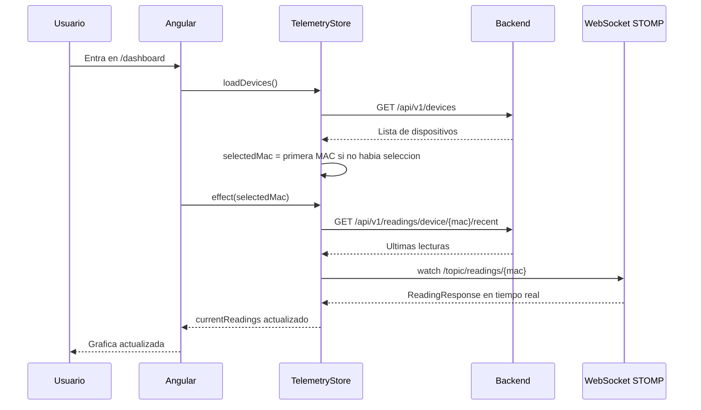

# Anexo B: Componentes, servicios y logica reactiva de Angular

## 1. Vision general del frontend

El frontend esta construido con Angular 21 y componentes standalone. La aplicacion se organiza en:

- **Componentes de pagina:** login, registro, dashboard, dispositivos, tarifas y alertas.
- **Servicios HTTP:** autenticacion, tarifas, dispositivos y WebSocket.
- **Stores reactivos:** `TelemetryStore` y `TariffStore`, basados en NgRx Signals.
- **Infraestructura transversal:** guard de autenticacion, interceptor HTTP y almacenamiento de sesion.

La intencion principal es separar la vista del estado compartido. Los componentes se encargan de formularios y experiencia de usuario; los stores mantienen datos reutilizables entre pantallas.

## 2. Enrutado y proteccion de rutas

Archivo: `frontend/src/app/app.routes.ts`.

| Ruta | Componente | Proteccion |
|---|---|---|
| `/login` | `LoginComponent` | Publica |
| `/register` | `RegisterComponent` | Publica |
| `/auth/oauth/callback` | `OAuthCallbackComponent` | Publica |
| `/dashboard` | `DashboardComponent` dentro de `MainLayoutComponent` | `authGuard` |
| `/devices` | `DevicesComponent` dentro de `MainLayoutComponent` | `authGuard` |
| `/tariffs` | `TariffComponent` dentro de `MainLayoutComponent` | `authGuard` |
| `/alerts` | `AlertsComponent` dentro de `MainLayoutComponent` | `authGuard` |

La ruta privada usa `canActivate` y `canActivateChild`. Asi se valida tanto la entrada inicial al layout como los cambios internos entre paginas.

## 3. Gestion de sesion e interceptor HTTP

### 3.1. `SessionStorageService`

Archivo: `frontend/src/app/services/session-storage.service.ts`.

Responsabilidades:

- Guardar el JWT bajo la clave `auth_token`.
- Leer el token actual.
- Borrar solo la clave de sesion al cerrar sesion.
- Comprobar expiracion decodificando el JWT con `jwt-decode`.
- Extraer `authorities` y `username` del token.

Decision importante: se usa `sessionStorage` y no `localStorage`, por lo que el token se limpia al cerrar la sesion del navegador.

### 3.2. `httpInterceptor`

Archivo: `frontend/src/app/interceptors/http.interceptor.ts`.

El interceptor clona cada peticion para anadir:

```http
X-Requested-With: XMLHttpRequest
```

Si la URL contiene `/api/v1` y no es una ruta publica de auth, tambien anade:

```http
Authorization: Bearer <token>
```

Si el backend responde 401, limpia la sesion y redirige a `/login`. Esta decision evita que un token caducado deje al usuario dentro de una pantalla privada con datos antiguos.

## 4. Store de telemetria: `TelemetryStore`

Archivo: `frontend/src/app/store/telemetry.store.ts`.

### 4.1. Estado

```ts
interface TelemetryState {
  devices: Device[];
  selectedMac: string | null;
  historicalReadings: {
    [mac: string]: {
      timestamps: string[];
      powerW: number[];
    };
  };
  isLoadingDevices: boolean;
}
```

El historico se guarda por MAC. Este cambio es importante para el panel multi-dispositivo: si el usuario cambia de enchufe, cada grafica conserva su propia serie y no mezcla lecturas de otro equipo.

### 4.2. Selector calculado

`currentReadings` es un `computed` que devuelve la serie de la MAC seleccionada:

```ts
currentReadings: computed(() => {
  const mac = state.selectedMac();
  return mac
    ? (state.historicalReadings()[mac] ?? { timestamps: [], powerW: [] })
    : { timestamps: [], powerW: [] };
})
```

La vista del dashboard no necesita saber como se organiza todo el historico, solo consume `currentReadings`.

### 4.3. Carga de dispositivos

`loadDevices` usa `rxMethod<void>` y `switchMap`:

1. Activa `isLoadingDevices`.
2. Llama a `GET /api/v1/devices`.
3. Guarda la lista.
4. Si no habia MAC seleccionada, selecciona la primera.
5. Apaga el loading incluso si hay error.

`switchMap` es adecuado porque si se dispara otra carga antes de terminar la anterior, se descarta la respuesta antigua y se conserva la mas reciente.

### 4.4. Precarga de historico reciente

Cuando se selecciona una MAC, `setSelectedMac(mac)` llama a:

```http
GET /api/v1/readings/device/{mac}/recent?seconds=120
```

El store conserva como maximo las ultimas 20 lecturas. La decision mantiene la grafica ligera y evita que una sesion larga acumule demasiados puntos en memoria.

### 4.5. Conexion de telemetria en tiempo real

`connectTelemetry` escucha la MAC seleccionada:

```ts
connectTelemetry: rxMethod<string | null>(
  pipe(
    distinctUntilChanged(),
    switchMap((mac) => {
      if (!mac) return of(null);
      return wsService.watchReadings(mac).pipe(...)
    })
  )
)
```

La combinacion tiene dos efectos:

- `distinctUntilChanged` evita reconexiones si la MAC no cambia.
- `switchMap` cancela la suscripcion anterior cuando el usuario elige otro dispositivo.

Despues filtra lecturas con `powerW` nulo y deduplica por `time`. Esto protege la grafica si el backend emite lecturas casi iguales desde dos canales MQTT distintos.

## 5. Store de tarifas: `TariffStore`

Archivo: `frontend/src/app/store/tariff.store.ts`.

### 5.1. Estado

```ts
interface TariffState {
  catalog: TariffResponse[];
  myTariff: TariffResponse | null;
  isLoadingCatalog: boolean;
  isLoadingMyTariff: boolean;
  errorMessage: string | null;
}
```

### 5.2. Computed signals

| Computed | Uso |
|---|---|
| `hasMyTariff` | Permite al dashboard decidir si puede llamar a analiticas. |
| `isCatalogEmpty` | Facilita mensajes de interfaz si no hay plantillas. |

### 5.3. Metodos reactivos

| Metodo | Endpoint usado | Intencion |
|---|---|---|
| `loadCatalog` | `GET /api/v1/tariffs` | Carga plantillas maestras. |
| `loadMyTariff` | `GET /api/v1/users/me/tariff` | Carga tarifa privada o `null` si el backend devuelve 204. |
| `saveMyTariff` | `POST /api/v1/users/me/tariff` | Asigna plantilla o guarda contrato. |
| `unlinkMyTariff` | `DELETE /api/v1/users/me/tariff` | Desvincula tarifa privada. |
| `refreshAfterCatalogMutation` | `GET /api/v1/tariffs` | Recarga catalogo tras cambios admin. |

El store captura errores con `catchError(() => EMPTY)` para cortar el flujo sin romper la aplicacion. El mensaje se guarda en `errorMessage` y los componentes lo muestran con `Message` de PrimeNG.

## 6. Servicios Angular

### 6.1. `AuthService`

Archivo: `frontend/src/app/services/auth.service.ts`.

| Metodo | Endpoint | Descripcion |
|---|---|---|
| `authentication(user)` | `POST /api/v1/auth/login` | Login tradicional. |
| `register(user)` | `POST /api/v1/auth/register` | Registro de usuario normal. |
| `exchangeOAuthTicket(ticket)` | `POST /api/v1/auth/oauth/exchange` | Cambia ticket OAuth2 por JWT. |

### 6.2. `TariffService`

Archivo: `frontend/src/app/services/tariff.service.ts`.

Encapsula las llamadas al catalogo y a la tarifa privada. Tiene una adaptacion relevante: `getMyTariff()` pide la respuesta completa con `observe: "response"` para distinguir:

- `200 + body`: existe tarifa.
- `204`: no hay tarifa y se devuelve `null` al store.

Tambien documenta una particularidad del backend: la actualizacion de tarifa de catalogo usa `POST /api/v1/tariffs/{id}`, no `PUT`.

### 6.3. `DeviceService`

Archivo: `frontend/src/app/services/device.service.ts`.

Actualmente contiene un `httpResource<Device[]>` hacia `/api/v1/devices`. El uso principal de dispositivos se ha desplazado a `TelemetryStore` y `DevicesComponent`, pero este servicio deja preparada una lectura declarativa con `httpResource`.

### 6.4. `WebsocketService`

Archivo: `frontend/src/app/services/websocket.service.ts`.

Configura `RxStomp` contra:

```ts
const wsUrl = `${protocol}//${window.location.host}/ws-iot`;
```

Si la pagina se sirve por HTTPS, usa `wss`; si no, usa `ws`. La suscripcion por dispositivo se hace en:

```text
/topic/readings/{macAddress}
```

La respuesta se parsea como `ReadingResponse`.

## 7. Componentes principales

### 7.1. `LoginComponent`

Responsabilidades:

- Formulario reactivo con email obligatorio y contrasena minima.
- Login normal mediante `AuthService.authentication`.
- Guardado de JWT en `SessionStorageService`.
- Redireccion a `/dashboard`.
- Login social redirigiendo a `/oauth2/authorization/google` o `/oauth2/authorization/github`.

Usa `signal` para `isLoading` y `loginError`, y un `effect` para borrar el error tras 7 segundos.

### 7.2. `RegisterComponent`

Responsabilidades:

- Formulario reactivo con email, password y confirmacion.
- Validador de grupo `passwordMatchValidator`.
- Alta mediante `POST /api/v1/auth/register`.
- Redireccion a `/login` tras registro correcto.

El validador trabaja sobre el grupo completo porque necesita comparar dos controles distintos.

### 7.3. `MainLayoutComponent`

Responsabilidades:

- Mostrar el chasis de rutas privadas.
- Leer el nombre de usuario desde el JWT.
- Cerrar sesion limpiando WebSocket, stores y token.

Orden del logout:

1. `telemetryStore.connectTelemetry(null)` para cerrar la suscripcion activa.
2. `telemetryStore.reset()` y `tariffStore.reset()` para evitar cache entre usuarios.
3. `sessionStorageService.logout()`.
4. Redireccion a `/login` con `replaceUrl`.

### 7.4. `DashboardComponent`

Es la pantalla principal de explotacion de datos.

Datos reactivos:

- `devices`: viene de `TelemetryStore`.
- `historicalData`: viene de `store.currentReadings`.
- `powerW` y `timestamps`: `computed`.
- `chartData`: `computed` compatible con Chart.js.
- `hasMyTariff`: viene de `TariffStore`.

Efectos importantes:

1. Al entrar, carga dispositivos y tarifa privada.
2. Cuando cambia `selectedMac`, carga lecturas recientes, conecta WebSocket y, si hay tarifa, calcula analiticas.
3. Cuando cambia la existencia de tarifa, resetea o recalcula metricas.

Analiticas:

```http
GET /api/v1/analytics/cost?macAddress=...&start=...&end=...
GET /api/v1/analytics/ghost-consumption?macAddress=...&start=...&end=...
```

La ventana usada por la interfaz es el dia actual desde las 00:00 locales del navegador hasta el momento de consulta.

### 7.5. `DevicesComponent`

Gestiona dispositivos fisicos y simulados.

Formulario principal:

| Campo | Validacion |
|---|---|
| `deviceKind` | Obligatorio: `physical` o `simulated`. |
| `name` | Obligatorio, minimo 3 caracteres. |
| `macAddress` | Solo para fisicos, patron `^[0-9A-Fa-f]{12}$`. |
| `simulationProfile` | Solo para simulados, obligatorio. |

La funcion `applyDeviceKindValidators` activa o desactiva validadores segun el tipo de dispositivo. Esta decision evita pedir MAC cuando el backend va a generar una MAC simulada.

Operaciones:

- Fisico: `POST /api/v1/devices/claim`.
- Simulado individual: `POST /api/v1/devices/simulated`.
- Pack demo: `POST /api/v1/devices/simulated/demo-pack`.
- Borrado: `DELETE /api/v1/devices/{id}`.
- Encendido/apagado: `PUT /api/v1/devices/{id}` cambiando `isOn`.
- Edicion: `PUT /api/v1/devices/{id}` cambiando nombre y, si procede, perfil.

### 7.6. `TariffComponent`

Pantalla de catalogo y contrato privado.

Decisiones importantes:

- Usa `isAdmin` calculado desde roles del JWT para distinguir acciones de administrador.
- Define periodos validos en frontend segun peaje:
  - `2.0TD`: energia `P1-P3`, potencia `P1-P2`.
  - `3.0TD`, `6.1TD`, `6.2TD`: energia y potencia `P1-P6`.
- Valida que las potencias contratadas vayan en orden ascendente mediante `ascendingPowerValidator`.
- Bloquea campos estructurales cuando el usuario edita su propia tarifa privada; solo puede cambiar precios y potencias.

El metodo `loadTariffIntoForm` usa `{ emitEvent: false }` al cargar datos. Esto es necesario porque el cambio de `accessTariffCode` reconstruye los arrays de periodos; si el evento se emitiera al cargar, se perderian los valores reales que llegan del backend.

### 7.7. `AlertsComponent`

Responsabilidades:

- Cargar alertas con `GET /api/v1/alerts`.
- Mostrar tabla de incidencias.
- Descartar una alerta con `DELETE /api/v1/alerts/{id}`.
- Mostrar mensajes temporales de exito y error.

La autorizacion real del borrado no se deja al frontend: el backend usa `deleteByIdAndUserUsername`.

## 8. Flujo completo de datos en el dashboard



## 9. Modelos TypeScript relevantes

### `Device`

```ts
interface Device {
  id: number;
  username: string;
  name: string;
  macAddress: string;
  isOn: boolean;
  simulated: boolean;
  simulationProfile: SimulationProfile | null;
}
```

### `ReadingResponse`

```ts
interface ReadingResponse {
  time: string | number;
  macAddress: string;
  powerW: number;
  energyTotalKwh: number;
  isOn: boolean;
}
```

### `TariffRequest`

```ts
interface TariffRequest {
  id: number | null;
  name: string;
  market: string;
  accessTariffCode: "2.0TD" | "3.0TD" | "6.1TD" | "6.2TD";
  geographicZone: "PENINSULA" | "CANARIAS" | "ISLAS_BALEARES" | "CEUTA" | "MELILLA";
  energyCompany: string;
  periods: PeriodRequest[];
  contractedPowers: TariffContractedPowerRequest[];
}
```

## 10. Relacion con los cambios recientes

Los ultimos cambios del frontend afectan sobre todo a:

- **Panel multi-dispositivo:** `historicalReadings` paso a estar indexado por MAC.
- **Precarga de historico:** al seleccionar dispositivo se consultan lecturas recientes antes de esperar al WebSocket.
- **Simuladores:** `DevicesComponent` permite elegir entre dispositivo fisico y simulado.
- **Pack demo:** boton que crea varios simuladores con perfiles distintos.
- **Borrado seguro:** tras borrar dispositivo, se recarga la lista y el store evita mantener una MAC seleccionada que ya no existe.
