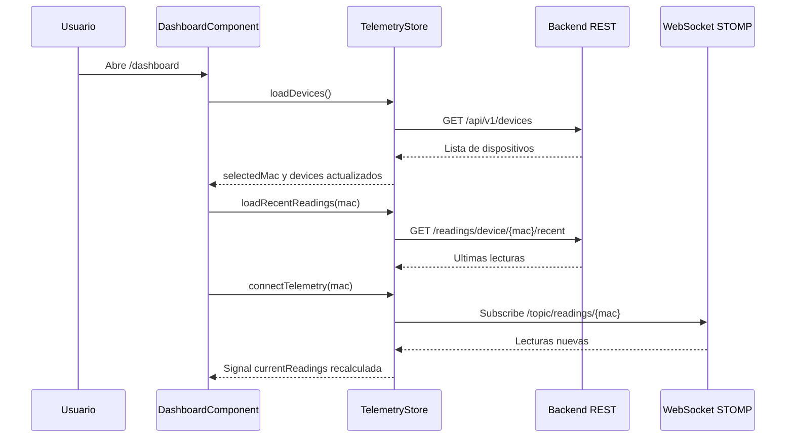

# Anexo B - Frontend Angular, RxJS y NgRx Signals

## 1. Vision general

El frontend esta implementado con **Angular 21.x** usando componentes standalone y rutas cargadas de forma diferida. La aplicacion no usa un NgRx Store clasico con acciones y reducers, sino **NgRx Signals** mediante `signalStore`, `withState`, `withComputed`, `withMethods` y `rxMethod`.

La idea principal es separar tres responsabilidades:

1. Los **servicios** encapsulan llamadas HTTP o WebSocket.
2. Los **stores** mantienen estado compartido y exponen metodos reactivos.
3. Los **componentes** gestionan formularios, eventos de usuario y presentacion.

## 2. Rutas y proteccion de navegacion

Archivo: `frontend/src/app/app.routes.ts`

| Ruta | Componente | Proteccion |
| --- | --- | --- |
| `/login` | `LoginComponent` | Publica |
| `/register` | `RegisterComponent` | Publica |
| `/auth/oauth/callback` | `OAuthCallbackComponent` | Publica |
| `/dashboard` | `DashboardComponent` | `authGuard` |
| `/devices` | `DevicesComponent` | `authGuard` |
| `/tariffs` | `TariffComponent` | `authGuard` |
| `/alerts` | `AlertsComponent` | `authGuard` |

El layout principal usa `canActivate` y `canActivateChild`. Esto protege tanto la primera entrada como los cambios internos de pantalla. Si el usuario intenta abrir directamente una URL privada sin sesion valida, el guard lo redirige.

## 3. Interceptor HTTP

Archivo: `frontend/src/app/interceptors/http.interceptor.ts`

El interceptor hace dos cosas en cada peticion:

- Anade `X-Requested-With: XMLHttpRequest`.
- Adjunta `Authorization: Bearer <token>` a las rutas `/api/v1`, salvo login, registro y `oauth/exchange`.

La exclusion de rutas publicas es importante porque en login todavia no existe token y en `oauth/exchange` la credencial temporal es el ticket de un solo uso. Si el backend devuelve `401`, el interceptor cierra sesion, limpia el almacenamiento y navega a `/login`.

```ts
const isAuthRoute =
	req.url.includes("/api/v1/auth/login") ||
	req.url.includes("/api/v1/auth/register") ||
	req.url.includes("/api/v1/auth/oauth/exchange");
```

## 4. Servicios Angular

### 4.1. `AuthService`

Archivo: `frontend/src/app/services/auth.service.ts`

| Metodo | Endpoint | Descripcion |
| --- | --- | --- |
| `authentication(user)` | `POST /api/v1/auth/login` | Envia usuario y contrasena, recibe JWT. |
| `register(user)` | `POST /api/v1/auth/register` | Crea una cuenta normal. |
| `exchangeOAuthTicket(ticket)` | `POST /api/v1/auth/oauth/exchange` | Cambia ticket OAuth2 por JWT final. |

### 4.2. `TariffService`

Archivo: `frontend/src/app/services/tariff.service.ts`

Este servicio refleja directamente el contrato REST de tarifas:

| Metodo | Endpoint | Observacion |
| --- | --- | --- |
| `getCatalog()` | `GET /api/v1/tariffs` | Catalogo maestro. |
| `getById(id)` | `GET /api/v1/tariffs/{id}` | Detalle de una tarifa. |
| `createCatalogTariff(payload)` | `POST /api/v1/tariffs` | Solo admin. |
| `updateCatalogTariff(id, payload)` | `POST /api/v1/tariffs/{id}` | El backend actual usa POST para actualizar. |
| `deleteCatalogTariff(id)` | `DELETE /api/v1/tariffs/{id}` | Solo admin. |
| `getMyTariff()` | `GET /api/v1/users/me/tariff` | Convierte `204 No Content` en `null`. |
| `saveMyTariff(payload)` | `POST /api/v1/users/me/tariff` | Crea o actualiza tarifa privada. |
| `unlinkMyTariff()` | `DELETE /api/v1/users/me/tariff` | Desvincula tarifa privada. |

La conversion de `204` a `null` evita que los componentes tengan que tratar una respuesta vacia como error.

### 4.3. `WebsocketService`

Archivo: `frontend/src/app/services/websocket.service.ts`

`WebsocketService` usa `RxStomp` y calcula la URL WebSocket segun el protocolo actual:

- `https:` -> `wss:`
- `http:` -> `ws:`

El endpoint es `/ws-iot`, que coincide con `StompWebSocketConfig` en el backend. Para cada dispositivo, el servicio se suscribe a:

```text
/topic/readings/{macAddress}
```

Devuelve un `Observable<ReadingResponse>` parseando el `message.body` recibido desde STOMP.

### 4.4. `DeviceService`

Archivo: `frontend/src/app/services/device.service.ts`

Este servicio contiene un `httpResource<Device[]>` contra `/api/v1/devices`. En el estado actual, la mayor parte de la gestion de dispositivos se hace desde `TelemetryStore` y `DevicesComponent`, pero este recurso queda como una alternativa declarativa para leer dispositivos.

## 5. Store de telemetria

Archivo: `frontend/src/app/store/telemetry.store.ts`

### 5.1. Estado

```ts
interface TelemetryState {
	devices: Device[];
	selectedMac: string | null;
	historicalReadings: {
		[mac: string]: {
			timestamps: string[];
			powerW: number[];
		};
	};
	isLoadingDevices: boolean;
}
```

El store guarda historiales por MAC. Esta decision permite cambiar entre dispositivos sin perder inmediatamente la grafica reciente de cada uno.

### 5.2. Selector computado

`currentReadings` depende de `selectedMac`. Si hay MAC seleccionada, devuelve el historial de esa MAC; si no, devuelve arrays vacios.

```ts
currentReadings: computed(() => {
	const mac = state.selectedMac();
	return mac
		? (state.historicalReadings()[mac] ?? { timestamps: [], powerW: [] })
		: { timestamps: [], powerW: [] };
})
```

### 5.3. Metodos HTTP con `rxMethod`

| Metodo | Tipo de flujo | Endpoint | Efecto en estado |
| --- | --- | --- | --- |
| `loadDevices` | `rxMethod<void>` | `GET /api/v1/devices` | Rellena `devices`, selecciona primera MAC si no habia una. |
| `claimDevice` | `rxMethod<ClaimDeviceRequest>` | `POST /api/v1/devices/claim` | Inserta el dispositivo reclamado en la lista. |
| `createSimulatedDevice` | `rxMethod<CreateSimulatedDeviceRequest>` | `POST /api/v1/devices/simulated` | Inserta simulador creado. |
| `addDevice` | `rxMethod<{ name; macAddress }>` | `POST /api/v1/devices` | Alta directa de dispositivo. |
| `updateDevice` | `rxMethod<Device>` | `PUT /api/v1/devices/{id}` | Sustituye el dispositivo actualizado. |
| `deleteDevice` | `rxMethod<number>` | `DELETE /api/v1/devices/{id}` | Quita el dispositivo y ajusta `selectedMac`. |

`rxMethod` permite iniciar flujos RxJS desde fuera del store sin exponer suscripciones en cada componente. Internamente se usa `switchMap` para cancelar el flujo anterior si llega una nueva accion del mismo tipo.

### 5.4. Carga de historial reciente

`loadRecentReadings(mac)` consulta:

```text
GET /api/v1/readings/device/{mac}/recent?seconds=120
```

Luego limita la grafica a las ultimas 20 muestras. El limite se aplica para que Chart.js no se llene de puntos y la interfaz siga siendo legible en tiempo real.

### 5.5. Conexion WebSocket

`connectTelemetry` recibe una MAC, se suscribe al WebSocket y aplica tres operaciones reactivas:

1. `distinctUntilChanged()` sobre la MAC para no reconectar si no cambia.
2. `filter()` para descartar lecturas sin `powerW`.
3. `distinctUntilChanged((prev, curr) => prev.time === curr.time)` para no duplicar lecturas con el mismo instante.

Cada lectura nueva se anade al historial de la MAC y se conserva una ventana maxima de 20 puntos.

## 6. Store de tarifas

Archivo: `frontend/src/app/store/tariff.store.ts`

### 6.1. Estado

```ts
interface TariffState {
	catalog: TariffResponse[];
	myTariff: TariffResponse | null;
	isLoadingCatalog: boolean;
	isLoadingMyTariff: boolean;
	errorMessage: string | null;
}
```

### 6.2. Computed signals

| Computed | Significado |
| --- | --- |
| `hasMyTariff` | `true` si el usuario tiene tarifa privada asignada. |
| `isCatalogEmpty` | `true` si no hay plantillas en catalogo. |

### 6.3. Metodos reactivos

| Metodo | Funcion |
| --- | --- |
| `loadCatalog` | Carga plantillas maestras. |
| `loadMyTariff` | Carga tarifa privada y acepta `null` si backend devuelve `204`. |
| `saveMyTariff` | Guarda contrato privado y actualiza estado. |
| `unlinkMyTariff` | Borra tarifa privada del usuario. |
| `refreshAfterCatalogMutation` | Recarga catalogo tras cambios de admin. |
| `reset` | Limpia estado al cerrar sesion. |

El store tambien incluye helpers sincronicos (`setCatalogTariff`, `addToCatalog`, `removeFromCatalog`, `patchMyTariff`) para que el componente actualice la UI justo despues de una respuesta HTTP correcta, sin tener que recargar siempre todo el catalogo.

## 7. Componentes principales

### 7.1. `DashboardComponent`

Archivo: `frontend/src/app/components/dashboard/dashboard.component.ts`

Responsabilidades:

- Cargar dispositivos y tarifa privada al iniciar.
- Seleccionar la MAC activa.
- Conectar el WebSocket de telemetria.
- Pintar grafica de potencia activa con Chart.js.
- Consultar coste del dia y consumo fantasma.

El componente usa `effect()` para reaccionar a cambios en `selectedMac` y `hasMyTariff`. Cuando hay MAC y tarifa, llama a:

```text
GET /api/v1/analytics/cost
GET /api/v1/analytics/ghost-consumption
```

El rango temporal va desde el inicio del dia local hasta el momento actual. Si el usuario no tiene tarifa, las metricas se limpian a `null` y la vista muestra guiones informativos.

### 7.2. `DevicesComponent`

Archivo: `frontend/src/app/components/devices/devices.component.ts`

Gestiona:

- Alta de dispositivo fisico por MAC.
- Alta de simulador por perfil.
- Creacion del pack demo.
- Edicion de nombre y perfil simulado.
- Eliminacion de dispositivo.
- Cambio logico de encendido/apagado.

El formulario cambia validadores segun el tipo de dispositivo:

- **Fisico:** exige MAC de 12 caracteres hexadecimales.
- **Simulado:** desactiva MAC y exige `simulationProfile`.

Esta decision evita pedir al usuario una MAC falsa cuando el backend ya genera una MAC sintetica segura.

### 7.3. `TariffComponent`

Archivo: `frontend/src/app/components/tariff/tariff.component.ts`

El componente maneja dos modos:

- **Modo administrador:** crear, editar y borrar plantillas del catalogo maestro.
- **Modo usuario:** asignar una plantilla y editar solo precios/potencias de su tarifa privada.

Los arrays del formulario se reconstruyen al cambiar el peaje:

| Peaje | Periodos energia | Periodos potencia |
| --- | --- | --- |
| `2.0TD` | `P1`, `P2`, `P3` | `P1`, `P2` |
| `3.0TD` | `P1` a `P6` | `P1` a `P6` |
| `6.1TD` | `P1` a `P6` | `P1` a `P6` |
| `6.2TD` | `P1` a `P6` | `P1` a `P6` |

El validador `ascendingPowerValidator` comprueba que las potencias contratadas no bajen de un periodo al siguiente. En modo tarifa privada, los campos estructurales se deshabilitan para que el usuario solo modifique precios y potencias; esto respeta la idea de clonar una plantilla y ajustar el contrato.

### 7.4. `AlertsComponent`

Archivo: `frontend/src/app/components/alerts/alerts.component.ts`

Consulta `/api/v1/alerts`, muestra la tabla de incidencias y permite descartarlas con `DELETE /api/v1/alerts/{id}`. Las alertas pertenecen al usuario autenticado, por lo que no se envia ningun `username` desde Angular.

## 8. Interfaces TypeScript principales

### 8.1. Dispositivos

```ts
export interface Device {
	id: number;
	username: string;
	name: string;
	macAddress: string;
	isOn: boolean;
	simulated: boolean;
	simulationProfile: SimulationProfile | null;
}
```

### 8.2. Lecturas

```ts
export interface ReadingResponse {
	time: string | number;
	macAddress: string;
	powerW: number;
	energyTotalKwh: number;
	isOn: boolean;
}
```

### 8.3. Tarifas

```ts
export interface TariffRequest {
	id: number | null;
	name: string;
	market: string;
	accessTariffCode: AccessTariffCode;
	geographicZone: GeographicZone;
	energyCompany: string;
	periods: PeriodRequest[];
	contractedPowers: TariffContractedPowerRequest[];
}
```

### 8.4. Perfiles de simulacion

```ts
export type SimulationProfile =
	| "SINE_WAVE"
	| "OVEN"
	| "WASHING_MACHINE"
	| "TELEVISION"
	| "FAN"
	| "DESKTOP_PC"
	| "FRIDGE"
	| "STANDBY"
	| "CONSTANT_HIGH_LOAD";
```

## 9. Flujo de datos en el dashboard



## 10. Decisiones destacables

- **Signals para estado local y compartido:** reducen suscripciones manuales y hacen que la UI se actualice de forma declarativa.
- **`rxMethod` en stores:** centraliza flujos HTTP y evita repetir `subscribe` en cada componente.
- **Historial limitado a 20 puntos:** mejora legibilidad y rendimiento de la grafica.
- **Tipos simetricos con DTOs Java:** reduce errores de contrato entre frontend y backend.
- **Interceptor unico:** concentra autenticacion y gestion de `401`, manteniendo los servicios limpios.
