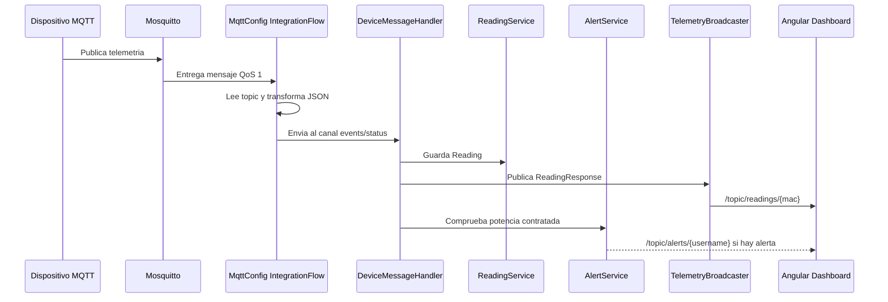

# Anexo C - Ingesta asincrona de telemetria MQTT

## 1. Objetivo de la ingesta

La ingesta MQTT permite que Wattimizer reciba datos de dispositivos electricos sin depender de peticiones HTTP desde el frontend. El dispositivo publica mensajes en Mosquitto, Spring Integration los consume, el backend los transforma en entidades `Reading` y despues emite el resultado al dashboard por WebSocket.

Este flujo es asincrono porque el dato no nace en una accion directa del usuario, sino en un equipo IoT o en el job interno de simulacion.

## 2. Componentes implicados

| Componente | Archivo | Responsabilidad |
| --- | --- | --- |
| Broker MQTT | `docker-compose.yml` / Mosquitto | Recibir mensajes de dispositivos. |
| Configuracion MQTT | `MqttConfig.java` | Crear cliente Paho, suscribirse a topics y enrutar mensajes. |
| Canales Spring Integration | `eventsRpcChannel`, `statusChannel` | Separar tipos de mensaje. |
| Handler de mensajes | `DeviceMessageHandler.java` | Persistir lecturas, emitir WebSocket y generar alertas. |
| Mappers | `EventsRpcMapper`, `StatusMapper` | Convertir JSON MQTT a entidad `Reading`. |
| Persistencia | `ReadingService`, `ReadingRepository` | Guardar lecturas en la hypertable `readings`. |
| WebSocket | `TelemetryBroadcaster`, `StompWebSocketConfig` | Enviar lecturas a Angular. |

## 3. Configuracion MQTT en Spring Integration

`MqttConfig` esta anotado con `@EnableIntegration`. Crea un `MqttPahoClientFactory` con:

- URL MQTT leida de `mqtt.url`.
- Usuario de `mqtt.username`.
- Password de `mqtt.password`.
- Reconexion automatica activada.
- Sesion limpia activada.

El adaptador de entrada es `MqttPahoMessageDrivenChannelAdapter`. Usa QoS 1, lo que significa que el broker intenta entregar cada mensaje al menos una vez. Por eso en el frontend tambien existe deduplicacion por timestamp para evitar pintar lecturas repetidas si se reciben dos eventos equivalentes.

El topic configurado sigue el patron:

```text
shellyplugsg3-<identificador-dispositivo>/#
```

En el codigo actual se suscribe a un dispositivo Shelly concreto de desarrollo. Para una version multi-dispositivo completa, esta parte deberia generalizarse a un patron mas amplio o a suscripciones dinamicas.

## 4. Enrutado de topics

El `IntegrationFlow` lee la cabecera `MqttHeaders.RECEIVED_TOPIC` y decide la ruta:

```java
if (topic != null && topic.endsWith("/events/rpc")) return "EVENTS";
if (topic != null && topic.endsWith("/status/switch:0")) return "STATUS";
return "IGNORE";
```

Despues transforma el JSON al DTO correspondiente:

| Sufijo de topic | DTO destino | Canal interno |
| --- | --- | --- |
| `/events/rpc` | `EventsRpc` | `eventsRpcChannel` |
| `/status/switch:0` | `Status` | `statusChannel` |
| Otro | Sin procesar | `nullChannel` |

Esta separacion evita que `DeviceMessageHandler` tenga que interpretar JSON crudo. Cuando el mensaje llega al handler, ya es un objeto Java tipado.

## 5. DTOs MQTT

### 5.1. `EventsRpc`

```java
public record EventsRpc(
    @JsonProperty("src")
    String source,
    Params params
) {}
```

`source` contiene el identificador del dispositivo Shelly. `Params` contiene timestamp y datos del switch.

```java
public record Params(
    @JsonProperty("ts")
    Double timestamp,
    @JsonProperty("switch:0")
    Switch switchData
) {}
```

### 5.2. `Status`

```java
public record Status(
    Boolean output,
    @JsonProperty("apower")
    Double activePower,
    @JsonProperty("aenergy")
    ActiveEnergy activeEnergy
) {}
```

`Status` representa el estado directo del switch: si esta encendido, potencia activa y energia acumulada.

### 5.3. Energia activa

```java
public record ActiveEnergy(Double total) {}
```

El dispositivo envia energia en Wh. La entidad `Reading` guarda `energyTotalKwh`, por lo que los mappers convierten Wh a kWh dividiendo entre 1000.

## 6. Mapeo a entidad `Reading`

### 6.1. Flujo `events/rpc`

`EventsRpcMapper` realiza estas conversiones:

| Campo MQTT | Campo `Reading` | Transformacion |
| --- | --- | --- |
| `params.ts` | `time` | Epoch seconds a `Instant`. |
| `src` | `device` | Extrae la MAC desde el ultimo tramo del identificador. |
| `params.switch:0.apower` | `powerW` | Potencia activa en W. |
| `params.switch:0.aenergy.total` | `energyTotalKwh` | Wh / 1000. |
| No incluido | `isOn` | Se ignora en este mapper. |

Despues `ReadingService.saveEntity(EventsRpc)` trabaja con el `Device` que haya devuelto `EventsRpcMapper`. Si la MAC ya existe en base de datos, la lectura queda asociada a ese dispositivo. Si no existe, el mapper devuelve `null` y el servicio acaba usando una MAC vacia al crear el registro de respaldo. Por eso, para hardware fisico, el flujo fiable es registrar o reclamar antes el dispositivo, o cargar el seed de desarrollo correspondiente.

### 6.2. Flujo `status/switch:0`

`StatusMapper` convierte:

| Campo MQTT | Campo `Reading` |
| --- | --- |
| `output` | `isOn` |
| `apower` | `powerW` |
| `aenergy.total` | `energyTotalKwh` |

En este caso la MAC no viene en el payload, sino en el topic. `DeviceMessageHandler.handleStatus` la obtiene desde la cabecera MQTT:

```java
String topic = mqttMessage.getHeaders().get(MqttHeaders.RECEIVED_TOPIC, String.class);
String macAddress = (topic != null) ? topic.split("/")[0].split("-")[1] : null;
```

Despues busca el `DeviceDto` y llama a `ReadingService.saveEntity(deviceDto, payload)`. El instante se asigna con `Instant.now()` porque el DTO `Status` no trae timestamp propio en el modelo usado por la aplicacion.

## 7. Handler transaccional

Archivo: `DeviceMessageHandler.java`

Los dos metodos principales estan anotados con `@Transactional` y `@ServiceActivator`:

```java
@ServiceActivator(inputChannel = "eventsRpcChannel")
public void handleEventsRpc(Message<EventsRpc> mqttMessage)
```

```java
@ServiceActivator(inputChannel = "statusChannel")
public void handleStatus(Message<Status> mqttMessage)
```

Ambos siguen el mismo patron:

1. Leer payload o cabecera MQTT.
2. Crear y guardar `Reading`.
3. Convertir la lectura a `ReadingResponse`.
4. Emitir por WebSocket.
5. Comprobar si hay que crear alerta de maximetro.



## 8. Emision WebSocket

`TelemetryBroadcaster` usa `SimpMessagingTemplate`:

| Metodo | Destino STOMP | Payload |
| --- | --- | --- |
| `broadcast(ReadingResponse)` | `/topic/readings/{macAddress}` | Lectura normalizada. |
| `broadcast(AlertDto)` | `/topic/alerts/{username}` | Alerta de maximetro. |

`StompWebSocketConfig` registra el endpoint `/ws-iot` y activa broker simple con prefijo `/topic`. Angular se conecta a ese endpoint con `RxStomp`.

## 9. Simulacion de telemetria

La aplicacion incluye una via de telemetria sin hardware real:

- `IotTelemetrySimulationJob` se ejecuta con `@Scheduled`.
- Solo trabaja si `simulation.enabled=true`.
- Recupera dispositivos `is_simulated=true`.
- Para cada dispositivo llama a `SimulatedTelemetryProcessor`.

`SimulatedTelemetryProcessor` abre una transaccion nueva por dispositivo. Esta decision evita que un fallo en un simulador cancele las lecturas del resto durante el mismo tick.

El perfil de potencia se resuelve en `SimulationProfileRegistry`:

| Perfil | Intencion |
| --- | --- |
| `SINE_WAVE` | Onda de prueba general. |
| `OVEN` | Picos y ciclos de horno. |
| `WASHING_MACHINE` | Consumo por fases de lavado. |
| `TELEVISION` | Consumo moderado estable. |
| `FAN` | Ventilador. |
| `DESKTOP_PC` | Equipo informatico. |
| `FRIDGE` | Nevera con ciclos. |
| `STANDBY` | Consumo fantasma. |
| `CONSTANT_HIGH_LOAD` | Carga alta para forzar alertas. |

La energia acumulada se calcula con:

```text
kWh_siguiente = kWh_anterior + (powerW * segundos_intervalo) / 1000 / 3600
```

El resultado se redondea a cuatro decimales, igual que una lectura acumulada realista.

## 10. Relacion con alertas

Cada lectura, venga de MQTT real o simulador, pasa por `AlertService.checkPowerThreshold`. El servicio:

1. Comprueba que la lectura tenga dispositivo, potencia y tiempo.
2. Obtiene usuario y tarifa del dispositivo.
3. Resuelve el periodo aplicable mediante `CalendarResolverService`.
4. Busca la potencia contratada del periodo.
5. Compara `powerW / 1000` con `contractedPowerKw`.
6. Si se supera, crea alerta `OVERPOWER` y la emite por WebSocket.

Esto hace que la alerta no dependa del frontend. Aunque nadie tenga el dashboard abierto, la alerta queda persistida en base de datos.

## 11. Limitaciones actuales

- La suscripcion MQTT esta fijada a un Shelly concreto de desarrollo. Para produccion multi-cliente convendria usar patrones de topic por tenant o gestionar suscripciones dinamicas.
- `events/rpc` solo conserva correctamente la MAC si el dispositivo ya existe. Si llega un origen desconocido, el codigo actual crea un respaldo con MAC vacia, asi que no debe tratarse como alta automatica completa.
- `status/switch:0` necesita que el dispositivo exista, porque busca la MAC del topic y despues carga el `DeviceDto`.
- No hay una cola intermedia persistente entre Mosquitto y base de datos; si el backend esta caido, la garantia depende de la configuracion del broker y del dispositivo.

## 12. Resumen

La ingesta MQTT de Wattimizer esta pensada para desacoplar la llegada de telemetria de la navegacion del usuario. Spring Integration se encarga de escuchar el broker y enrutar mensajes; los servicios de dominio guardan lecturas y generan alertas; WebSocket mantiene el dashboard actualizado sin polling constante.
