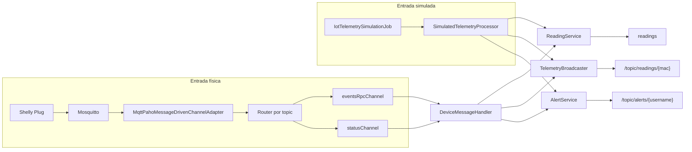

# Anexo C. Ingesta asíncrona MQTT y simulación de telemetría

## 1. Alcance del anexo

Este anexo explica cómo Wattimizer recibe telemetría eléctrica de forma asíncrona. Hay dos entradas de datos:

1. **Dispositivo físico Shelly** mediante MQTT y Spring Integration.
2. **Dispositivos simulados** mediante un job programado de Spring.

Ambos caminos acaban guardando lecturas en `readings`, publicando actualizaciones por WebSocket STOMP y comprobando alertas de potencia.

Archivos principales:

- `backend/src/main/java/com/joselumartos/jwtauthbackenddemo/config/MqttConfig.java`
- `backend/src/main/java/com/joselumartos/jwtauthbackenddemo/services/DeviceMessageHandler.java`
- `backend/src/main/java/com/joselumartos/jwtauthbackenddemo/services/ReadingService.java`
- `backend/src/main/java/com/joselumartos/jwtauthbackenddemo/services/IotTelemetrySimulationJob.java`
- `backend/src/main/java/com/joselumartos/jwtauthbackenddemo/services/SimulatedTelemetryProcessor.java`
- `backend/src/main/java/com/joselumartos/jwtauthbackenddemo/services/TelemetryBroadcaster.java`
- `backend/src/main/java/com/joselumartos/jwtauthbackenddemo/config/StompWebSocketConfig.java`

## 2. Arquitectura del flujo



La decisión de diseño es clara: MQTT se usa solo como entrada IoT. El navegador no habla MQTT. El frontend recibe eventos por WebSocket STOMP, que encaja mejor con una SPA Angular detrás de Nginx.

## 3. Configuración MQTT

### 3.1. Propiedades

`application.properties` define:

```properties
mqtt.url=${MQTT_URL:tcp://localhost:1883}
mqtt.username=${MQTT_USER:<fallback-local>}
mqtt.password=${MQTT_PASSWORD:<fallback-local>}
```

El fichero real de configuración incluye valores de desarrollo para arrancar en local, pero en la documentación se omiten para no copiar credenciales aunque sean de entorno de pruebas.

En `docker-compose.yml`, el backend recibe:

```yaml
MQTT_URL: tcp://mosquitto:1883
MQTT_USER: ${PROD_MQTT_USER}
MQTT_PASSWORD: ${PROD_MQTT_PASSWORD}
```

Esto permite que en local se use un broker sencillo y en producción se inyecten credenciales sin hardcodearlas en el código.

### 3.2. Cliente MQTT

`MqttConfig` crea un `DefaultMqttPahoClientFactory` con:

- `automaticReconnect = true`
- `cleanSession = true`
- usuario y contraseña desde propiedades
- servidor desde `mqtt.url`

El adaptador de entrada es:

```java
new MqttPahoMessageDrivenChannelAdapter(
    "backend-spring-iot",
    mqttClientFactory(),
    "shellyplugsg3-9070694d3590/#"
);
```

El `clientId` es `backend-spring-iot` y el QoS configurado es `1`.

### 3.3. Limitación actual de topic

La suscripción MQTT está acotada a:

```text
shellyplugsg3-9070694d3590/#
```

Eso significa que el backend escucha un Shelly concreto. Para soportar múltiples Shelly físicos de forma dinámica, habría que cambiar esta configuración y gestionar topics por dispositivo o usar un patrón más amplio.

## 4. Enrutamiento interno con Spring Integration

El flujo `mqttInboundFlow` lee la cabecera `MqttHeaders.RECEIVED_TOPIC` y decide por sufijo:

| Sufijo de topic | Rama | DTO destino | Canal |
| --- | --- | --- | --- |
| `/events/rpc` | `EVENTS` | `EventsRpc` | `eventsRpcChannel` |
| `/status/switch:0` | `STATUS` | `Status` | `statusChannel` |
| Cualquier otro | `IGNORE` | Ninguno | `nullChannel` |

La transformación se hace con:

```java
Transformers.fromJson(EventsRpc.class)
Transformers.fromJson(Status.class)
```

Esto permite que el handler reciba objetos Java ya parseados en lugar de strings JSON.

## 5. Topics y payloads Shelly

### 5.1. Topics usados

El seed del dispositivo físico documenta estos topics:

| Topic | Significado |
| --- | --- |
| `shellyplugsg3-9070694d3590/events/rpc` | Evento RPC con potencia, energía acumulada y timestamp. |
| `shellyplugsg3-9070694d3590/status/switch:0` | Estado del relé y medidas del switch principal. |

### 5.2. DTOs de entrada

| DTO | Campos relevantes | Uso |
| --- | --- | --- |
| `EventsRpc` | `src`, `params` | Evento completo de Shelly. |
| `Params` | `ts`, `switch:0` | Timestamp y datos eléctricos. |
| `Switch` | `apower`, `aenergy` | Potencia activa y energía. |
| `ActiveEnergy` | `total` | Energía total en Wh. |
| `Status` | `output`, `apower`, `aenergy` | Estado del relé y consumo actual. |

Los DTOs usan tolerancia a campos desconocidos, algo necesario porque los firmwares de dispositivos IoT pueden añadir propiedades sin avisar.

## 6. Mapeo de datos a `Reading`

### 6.1. Eventos RPC

`EventsRpcMapper` transforma el evento en una entidad `Reading`.

| Origen | Destino | Regla |
| --- | --- | --- |
| `params.ts` | `time` | Conversión de epoch a `Instant`. |
| `src` | `device` | Extrae MAC del texto después del último guion. |
| `switch:0.apower` | `powerW` | Potencia activa en W. |
| `switch:0.aenergy.total` | `energyTotalKwh` | Conversión de Wh a kWh dividiendo entre 1000. |
| Sin dato directo | `isOn` | No se rellena desde `events/rpc`. |

Si la MAC no corresponde a un dispositivo existente, `ReadingService.saveEntity(EventsRpc)` intenta aprovisionar un dispositivo nuevo. En el caso actual, si el mapper no logra asociar MAC, se usa cadena vacía como MAC. Por eso no conviene afirmar que cualquier evento RPC aprovisiona correctamente el Shelly: solo conserva la MAC si el mapeo encuentra un dispositivo reconocible.

### 6.2. Estado `status/switch:0`

`StatusMapper` transforma el estado en lectura, pero el handler primero extrae la MAC desde el topic:

```java
String macAddress = (topic != null) ? topic.split("/")[0].split("-")[1] : null;
DeviceDto deviceDto = deviceService.findByMacAddress(macAddress);
```

Este flujo exige que el dispositivo exista en base de datos. Si no existe, `DeviceService.findByMacAddress` lanza `EntityNotFoundException`.

## 7. Handler transaccional

`DeviceMessageHandler` tiene dos métodos con `@ServiceActivator`:

| Método | Canal | Pasos |
| --- | --- | --- |
| `handleEventsRpc` | `eventsRpcChannel` | Guarda lectura, publica STOMP y comprueba alerta. |
| `handleStatus` | `statusChannel` | Resuelve dispositivo por MAC, guarda lectura, publica STOMP y comprueba alerta. |

Ambos métodos usan `@Transactional`. La intención es que persistencia, broadcast y comprobación de alerta trabajen con una lectura coherente. El broadcast se lanza después de llamar al guardado de la lectura, aunque todavía dentro de la transacción del handler.

## 8. Persistencia en `ReadingService`

### 8.1. Guardado desde `EventsRpc`

Flujo:

1. MapStruct convierte `EventsRpc` a `Reading`.
2. Se obtiene la MAC del device mapeado.
3. Se busca el dispositivo por MAC.
4. Si no existe, se crea uno con nombre `Nuevo Enchufe {mac}`.
5. Se asocia el dispositivo gestionado a la lectura.
6. Se guarda la lectura.

### 8.2. Guardado desde `Status`

Flujo:

1. `DeviceMessageHandler` localiza el dispositivo por MAC.
2. `StatusMapper` crea la lectura.
3. `ReadingService` asigna `Instant.now()` como tiempo.
4. Se asigna el dispositivo.
5. Se guarda.

### 8.3. Guardado simulado

`saveSimulatedReading` no usa MapStruct porque no parte de un DTO externo. Recibe directamente:

- `Device`
- `Instant time`
- `BigDecimal powerW`
- `BigDecimal energyTotalKwh`
- `Boolean isOn`

Esto evita fingir que la simulación viene de MQTT. La simulación está calculada dentro del backend y se persiste de forma explícita.

## 9. Simulación de telemetría

### 9.1. Configuración

Propiedades:

```properties
simulation.enabled=${SIMULATION_ENABLED:true}
simulation.interval-ms=${SIMULATION_INTERVAL_MS:5000}
```

`SimulationProperties` se usa para leer estos valores. La planificación se activa con `SchedulingConfig`.

### 9.2. Job programado

`IotTelemetrySimulationJob` ejecuta:

```java
@Scheduled(fixedRateString = "${simulation.interval-ms:5000}")
public void publishSimulatedTelemetry()
```

Si `simulation.enabled` es `false`, no hace nada. Si está activo:

1. Toma `Instant.now()` como inicio del tick.
2. Lee todos los dispositivos `simulated=true`.
3. Procesa cada dispositivo con `SimulatedTelemetryProcessor`.
4. Si un dispositivo falla, registra warning y continúa con el resto.

### 9.3. Procesamiento por dispositivo

`SimulatedTelemetryProcessor.processDevice` usa `REQUIRES_NEW`. Cada dispositivo tiene su propia transacción para que un error no revierta el tick completo.

Pasos:

1. Obtiene el perfil de simulación del dispositivo.
2. Comprueba si está encendido.
3. Calcula un timestamp con pequeño desfase por `device.id` para evitar colisiones de PK `(time, device_id)`.
4. Si está encendido, calcula potencia con `SimulationProfileRegistry`.
5. Obtiene el último odómetro `energyTotalKwh`.
6. Calcula el siguiente acumulado en kWh.
7. Guarda la lectura.
8. Publica por STOMP.
9. Comprueba alertas.

### 9.4. Cálculo del odómetro simulado

La energía acumulada se calcula así:

```text
incremento_kWh = (powerW * intervalSeconds) / 1000 / 3600
nextKwh = previousKwh + incremento_kWh
```

Si el dispositivo está apagado o la potencia es cero, se mantiene el acumulado anterior.

## 10. Perfiles de simulación

Los perfiles están definidos en `SimulationProfile` y se calculan en `SimulationProfileRegistry` con clases especializadas bajo `backend/src/main/java/.../simulation`.

| Perfil | Uso en demostración |
| --- | --- |
| `SINE_WAVE` | Señal variable para probar la gráfica. |
| `OVEN` | Carga con picos altos y ciclos. |
| `WASHING_MACHINE` | Consumo por fases. |
| `TELEVISION` | Consumo doméstico estable. |
| `FAN` | Potencia moderada. |
| `DESKTOP_PC` | Equipo informático con variaciones. |
| `FRIDGE` | Ciclos de encendido/apagado. |
| `STANDBY` | Consumo bajo continuo. |
| `CONSTANT_HIGH_LOAD` | Escenario para probar alertas por potencia. |

El seed `05-seed-device-simulation.sql` crea dispositivos `SIM000000001` a `SIM000000009` para el usuario `admin@wattimizer.dev`.

## 11. Difusión al frontend

Aunque el requisito funcional habla de telemetría en tiempo real, el mecanismo real no es SSE, sino **WebSocket STOMP**.

### 11.1. Backend

`StompWebSocketConfig` expone:

- Endpoint: `/ws-iot`
- Broker simple: `/topic`

`TelemetryBroadcaster` publica lecturas en:

```text
/topic/readings/{macAddress}
```

Las alertas se publican en:

```text
/topic/alerts/{username}
```

### 11.2. Frontend

`WebsocketService` se conecta a:

```text
ws(s)://{host}/ws-iot
```

Y escucha:

```text
/topic/readings/{macAddress}
```

La suscripción concreta la gestiona `TelemetryStore.connectTelemetry`, no el componente. Así el dashboard no depende de detalles de STOMP.

## 12. Relación con alertas

Después de cada lectura, física o simulada, se llama a:

```java
alertService.checkPowerThreshold(reading);
```

El servicio:

1. Resuelve la tarifa del usuario del dispositivo.
2. Resuelve el periodo aplicable.
3. Busca la potencia contratada de ese periodo.
4. Compara `powerW` con `contractedPowerKw`.
5. Si se supera el límite, crea una alerta `OVERPOWER`.
6. Publica la alerta por `/topic/alerts/{username}`.

Esta integración convierte la telemetría bruta en una incidencia de negocio.

## 13. Diferencias entre telemetría física y simulada

| Aspecto | Física MQTT | Simulada |
| --- | --- | --- |
| Entrada | Broker Mosquitto | Job programado |
| Fuente de datos | Shelly real | Perfil matemático |
| Mapeo | DTOs `EventsRpc` / `Status` | Cálculo directo |
| Identidad del dispositivo | MAC del topic o del `src` | MAC `SIM...` en base de datos |
| Persistencia | `ReadingService.saveEntity` | `ReadingService.saveSimulatedReading` |
| Tiempo real | STOMP | STOMP |
| Alertas | Sí | Sí |

## 14. Consideraciones técnicas

- La suscripción MQTT está limitada a un único prefijo Shelly.
- `events/rpc` y `status/switch:0` tienen comportamientos distintos si el dispositivo no existe.
- El broker Mosquitto expone 1883 en Docker para hardware físico; el propio `docker-compose.yml` documenta la deuda de seguridad de usar texto plano.
- El frontend no necesita conocer MQTT; consume REST y STOMP.
- La simulación permite demostrar el proyecto aunque el enchufe físico no esté disponible.

## 15. Valor para la memoria DAW

Esta parte demuestra uso real de programación asíncrona: el usuario no crea lecturas por formulario, sino que el sistema reacciona a eventos externos. Spring Integration enruta mensajes MQTT, los servicios los persisten y Angular los visualiza en vivo. Además, el modo simulado muestra una decisión práctica de ingeniería: desacoplar la demostración del hardware para poder probar siempre el sistema completo.
