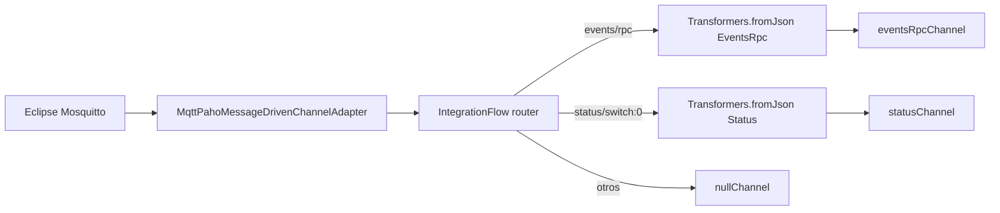
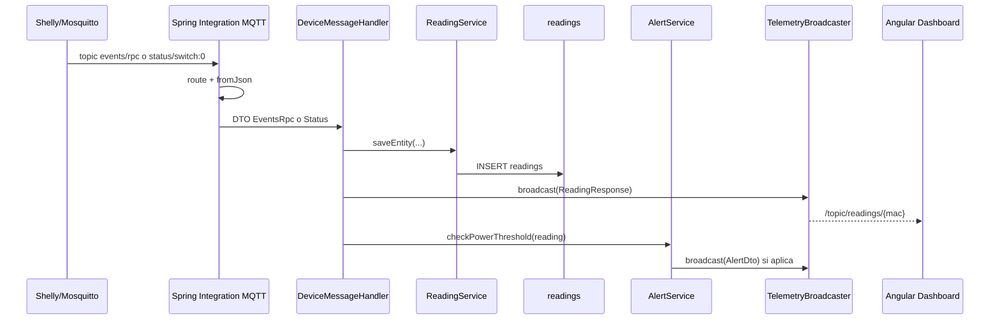
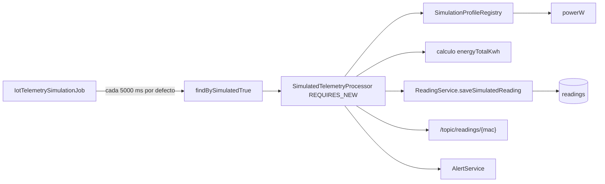

# Anexo C - Ingesta asíncrona de telemetría MQTT y simulación IoT

## 1. Alcance del anexo

Este anexo documenta cómo Wattimizer recibe, transforma, guarda y difunde telemetría eléctrica. El flujo combina:

- Mensajes MQTT reales procedentes de un Shelly Plug.
- Spring Integration MQTT para enrutar topics.
- Servicios de persistencia en `readings`.
- WebSocket STOMP para actualizar Angular en tiempo real.
- Un job de simulación para generar datos cuando no hay hardware físico.

Los ficheros principales son:

- `backend/src/main/java/com/joselumartos/jwtauthbackenddemo/config/MqttConfig.java`
- `backend/src/main/java/com/joselumartos/jwtauthbackenddemo/services/DeviceMessageHandler.java`
- `backend/src/main/java/com/joselumartos/jwtauthbackenddemo/services/ReadingService.java`
- `backend/src/main/java/com/joselumartos/jwtauthbackenddemo/services/TelemetryBroadcaster.java`
- `backend/src/main/java/com/joselumartos/jwtauthbackenddemo/services/IotTelemetrySimulationJob.java`
- `backend/src/main/java/com/joselumartos/jwtauthbackenddemo/services/SimulatedTelemetryProcessor.java`
- `backend/src/main/java/com/joselumartos/jwtauthbackenddemo/simulation/SimulationProfileRegistry.java`

## 2. Configuración MQTT

Archivo: `MqttConfig.java`.

El backend usa `DefaultMqttPahoClientFactory` y `MqttConnectOptions`.

| Propiedad Spring | Variable habitual | Uso |
| --- | --- | --- |
| `mqtt.url` | `MQTT_URL` | URL del broker, por ejemplo `tcp://mosquitto:1883`. |
| `mqtt.username` | `MQTT_USER` | Usuario MQTT. |
| `mqtt.password` | `MQTT_PASSWORD` | Contraseña MQTT. |

Opciones de conexión:

- `automaticReconnect = true`
- `cleanSession = true`
- QoS `1`
- `clientId = backend-spring-iot`

### 2.1. Topic suscrito

El adaptador se suscribe actualmente a:

```text
shellyplugsg3-9070694d3590/#
```

Esto significa que la integración real está preparada para ese prefijo concreto de Shelly. Si se quiere admitir cualquier Shelly físico sin tocar código, conviene externalizar este topic a una propiedad de configuración.

## 3. Enrutamiento con Spring Integration

`mqttInboundFlow` recibe mensajes desde `MqttPahoMessageDrivenChannelAdapter` y decide el destino por el sufijo del topic.

| Condición del topic | Canal | Transformación JSON |
| --- | --- | --- |
| Termina en `/events/rpc` | `eventsRpcChannel` | `EventsRpc.class` |
| Termina en `/status/switch:0` | `statusChannel` | `Status.class` |
| Cualquier otro topic | `nullChannel` | Se descarta |

El router evita que `DeviceMessageHandler` tenga que inspeccionar todos los topics posibles. Solo llegan a los métodos de negocio mensajes ya transformados al DTO correcto.



## 4. DTOs de entrada MQTT

### 4.1. `EventsRpc`

```java
public record EventsRpc(
        @JsonProperty("src") String source,
        Params params
) {}
```

`source` contiene el identificador de origen enviado por Shelly. El mapper lo usa para derivar la MAC cuando el mensaje viene con formato compatible.

### 4.2. `Params`

```java
public record Params(
        @JsonProperty("ts") Double timestamp,
        @JsonProperty("switch:0") Switch switchData
) {}
```

### 4.3. `Switch`

```java
public record Switch(
    @JsonProperty("aenergy") ActiveEnergy activeEnergy,
    @JsonProperty("apower") Double activePower
) {}
```

### 4.4. `Status`

```java
public record Status(
        Boolean output,
        @JsonProperty("apower") Double activePower,
        @JsonProperty("aenergy") ActiveEnergy activeEnergy
) {}
```

### 4.5. `ActiveEnergy`

```java
public record ActiveEnergy(Double total) { }
```

Estos DTOs usan `@JsonIgnoreProperties(ignoreUnknown = true)`. La razón es que Shelly puede enviar campos extra y la aplicación solo necesita potencia activa, energía acumulada, timestamp y estado.

## 5. Procesamiento de mensajes

Archivo: `DeviceMessageHandler.java`.

### 5.1. Eventos RPC

Método:

```java
@ServiceActivator(inputChannel = "eventsRpcChannel")
public void handleEventsRpc(Message<EventsRpc> mqttMessage)
```

Flujo:

1. Lee el payload `EventsRpc`.
2. Llama a `ReadingService.saveEntity(payload)`.
3. Convierte la entidad guardada a `ReadingResponse`.
4. Publica la lectura por WebSocket con `TelemetryBroadcaster`.
5. Ejecuta `AlertService.checkPowerThreshold(reading)`.

En `ReadingService.saveEntity(EventsRpc)`, si el mapper no consigue extraer una MAC, se puede acabar buscando o creando un dispositivo con MAC vacía. Por eso la documentación no debe afirmar que cualquier `events/rpc` provisiona automáticamente un dispositivo válido.

### 5.2. Estado `status/switch:0`

Método:

```java
@ServiceActivator(inputChannel = "statusChannel")
public void handleStatus(Message<Status> mqttMessage)
```

Flujo:

1. Obtiene el topic desde `MqttHeaders.RECEIVED_TOPIC`.
2. Extrae la MAC desde el prefijo antes de `/`, separando por `-`.
3. Busca el dispositivo con `DeviceService.findByMacAddress`.
4. Guarda la lectura con `ReadingService.saveEntity(deviceDto, payload)`.
5. Publica la lectura y revisa alertas.

El endpoint MQTT real no llama a controladores REST. La integración entra directamente en servicios, lo que evita latencia adicional y mantiene el flujo asíncrono dentro del backend.

## 6. Persistencia de lecturas

Archivo: `ReadingService.java`.

La entidad persistida es `Reading`, con campos:

- `time`
- `device`
- `powerW`
- `energyTotalKwh`
- `isOn`

Para mensajes `Status`, el tiempo se asigna con `Instant.now()`. Para `EventsRpc`, el mapper puede usar datos del mensaje.

```java
Reading reading = statusMapper.toEntity(dto);
reading.setTime(Instant.now());
reading.setDevice(deviceDtoMapper.toEntity(deviceDto));
return readingRepository.save(reading);
```

La tabla de lecturas funciona como serie temporal, pero la capa Java sigue usando repositorios JPA.

## 7. Difusión en tiempo real con WebSocket STOMP

Archivo: `TelemetryBroadcaster.java`.

| Tipo | Destino STOMP | DTO enviado |
| --- | --- | --- |
| Lectura | `/topic/readings/{macAddress}` | `ReadingResponse` |
| Alerta | `/topic/alerts/{username}` | `AlertDto` |

La configuración del endpoint está en `StompWebSocketConfig.java`:

- Endpoint WebSocket: `/ws-iot`
- Broker simple: `/topic`
- Prefijo de aplicación: `/app`

Angular se conecta a `/ws-iot` con `RxStomp` y observa `/topic/readings/{macAddress}`.

## 8. Detección de alertas

Después de guardar cada lectura real o simulada se llama a:

```java
alertService.checkPowerThreshold(reading);
```

La alerta se calcula comparando la potencia registrada con la potencia contratada aplicable. El resultado se persiste y puede emitirse por WebSocket en `/topic/alerts/{username}`.

Esta decisión hace que la alerta se genere en el mismo momento en que entra la telemetría, no en una tarea posterior.

## 9. Telemetría simulada

La simulación permite probar Wattimizer sin depender de hardware físico. Es especialmente útil para una defensa de proyecto, porque genera lecturas continuas, costes y posibles alertas usando los mismos servicios que la telemetría real.

### 9.1. Configuración

Archivo: `SimulationProperties.java`.

Propiedades:

- `simulation.enabled`
- `simulation.interval-ms`

En `docker-compose.yml`, producción deja:

```yaml
SIMULATION_ENABLED: ${SIMULATION_ENABLED:-true}
```

Esto activa por defecto los simuladores para modo demostración web.

### 9.2. Job programado

Archivo: `IotTelemetrySimulationJob.java`.

```java
@Scheduled(fixedRateString = "${simulation.interval-ms:5000}")
public void publishSimulatedTelemetry()
```

Flujo:

1. Si `simulation.enabled` es falso, sale sin hacer nada.
2. Obtiene `tickStart = Instant.now()`.
3. Lee `intervalMs`.
4. Busca dispositivos con `deviceRepository.findBySimulatedTrue()`.
5. Procesa cada dispositivo dentro de un `try/catch`.

El `try/catch` por dispositivo evita que un simulador con error detenga el tick completo.

### 9.3. Procesador por dispositivo

Archivo: `SimulatedTelemetryProcessor.java`.

```java
@Transactional(propagation = Propagation.REQUIRES_NEW)
public void processDevice(Device device, Instant tickStart, long intervalMs)
```

Cada dispositivo se procesa en una transacción nueva. La razón es aislar fallos: si un simulador falla al calcular o guardar lectura, no revierte las lecturas de los demás.

Pasos:

1. Resuelve `SimulationProfile`.
2. Comprueba si el dispositivo está encendido.
3. Calcula `readingTime` sumando un pequeño desfase por `device.getId() % 1000L`.
4. Calcula potencia con `SimulationProfileRegistry`.
5. Recupera el último `energyTotalKwh`.
6. Calcula el siguiente odómetro.
7. Guarda con `ReadingService.saveSimulatedReading`.
8. Publica por WebSocket.
9. Revisa alertas.

El desfase en milisegundos reduce colisiones de clave compuesta `(time, device_id)` cuando hay varios simuladores en el mismo tick.

### 9.4. Perfiles de consumo

Archivo: `SimulationProfile.java`.

| Perfil | Intención |
| --- | --- |
| `SINE_WAVE` | Señal de prueba con variación suave. |
| `OVEN` | Carga alta con comportamiento de horno. |
| `WASHING_MACHINE` | Ciclos de lavadora. |
| `TELEVISION` | Consumo doméstico moderado. |
| `FAN` | Ventilador con carga estable. |
| `DESKTOP_PC` | Ordenador de sobremesa. |
| `FRIDGE` | Nevera con ciclos. |
| `STANDBY` | Consumo fantasma. |
| `CONSTANT_HIGH_LOAD` | Carga elevada constante. |

`SimulationProfileRegistry` asocia cada perfil con un calculador de potencia. Si el perfil es nulo o no se encuentra, cae a `SINE_WAVE`.

## 10. Flujo completo de telemetría





## 11. Relación con Angular

El frontend no consume MQTT directamente. La ruta de datos es:

1. Backend recibe MQTT.
2. Backend guarda lectura.
3. Backend emite STOMP.
4. Angular escucha STOMP.
5. `TelemetryStore` actualiza el histórico de la MAC activa.
6. `DashboardComponent` repinta la gráfica.

Esta separación evita exponer el broker MQTT al navegador y mantiene las credenciales MQTT solo en el backend.

## 12. Limitaciones actuales y mejoras razonables

- El topic MQTT está fijado a un Shelly concreto.
- El endpoint WebSocket está permitido en la configuración HTTP; si se necesita mayor seguridad, se puede añadir autenticación STOMP.
- No hay cola intermedia persistente entre MQTT y base de datos; si el backend cae, depende de QoS y broker.
- La simulación está integrada en la misma aplicación backend; para cargas muy grandes se podría mover a un proceso separado.
- `events/rpc` no debe considerarse una provisión automática robusta para cualquier dispositivo si la MAC no se extrae correctamente.

## 13. Conclusión técnica

La arquitectura de telemetría usa un enfoque práctico: MQTT para entrada asíncrona, servicios Spring para normalizar y persistir, TimescaleDB para guardar serie temporal y WebSocket STOMP para actualizar la interfaz. Los simuladores comparten el mismo camino final de persistencia y difusión, lo que permite probar dashboard, alertas y costes sin duplicar lógica de frontend.
