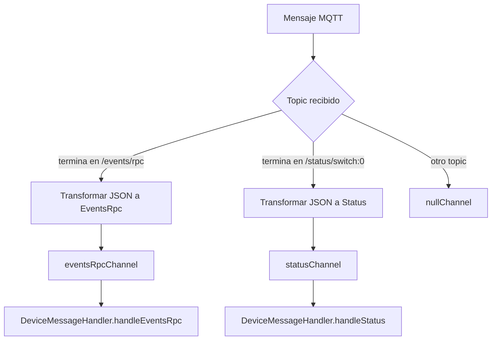
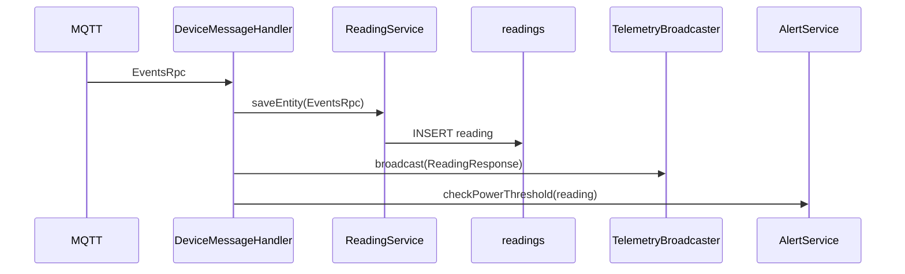
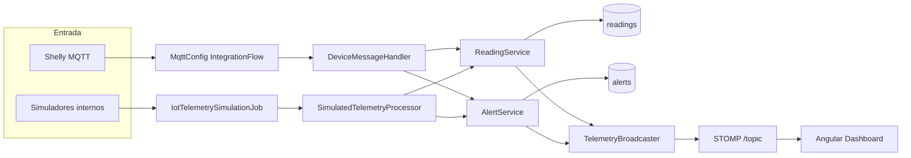

# Anexo C: Ingesta MQTT y telemetria asincrona

Este anexo explica como Wattimizer recibe, transforma, guarda y emite telemetria electrica. Hay dos vias de entrada:

1. Mensajes MQTT de un enchufe Shelly fisico.
2. Lecturas generadas por el job interno de simulacion.

Ambas vias terminan en el mismo modelo de datos (`readings`) y en la misma salida hacia Angular mediante WebSocket STOMP.

## 1. Componentes implicados

| Archivo | Responsabilidad |
|---|---|
| `config/MqttConfig.java` | Conexion MQTT, suscripcion y enrutado con Spring Integration. |
| `services/DeviceMessageHandler.java` | Procesa mensajes MQTT ya transformados a DTO. |
| `mappers/EventsRpcMapper.java` | Convierte payload Shelly RPC a entidad `Reading`. |
| `mappers/StatusMapper.java` | Convierte payload status a entidad `Reading`. |
| `services/ReadingService.java` | Persiste lecturas fisicas y simuladas. |
| `services/TelemetryBroadcaster.java` | Publica lecturas y alertas en STOMP. |
| `services/AlertService.java` | Comprueba sobrepotencia tras cada lectura. |
| `services/IotTelemetrySimulationJob.java` | Lanza periodicamente la simulacion. |
| `services/SimulatedTelemetryProcessor.java` | Calcula y persiste una lectura simulada por dispositivo. |
| `simulation/SimulationProfileRegistry.java` | Selecciona el calculador de potencia segun perfil. |

## 2. Configuracion MQTT

Archivo: `backend/src/main/java/com/joselumartos/jwtauthbackenddemo/config/MqttConfig.java`

La conexion se crea con `DefaultMqttPahoClientFactory` y `MqttConnectOptions`.

Propiedades usadas:

| Propiedad Spring | Variable habitual | Uso |
|---|---|---|
| `mqtt.url` | `MQTT_URL` | URL del broker Mosquitto. |
| `mqtt.username` | `MQTT_USER` | Usuario MQTT. |
| `mqtt.password` | `MQTT_PASSWORD` | Contrasena MQTT. |

La configuracion activa:

- Reconexion automatica.
- Sesion limpia.
- QoS 1 en el adaptador inbound.
- Cliente `backend-spring-iot`.
- Suscripcion al topic `shellyplugsg3-9070694d3590/#`.

La suscripcion esta centrada en un prefijo Shelly concreto. Esto encaja con el estado actual del proyecto, pero si se quisiera escalar a varios dispositivos fisicos sin registrar topics manualmente, habria que generalizar este patron.

## 3. Rutas de Spring Integration

`MqttConfig.mqttInboundFlow` recibe mensajes MQTT y decide la ruta segun el sufijo del topic.



### Topics aceptados

| Sufijo | DTO | Canal |
|---|---|---|
| `/events/rpc` | `EventsRpc` | `eventsRpcChannel` |
| `/status/switch:0` | `Status` | `statusChannel` |
| Otros | Ninguno | `nullChannel` |

Esta separacion evita que un payload se intente parsear con una forma incorrecta. Cada rama transforma JSON a un DTO concreto antes de llegar al servicio.

## 4. DTOs de MQTT

### `EventsRpc`

Archivos:

- `dtos/EventsRpc.java`
- `dtos/Params.java`
- `dtos/Switch.java`
- `dtos/ActiveEnergy.java`

Forma simplificada:

```json
{
  "src": "shellyplugsg3-9070694d3590",
  "params": {
    "ts": 1760000000.0,
    "switch:0": {
      "apower": 123.45,
      "aenergy": {
        "total": 12.34
      }
    }
  }
}
```

`EventsRpcMapper` extrae la MAC desde `src`, interpreta `params.switch:0`, convierte potencia activa y energia acumulada y genera una entidad `Reading`.

### `Status`

Archivo: `dtos/Status.java`

Forma simplificada:

```json
{
  "output": true,
  "apower": 45.6,
  "aenergy": {
    "total": 10.2
  }
}
```

En esta rama la MAC no viene en el body, sino en el topic. `DeviceMessageHandler.handleStatus` la obtiene con:

```java
String macAddress = (topic != null) ? topic.split("/")[0].split("-")[1] : null;
```

Esta decision funciona con topics del tipo `shellyplugsg3-<mac>/status/switch:0`.

## 5. Procesamiento de mensajes MQTT

Archivo: `services/DeviceMessageHandler.java`

### Rama `events/rpc`

1. Recibe `Message<EventsRpc>`.
2. Llama a `readingService.saveEntity(payload)`.
3. Publica la lectura por STOMP.
4. Comprueba si hay alerta de maximetro.



En esta rama hay que matizar el alta automatica. `EventsRpcMapper` solo asocia el dispositivo si la MAC extraida de `src` ya existe en `devices`. Si no existe, el `ReadingService` no recibe una MAC util desde el mapper y puede crear un registro auxiliar sin MAC practica. Por eso, para que la telemetria Shelly quede correctamente asociada, el dispositivo debe estar registrado o reclamado antes por su MAC.

### Rama `status/switch:0`

1. Recibe `Message<Status>`.
2. Extrae la MAC del topic.
3. Busca el dispositivo por MAC.
4. Persiste lectura con `readingService.saveEntity(deviceDto, payload)`.
5. Publica STOMP y comprueba alerta.

En esta rama el dispositivo debe existir, porque `deviceService.findByMacAddress` lanza excepcion si no lo encuentra. Por tanto, `events/rpc` es mas tolerante con dispositivos nuevos que `status`.

## 6. Persistencia en `ReadingService`

`ReadingService` centraliza la persistencia de lecturas:

| Metodo | Entrada | Uso |
|---|---|---|
| `saveEntity(EventsRpc dto)` | Payload Shelly RPC | Telemetria MQTT; conserva la MAC solo si el dispositivo ya existe. |
| `saveEntity(DeviceDto deviceDto, Status dto)` | Dispositivo conocido + payload status | Telemetria MQTT de estado. |
| `saveSimulatedReading(...)` | Datos ya calculados | Job de simulacion. |

La entidad `Reading` tiene clave compuesta:

- `time`
- `device`

Esto significa que no puede haber dos lecturas del mismo dispositivo con exactamente el mismo instante. En simulacion se introduce un desfase por dispositivo para reducir colisiones en ticks simultaneos.

## 7. Simulacion de telemetria

La simulacion existe para poder demostrar Wattimizer sin depender siempre de un enchufe fisico conectado.

### Activacion

Archivo: `config/SimulationProperties.java`

Propiedades:

| Propiedad | Significado |
|---|---|
| `simulation.enabled` | Activa o desactiva el job. |
| `simulation.interval-ms` | Frecuencia del tick, por defecto 5000 ms. |

En Docker se controla con `SIMULATION_ENABLED` y `SIMULATION_INTERVAL_MS`.

### Job programado

Archivo: `services/IotTelemetrySimulationJob.java`

`@Scheduled(fixedRateString = "${simulation.interval-ms:5000}")` ejecuta el job. Si `simulation.enabled` es falso, sale sin hacer nada.

Flujo:

1. Obtiene `Instant.now()` como inicio del tick.
2. Lee todos los dispositivos con `is_simulated = true`.
3. Procesa cada dispositivo dentro de un `try/catch`.
4. Un fallo en un simulador no bloquea el resto.

### Procesador por dispositivo

Archivo: `services/SimulatedTelemetryProcessor.java`

Usa `@Transactional(propagation = Propagation.REQUIRES_NEW)`. La intencion es clara: cada dispositivo tiene su propia transaccion, de modo que un error puntual no revierte lecturas ya generadas para otros simuladores.

Calculo simplificado:

```java
BigDecimal powerW = deviceOn
        ? profileRegistry.calculatePowerW(profile, readingTime, device)
        : BigDecimal.ZERO;
```

Despues recupera el ultimo `energyTotalKwh` del dispositivo y calcula el nuevo odometro:

```java
kWh += powerW * intervalSeconds / 1000 / 3600
```

Si el dispositivo esta apagado, la potencia es cero y el odometro no aumenta.

## 8. Perfiles de simulacion

Enum: `entities/SimulationProfile.java`

| Perfil | Intencion funcional |
|---|---|
| `SINE_WAVE` | Onda generica para pruebas visuales. |
| `OVEN` | Consumo alto con comportamiento de electrodomestico. |
| `WASHING_MACHINE` | Ciclos variables. |
| `TELEVISION` | Consumo domestico moderado. |
| `FAN` | Carga baja/media estable. |
| `DESKTOP_PC` | Consumo de equipo informatico. |
| `FRIDGE` | Ciclos de compresor. |
| `STANDBY` | Consumo fantasma bajo pero continuo. |
| `CONSTANT_HIGH_LOAD` | Carga alta para probar alertas de maximetro. |

El frontend ofrece estos perfiles en `simulation-profile.interface.ts` con etiquetas legibles para usuario.

## 9. Emision en tiempo real

Archivo: `services/TelemetryBroadcaster.java`

Despues de guardar una lectura, el backend publica:

```java
String destination = "/topic/readings/" + readingDto.macAddress();
messagingTemplate.convertAndSend(destination, readingDto);
```

Para alertas:

```java
String destination = "/topic/alerts/" + alertDto.username();
messagingTemplate.convertAndSend(destination, alertDto);
```

La configuracion STOMP esta en `StompWebSocketConfig`:

- Endpoint de conexion: `/ws-iot`.
- Broker simple: `/topic`.
- Prefijo de aplicacion: `/app`.

Angular se conecta a `/ws-iot` y escucha `/topic/readings/{macAddress}` desde `WebsocketService`.

## 10. Alertas de maximetro

Archivo: `services/AlertService.java`

Cada lectura puede generar una alerta `OVERPOWER` si:

1. La lectura tiene dispositivo, potencia y tiempo.
2. El dispositivo tiene usuario.
3. El usuario tiene tarifa.
4. `CalendarResolverService` resuelve el periodo aplicable.
5. Existe potencia contratada para ese periodo.
6. `powerW / 1000` supera `contractedPowerKw`.

Si falta calendario o potencia contratada, el sistema no inventa una alerta. Esta decision evita falsos positivos cuando la tarifa esta incompleta.

## 11. Flujo completo de datos



## 12. Decisiones arquitectonicas

- **Spring Integration** se usa para separar recepcion MQTT, transformacion JSON y canales internos. Esto deja el controlador REST fuera del camino de telemetria.
- **MQTT y simulacion convergen en `ReadingService`**, por lo que dashboard, analitica y alertas no tienen que distinguir si una lectura viene de hardware o de demo.
- **STOMP evita polling constante** para la grafica. REST se mantiene para cargar el historico inicial.
- **Transaccion por simulador** evita que un perfil defectuoso deje sin lecturas a todos los demas.
- **Asociacion previa en `events/rpc`**: el mapper localiza el dispositivo por la MAC del `src`; si no existe, el flujo actual no conserva una MAC util para que el usuario lo reclame despues.

## 13. Limitaciones actuales

- La suscripcion MQTT esta ligada a un prefijo Shelly concreto.
- Mosquitto expone el puerto 1883 en el compose; el propio archivo marca como deuda usar TLS/8883 o VPN.
- El frontend escucha lecturas por STOMP, pero la pantalla de alertas refresca por REST.
- No hay cola persistente entre MQTT y base de datos: si el backend esta caido, depende del broker y del dispositivo recuperar o reenviar.
