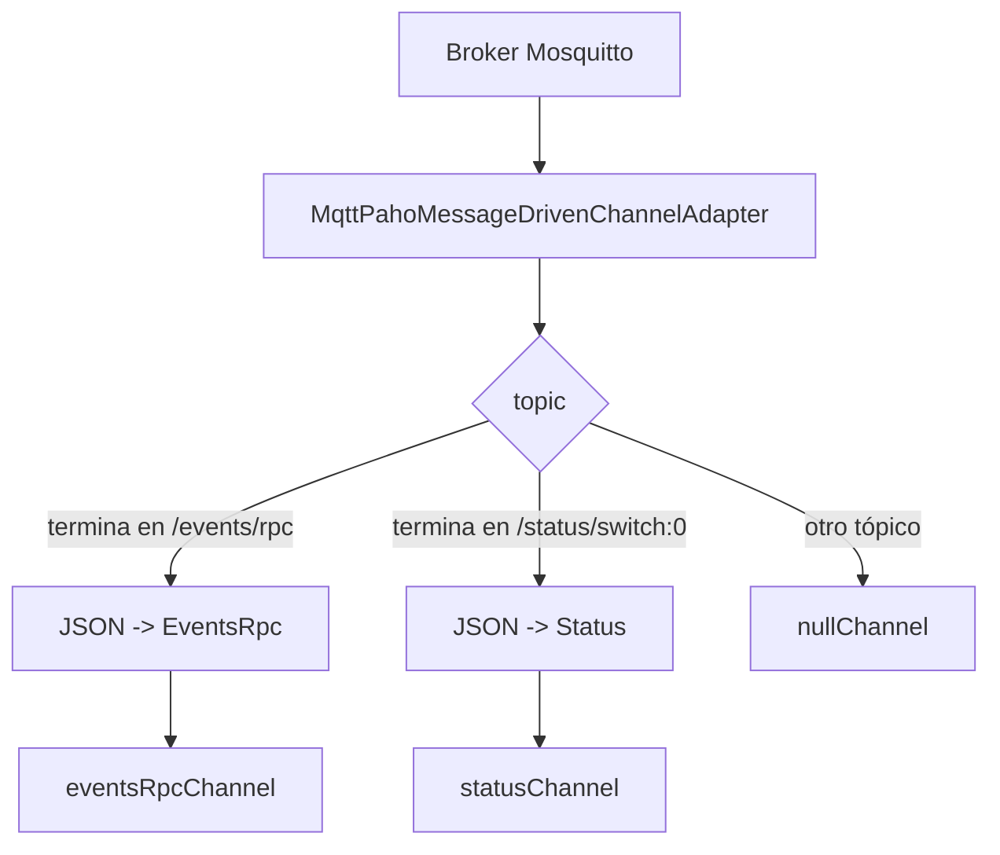
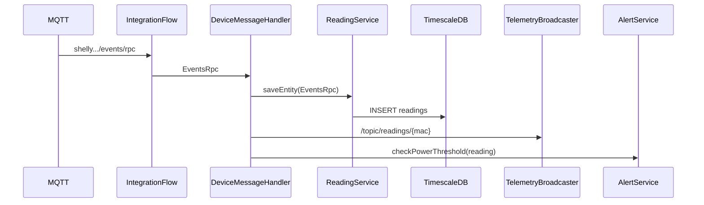

# Anexo C. Ingesta asíncrona de telemetría MQTT

La telemetría de Wattimizer entra por dos caminos: mensajes MQTT de un Shelly Plug físico y lecturas generadas por simuladores internos. Ambos caminos acaban guardando registros en `readings`, emitiendo datos por STOMP y comprobando si hay que crear alertas.

## C.1. Configuración MQTT

La clase principal es `MqttConfig`, anotada con `@EnableIntegration`.

### Propiedades

Se leen desde `application.properties` o variables de entorno:

| Propiedad | Uso |
|---|---|
| `mqtt.url` | URL del broker MQTT. |
| `mqtt.username` | Usuario del cliente MQTT. |
| `mqtt.password` | Contraseña del cliente MQTT. |

La documentación no reproduce valores de credenciales. En local existen fallbacks de desarrollo, pero en despliegue deben inyectarse por entorno.

### Cliente MQTT

`mqttClientFactory()` crea un `DefaultMqttPahoClientFactory` con:

- URI del broker.
- Usuario y contraseña.
- Reconexión automática.
- Sesión limpia.

El adaptador de entrada se define con:

```java
new MqttPahoMessageDrivenChannelAdapter(
    "backend-spring-iot",
    mqttClientFactory(),
    "shellyplugsg3-9070694d3590/#"
);
```

La suscripción física está fijada al tópico `shellyplugsg3-9070694d3590/#`. Si se quisiera admitir más enchufes reales de forma dinámica, habría que parametrizar esta lista o cambiar el patrón de suscripción.

## C.2. Canales de Spring Integration

`MqttConfig` define dos `DirectChannel`:

| Canal | Tipo de payload | Finalidad |
|---|---|---|
| `eventsRpcChannel` | `EventsRpc` | Mensajes completos de evento Shelly. |
| `statusChannel` | `Status` | Estado puntual del switch `0`. |

El `IntegrationFlow` enruta según el tópico recibido en la cabecera `MqttHeaders.RECEIVED_TOPIC`:



Los mensajes que no coinciden se descartan en `nullChannel`. Esta decisión evita que el backend falle por tópicos Shelly que no aportan datos eléctricos útiles.

## C.3. DTOs MQTT

### `EventsRpc`

```java
public record EventsRpc(
        @JsonProperty("src") String source,
        Params params
) {}
```

`source` contiene normalmente el identificador del dispositivo Shelly. `params` contiene timestamp y datos del switch.

### `Params`

```java
public record Params(
        @JsonProperty("ts") Double timestamp,
        @JsonProperty("switch:0") Switch switchData
) {}
```

### `Switch`

```java
public record Switch(
        @JsonProperty("aenergy") ActiveEnergy activeEnergy,
        @JsonProperty("apower") Double activePower
) {}
```

### `Status`

```java
public record Status(
        Boolean output,
        @JsonProperty("apower") Double activePower,
        @JsonProperty("aenergy") ActiveEnergy activeEnergy
) {}
```

### `ActiveEnergy`

```java
public record ActiveEnergy(Double total) {}
```

`@JsonIgnoreProperties(ignoreUnknown = true)` permite que los DTOs acepten mensajes Shelly con campos adicionales sin romper la ingesta.

## C.4. Procesamiento de `events/rpc`

El método activo es:

```java
@ServiceActivator(inputChannel = "eventsRpcChannel")
public void handleEventsRpc(Message<EventsRpc> mqttMessage)
```

Flujo:

1. Lee `EventsRpc` desde el mensaje.
2. `ReadingService.saveEntity(payload)` transforma y persiste la lectura.
3. Publica `ReadingResponse` por STOMP.
4. Ejecuta `AlertService.checkPowerThreshold(reading)`.



### Mapeo a entidad `Reading`

`EventsRpcMapper` transforma:

- `params.ts` a `Reading.time`.
- `params.switch:0.apower` a `Reading.powerW`.
- `params.switch:0.aenergy.total` a energía acumulada.
- La fuente `src` a MAC del dispositivo.

`ReadingService.saveEntity(EventsRpc)` intenta localizar el dispositivo por MAC. Si no existe, crea un dispositivo nuevo sin usuario asignado. En caso de que no pueda extraer MAC, el código puede acabar usando cadena vacía; por eso no debe afirmarse que el sistema haga un aprovisionamiento robusto automático de cualquier dispositivo desconocido.

## C.5. Procesamiento de `status/switch:0`

El método activo es:

```java
@ServiceActivator(inputChannel = "statusChannel")
public void handleStatus(Message<Status> mqttMessage)
```

Flujo:

1. Extrae el topic de `MqttHeaders.RECEIVED_TOPIC`.
2. Obtiene la MAC dividiendo el primer segmento `shellyplugsg3-<mac>`.
3. Busca el dispositivo con `DeviceService.findByMacAddress(macAddress)`.
4. Convierte `Status` a `Reading`.
5. Asigna `Instant.now()` como tiempo de lectura.
6. Persiste, emite por STOMP y comprueba alertas.

Este camino es más estricto que `events/rpc`: si la MAC no existe, `DeviceService.findByMacAddress` lanza `EntityNotFoundException`.

## C.6. Persistencia de lecturas

La entidad `Reading` usa clave compuesta:

```java
@Id
private Instant time;

@Id
@ManyToOne(fetch = FetchType.LAZY)
@JoinColumn(name = "device_id", nullable = false)
private Device device;
```

Campos medidos:

| Campo | Tipo | Significado |
|---|---|---|
| `time` | `Instant` | Instante UTC de la lectura. |
| `device` | `Device` | Dispositivo propietario. |
| `powerW` | `BigDecimal` | Potencia activa instantánea en vatios. |
| `energyTotalKwh` | `BigDecimal` | Energía acumulada en kWh. |
| `isOn` | `Boolean` | Estado lógico del equipo. |

El uso de `Instant` evita mezclar zonas horarias en la tabla de series temporales. La conversión a hora local se realiza solo al resolver tarifas.

## C.7. Emisión en tiempo real por STOMP

`TelemetryBroadcaster` publica lecturas en:

```text
/topic/readings/{macAddress}
```

Y alertas en:

```text
/topic/alerts/{username}
```

`StompWebSocketConfig` expone el endpoint:

```text
/ws-iot
```

Con broker simple:

- Prefijo de salida: `/topic`.
- Prefijo de entrada aplicación: `/app`.

En la aplicación actual, Angular escucha lecturas por STOMP. No hay SSE; cualquier referencia a tiempo real debe hablar de WebSocket STOMP.

## C.8. Simulación IoT

La simulación no usa MQTT, pero comparte el resultado funcional con la ingesta real.

### Configuración

`SimulationProperties` lee:

| Propiedad | Uso |
|---|---|
| `simulation.enabled` | Activa o desactiva el job. |
| `simulation.interval-ms` | Periodicidad de generación. Por defecto, 5000 ms. |

### Job periódico

`IotTelemetrySimulationJob` usa:

```java
@Scheduled(fixedRateString = "${simulation.interval-ms:5000}")
```

En cada tick:

1. Comprueba si la simulación está habilitada.
2. Busca dispositivos `findBySimulatedTrue()`.
3. Procesa cada dispositivo de forma aislada.
4. Si un simulador falla, registra warning y continúa con el resto.

### Procesador de telemetría simulada

`SimulatedTelemetryProcessor.processDevice()` abre una transacción nueva por dispositivo (`REQUIRES_NEW`). Esto evita que un error en un simulador revierta las lecturas generadas por otros.

Pasos:

1. Lee `simulationProfile`.
2. Si el dispositivo está apagado, usa potencia `0`.
3. Si está encendido, calcula potencia con `SimulationProfileRegistry`.
4. Recupera la última energía acumulada de la MAC.
5. Calcula nuevo odómetro kWh con:

```text
kWh_nuevo = kWh_anterior + (powerW * segundos) / 1000 / 3600
```

6. Guarda lectura con `ReadingService.saveSimulatedReading`.
7. Emite STOMP y comprueba alertas.

### Perfiles disponibles

| Perfil | Intención |
|---|---|
| `SINE_WAVE` | Señal de prueba suave. |
| `OVEN` | Cargas altas por ciclos. |
| `WASHING_MACHINE` | Ciclos variables de lavadora. |
| `TELEVISION` | Consumo doméstico estable. |
| `FAN` | Potencia moderada continua. |
| `DESKTOP_PC` | Uso irregular de ordenador. |
| `FRIDGE` | Ciclos cortos de compresor. |
| `STANDBY` | Consumo fantasma bajo. |
| `CONSTANT_HIGH_LOAD` | Carga alta constante para probar alertas. |

## C.9. Generación de alertas desde telemetría

`AlertService.checkPowerThreshold()` se llama tanto desde MQTT como desde simulación. La alerta se genera solo si:

- La lectura tiene dispositivo, potencia y tiempo.
- El dispositivo tiene usuario.
- El usuario tiene tarifa.
- Se puede resolver un periodo en `tariff_calendar_slots`.
- Existe potencia contratada para ese periodo.
- `powerW / 1000` supera la potencia contratada.

Si se cumple, guarda alerta:

```text
type = "OVERPOWER"
```

Y emite un mensaje en `/topic/alerts/{username}`.

## C.10. Limitaciones actuales

- La suscripción MQTT está acotada a un Shelly físico concreto.
- No hay gestión REST para cambiar topics MQTT en caliente.
- El aprovisionamiento de dispositivos desconocidos desde `events/rpc` es básico y puede crear registros sin usuario.
- Angular escucha lecturas, pero no se observa todavía una suscripción frontend activa a `/topic/alerts/{username}`.
- La simulación no pasa por Mosquitto; genera lecturas directamente en backend. Esto es correcto para demos, pero no prueba el broker.
