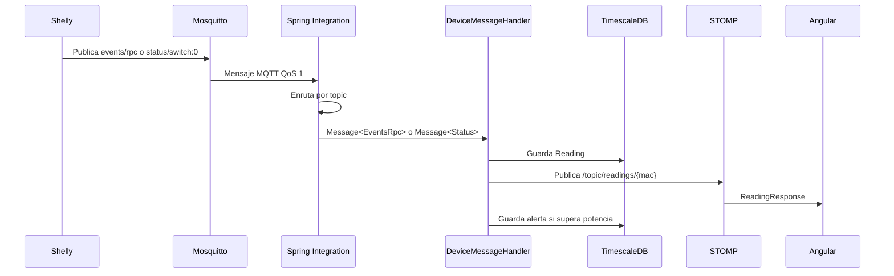

# Anexo C — Telemetría MQTT con Spring Integration

## 1. Objetivo

Wattimizer recibe lecturas eléctricas por dos vías: mensajes MQTT de un Shelly físico y lecturas sintéticas generadas por el backend. Las dos vías acaban en la misma salida: una entidad `Reading`, una emisión STOMP al frontend y una comprobación de alerta por sobrepotencia.

## 2. Configuración MQTT

Clase: `MqttConfig`

Propiedades:

| Propiedad | Uso |
|---|---|
| `mqtt.url` | URL del broker Mosquitto. |
| `mqtt.username` | Usuario MQTT. |
| `mqtt.password` | Contraseña MQTT. |

`mqttClientFactory()` crea un `DefaultMqttPahoClientFactory` con reconexión automática y sesión limpia:

```java
options.setAutomaticReconnect(true);
options.setCleanSession(true);
```

La reconexión automática es necesaria porque en producción el broker forma parte de Docker Compose y puede reiniciarse durante despliegues.

## 3. Adaptador de entrada

`mqttInbound()` crea un `MqttPahoMessageDrivenChannelAdapter`:

```java
new MqttPahoMessageDrivenChannelAdapter(
    "backend-spring-iot",
    mqttClientFactory(),
    "shellyplugsg3-9070694d3590/#"
)
```

El QoS se establece a `1`, es decir, entrega al menos una vez. Esto justifica que Angular deduplique lecturas por `time`, porque un mensaje podría llegar repetido.

Limitación actual: el topic está preparado para un Shelly concreto. Para varios Shelly físicos habría que parametrizar la suscripción o ampliarla.

## 4. Enrutado con Spring Integration

El flujo `mqttInboundFlow` lee la cabecera `MqttHeaders.RECEIVED_TOPIC` y decide qué hacer según el topic:

| Topic | Rama | Transformación | Canal |
|---|---|---|---|
| `.../events/rpc` | `EVENTS` | JSON a `EventsRpc` | `eventsRpcChannel` |
| `.../status/switch:0` | `STATUS` | JSON a `Status` | `statusChannel` |
| Otros | `IGNORE` | Ninguna | `nullChannel` |

Fragmento principal:

```java
if (topic != null && topic.endsWith("/events/rpc")) return "EVENTS";
if (topic != null && topic.endsWith("/status/switch:0")) return "STATUS";
return "IGNORE";
```

La separación de canales evita tratar todos los JSON como si tuvieran la misma estructura.

## 5. DTOs de entrada MQTT

### 5.1. `EventsRpc`

```java
@JsonIgnoreProperties(ignoreUnknown = true)
public record EventsRpc(
    @JsonProperty("src") String source,
    Params params
) {}
```

`source` suele tener forma parecida a `shellyplugsg3-9070694d3590`.

### 5.2. `Params`

```java
@JsonIgnoreProperties(ignoreUnknown = true)
public record Params(
    @JsonProperty("ts") Double timestamp,
    @JsonProperty("switch:0") Switch switchData
) {}
```

`timestamp` llega en segundos Unix y `switch:0` contiene datos eléctricos.

### 5.3. `Switch`

```java
@JsonIgnoreProperties(ignoreUnknown = true)
public record Switch(
    @JsonProperty("aenergy") ActiveEnergy activeEnergy,
    @JsonProperty("apower") Double activePower
) {}
```

### 5.4. `Status`

```java
@JsonIgnoreProperties(ignoreUnknown = true)
public record Status(
    Boolean output,
    @JsonProperty("apower") Double activePower,
    @JsonProperty("aenergy") ActiveEnergy activeEnergy
) {}
```

`Status` incluye `output`, por eso permite informar `isOn`. `EventsRpc` aporta timestamp propio y valores de energía/potencia, pero el mapper actual ignora `isOn`.

## 6. Handlers de mensajes

Clase: `DeviceMessageHandler`

### 6.1. `eventsRpcChannel`

```java
@ServiceActivator(inputChannel = "eventsRpcChannel")
public void handleEventsRpc(Message<EventsRpc> mqttMessage) {
    EventsRpc payload = mqttMessage.getPayload();
    Reading reading = readingService.saveEntity(payload);
    broadcaster.broadcast(readingResponseMapper.toDto(reading));
    alertService.checkPowerThreshold(reading);
}
```

Flujo:

1. Recibe `EventsRpc` deserializado.
2. Lo persiste con `ReadingService.saveEntity(EventsRpc)`.
3. Publica la lectura por STOMP.
4. Comprueba si debe crear alerta.

### 6.2. `statusChannel`

```java
@ServiceActivator(inputChannel = "statusChannel")
public void handleStatus(Message<Status> mqttMessage) {
    String topic = mqttMessage.getHeaders().get(MqttHeaders.RECEIVED_TOPIC, String.class);
    String macAddress = (topic != null) ? topic.split("/")[0].split("-")[1] : null;
    DeviceDto deviceDto = deviceService.findByMacAddress(macAddress);

    Status payload = mqttMessage.getPayload();
    Reading reading = readingService.saveEntity(deviceDto, payload);
    broadcaster.broadcast(readingResponseMapper.toDto(reading));
    alertService.checkPowerThreshold(reading);
}
```

Aquí la MAC se extrae del topic. Si el dispositivo no existe, el servicio no inventa una lectura huérfana; `findByMacAddress` lanza error.

## 7. Mappers de telemetría

### 7.1. `EventsRpcMapper`

| Campo MQTT | Campo `Reading` | Transformación |
|---|---|---|
| `params.timestamp` | `time` | `Instant.ofEpochSecond(...)`. |
| `source` | `device` | Extrae MAC tras el último guion y busca en repositorio. |
| `params.switchData.activePower` | `powerW` | Directa. |
| `params.switchData.activeEnergy.total` | `energyTotalKwh` | Wh / 1000. |
| — | `isOn` | Ignorado. |

Matiz importante: `ReadingService.saveEntity(EventsRpc)` conserva la MAC real cuando el dispositivo existe. Si no existe, puede terminar creando un dispositivo fallback con MAC vacía o incompleta. Por eso los dispositivos físicos deben estar sembrados o reclamados antes de confiar en `events/rpc` como fuente principal.

### 7.2. `StatusMapper`

| Campo MQTT | Campo `Reading` | Transformación |
|---|---|---|
| `output` | `isOn` | Directa. |
| `activePower` | `powerW` | Directa. |
| `activeEnergy.total` | `energyTotalKwh` | Wh / 1000. |
| — | `time` | Se asigna con `Instant.now()`. |
| — | `device` | Se asigna desde el dispositivo localizado por MAC. |

## 8. Persistencia

Entidad: `Reading`

```java
@Id
@Column(nullable = false, updatable = false)
private Instant time;

@Id
@ManyToOne(fetch = FetchType.LAZY)
@JoinColumn(name = "device_id", nullable = false)
private Device device;

@Column(name = "power_w", precision = 10, scale = 2)
private BigDecimal powerW;

@Column(name = "energy_total_kwh", precision = 14, scale = 4)
private BigDecimal energyTotalKwh;

@Column(name = "is_on")
private Boolean isOn;
```

La clave compuesta permite que distintos dispositivos tengan lecturas en el mismo instante sin chocar.

## 9. Emisión al frontend

Clase: `TelemetryBroadcaster`

```java
public void broadcast(ReadingResponse readingDto) {
    String destination = "/topic/readings/" + readingDto.macAddress();
    messagingTemplate.convertAndSend(destination, readingDto);
}
```

Cada MAC tiene su topic STOMP. Angular solo se suscribe a la MAC seleccionada. Las alertas usan otro destino:

```java
String destination = "/topic/alerts/" + alertDto.username();
```

## 10. Telemetría simulada

### 10.1. Job programado

Clase: `IotTelemetrySimulationJob`

- Se ejecuta con `@Scheduled(fixedRateString = "${simulation.interval-ms:5000}")`.
- Si `simulation.enabled=false`, sale sin hacer nada.
- Consulta `deviceRepository.findBySimulatedTrue()`.
- Procesa cada dispositivo dentro de un `try/catch`; si uno falla, continúa con el siguiente.

### 10.2. Procesador por dispositivo

Clase: `SimulatedTelemetryProcessor`

Se usa una transacción nueva por dispositivo (`Propagation.REQUIRES_NEW`). El flujo es:

1. Lee `simulationProfile` e `isOn`.
2. Calcula `readingTime` con pequeño desfase `device.getId() % 1000L`.
3. Calcula potencia mediante `SimulationProfileRegistry`.
4. Obtiene el último `energyTotalKwh`.
5. Calcula el siguiente odómetro según potencia e intervalo.
6. Guarda con `ReadingService.saveSimulatedReading`.
7. Emite por WebSocket.
8. Comprueba alerta de maxímetro.

El desfase por dispositivo reduce el riesgo de colisión de clave temporal cuando varios simuladores emiten en el mismo tick.

### 10.3. Perfiles

| Perfil | Intención |
|---|---|
| `SINE_WAVE` | Señal suave de prueba. |
| `OVEN` | Carga alta con ciclos. |
| `WASHING_MACHINE` | Fases de lavado. |
| `TELEVISION` | Consumo estable. |
| `FAN` | Carga baja/media. |
| `DESKTOP_PC` | Variación de ordenador. |
| `FRIDGE` | Compresor cíclico. |
| `STANDBY` | Consumo fantasma. |
| `CONSTANT_HIGH_LOAD` | Carga alta sostenida. |

## 11. Secuencia de datos



## 12. Limitaciones y decisiones pendientes de mejora

- El puerto MQTT de producción se expone por `1883`, sin TLS. El propio `docker-compose.yml` recomienda migrar a TLS/8883 o VPN.
- La suscripción física está ligada a un Shelly concreto.
- Para que `events/rpc` conserve correctamente la MAC, el dispositivo debe existir antes en la base de datos.
