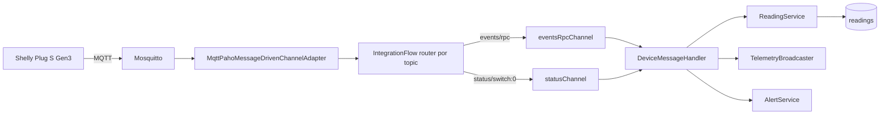

# Anexo C - Ingesta de telemetria MQTT con Spring Integration

## 1. Objetivo de la ingesta

La ingesta MQTT convierte mensajes enviados por enchufes Shelly en lecturas persistidas en la tabla `readings`. Despues de guardar cada lectura, el backend la publica por WebSocket y comprueba si supera la potencia contratada del periodo tarifario actual.

La arquitectura separa tres tareas:

1. recibir mensajes MQTT desde Mosquitto;
2. transformar JSON externo a DTOs internos;
3. guardar, emitir y analizar la lectura.



## 2. Configuracion MQTT

Archivo: `backend/src/main/java/.../config/MqttConfig.java`.

Propiedades:

```properties
mqtt.url=${MQTT_URL:tcp://localhost:1883}
mqtt.username=${MQTT_USER:gateway-service}
mqtt.password=${MQTT_PASSWORD:s3cr3t}
```

En Docker Compose, el backend usa:

```yaml
MQTT_URL: tcp://mosquitto:1883
MQTT_USER: ${PROD_MQTT_USER}
MQTT_PASSWORD: ${PROD_MQTT_PASSWORD}
```

El `MqttPahoClientFactory` configura:

- servidor MQTT desde `mqtt.url`;
- usuario y contrasena;
- reconexion automatica;
- `cleanSession=true`.

El adaptador escucha:

```java
new MqttPahoMessageDrivenChannelAdapter(
    "backend-spring-iot",
    mqttClientFactory(),
    "shellyplugsg3-9070694d3590/#"
);
```

El patron actual esta centrado en un dispositivo Shelly concreto. Para varios dispositivos fisicos reales, habria que generalizar el topic de suscripcion.

## 3. Enrutado con Spring Integration

`mqttInboundFlow` decide el canal segun el final del topic:

| Condicion de topic | Ruta interna | DTO destino |
|---|---|---|
| termina en `/events/rpc` | `eventsRpcChannel` | `EventsRpc` |
| termina en `/status/switch:0` | `statusChannel` | `Status` |
| cualquier otro topic | `nullChannel` | Se ignora |

Codigo conceptual:

```java
.route(Message.class, message -> {
    String topic = message.getHeaders().get(MqttHeaders.RECEIVED_TOPIC, String.class);
    if (topic != null && topic.endsWith("/events/rpc")) return "EVENTS";
    if (topic != null && topic.endsWith("/status/switch:0")) return "STATUS";
    return "IGNORE";
})
```

La decision de filtrar por topic evita guardar mensajes de configuracion o estado que no contienen potencia ni energia utiles para la analitica.

## 4. DTOs de entrada MQTT

### 4.1. `EventsRpc`

```java
@JsonIgnoreProperties(ignoreUnknown = true)
public record EventsRpc(
    @JsonProperty("src")
    String source,
    Params params
) {}
```

`source` suele llegar con formato parecido a:

```text
shellyplugsg3-9070694d3590
```

### 4.2. `Params`

```java
@JsonIgnoreProperties(ignoreUnknown = true)
public record Params(
    @JsonProperty("ts")
    Double timestamp,
    @JsonProperty("switch:0")
    Switch switchData
) {}
```

El campo `switch:0` no es un identificador Java valido, por eso se mapea a `switchData` con `@JsonProperty`.

### 4.3. `Switch`

```java
@JsonIgnoreProperties(ignoreUnknown = true)
public record Switch(
    @JsonProperty("aenergy")
    ActiveEnergy activeEnergy,
    @JsonProperty("apower")
    Double activePower
) {}
```

### 4.4. `ActiveEnergy`

```java
@JsonIgnoreProperties(ignoreUnknown = true)
public record ActiveEnergy(
    Double total
) {}
```

El total de Shelly se recibe en Wh y el backend lo convierte a kWh para almacenarlo de forma uniforme.

### 4.5. `Status`

```java
@JsonIgnoreProperties(ignoreUnknown = true)
public record Status(
    Boolean output,
    @JsonProperty("apower")
    Double activePower,
    @JsonProperty("aenergy")
    ActiveEnergy activeEnergy
) {}
```

`Status` aporta `output`, que se guarda como `isOn`.

## 5. Procesamiento de `events/rpc`

Metodo:

```java
@ServiceActivator(inputChannel = "eventsRpcChannel")
public void handleEventsRpc(Message<EventsRpc> mqttMessage)
```

Flujo:

1. Spring Integration transforma el JSON a `EventsRpc`.
2. `DeviceMessageHandler` llama a `readingService.saveEntity(payload)`.
3. `EventsRpcMapper` construye una entidad `Reading`.
4. `ReadingService` busca el dispositivo por MAC.
5. Se persiste la lectura.
6. Se emite por WebSocket.
7. `AlertService` comprueba el umbral de potencia.

### 5.1. Mapeo de `EventsRpcMapper`

```java
@Mapping(source = "params.timestamp", target = "time", qualifiedByName = "doubleToInstant")
@Mapping(source = "source", target = "device", qualifiedByName = "mapSourceToDevice")
@Mapping(source = "params.switchData.activePower", target = "powerW")
@Mapping(source = "params.switchData.activeEnergy.total", target = "energyTotalKwh", qualifiedByName = "toKwh")
@Mapping(target = "isOn", ignore = true)
Reading toEntity(EventsRpc dto);
```

Conversiones:

| Origen MQTT | Entidad `Reading` | Transformacion |
|---|---|---|
| `params.ts` | `time` | `Instant.ofEpochSecond(timestamp.longValue())` |
| `src` | `device` | Extrae la MAC tras el ultimo `-` y busca en `DeviceRepository`. |
| `params.switch:0.apower` | `powerW` | Valor directo en W. |
| `params.switch:0.aenergy.total` | `energyTotalKwh` | Wh dividido entre 1000. |
| No disponible | `isOn` | Queda ignorado en este mapper. |

### 5.2. Caso de dispositivo desconocido

`EventsRpcMapper.mapSourceToDevice` devuelve `null` si la MAC no existe en `DeviceRepository`. Despues, `ReadingService.saveEntity(EventsRpc)` hace este fallback:

```java
String macAddress = (reading.getDevice() == null || reading.getDevice().getMacAddress() == null)
    ? ""
    : reading.getDevice().getMacAddress();
```

Esto significa que en mensajes `events/rpc` la MAC real solo se conserva si el dispositivo ya existe en base de datos. Si no existe, el fallback crea un dispositivo con MAC vacia. Por eso, para telemetria fisica fiable, el Shelly debe estar previamente sembrado, registrado o reclamado por el usuario.

## 6. Procesamiento de `status/switch:0`

Metodo:

```java
@ServiceActivator(inputChannel = "statusChannel")
public void handleStatus(Message<Status> mqttMessage)
```

Flujo:

1. El handler obtiene el topic desde `MqttHeaders.RECEIVED_TOPIC`.
2. Extrae la MAC con:

```java
String macAddress = (topic != null) ? topic.split("/")[0].split("-")[1] : null;
```

3. Busca el dispositivo con `deviceService.findByMacAddress(macAddress)`.
4. Convierte `Status` a `Reading` con `StatusMapper`.
5. Asigna `time = Instant.now()`.
6. Asigna el dispositivo encontrado.
7. Persiste, emite por WebSocket y comprueba alertas.

`StatusMapper` si guarda `isOn`, porque el payload contiene `output`.

## 7. Persistencia de lecturas

Entidad:

```java
@Entity
@Table(name = "readings")
@IdClass(ReadingId.class)
public class Reading {
    @Id
    private Instant time;

    @Id
    @ManyToOne(fetch = FetchType.LAZY)
    @JoinColumn(name = "device_id", nullable = false)
    private Device device;

    private BigDecimal powerW;
    private BigDecimal energyTotalKwh;
    private Boolean isOn;
}
```

La clave compuesta evita dos lecturas del mismo dispositivo en el mismo instante. En simulacion se anade un desfase por dispositivo para reducir colisiones cuando varios simuladores generan lectura en el mismo tick.

## 8. Emision WebSocket

Despues de persistir, `TelemetryBroadcaster` publica:

```java
String destination = "/topic/readings/" + readingDto.macAddress();
messagingTemplate.convertAndSend(destination, readingDto);
```

Angular escucha ese destino con `RxStomp`:

```ts
watchReadings(macAddress: string): Observable<ReadingResponse> {
  const destination = `/topic/readings/${macAddress}`;
  return this.rxStomp
    .watch(destination)
    .pipe(map((message) => JSON.parse(message.body) as ReadingResponse));
}
```

Esta separacion por MAC evita que un usuario reciba en su grafica lecturas de otro dispositivo seleccionado.

## 9. Alertas tras la ingesta

Cada lectura pasa por:

```java
alertService.checkPowerThreshold(reading);
```

Condiciones para crear alerta:

1. la lectura tiene dispositivo, potencia y tiempo;
2. el dispositivo tiene usuario;
3. el usuario tiene tarifa;
4. `CalendarResolverService` resuelve el periodo aplicable;
5. existe potencia contratada para ese periodo;
6. `reading.powerW / 1000` supera `contractedPowerKw`.

La alerta guardada usa:

```text
type = "OVERPOWER"
```

Y se emite tambien por WebSocket en:

```text
/topic/alerts/{username}
```

## 10. Telemetria simulada

Ademas de MQTT real, el backend incluye simuladores para demostracion.

Archivos:

- `IotTelemetrySimulationJob`
- `SimulatedTelemetryProcessor`
- `SimulationProfileRegistry`
- calculadoras en `backend/src/main/java/.../simulation`

Propiedades:

```properties
simulation.enabled=${SIMULATION_ENABLED:true}
simulation.interval-ms=${SIMULATION_INTERVAL_MS:5000}
```

`IotTelemetrySimulationJob` se ejecuta con:

```java
@Scheduled(fixedRateString = "${simulation.interval-ms:5000}")
```

Por cada dispositivo `is_simulated=true`:

1. resuelve el perfil;
2. calcula potencia en W;
3. lee el ultimo `energyTotalKwh`;
4. calcula el nuevo total acumulado;
5. guarda la lectura;
6. emite por WebSocket;
7. comprueba alertas.

La simulacion no es una maqueta visual: escribe datos reales en `readings` y usa la misma analitica que los dispositivos fisicos.

## 11. Perfiles de simulacion

| Perfil | Intencion |
|---|---|
| `SINE_WAVE` | Senal suave para comprobar grafica. |
| `OVEN` | Picos altos y estabilizacion de consumo. |
| `WASHING_MACHINE` | Ciclo variable con fases. |
| `TELEVISION` | Consumo moderado y bastante estable. |
| `FAN` | Consumo bajo-medio. |
| `DESKTOP_PC` | Variabilidad de un equipo informatico. |
| `FRIDGE` | Ciclos de compresor. |
| `STANDBY` | Consumo fantasma bajo pero persistente. |
| `CONSTANT_HIGH_LOAD` | Carga alta para forzar alertas. |

El seed `05-seed-device-simulation.sql` crea un dispositivo por perfil para `admin@wattimizer.dev` y usa `ON CONFLICT (mac_address)` para ser idempotente.

## 12. Limitaciones tecnicas actuales

- El topic MQTT esta fijado a `shellyplugsg3-9070694d3590/#`; para produccion con varios Shelly conviene parametrizarlo.
- Mosquitto expone `1883` en texto plano; el propio `docker-compose.yml` lo marca como deuda de seguridad hasta usar TLS o VPN.
- En `events/rpc`, un dispositivo desconocido no queda registrado con su MAC real por la forma actual del mapper y fallback.
- No hay agregaciones continuas de TimescaleDB; las consultas analiticas recorren lecturas del intervalo solicitado.
