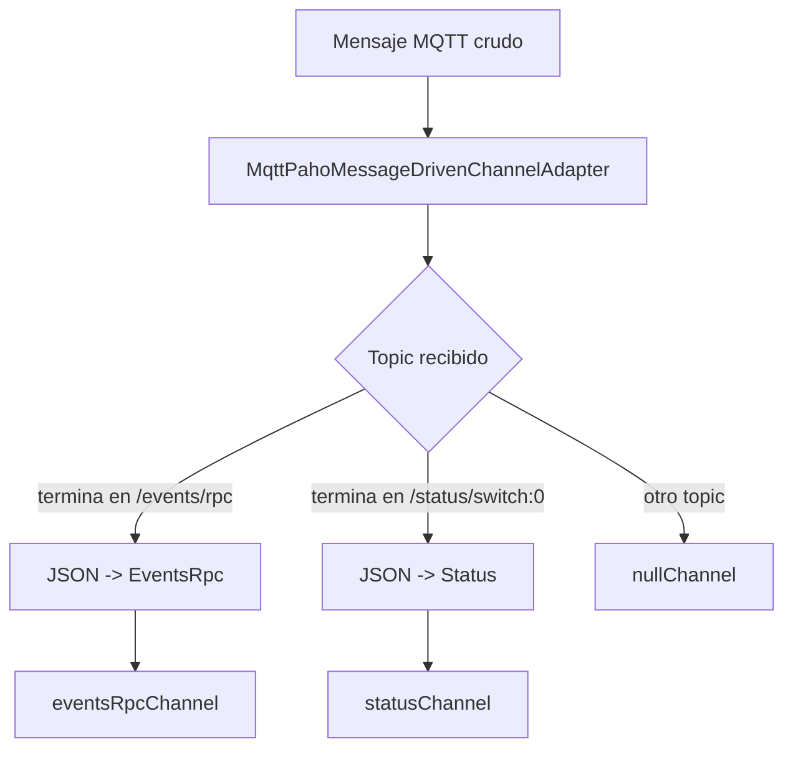
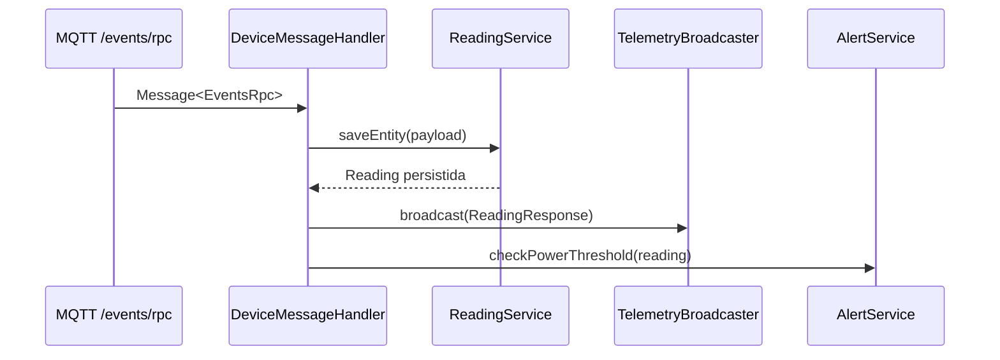
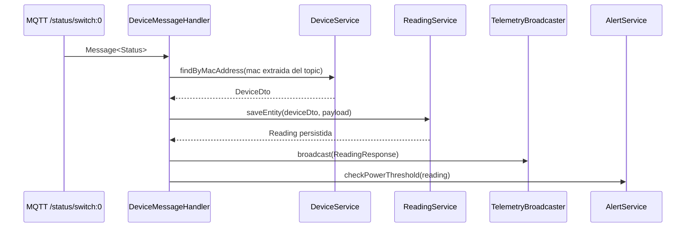
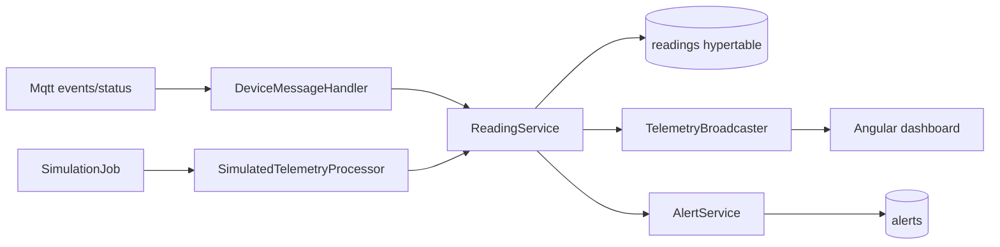

# Anexo C: Ingesta de telemetria MQTT y simulacion IoT

## 1. Objetivo de la ingesta

La ingesta de telemetria convierte mensajes IoT en lecturas persistidas y eventos visibles en tiempo real. En Wattimizer hay dos fuentes:

1. **Dispositivo fisico Shelly Plug**, que publica en MQTT.
2. **Dispositivos simulados**, generados por un job programado del backend.

Ambas fuentes terminan en el mismo resultado funcional:

- lectura guardada en `readings`;
- emision STOMP a Angular;
- comprobacion de alertas de potencia.

## 2. Configuracion MQTT con Spring Integration

Archivo: `backend/src/main/java/com/joselumartos/jwtauthbackenddemo/config/MqttConfig.java`.

### 2.1. Conexion al broker

El backend crea un `MqttPahoClientFactory` con:

- URL de broker desde `mqtt.url`.
- usuario desde `mqtt.username`.
- contrasena desde `mqtt.password`.
- reconexion automatica activada.
- sesion limpia.

Los valores reales se inyectan por variables de entorno en Docker Compose. No deben quedar escritos en documentacion ni codigo.

### 2.2. Adaptador entrante

El bean `mqttInbound()` crea un `MqttPahoMessageDrivenChannelAdapter`:

```java
new MqttPahoMessageDrivenChannelAdapter(
    "backend-spring-iot",
    mqttClientFactory(),
    "shellyplugsg3-9070694d3590/#"
);
```

La suscripcion fisica actual esta fijada al arbol:

```text
shellyplugsg3-9070694d3590/#
```

Por tanto, el codigo esta preparado para ese dispositivo o familia de topics, pero no implementa aun una suscripcion dinamica a cualquier MAC. Esta es una limitacion importante a documentar.

El QoS configurado es `1`, lo que significa "al menos una vez". El sistema puede recibir duplicados, por eso el frontend deduplica visualmente lecturas por timestamp en el store.

### 2.3. Enrutado de mensajes

El `IntegrationFlow` lee la cabecera `MqttHeaders.RECEIVED_TOPIC` y decide:

| Sufijo del topic | Ruta interna | DTO |
|---|---|---|
| `/events/rpc` | `eventsRpcChannel` | `EventsRpc` |
| `/status/switch:0` | `statusChannel` | `Status` |
| Otro | `nullChannel` | Se ignora |

Diagrama:



## 3. Payload `events/rpc`

DTOs implicados:

- `EventsRpc`
- `Params`
- `Switch`
- `ActiveEnergy`

Estructura esperada por el mapper:

```json
{
  "src": "shellyplugsg3-A1B2C3D4E5F6",
  "params": {
    "ts": 1793916000,
    "switch:0": {
      "apower": 125.5,
      "aenergy": {
        "total": 14235.0
      }
    }
  }
}
```

Mapeo a `Reading` en `EventsRpcMapper`:

| Campo MQTT | Campo entidad | Transformacion |
|---|---|---|
| `params.ts` | `time` | `Instant.ofEpochSecond(timestamp.longValue())` |
| `src` | `device` | Extrae la MAC despues del ultimo `-` y busca `Device` |
| `params.switch:0.apower` | `powerW` | Valor directo |
| `params.switch:0.aenergy.total` | `energyTotalKwh` | Divide Wh entre 1000 |
| - | `isOn` | Se ignora en este mapper |

Si el mapper no encuentra el dispositivo, `ReadingService.saveEntity(EventsRpc)` calcula una MAC de respaldo. Si el dispositivo es nulo o no tiene MAC, puede acabar usando cadena vacia. Por eso no se debe afirmar que el sistema aprovisiona dispositivos desconocidos de forma robusta; el flujo correcto para usuario es reclamar o crear dispositivos mediante REST.

## 4. Payload `status/switch:0`

DTO implicado: `Status`.

Estructura:

```json
{
  "output": true,
  "apower": 125.5,
  "aenergy": {
    "total": 14235.0
  }
}
```

Mapeo en `StatusMapper`:

| Campo MQTT | Campo entidad |
|---|---|
| `output` | `isOn` |
| `apower` | `powerW` |
| `aenergy.total` | `energyTotalKwh` en kWh |

En este caso, el `DeviceMessageHandler` extrae la MAC desde el topic:

```java
String macAddress = topic.split("/")[0].split("-")[1];
```

Despues llama a `deviceService.findByMacAddress(macAddress)`. Si la MAC no existe en base de datos, se lanza `EntityNotFoundException` y no se guarda la lectura.

## 5. `DeviceMessageHandler`

Archivo: `backend/src/main/java/com/joselumartos/jwtauthbackenddemo/services/DeviceMessageHandler.java`.

### 5.1. Flujo de `eventsRpcChannel`



Metodo:

```java
@ServiceActivator(inputChannel = "eventsRpcChannel")
public void handleEventsRpc(Message<EventsRpc> mqttMessage)
```

### 5.2. Flujo de `statusChannel`



La diferencia principal es que `statusChannel` fija `time = Instant.now()`, mientras que `events/rpc` usa el timestamp que viene en el payload.

## 6. Persistencia de lecturas

Entidad: `Reading`.

Campos:

| Campo | Tipo | Descripcion |
|---|---|---|
| `time` | `Instant` | Instante UTC de la lectura. Forma parte de la clave. |
| `device` | `Device` | Relacion ManyToOne. Forma parte de la clave. |
| `powerW` | `BigDecimal(10,2)` | Potencia activa en vatios. |
| `energyTotalKwh` | `BigDecimal(14,4)` | Odometro de energia acumulada. |
| `isOn` | `Boolean` | Estado del rele o salida del enchufe. |

La clave primaria compuesta se declara con `@IdClass(ReadingId.class)`, usando `time` y `device`.

## 7. Emision en tiempo real por STOMP

Servicio: `TelemetryBroadcaster`.

Cuando se guarda una lectura, el backend construye el destino:

```text
/topic/readings/{macAddress}
```

y envia un `ReadingResponse`. Angular se suscribe al mismo destino desde `WebsocketService.watchReadings(macAddress)`.

Para alertas, el destino es:

```text
/topic/alerts/{username}
```

Aunque el frontend actual carga alertas por REST, el backend ya tiene preparado el canal de eventos para avisos por usuario.

## 8. Alertas de maximetro

Servicio: `AlertService`.

La alerta no se crea con cualquier pico arbitrario. El proceso es:

1. Verificar que la lectura tenga dispositivo, potencia y tiempo.
2. Verificar que el dispositivo tenga usuario y tarifa.
3. Resolver el periodo aplicable con `CalendarResolverService`.
4. Buscar la potencia contratada de ese periodo.
5. Convertir `powerW` a kW.
6. Comparar potencia actual contra potencia contratada.
7. Si se supera el limite, crear alerta `OVERPOWER`.
8. Emitir la alerta por STOMP a `/topic/alerts/{username}`.

Esto permite que el umbral sea diferente segun el periodo horario de la tarifa.

## 9. Telemetria simulada

La simulacion se implementa para que la aplicacion sea demostrable sin un Shelly fisico.

### 9.1. Configuracion

Archivo: `SimulationProperties`.

Propiedades:

```properties
simulation.enabled=true
simulation.interval-ms=5000
```

En produccion se controlan mediante variables de entorno en Docker Compose. Si `simulation.enabled=false`, el job no genera lecturas.

### 9.2. `IotTelemetrySimulationJob`

Archivo: `IotTelemetrySimulationJob`.

Cada `simulation.interval-ms`:

1. Comprueba si la simulacion esta habilitada.
2. Obtiene `Instant.now()` como inicio del tick.
3. Busca dispositivos con `findBySimulatedTrue()`.
4. Para cada dispositivo, delega en `SimulatedTelemetryProcessor`.
5. Si un dispositivo falla, se registra warning y continua con el resto.

La decision de procesar cada dispositivo de forma aislada evita que un simulador defectuoso detenga toda la demostracion.

### 9.3. `SimulatedTelemetryProcessor`

Este servicio ejecuta una transaccion nueva por dispositivo:

```java
@Transactional(propagation = Propagation.REQUIRES_NEW)
public void processDevice(Device device, Instant tickStart, long intervalMs)
```

Flujo:

1. Lee el perfil `SimulationProfile`.
2. Comprueba si el dispositivo esta encendido (`isOn`).
3. Calcula un `readingTime` con pequeno desfase por `device.getId() % 1000L` para reducir colisiones de clave primaria si varios ticks coinciden.
4. Calcula `powerW` con `SimulationProfileRegistry`.
5. Recupera el ultimo `energyTotalKwh`.
6. Calcula el siguiente odometro.
7. Guarda la lectura con `ReadingService.saveSimulatedReading`.
8. Emite por STOMP.
9. Comprueba alertas.

### 9.4. Perfiles de simulacion

Enum: `SimulationProfile`.

| Perfil | Intencion funcional |
|---|---|
| `SINE_WAVE` | Onda de prueba para comprobar variacion continua. |
| `OVEN` | Consumo alto con comportamiento de calentamiento. |
| `WASHING_MACHINE` | Ciclo variable de lavadora. |
| `TELEVISION` | Consumo moderado. |
| `FAN` | Carga pequena y estable. |
| `DESKTOP_PC` | Consumo de ordenador de sobremesa. |
| `FRIDGE` | Ciclos de compresor. |
| `STANDBY` | Consumo fantasma constante o bajo. |
| `CONSTANT_HIGH_LOAD` | Carga alta para probar alertas de potencia. |

## 10. Calculo del odometro energetico

El odometro simulado no suma vatios directamente. Convierte potencia e intervalo:

```text
energia_kWh = potencia_W * segundos / 1000 / 3600
```

En codigo se usa `BigDecimal` y se redondea a 4 decimales:

```text
nextKwh = previousKwh + (powerW * intervalSeconds / 1000 / 3600)
```

Si el dispositivo esta apagado o la potencia es menor o igual que cero, el odometro no crece.

## 11. Relacion entre telemetria real y simulada



La ventaja de este diseno es que las lecturas simuladas son equivalentes para el resto del sistema: se guardan en la misma tabla, se emiten por el mismo WebSocket y pueden disparar las mismas alertas.

## 12. Limitaciones actuales detectadas

- La suscripcion MQTT fisica esta fijada a `shellyplugsg3-9070694d3590/#`.
- El alta automatica desde `events/rpc` puede crear dispositivos sin usuario y, en casos incompletos, con MAC vacia.
- No hay publicacion MQTT desde Angular para encender o apagar el Shelly fisico; el cambio `isOn` actual modifica el registro de dispositivo por REST.
- El frontend no esta suscrito todavia al topic de alertas, aunque el backend lo emite.
- La idempotencia de mensajes MQTT se controla de forma parcial en frontend; no hay constraint especifico para descartar duplicados por payload.
