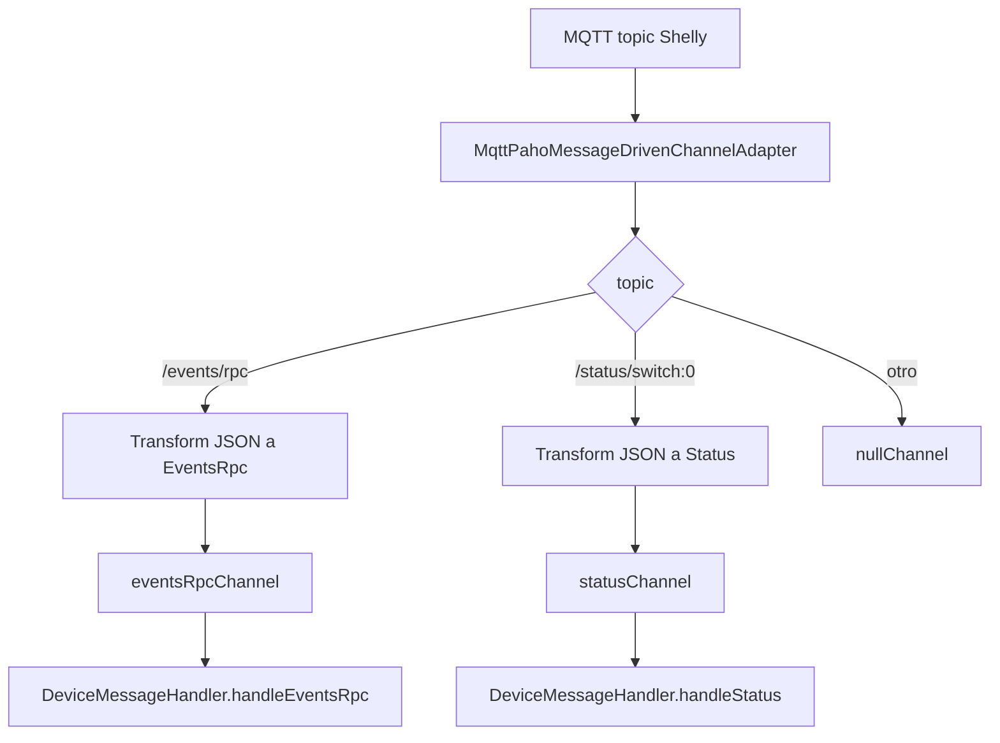
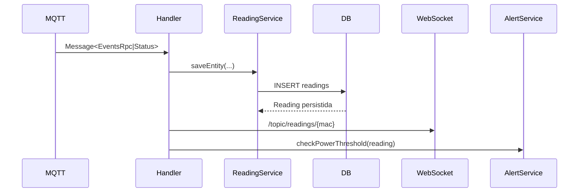

# Anexo C. Ingesta asincrona MQTT y simulacion IoT

Este anexo documenta la logica de telemetria asincrona implementada en el backend. El flujo combina MQTT, Spring Integration, persistencia JPA, TimescaleDB, alertas y WebSocket STOMP.

## 1. Objetivo de la ingesta

La plataforma recibe mediciones electricas desde un enchufe Shelly. Esas mediciones llegan al broker MQTT y el backend las transforma en lecturas internas (`Reading`) con:

- instante (`time`);
- dispositivo (`device`);
- potencia activa en W (`powerW`);
- energia acumulada en kWh (`energyTotalKwh`);
- estado del rele (`isOn`).

Despues de guardar la lectura, el backend:

1. La publica por WebSocket STOMP para actualizar Angular en tiempo real.
2. Comprueba si la potencia supera el maximo contratado y, si procede, crea una alerta.

## 2. Configuracion MQTT

Archivo: `backend/src/main/java/com/joselumartos/jwtauthbackenddemo/config/MqttConfig.java`.

### 2.1. Propiedades

El backend lee estas propiedades:

| Propiedad Spring | Variable Docker | Funcion |
| --- | --- | --- |
| `mqtt.url` | `MQTT_URL` | URL del broker, por ejemplo `tcp://mosquitto:1883`. |
| `mqtt.username` | `MQTT_USER` | Usuario del backend en Mosquitto. |
| `mqtt.password` | `MQTT_PASSWORD` | Password del backend en Mosquitto. |

No se documentan valores secretos porque deben vivir fuera del repositorio.

### 2.2. Cliente Paho

`mqttClientFactory()` crea un `DefaultMqttPahoClientFactory` con:

- reconexion automatica (`setAutomaticReconnect(true)`);
- sesion limpia (`setCleanSession(true)`);
- usuario y password del entorno.

### 2.3. Adaptador de entrada

```java
new MqttPahoMessageDrivenChannelAdapter(
    "backend-spring-iot",
    mqttClientFactory(),
    "shellyplugsg3-9070694d3590/#"
);
```

Actualmente la suscripcion fisica esta acotada a un topic Shelly concreto: `shellyplugsg3-9070694d3590/#`. Esto es suficiente para el prototipo con un enchufe real, pero una mejora futura seria parametrizar o ampliar la suscripcion a varios dispositivos.

El QoS configurado es `1`, por lo que el broker intenta entregar el mensaje al menos una vez.

## 3. Enrutado con Spring Integration

`mqttInboundFlow` recibe todos los mensajes del adaptador y decide el canal segun el topic:

| Condicion de topic | Tipo destino | Canal interno |
| --- | --- | --- |
| Termina en `/events/rpc` | Evento de energia Shelly | `eventsRpcChannel` |
| Termina en `/status/switch:0` | Estado del rele | `statusChannel` |
| Cualquier otro topic | Ignorado | `nullChannel` |

Diagrama del flujo:



## 4. DTOs de MQTT

### 4.1. `EventsRpc`

Representa mensajes donde Shelly manda datos dentro de `params`:

```java
public record EventsRpc(
    @JsonProperty("src") String source,
    Params params
) {}

public record Params(
    @JsonProperty("ts") Double timestamp,
    @JsonProperty("switch:0") Switch switchData
) {}

public record Switch(
    @JsonProperty("aenergy") ActiveEnergy activeEnergy,
    @JsonProperty("apower") Double activePower
) {}
```

`EventsRpcMapper` hace estas conversiones:

| Campo MQTT | Campo `Reading` | Conversion |
| --- | --- | --- |
| `params.ts` | `time` | `Instant.ofEpochSecond(timestamp.longValue())` |
| `src` | `device` | Extrae MAC despues del ultimo `-` y busca `Device` |
| `params.switch:0.apower` | `powerW` | Directo |
| `params.switch:0.aenergy.total` | `energyTotalKwh` | Wh dividido entre 1000 |

Si el mapper no encuentra dispositivo por MAC, `ReadingService.saveEntity(EventsRpc)` puede crear un dispositivo nuevo con la MAC resuelta. En el caso extremo de que el payload no permita resolver MAC, el codigo actual usa cadena vacia como fallback; por eso no conviene afirmar que la provision automatica sea completa para todos los mensajes desconocidos.

### 4.2. `Status`

Representa mensajes de estado del interruptor:

```java
public record Status(
    Boolean output,
    @JsonProperty("apower") Double activePower,
    @JsonProperty("aenergy") ActiveEnergy activeEnergy
) {}
```

`StatusMapper` mapea:

| Campo MQTT | Campo `Reading` |
| --- | --- |
| `output` | `isOn` |
| `apower` | `powerW` |
| `aenergy.total` | `energyTotalKwh` en kWh |

En este flujo la MAC se extrae del topic:

```java
String macAddress = topic.split("/")[0].split("-")[1];
```

Despues se busca el dispositivo con `deviceService.findByMacAddress(macAddress)`.

## 5. `DeviceMessageHandler`

Archivo: `services/DeviceMessageHandler.java`.

Tiene dos metodos activados por canal:

```java
@ServiceActivator(inputChannel = "eventsRpcChannel")
public void handleEventsRpc(Message<EventsRpc> mqttMessage)
```

```java
@ServiceActivator(inputChannel = "statusChannel")
public void handleStatus(Message<Status> mqttMessage)
```

Ambos metodos ejecutan el mismo patron:

1. Transformar DTO MQTT a `Reading`.
2. Persistir la lectura con `ReadingService`.
3. Convertir a `ReadingResponse`.
4. Publicar por WebSocket con `TelemetryBroadcaster`.
5. Ejecutar `AlertService.checkPowerThreshold(reading)`.



## 6. Persistencia de lecturas

Archivo: `ReadingService.java`.

Hay tres formas de guardar lecturas:

| Metodo | Origen | Uso |
| --- | --- | --- |
| `saveEntity(EventsRpc dto)` | MQTT `events/rpc` | Convierte con MapStruct y asegura dispositivo gestionado por JPA. |
| `saveEntity(DeviceDto deviceDto, Status dto)` | MQTT `status/switch:0` | Usa hora actual y dispositivo resuelto por topic. |
| `saveSimulatedReading(...)` | Job de simulacion | Construye la lectura manualmente porque no viene de MQTT externo. |

`readings` usa clave compuesta `time + device_id`, por lo que en simuladores se aplica un pequeno desfase por dispositivo para evitar colisiones cuando varios se procesan en el mismo tick.

## 7. Publicacion en tiempo real con STOMP

Archivo: `TelemetryBroadcaster.java`.

```java
public void broadcast(ReadingResponse readingDto) {
    String destination = "/topic/readings/" + readingDto.macAddress();
    messagingTemplate.convertAndSend(destination, readingDto);
}
```

La lectura no se emite en un canal global, sino en un topic por MAC. Esto hace que Angular pueda suscribirse solo al medidor activo:

```ts
const destination = `/topic/readings/${macAddress}`;
```

Tambien existe emision de alertas:

```java
String destination = "/topic/alerts/" + alertDto.username();
```

## 8. Configuracion WebSocket

Archivo: `StompWebSocketConfig.java`.

| Elemento | Valor |
| --- | --- |
| Endpoint handshake | `/ws-iot` |
| Broker simple | `/topic` |
| Prefijo de entrada aplicacion | `/app` |
| Origenes permitidos | `app.cors.allowed-origins` |

El endpoint `/ws-iot` queda permitido en `SecurityConfig` para que el navegador pueda establecer handshake. La autorizacion de datos se controla por el topic concreto que el frontend decide escuchar.

## 9. Generacion de alertas

`AlertService.checkPowerThreshold(reading)` se ejecuta despues de cada lectura real o simulada.

Condiciones para generar alerta:

1. La lectura tiene dispositivo, potencia y hora.
2. El dispositivo tiene usuario.
3. El usuario tiene tarifa asignada.
4. `CalendarResolverService` resuelve el periodo aplicable.
5. Existe potencia contratada para ese periodo.
6. `powerW / 1000` supera `contractedPowerKw`.

Si se cumple, se crea alerta:

- `type = "OVERPOWER"`
- mensaje con nombre de dispositivo, kW medidos, periodo y porcentaje sobre el limite.

Despues se emite por WebSocket a:

```text
/topic/alerts/{username}
```

## 10. Simulacion de telemetria

La simulacion permite usar Wattimizer sin hardware real. Se activa con:

```properties
simulation.enabled=true
simulation.interval-ms=5000
```

En Docker Compose se controla con:

```env
SIMULATION_ENABLED=true
```

### 10.1. `IotTelemetrySimulationJob`

Archivo: `services/IotTelemetrySimulationJob.java`.

Se ejecuta con:

```java
@Scheduled(fixedRateString = "${simulation.interval-ms:5000}")
```

Flujo:

1. Si `simulation.enabled=false`, termina sin hacer nada.
2. Lee todos los dispositivos `is_simulated=true`.
3. Procesa cada dispositivo con `SimulatedTelemetryProcessor`.
4. Si un dispositivo falla, registra warning y continua con los demas.

Esta ultima decision esta cubierta por `IotTelemetrySimulationJobTest.publishSimulatedTelemetryContinuesWhenOneDeviceFails`.

### 10.2. `SimulatedTelemetryProcessor`

Cada dispositivo se procesa en transaccion nueva:

```java
@Transactional(propagation = Propagation.REQUIRES_NEW)
```

Motivo: si una lectura simulada falla, no debe revertir el tick entero ni afectar al resto de dispositivos.

Calculos:

- Si `isOn=false`, potencia `0 W` y el contador kWh no aumenta.
- Si `isOn=true`, se calcula potencia segun perfil.
- Se busca el ultimo `energyTotalKwh`.
- Se calcula el nuevo acumulado:

```text
nextKwh = previousKwh + (powerW * seconds) / 1000 / 3600
```

Despues se guarda lectura, se emite por STOMP y se comprueban alertas.

### 10.3. Perfiles de simulacion

Archivo: `simulation/SimulationProfileRegistry.java`.

| Perfil | Comportamiento aproximado |
| --- | --- |
| `SINE_WAVE` | Onda senoidal de prueba alrededor de 500 W. |
| `OVEN` | Ciclo con arranque fuerte, oscilacion termica y reposo bajo. |
| `WASHING_MACHINE` | Fases de llenado, calentamiento, lavado, centrifugado y reposo. |
| `TELEVISION` | Consumo estable con oscilacion suave. |
| `FAN` | Ventilador con variacion pequena. |
| `DESKTOP_PC` | Base variable con picos de carga. |
| `FRIDGE` | Ciclo de compresor: picos cortos y consumo bajo. |
| `STANDBY` | Consumo fantasma bajo, alrededor de 10 W. |
| `CONSTANT_HIGH_LOAD` | Carga constante alta de 3500 W para provocar escenarios de alerta. |

El registro aplica fallback a `SINE_WAVE` si el perfil llega nulo o no existe.

## 11. Pack de demostracion

`DeviceService.createDemoSimulatorPack(username)` recorre todos los valores de `SimulationProfile` y crea los que el usuario aun no tiene.

Nombres generados:

| Perfil | Nombre |
| --- | --- |
| `SINE_WAVE` | Simulador onda de prueba |
| `OVEN` | Simulador horno |
| `WASHING_MACHINE` | Simulador lavadora |
| `TELEVISION` | Simulador televisor |
| `FAN` | Simulador ventilador |
| `DESKTOP_PC` | Simulador PC |
| `FRIDGE` | Simulador nevera |
| `STANDBY` | Simulador consumo fantasma |
| `CONSTANT_HIGH_LOAD` | Simulador carga alta |

Las MAC simuladas se generan con prefijo `SIM` y nueve digitos, por ejemplo `SIM000000001`. El servicio busca la secuencia maxima existente y prueba candidatos hasta encontrar uno libre.

## 12. Limitaciones tecnicas actuales

- La suscripcion MQTT fisica esta fijada a un topic Shelly concreto.
- No hay autenticacion STOMP por usuario en el handshake; el backend publica por topic especifico y el frontend escucha la MAC seleccionada.
- La provision automatica desde `events/rpc` depende de poder extraer MAC desde `src`.
- No hay cola intermedia entre MQTT y base de datos: el procesamiento ocurre en el flujo de Spring Integration.
- Las lecturas simuladas y reales comparten la misma tabla `readings`, diferenciandose por `devices.is_simulated`.

Estas limitaciones son aceptables para el MVP, pero conviene reflejarlas en la memoria porque marcan lineas futuras claras.
