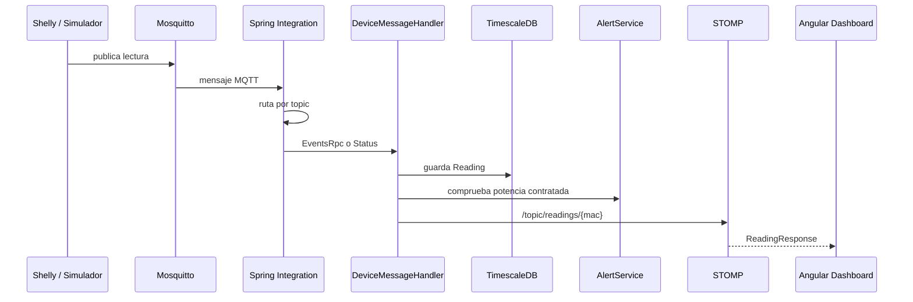

# Anexo C. Ingesta de telemetria MQTT y simulacion IoT

## 1. Objetivo de la ingesta

Wattimizer necesita recibir lecturas de consumo desde dispositivos IoT y convertirlas en datos utiles para el usuario. El backend implementa dos fuentes:

1. **Dispositivo fisico Shelly Plug S Gen 3**, conectado por MQTT a Mosquitto.
2. **Dispositivos simulados**, generados por un job interno para probar la aplicacion sin hardware.

Ambas fuentes terminan en el mismo flujo de negocio:

```text
lectura -> tabla readings -> comprobacion de alerta -> WebSocket STOMP -> dashboard Angular
```

## 2. Configuracion MQTT

Archivo: `backend/src/main/java/.../config/MqttConfig.java`

La clase esta anotada con:

```java
@Configuration
@EnableIntegration
public class MqttConfig { ... }
```

Spring Integration se utiliza porque permite montar un flujo declarativo: entrada MQTT, enrutado por topic, transformacion JSON y envio a canales internos.

### 2.1. Propiedades

Las credenciales se leen desde `application.properties` o variables de entorno:

```properties
mqtt.url=${MQTT_URL:tcp://localhost:1883}
mqtt.username=${MQTT_USER:gateway-service}
mqtt.password=${MQTT_PASSWORD:<valor-local-no-documentado>}
```

En Docker Compose, el backend usa:

```yaml
MQTT_URL: tcp://mosquitto:1883
MQTT_USER: ${PROD_MQTT_USER}
MQTT_PASSWORD: ${PROD_MQTT_PASSWORD}
```

### 2.2. Cliente Paho

`mqttClientFactory()` crea un `DefaultMqttPahoClientFactory` con:

- URL del broker.
- Usuario y contrasena.
- Reconexion automatica.
- `cleanSession=true`.

La reconexion automatica es importante porque en un entorno con Docker o red domestica el broker puede reiniciarse antes que el backend.

### 2.3. Adapter de entrada

```java
new MqttPahoMessageDrivenChannelAdapter(
    "backend-spring-iot",
    mqttClientFactory(),
    "shellyplugsg3-9070694d3590/#"
);
```

El backend esta suscrito al arbol de topics del Shelly fisico identificado como `shellyplugsg3-9070694d3590`. El `#` permite recibir subtopics como:

- `shellyplugsg3-9070694d3590/events/rpc`
- `shellyplugsg3-9070694d3590/status/switch:0`

El QoS se configura a `1`, lo que implica entrega al menos una vez. Por eso el frontend deduplica lecturas por timestamp cuando consume el WebSocket.

## 3. Canales internos

`MqttConfig` define dos `DirectChannel`:

```java
public MessageChannel eventsRpcChannel()
MessageChannel statusChannel()
```

Cada canal representa un tipo de mensaje que el backend sabe transformar:

| Canal | Topic origen | DTO destino | Uso |
| --- | --- | --- | --- |
| `eventsRpcChannel` | termina en `/events/rpc` | `EventsRpc` | Evento RPC con `params.ts` y datos de `switch:0`. |
| `statusChannel` | termina en `/status/switch:0` | `Status` | Estado periodico del interruptor. |

## 4. Flujo Spring Integration

El flujo principal es `mqttInboundFlow()`:

```java
return IntegrationFlow.from(mqttInbound)
    .route(Message.class, message -> {
        String topic = message.getHeaders().get(MqttHeaders.RECEIVED_TOPIC, String.class);
        if (topic != null && topic.endsWith("/events/rpc")) return "EVENTS";
        if (topic != null && topic.endsWith("/status/switch:0")) return "STATUS";
        return "IGNORE";
    }, router -> router
        .subFlowMapping("EVENTS", eventsBranch -> eventsBranch
            .transform(Transformers.fromJson(EventsRpc.class))
            .channel("eventsRpcChannel")
        )
        .subFlowMapping("STATUS", statusBranch -> statusBranch
            .transform(Transformers.fromJson(Status.class))
            .channel("statusChannel")
        )
        .defaultOutputChannel("nullChannel")
    )
    .get();
```

La decision de enrutar por sufijo del topic permite ignorar mensajes del Shelly que no aportan consumo electrico. Los mensajes no reconocidos van a `nullChannel`, por lo que no rompen la ingesta.

## 5. DTOs MQTT

### 5.1. EventsRpc

```java
@JsonIgnoreProperties(ignoreUnknown = true)
public record EventsRpc(
    @JsonProperty("src") String source,
    Params params
) {}
```

`@JsonIgnoreProperties(ignoreUnknown = true)` evita que el backend falle si Shelly envia campos adicionales.

### 5.2. Params

```java
@JsonIgnoreProperties(ignoreUnknown = true)
public record Params(
    @JsonProperty("ts") Double timestamp,
    @JsonProperty("switch:0") Switch switchData
) {}
```

El campo `switch:0` no es un identificador Java valido, por eso se mapea con `@JsonProperty`.

### 5.3. Switch y ActiveEnergy

```java
public record Switch(
    @JsonProperty("aenergy") ActiveEnergy activeEnergy,
    @JsonProperty("apower") Double activePower
) {}

public record ActiveEnergy(Double total) {}
```

El Shelly separa potencia activa (`apower`) y energia acumulada (`aenergy.total`). Wattimizer conserva ambos valores: potencia para la grafica y energia acumulada para calculos de coste por delta.

### 5.4. Status

```java
public record Status(
    Boolean output,
    @JsonProperty("apower") Double activePower,
    @JsonProperty("aenergy") ActiveEnergy activeEnergy
) {}
```

El mensaje de estado no trae la MAC como campo directo. `DeviceMessageHandler` la obtiene del topic:

```java
String macAddress = (topic != null) ? topic.split("/")[0].split("-")[1] : null;
```

## 6. Procesamiento de mensajes

Archivo: `DeviceMessageHandler.java`

La clase tiene dos `@ServiceActivator`:

```java
@ServiceActivator(inputChannel = "eventsRpcChannel")
public void handleEventsRpc(Message<EventsRpc> mqttMessage)

@ServiceActivator(inputChannel = "statusChannel")
public void handleStatus(Message<Status> mqttMessage)
```

### 6.1. Flujo `events/rpc`

1. Se recibe un `Message<EventsRpc>`.
2. `ReadingService.saveEntity(payload)` convierte el DTO en entidad `Reading`.
3. Se persiste la lectura.
4. `TelemetryBroadcaster.broadcast()` envia la lectura por STOMP.
5. `AlertService.checkPowerThreshold()` evalua si hay alerta de maximetro.

### 6.2. Flujo `status/switch:0`

1. Se extrae la MAC desde la cabecera `MqttHeaders.RECEIVED_TOPIC`.
2. `DeviceService.findByMacAddress(macAddress)` busca el dispositivo.
3. `ReadingService.saveEntity(deviceDto, status)` crea una lectura con `Instant.now()`.
4. Se publica por STOMP y se comprueba alerta.

## 7. Persistencia de lecturas

Archivo: `ReadingService.java`

### 7.1. Guardado desde `EventsRpc`

```java
public Reading saveEntity(EventsRpc dto) {
    Reading reading = eventsRpcMapper.toEntity(dto);

    String macAddress = (reading.getDevice() == null || reading.getDevice().getMacAddress() == null)
            ? ""
            : reading.getDevice().getMacAddress();

    Device managedDevice = deviceRepository.findByMacAddress(macAddress)
            .orElseGet(() -> {
                Device newDevice = new Device();
                newDevice.setMacAddress(macAddress);
                newDevice.setName("Nuevo Enchufe " + macAddress);
                newDevice.setIsOn(true);
                return deviceRepository.save(newDevice);
            });

    reading.setDevice(managedDevice);
    return readingRepository.save(reading);
}
```

Hay un autoaprovisionamiento basico si llega una MAC no registrada. Si el mapper no consigue extraer la MAC, el valor puede quedar vacio, por lo que no se debe afirmar que todos los mensajes MQTT crean automaticamente un dispositivo valido y asignado a usuario. Para uso normal, el dispositivo fisico se preinserta con seed o se reclama desde la UI.

### 7.2. Guardado desde `Status`

El flujo de estado usa `StatusMapper`, fija `Instant.now()` y asocia el dispositivo ya localizado por MAC.

## 8. Emision WebSocket STOMP

Archivo: `TelemetryBroadcaster.java`

```java
public void broadcast(ReadingResponse readingDto) {
    String destination = "/topic/readings/" + readingDto.macAddress();
    messagingTemplate.convertAndSend(destination, readingDto);
}
```

Cada dispositivo tiene su propio topic. Esto reduce trabajo en el frontend: si el usuario esta viendo una MAC concreta, solo se suscribe a su topic.

Tambien se emiten alertas:

```java
String destination = "/topic/alerts/" + alertDto.username();
```

Actualmente la UI de alertas consulta por REST; el canal STOMP queda preparado para notificaciones en vivo por usuario.

## 9. Simulacion IoT

### 9.1. Configuracion

Archivos:

- `SchedulingConfig.java`
- `SimulationProperties.java`
- `IotTelemetrySimulationJob.java`
- `SimulatedTelemetryProcessor.java`
- paquete `simulation/`

Propiedades:

```properties
simulation.enabled=${SIMULATION_ENABLED:true}
simulation.interval-ms=${SIMULATION_INTERVAL_MS:5000}
```

`SchedulingConfig` activa `@EnableScheduling`. El job se ejecuta cada `simulation.interval-ms`.

### 9.2. Job programado

```java
@Scheduled(fixedRateString = "${simulation.interval-ms:5000}")
public void publishSimulatedTelemetry() {
    if (!simulationProperties.enabled()) {
        return;
    }

    Instant tickStart = Instant.now();
    long intervalMs = simulationProperties.intervalMs();
    List<Device> simulatedDevices = deviceRepository.findBySimulatedTrue();

    for (Device device : simulatedDevices) {
        telemetryProcessor.processDevice(device, tickStart, intervalMs);
    }
}
```

Cada dispositivo se procesa en una transaccion independiente (`REQUIRES_NEW`). Esta decision evita que el fallo de un simulador impida guardar lecturas de los demas.

### 9.3. Perfiles de potencia

`SimulationProfileRegistry` asocia cada perfil con un calculador:

| Perfil | Comportamiento |
| --- | --- |
| `SINE_WAVE` | Onda senoidal entre valores medios. |
| `OVEN` | Pico inicial, fase de mantenimiento y reposo. |
| `WASHING_MACHINE` | Fases de lavado, calentamiento, giro y reposo. |
| `TELEVISION` | Oscilacion baja alrededor de 90 W. |
| `FAN` | Oscilacion suave alrededor de 35 W. |
| `DESKTOP_PC` | Base con picos de carga. |
| `FRIDGE` | Ciclos cortos de compresor y reposo. |
| `STANDBY` | Consumo fantasma bajo y casi constante. |
| `CONSTANT_HIGH_LOAD` | Carga fija alta de 3500 W. |

`SimulationMath` aporta funciones comunes para desfase por dispositivo, posicion en ciclo, oscilacion y redondeo a vatios.

### 9.4. Calculo de energia acumulada

`SimulatedTelemetryProcessor` calcula el siguiente odometro:

```text
kWh nuevo = kWh anterior + (W * segundos) / 1000 / 3600
```

El valor se guarda con escala de 4 decimales. El acumulado permite que los calculos economicos funcionen igual en dispositivos fisicos y simulados.

## 10. Flujo completo de telemetria



## 11. Relacion con alertas

Cada lectura pasa por `AlertService.checkPowerThreshold()`:

1. Comprueba que lectura, dispositivo, usuario y tarifa existen.
2. Resuelve el periodo tarifario con `CalendarResolverService`.
3. Busca la potencia contratada de ese periodo.
4. Convierte `powerW` a kW.
5. Si la lectura supera el limite, crea alerta `OVERPOWER`.
6. Publica la alerta por `/topic/alerts/{username}`.

El sistema no genera alertas si falta calendario, tarifa o potencia contratada. Es una decision conservadora: mejor no avisar que lanzar alertas con datos incompletos.

## 12. Limitaciones actuales

- La suscripcion MQTT esta ligada al identificador `shellyplugsg3-9070694d3590/#`; para varios Shelly fisicos habria que parametrizar topics o usar un patron mas amplio.
- MQTT se expone por `1883` en Docker Compose, sin TLS. El propio compose lo marca como deuda de seguridad.
- No existe todavia un canal frontend activo para alertas en tiempo real, aunque el backend ya las emite por STOMP.
- La deduplicacion fuerte de lecturas se deja principalmente al frontend y a la clave compuesta de base de datos.
