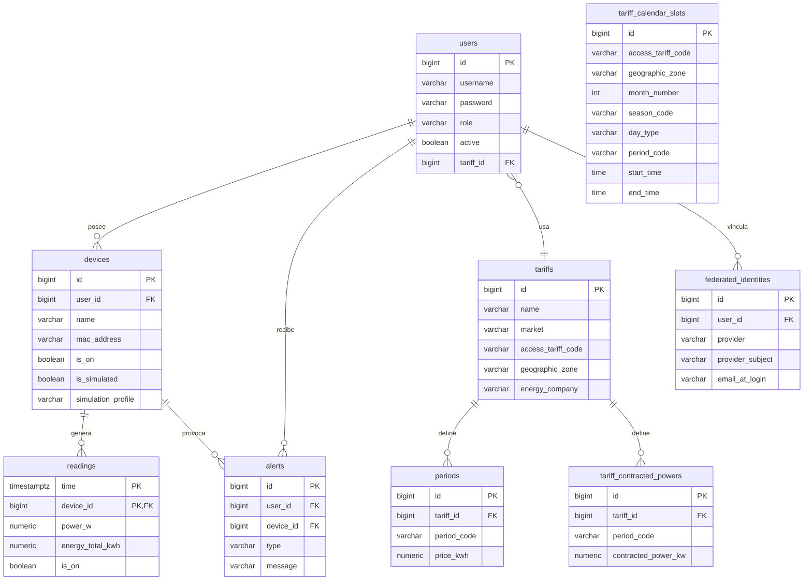
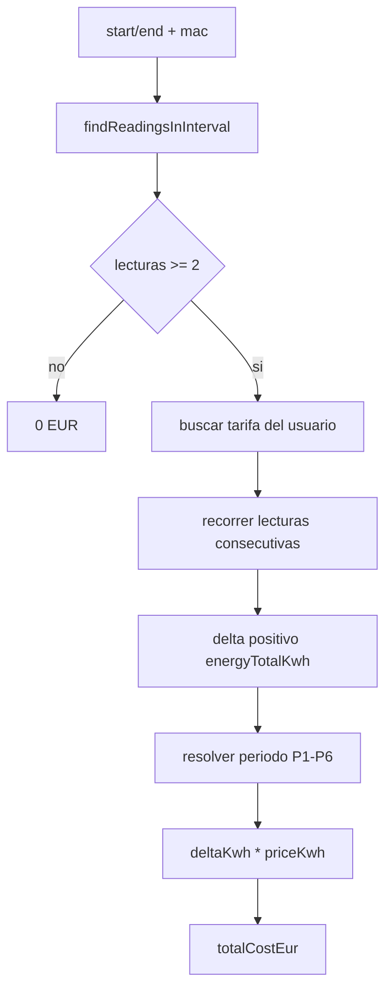

# Anexo D - TimescaleDB, modelo relacional y consultas analíticas

## 1. Alcance del anexo

Este anexo documenta la estructura de datos de Wattimizer y las consultas analíticas reales que se ejecutan sobre las lecturas. La base es PostgreSQL con TimescaleDB, pero la aplicación Java accede a los datos principalmente mediante JPA y JPQL.

Punto importante: en la rama actual no hay consultas `time_bucket`, continuous aggregates, políticas de retención ni compresión. La parte TimescaleDB implementada consiste en convertir `readings` en hypertable por la columna `time`.

## 2. Stack de base de datos

En `docker-compose.yml` se declara:

```yaml
timescaledb:
  image: timescale/timescaledb-ha:pg17
  container_name: db_iot
```

El backend usa PostgreSQL mediante Spring Data JPA. Hibernate crea o actualiza tablas con `ddl-auto=update`, y después se aplican scripts SQL de referencia para extensiones, hypertable y modelo de tarifas.

## 3. Scripts SQL relevantes

| Script | Función |
| --- | --- |
| `backend/src/main/resources/db/dev-seed/00-extensions.sql` | Activa extensiones como TimescaleDB y `pgcrypto`. |
| `backend/src/main/resources/db/dev-seed/01-hypertable.sql` | Convierte `readings` en hypertable por `time`. |
| `backend/src/main/resources/db/tariffs-td-schema.sql` | Ajusta constraints e índices de tarifas TD. |
| `backend/src/main/resources/db/seed-tariff-calendar-slots.sql` | Inserta calendario regulatorio de periodos. |
| `backend/src/main/resources/db/prod/99-resync-sequences.sql` | Resincroniza secuencias en producción. |

## 4. Hypertable `readings`

Archivo: `db/dev-seed/01-hypertable.sql`.

```sql
-- Convertir la tabla vacía en hypertable particionada por 'time'.
-- TimescaleDB gestionará automáticamente los chunks semanales.
SELECT create_hypertable('readings', 'time');
```

El propio script indica que debe ejecutarse después de crear la tabla y antes de que lleguen datos MQTT. Si ya hay filas, se puede usar:

```sql
SELECT create_hypertable('readings', 'time', migrate_data => true);
```

La decisión de particionar por `time` encaja con el dominio: cada lectura eléctrica se identifica por instante y dispositivo.

## 5. Modelo relacional



## 6. Entidades principales

### 6.1. `Reading`

Archivo: `entities/Reading.java`.

Tabla: `readings`.

| Campo Java | Columna | Tipo conceptual | Observaciones |
| --- | --- | --- | --- |
| `time` | `time` | `Instant` | Parte de la clave compuesta. |
| `device` | `device_id` | FK a `devices` | Parte de la clave compuesta. |
| `powerW` | `power_w` | `BigDecimal(10,2)` | Potencia activa instantánea. |
| `energyTotalKwh` | `energy_total_kwh` | `BigDecimal(14,4)` | Energía acumulada tipo odómetro. |
| `isOn` | `is_on` | `Boolean` | Estado lógico del enchufe. |

La clave compuesta se declara con `@IdClass(ReadingId.class)` y combina `time` con `device`.

### 6.2. `Device`

Archivo: `entities/Device.java`.

Tabla: `devices`.

| Campo | Columna | Uso |
| --- | --- | --- |
| `user` | `user_id` | Propietario del dispositivo. |
| `name` | `name` | Nombre visible. |
| `macAddress` | `mac_address` | Identificador único funcional. |
| `isOn` | `is_on` | Estado lógico del dispositivo. |
| `simulated` | `is_simulated` | Indica si el dispositivo lo genera el simulador. |
| `simulationProfile` | `simulation_profile` | Perfil sintético asociado. |

`mac_address` es único y se usa en APIs, WebSocket y consultas de lecturas.

### 6.3. `Tariff`

Archivo: `entities/Tariff.java`.

Tabla: `tariffs`.

Campos relevantes:

- `name`
- `market`
- `accessTariffCode`
- `geographicZone`
- `energyCompany`
- `periods`
- `contractedPowers`

La tarifa privada de usuario se referencia desde `users.tariff_id`.

### 6.4. `Period`

Tabla: `periods`.

Guarda precios por periodo (`P1` a `P6`) mediante `period_code` y `price_kwh`. Ya no contiene horarios; esa responsabilidad está en `tariff_calendar_slots`.

### 6.5. `TariffContractedPower`

Tabla: `tariff_contracted_powers`.

Guarda potencia contratada por periodo, usada para comparar contra lecturas y generar alertas.

### 6.6. `TariffCalendarSlot`

Tabla: `tariff_calendar_slots`.

Representa las franjas regulatorias para resolver qué periodo aplica según:

- Peaje de acceso.
- Zona geográfica.
- Mes.
- Tipo de día.
- Hora de inicio y fin.
- Código de periodo.

## 7. Constraints e índices de tarifas TD

Archivo: `db/tariffs-td-schema.sql`.

### 7.1. Catálogo de peajes y zonas

El script limita peajes:

```sql
CHECK (access_tariff_code IN ('2.0TD', '3.0TD', '6.1TD', '6.2TD'))
```

Y zonas:

```sql
CHECK (geographic_zone IN ('PENINSULA', 'CANARIAS', 'ISLAS_BALEARES', 'CEUTA', 'MELILLA'))
```

### 7.2. Periodos

```sql
CHECK (period_code IN ('P1', 'P2', 'P3', 'P4', 'P5', 'P6'))
```

Índice único:

```sql
CREATE UNIQUE INDEX IF NOT EXISTS ux_periods_tariff_period_code
  ON periods (tariff_id, period_code);
```

### 7.3. Calendario regulatorio

Índice principal de búsqueda:

```sql
CREATE UNIQUE INDEX IF NOT EXISTS ux_tariff_calendar_slots_lookup
  ON tariff_calendar_slots (
    access_tariff_code, geographic_zone, month_number, day_type, start_time, end_time
  );
```

Índice por periodo:

```sql
CREATE INDEX IF NOT EXISTS ix_tariff_calendar_slots_period_code
  ON tariff_calendar_slots (access_tariff_code, geographic_zone, month_number, day_type, period_code);
```

Estos índices encajan con las búsquedas de calendario que necesita `CalendarResolverService`.

## 8. Repositorio de lecturas

Archivo: `repositories/ReadingRepository.java`.

### 8.1. Última lectura por dispositivo

```java
Optional<Reading> findFirstByDeviceMacAddressOrderByTimeDesc(String macAddress);
```

Se usa para obtener el estado más reciente y para calcular el siguiente odómetro en simuladores.

### 8.2. Búsqueda por clave temporal y MAC

```java
Optional<Reading> findByTimeAndDeviceMacAddress(Instant time, String macAddress);
```

Da soporte a `GET /api/v1/readings/search`.

### 8.3. Intervalo temporal

```java
@Query("SELECT r FROM Reading r WHERE r.device.macAddress = :macAddress " +
       "AND r.time >= :start AND r.time <= :end ORDER BY r.time ASC")
List<Reading> findReadingsInInterval(
        @Param("macAddress") String macAddress,
        @Param("start") Instant start,
        @Param("end") Instant end);
```

Esta es la consulta analítica central. Se ordena por tiempo ascendente porque `ConsumptionService` necesita comparar cada lectura con la anterior.

### 8.4. Borrados

```java
@Query("DELETE FROM Reading r WHERE r.time = :time AND r.device.macAddress = :macAddress")
Long deleteByTimeAndDeviceMacAddress(...)
```

```java
@Query("DELETE FROM Reading r WHERE r.device.macAddress = :macAddress")
int deleteAllByDeviceMacAddress(...)
```

El borrado por MAC se usa al eliminar dispositivos para no dejar lecturas asociadas.

## 9. Consultas analíticas implementadas

### 9.1. Coste energético por intervalo

Endpoint:

```text
GET /api/v1/analytics/cost?macAddress=...&start=...&end=...
```

Servicio: `ConsumptionService.calculateCostInPeriod`.

Flujo:

1. Carga lecturas con `findReadingsInInterval`.
2. Si hay menos de dos lecturas, devuelve `0`.
3. Busca el dispositivo y su tarifa.
4. Recorre lecturas consecutivas.
5. Calcula delta positivo de `energyTotalKwh`.
6. Resuelve periodo aplicable en `CalendarResolverService`.
7. Multiplica delta kWh por `priceKwh`.
8. Redondea a dos decimales.



### 9.2. Consumo fantasma

Endpoint:

```text
GET /api/v1/analytics/ghost-consumption?macAddress=...&start=...&end=...
```

Servicio: `ConsumptionService.calculateGhostCost`.

La ventana fantasma se define entre las 00:00 y las 05:59 en la zona local del contrato. No se equipara automáticamente al periodo valle P6, porque el objetivo funcional es detectar consumo de madrugada.

Código conceptual:

```java
ZoneId zoneId = calendarResolverService.resolveZoneIdForTariff(tariff);
int hour = instant.atZone(zoneId).getHour();
return hour >= 0 && hour < 6;
```

### 9.3. Coste instantáneo

Método:

```java
calculateInstantaneousCost(String macAddress, double powerW, int durationSeconds)
```

Calcula coste estimado para una potencia y duración concretas:

```text
kWh = (powerW / 1000) * (durationSeconds / 3600)
coste = kWh * priceKwh
```

En la rama actual, las métricas del dashboard usan principalmente el cálculo por intervalo basado en lecturas acumuladas.

## 10. Relación entre TimescaleDB y JPA

Aunque `readings` sea una hypertable, la entidad JPA sigue representándose igual que una tabla normal. Esto permite mantener:

- Repositorios Spring Data.
- DTOs sencillos.
- Servicios de negocio independientes de SQL nativo.

La ventaja de TimescaleDB queda en la capa de almacenamiento: particionado por tiempo y mejor base para evolucionar hacia agregados temporales.

## 11. Consultas SQL útiles para administración

### 11.1. Verificar hypertable

```sql
SELECT hypertable_name, num_chunks
FROM timescaledb_information.hypertables;
```

Debe aparecer `readings`.

### 11.2. Revisar últimas lecturas de una MAC

```sql
SELECT r.time, d.mac_address, r.power_w, r.energy_total_kwh, r.is_on
FROM readings r
JOIN devices d ON d.id = r.device_id
WHERE d.mac_address = 'SIM000000001'
ORDER BY r.time DESC
LIMIT 20;
```

### 11.3. Consumo acumulado en un intervalo

```sql
SELECT
  max(r.energy_total_kwh) - min(r.energy_total_kwh) AS consumed_kwh
FROM readings r
JOIN devices d ON d.id = r.device_id
WHERE d.mac_address = 'SIM000000001'
  AND r.time >= now() - interval '1 hour'
  AND r.time <= now();
```

Esta consulta reproduce la idea base del servicio Java: trabajar con diferencia de odómetro, no con suma directa de potencia.

### 11.4. Lecturas por dispositivo

```sql
SELECT d.mac_address, count(*) AS reading_count
FROM readings r
JOIN devices d ON d.id = r.device_id
GROUP BY d.mac_address
ORDER BY reading_count DESC;
```

## 12. Datos de calendario tarifario

La semilla actual cubre tarifas `2.0TD` y `3.0TD` para `PENINSULA` e `ISLAS_BALEARES`. Las entidades y constraints admiten más zonas y peajes, pero no todos tienen necesariamente datos semilla cargados.

Esto afecta a `CalendarResolverService`: si no hay slot aplicable, el cálculo de coste devuelve modo degradado y puede terminar en coste `0`.

## 13. Limitaciones actuales

- No se usan funciones TimescaleDB como `time_bucket`.
- No hay continuous aggregates para informes diarios o mensuales.
- No hay política de compresión.
- No hay política de retención.
- La conversión a hypertable depende de ejecutar el script después de que Hibernate cree la tabla.
- Las consultas analíticas traen lecturas a Java y calculan en memoria; para grandes volúmenes convendrá mover parte del cálculo a SQL.

## 14. Mejoras futuras propuestas

### 14.1. Agregados horarios

Una evolución natural sería añadir una consulta nativa:

```sql
SELECT
  time_bucket('1 hour', r.time) AS bucket,
  d.mac_address,
  avg(r.power_w) AS avg_power_w,
  max(r.energy_total_kwh) - min(r.energy_total_kwh) AS consumed_kwh
FROM readings r
JOIN devices d ON d.id = r.device_id
WHERE d.mac_address = :macAddress
  AND r.time BETWEEN :start AND :end
GROUP BY bucket, d.mac_address
ORDER BY bucket;
```

No está implementada todavía, pero encaja directamente con TimescaleDB.

### 14.2. Compresión

Para producción con muchos meses de lecturas:

```sql
ALTER TABLE readings SET (
  timescaledb.compress,
  timescaledb.compress_segmentby = 'device_id'
);
```

La compresión agruparía datos históricos por dispositivo y reduciría almacenamiento.

### 14.3. Retención

Una política de retención podría conservar lecturas crudas durante un plazo y dejar agregados históricos:

```sql
SELECT add_retention_policy('readings', INTERVAL '12 months');
```

Antes de aplicarla habría que decidir requisitos funcionales y legales del proyecto.

## 15. Conclusión técnica

El modelo actual es coherente para un MVP: JPA simplifica el desarrollo y TimescaleDB prepara la tabla de lecturas para crecimiento temporal. La analítica implementada se basa en intervalos ordenados, deltas positivos de energía acumulada y resolución de periodo tarifario. Para una versión avanzada, el siguiente paso lógico sería trasladar agregaciones a SQL nativo con funciones propias de TimescaleDB.
