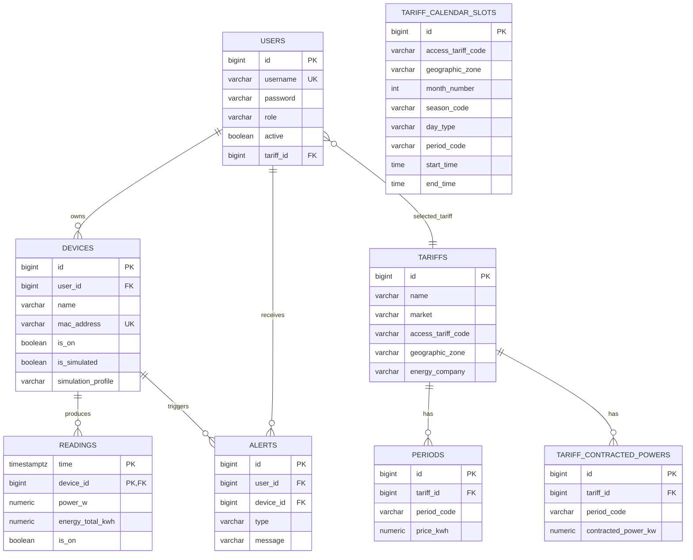
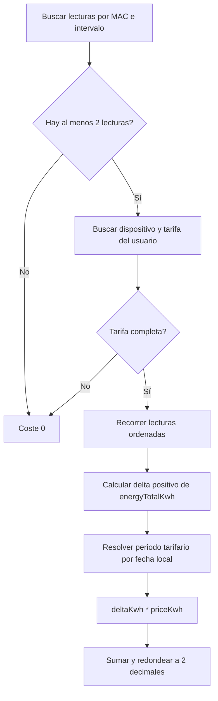

# Anexo D: TimescaleDB, estructura de tablas y consultas analíticas

Este anexo documenta el modelo de datos usado por Wattimizer y las consultas relacionadas con lecturas energéticas. La base se apoya en PostgreSQL y TimescaleDB; Hibernate crea las tablas principales y los scripts SQL del repositorio completan lo que JPA no puede expresar.

## 1. Activación de TimescaleDB

Script: `backend/src/main/resources/db/dev-seed/00-extensions.sql`

```sql
CREATE EXTENSION IF NOT EXISTS timescaledb;
```

TimescaleDB se usa porque `readings` es una serie temporal: muchas filas, ordenadas por tiempo, consultadas por intervalos y por dispositivo.

## 2. Conversión de `readings` en hypertable

Script: `backend/src/main/resources/db/dev-seed/01-hypertable.sql`

```sql
SELECT create_hypertable('readings', 'time');
```

La tabla debe existir antes porque la crea Hibernate con `spring.jpa.hibernate.ddl-auto=update`. El script se ejecuta después y convierte esa tabla normal en una hypertable particionada por `time`.

Si la tabla ya tiene datos, el propio script indica la variante:

```sql
SELECT create_hypertable('readings', 'time', migrate_data => true);
```

En el estado actual del repositorio no hay scripts de `time_bucket`, continuous aggregates, compresión ni retención. Por tanto, esos elementos se plantean como mejoras futuras, no como funcionalidad existente.

## 3. Modelo relacional principal



## 4. Tabla `readings`

Entidad Java: `entities/Reading.java`

Campos:

| Campo | Tipo Java | Tipo aproximado en PostgreSQL | Descripción |
|---|---|---|---|
| `time` | `Instant` | `timestamp with time zone` | Instante de la lectura en UTC. |
| `device_id` | `Device` | `bigint` FK | Dispositivo que produce la lectura. |
| `power_w` | `BigDecimal` | `numeric(10,2)` | Potencia activa medida en vatios. |
| `energy_total_kwh` | `BigDecimal` | `numeric(14,4)` | Odómetro de energía acumulada. |
| `is_on` | `Boolean` | `boolean` | Estado lógico del dispositivo. |

La clave primaria está formada por `(time, device_id)`. Esta decisión tiene sentido porque dos dispositivos distintos pueden tener lecturas en el mismo instante, pero un mismo dispositivo no debería duplicar la misma marca temporal.

## 5. Consultas implementadas en repositorio

Archivo: `repositories/ReadingRepository.java`

### 5.1. Última lectura por MAC

```java
Optional<Reading> findFirstByDeviceMacAddressOrderByTimeDesc(String macAddress);
```

Uso:

- Dashboard para estado reciente.
- Simulación para obtener el último `energyTotalKwh` antes de calcular el siguiente acumulado.

Equivalente SQL:

```sql
SELECT r.*
FROM readings r
JOIN devices d ON d.id = r.device_id
WHERE d.mac_address = :macAddress
ORDER BY r.time DESC
LIMIT 1;
```

### 5.2. Lectura exacta por clave compuesta

```java
Optional<Reading> findByTimeAndDeviceMacAddress(Instant time, String macAddress);
```

Equivalente SQL:

```sql
SELECT r.*
FROM readings r
JOIN devices d ON d.id = r.device_id
WHERE r.time = :time
  AND d.mac_address = :macAddress;
```

Esta consulta se usa en el endpoint `/api/v1/readings/search`.

### 5.3. Lecturas en intervalo

```java
@Query("""
    SELECT r FROM Reading r
    WHERE r.device.macAddress = :macAddress
      AND r.time >= :start
      AND r.time <= :end
    ORDER BY r.time ASC
""")
List<Reading> findReadingsInInterval(String macAddress, Instant start, Instant end);
```

Equivalente SQL:

```sql
SELECT r.*
FROM readings r
JOIN devices d ON d.id = r.device_id
WHERE d.mac_address = :macAddress
  AND r.time >= :start
  AND r.time <= :end
ORDER BY r.time ASC;
```

Esta es la consulta analítica más importante del MVP. Alimenta:

- `/api/v1/readings/device/{macAddress}/recent`
- `/api/v1/analytics/cost`
- `/api/v1/analytics/ghost-consumption`

### 5.4. Borrado por clave compuesta

```java
@Modifying
@Query("""
    DELETE FROM Reading r
    WHERE r.time = :time
      AND r.device.macAddress = :macAddress
""")
Long deleteByTimeAndDeviceMacAddress(Instant time, String macAddress);
```

### 5.5. Borrado masivo por MAC

```java
@Modifying
@Query("DELETE FROM Reading r WHERE r.device.macAddress = :macAddress")
int deleteAllByDeviceMacAddress(String macAddress);
```

Se usa en `DeviceService.deleteById`. Es una mejora reciente para que el borrado de un dispositivo no falle por lecturas históricas asociadas.

## 6. Analítica de coste energético

Archivo: `services/ConsumptionService.java`

La función `calculateCostInPeriod(macAddress, start, end)` sigue este proceso:



El cálculo se basa en el odómetro `energyTotalKwh`, no solo en `powerW`. Esto es más fiable para coste acumulado porque trabaja con energía consumida entre dos puntos.

Fragmento conceptual:

```java
BigDecimal delta = current.getEnergyTotalKwh()
    .subtract(previous.getEnergyTotalKwh());

if (delta.compareTo(BigDecimal.ZERO) > 0) {
    totalCost = totalCost.add(delta.multiply(period.getPriceKwh()));
}
```

Si el delta es negativo o nulo, se ignora. Esto evita sumar valores erróneos cuando un dispositivo se reinicia y su contador vuelve a cero.

## 7. Analítica de consumo fantasma

Método: `calculateGhostCost(macAddress, start, end)`

El cálculo es parecido al coste total, pero añade una condición horaria:

```java
private boolean isGhostWindow(Tariff tariff, Instant instant) {
    ZoneId zoneId = calendarResolverService.resolveZoneIdForTariff(tariff);
    int hour = instant.atZone(zoneId).getHour();
    return hour >= 0 && hour < 6;
}
```

La ventana fantasma se define como 00:00-05:59 en hora local del contrato. No se confunde con el periodo valle regulatorio `P6`; son conceptos distintos.

Esta distinción es importante porque:

- Canarias usa `Atlantic/Canary`.
- Península, Baleares, Ceuta y Melilla usan `Europe/Madrid`.
- Un mismo `Instant` puede caer en horas locales distintas según zona.

## 8. Resolución de periodo tarifario

Archivo: `CalendarResolverService.java`

El servicio resuelve qué precio aplicar:

1. Convierte `Instant` a `ZonedDateTime` según la zona geográfica de la tarifa.
2. Obtiene mes, hora local y día de la semana.
3. Determina `day_type`: fines de semana son `D`; laborables se resuelven desde `tariff_calendar_slots`.
4. Consulta `tariff_calendar_slots` para obtener `period_code`.
5. Busca en `periods` el precio contractual de ese `period_code`.

Tabla regulatoria:

| Campo | Sentido |
|---|---|
| `access_tariff_code` | Peaje: `2.0TD`, `3.0TD`, `6.1TD`, `6.2TD`. |
| `geographic_zone` | Zona española del contrato. |
| `month_number` | Mes para resolver temporada. |
| `season_code` | Temporada regulatoria. |
| `day_type` | Tipo de día: `A`, `B`, `B1`, `C`, `D`. |
| `period_code` | Periodo final que se cruza con `periods`. |
| `start_time`, `end_time` | Intervalo horario local. |

El script `tariffs-td-schema.sql` añade checks e índices:

```sql
CREATE UNIQUE INDEX IF NOT EXISTS ux_tariff_calendar_slots_lookup
  ON tariff_calendar_slots (
    access_tariff_code, geographic_zone, month_number, day_type, start_time, end_time
  );

CREATE INDEX IF NOT EXISTS ix_tariff_calendar_slots_period_code
  ON tariff_calendar_slots (
    access_tariff_code, geographic_zone, month_number, day_type, period_code
  );
```

## 9. Consultas analíticas SQL útiles para revisión

Estas consultas son compatibles con el modelo actual. No sustituyen al código Java, pero sirven para verificar datos directamente en PostgreSQL.

### 9.1. Últimas lecturas de un dispositivo

```sql
SELECT r.time, d.mac_address, r.power_w, r.energy_total_kwh, r.is_on
FROM readings r
JOIN devices d ON d.id = r.device_id
WHERE d.mac_address = 'SIM000000001'
ORDER BY r.time DESC
LIMIT 20;
```

### 9.2. Consumo energético por diferencia de odómetro

```sql
WITH ordered AS (
  SELECT
    r.time,
    d.mac_address,
    r.energy_total_kwh,
    LAG(r.energy_total_kwh) OVER (
      PARTITION BY d.mac_address
      ORDER BY r.time
    ) AS previous_kwh
  FROM readings r
  JOIN devices d ON d.id = r.device_id
  WHERE d.mac_address = 'SIM000000001'
    AND r.time >= now() - interval '1 day'
)
SELECT
  mac_address,
  SUM(GREATEST(energy_total_kwh - previous_kwh, 0)) AS consumed_kwh
FROM ordered
WHERE previous_kwh IS NOT NULL
GROUP BY mac_address;
```

Esta consulta reproduce la idea del backend: solo sumar deltas positivos.

### 9.3. Potencia media por minuto con TimescaleDB

```sql
SELECT
  time_bucket('1 minute', r.time) AS bucket,
  d.mac_address,
  AVG(r.power_w) AS avg_power_w
FROM readings r
JOIN devices d ON d.id = r.device_id
WHERE d.mac_address = 'SIM000000001'
  AND r.time >= now() - interval '2 hours'
GROUP BY bucket, d.mac_address
ORDER BY bucket;
```

Esta consulta usa `time_bucket`, pero actualmente está pensada como consulta manual de análisis. No existe todavía un endpoint REST específico ni una continuous aggregate en el repositorio.

### 9.4. Lecturas en ventana fantasma

```sql
SELECT r.time, d.mac_address, r.power_w, r.energy_total_kwh
FROM readings r
JOIN devices d ON d.id = r.device_id
WHERE d.mac_address = 'SIM000000001'
  AND r.time >= now() - interval '1 day'
  AND EXTRACT(HOUR FROM r.time AT TIME ZONE 'Europe/Madrid') BETWEEN 0 AND 5
ORDER BY r.time;
```

Para Canarias se sustituye la zona por `Atlantic/Canary`, igual que hace `CalendarResolverService`.

## 10. Semillas de desarrollo

Scripts relevantes:

| Script | Función |
|---|---|
| `00-extensions.sql` | Activa TimescaleDB y `pgcrypto`. |
| `01-hypertable.sql` | Convierte `readings` en hypertable. |
| `03-seed-users-dev.sql` | Crea usuarios de desarrollo. |
| `04-seed-device-shelly.sql` | Registra el Shelly físico de desarrollo. |
| `05-seed-device-simulation.sql` | Añade columnas y datos para simuladores. |
| `seed-tariff-calendar-slots.sql` | Carga slots regulatorios de calendario. |
| `tariffs-td-schema.sql` | Añade columnas, checks e índices de tarifas TD. |

La cobertura del seed tarifario actual se centra en `2.0TD` y `3.0TD` para `PENINSULA` e `ISLAS_BALEARES`. Las entidades admiten más zonas y peajes, pero no debe afirmarse que todos estén completamente sembrados.

## 11. Decisiones técnicas y limitaciones

### Decisiones tomadas

- Usar `Instant` para guardar tiempo en UTC.
- Resolver la zona horaria solo al calcular periodos o consumo fantasma.
- Separar `periods` de `tariff_calendar_slots`: una tabla guarda precios del contrato y otra resuelve qué periodo aplica.
- Mantener lecturas físicas y simuladas en la misma tabla para que la analítica y el frontend sean iguales.
- Borrar lecturas y alertas antes de eliminar dispositivos para respetar integridad referencial.

### Limitaciones actuales

- No hay migrations formales tipo Flyway o Liquibase; los scripts se ejecutan manualmente o como parte de la preparación del entorno.
- No hay continuous aggregates ni políticas de compresión/retención.
- `ReadingService.listByUsername` filtra en memoria después de `findAll()`, lo que puede ser insuficiente si la tabla crece mucho.
- Las consultas REST analíticas trabajan con intervalos directos; no hay todavía paginación ni agregación configurable desde el frontend.

Estas limitaciones son asumibles para el MVP, pero marcan la evolución natural si aumenta el volumen de datos.
