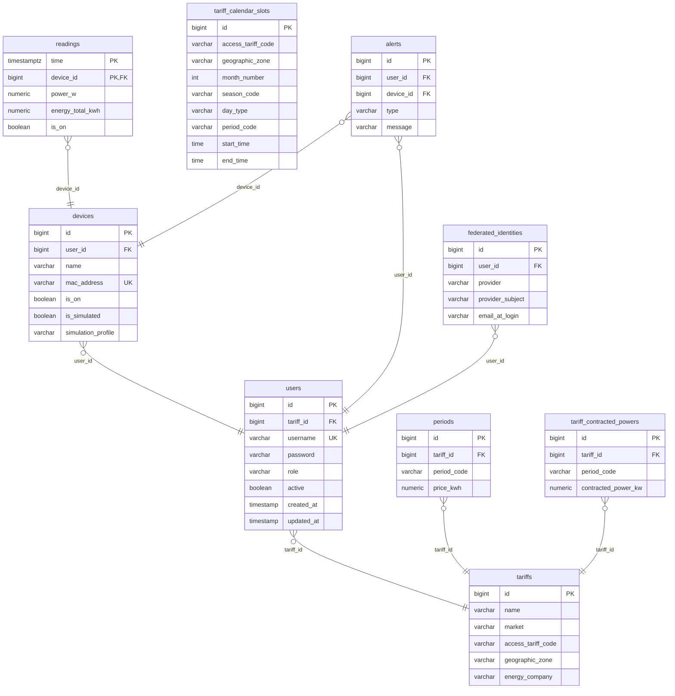
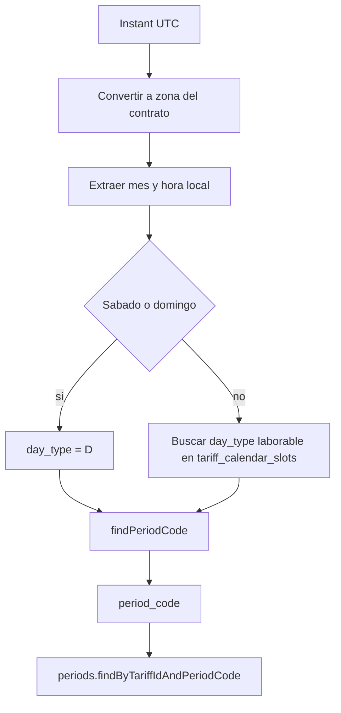

# Anexo D: TimescaleDB, tablas y consultas analiticas

## 1. Objetivo de la capa de datos

Wattimizer guarda datos de usuarios, tarifas, dispositivos y alertas como entidades relacionales normales. Las lecturas electricas, en cambio, son una serie temporal: muchas filas por dispositivo, ordenadas por tiempo. Por eso la tabla `readings` se convierte en hypertable de TimescaleDB.

El objetivo tecnico es que la aplicacion pueda:

- consultar la ultima lectura de un dispositivo;
- recuperar historico reciente para graficas;
- calcular coste por intervalo;
- detectar consumo fantasma;
- eliminar lecturas asociadas al dar de baja un dispositivo;
- mantener tarifas TD con periodos horarios desacoplados del precio.

## 2. Configuracion de base de datos

Archivo: `backend/src/main/resources/application.properties`.

Puntos relevantes:

- Spring usa PostgreSQL mediante `org.postgresql.Driver`.
- Hibernate esta en `spring.jpa.hibernate.ddl-auto=update`.
- Los comentarios del propio fichero indican que Hibernate crea tablas, pero no puede generar hypertables ni todos los constraints regulatorios.
- Los scripts SQL bajo `backend/src/main/resources/db/` completan la parte que JPA no cubre.

En Docker Compose, la base se levanta con:

```yaml
image: timescale/timescaledb-ha:pg17
```

El contenedor no expone el puerto PostgreSQL al host en produccion; queda dentro de la red Docker `iot_net`.

## 3. Modelo relacional



## 4. Tabla `readings` como hypertable

Entidad Java: `Reading`.

La clave primaria compuesta esta formada por:

- `time`
- `device`

Definicion conceptual:

| Columna | Tipo logico | Origen |
|---|---|---|
| `time` | `Instant` | Timestamp MQTT o `Instant.now()` en status/simulacion. |
| `device_id` | FK a `devices` | Dispositivo propietario de la lectura. |
| `power_w` | `numeric(10,2)` | Potencia activa. |
| `energy_total_kwh` | `numeric(14,4)` | Energia acumulada. |
| `is_on` | boolean | Estado del enchufe. |

Script: `backend/src/main/resources/db/dev-seed/01-hypertable.sql`.

```sql
SELECT create_hypertable('readings', 'time');
```

El script indica que debe ejecutarse despues de crear extensiones y antes de recibir datos MQTT. Si ya existen filas, habria que usar:

```sql
SELECT create_hypertable('readings', 'time', migrate_data => true);
```

Actualmente no hay scripts versionados para:

- `time_bucket`;
- continuous aggregates;
- compression policies;
- retention policies.

Por tanto, el uso real de TimescaleDB en este estado del proyecto es la hypertable sobre `readings`.

## 5. Consultas implementadas sobre lecturas

Repositorio: `ReadingRepository`.

### 5.1. Ultima lectura de un dispositivo

Metodo JPA:

```java
Optional<Reading> findFirstByDeviceMacAddressOrderByTimeDesc(String macAddress);
```

SQL equivalente:

```sql
SELECT r.*
FROM readings r
JOIN devices d ON d.id = r.device_id
WHERE d.mac_address = :macAddress
ORDER BY r.time DESC
LIMIT 1;
```

Uso:

- `GET /api/v1/readings/latest/{macAddress}`
- Recuperar ultimo odometro en simulacion antes de calcular el siguiente `energyTotalKwh`.

### 5.2. Buscar lectura por instante y MAC

Metodo:

```java
Optional<Reading> findByTimeAndDeviceMacAddress(Instant time, String macAddress);
```

SQL equivalente:

```sql
SELECT r.*
FROM readings r
JOIN devices d ON d.id = r.device_id
WHERE r.time = :time
  AND d.mac_address = :macAddress;
```

Uso:

- `GET /api/v1/readings/search`
- Validacion previa a `DELETE /api/v1/readings/search`.

### 5.3. Lecturas en intervalo

Metodo:

```java
@Query("""
SELECT r FROM Reading r WHERE r.device.macAddress = :macAddress
AND r.time >= :start AND r.time <= :end ORDER BY r.time ASC
""")
List<Reading> findReadingsInInterval(...);
```

SQL equivalente:

```sql
SELECT r.*
FROM readings r
JOIN devices d ON d.id = r.device_id
WHERE d.mac_address = :macAddress
  AND r.time >= :start
  AND r.time <= :end
ORDER BY r.time ASC;
```

Uso:

- Historico reciente para dashboard.
- Calculo de coste energetico.
- Calculo de consumo fantasma.

### 5.4. Borrado de lectura concreta

Metodo:

```java
DELETE FROM Reading r
WHERE r.time = :time
  AND r.device.macAddress = :macAddress
```

SQL equivalente:

```sql
DELETE FROM readings r
USING devices d
WHERE r.device_id = d.id
  AND r.time = :time
  AND d.mac_address = :macAddress;
```

### 5.5. Borrado de lecturas por dispositivo

Metodo:

```java
DELETE FROM Reading r WHERE r.device.macAddress = :macAddress
```

SQL equivalente:

```sql
DELETE FROM readings r
USING devices d
WHERE r.device_id = d.id
  AND d.mac_address = :macAddress;
```

Este metodo se usa en `DeviceService.deleteById` para que el borrado de dispositivo no choque con claves foraneas.

## 6. Consultas analiticas en servicios

### 6.1. Coste energetico por intervalo

Servicio: `ConsumptionService.calculateCostInPeriod`.

Algoritmo:

1. Carga lecturas ordenadas por tiempo.
2. Si hay menos de dos lecturas, devuelve `0`.
3. Busca el dispositivo y comprueba que tenga usuario y tarifa.
4. Recorre parejas consecutivas.
5. Calcula delta positivo de energia:

```text
delta_kWh = current.energyTotalKwh - previous.energyTotalKwh
```

6. Ignora deltas nulos o negativos. Esto cubre reinicios de hardware o lecturas incompletas.
7. Para cada delta, resuelve el periodo tarifario aplicable al instante de la lectura actual.
8. Multiplica:

```text
coste = delta_kWh * priceKwh_del_periodo
```

9. Suma todos los pasos y redondea a 2 decimales.

SQL base que alimenta el calculo:

```sql
SELECT r.time, r.energy_total_kwh, r.power_w
FROM readings r
JOIN devices d ON d.id = r.device_id
WHERE d.mac_address = :macAddress
  AND r.time BETWEEN :start AND :end
ORDER BY r.time ASC;
```

La parte de precio no se resuelve en una query SQL unica; se hace en Java con `CalendarResolverService`.

### 6.2. Consumo fantasma

Servicio: `ConsumptionService.calculateGhostCost`.

Comparte el calculo de deltas con el coste normal, pero anade el filtro:

```java
hour >= 0 && hour < 6
```

La hora se calcula con la zona del contrato:

- `CANARIAS` -> `Atlantic/Canary`
- resto -> `Europe/Madrid`

La decision funcional es considerar consumo fantasma como consumo entre 00:00 y 05:59. No equivale necesariamente al periodo valle regulatorio.

### 6.3. Coste instantaneo

Metodos presentes en `ConsumptionService` y `TariffService`:

```java
calculateInstantaneousCost(String macAddress, double powerW, int durationSeconds)
```

Formula:

```text
kWh = (powerW / 1000) * (durationSeconds / 3600)
coste = kWh * priceKwh
```

Aunque el metodo existe, las analiticas expuestas por REST usan actualmente el calculo por intervalo sobre lecturas guardadas.

## 7. Tabla `tariff_calendar_slots`

Entidad: `TariffCalendarSlot`.

Esta tabla separa la regulacion horaria de los precios de cada contrato. Asi, una tarifa guarda precios (`periods`) y potencias (`tariff_contracted_powers`), mientras que los horarios reales se resuelven con una tabla global.

Columnas principales:

| Columna | Descripcion |
|---|---|
| `access_tariff_code` | Peaje: `2.0TD`, `3.0TD`, `6.1TD`, `6.2TD`. |
| `geographic_zone` | Zona: `PENINSULA`, `CANARIAS`, `ISLAS_BALEARES`, `CEUTA`, `MELILLA`. |
| `month_number` | Mes 1-12. |
| `season_code` | Temporada regulatoria. |
| `day_type` | Tipo de dia: `A`, `B`, `B1`, `C`, `D`. |
| `period_code` | Periodo resultante `P1` a `P6`. |
| `start_time`, `end_time` | Intervalo horario semiabierto `[inicio, fin)`. |

Script de constraints: `db/tariffs-td-schema.sql`.

Indice de lookup:

```sql
CREATE UNIQUE INDEX IF NOT EXISTS ux_tariff_calendar_slots_lookup
  ON tariff_calendar_slots (
    access_tariff_code,
    geographic_zone,
    month_number,
    day_type,
    start_time,
    end_time
  );
```

Indice auxiliar:

```sql
CREATE INDEX IF NOT EXISTS ix_tariff_calendar_slots_period_code
  ON tariff_calendar_slots (
    access_tariff_code,
    geographic_zone,
    month_number,
    day_type,
    period_code
  );
```

## 8. Resolucion de periodo tarifario

Servicio: `CalendarResolverService`.

Proceso:



Repositorio: `TariffCalendarSlotRepository`.

Consulta JPQL principal:

```java
SELECT cs.periodCode FROM TariffCalendarSlot cs
WHERE cs.accessTariffCode = :accessTariffCode
  AND cs.geographicZone   = :zone
  AND cs.monthNumber      = :month
  AND cs.dayType          = :dayType
  AND (
        (cs.startTime <> cs.endTime AND cs.startTime <= :localTime AND cs.endTime > :localTime)
        OR
        (cs.startTime = cs.endTime AND cs.dayType = 'D')
        OR (cs.endTime = :endOfDay AND :localTime >= cs.startTime)
      )
```

Equivalente SQL aproximado:

```sql
SELECT period_code
FROM tariff_calendar_slots
WHERE access_tariff_code = :accessTariffCode
  AND geographic_zone = :zone
  AND month_number = :month
  AND day_type = :dayType
  AND (
        (start_time <> end_time AND start_time <= :localTime AND end_time > :localTime)
        OR (start_time = end_time AND day_type = 'D')
        OR (end_time = TIME '23:59' AND :localTime >= start_time)
      );
```

Despues se busca el precio:

```sql
SELECT *
FROM periods
WHERE tariff_id = :tariffId
  AND period_code = :periodCode;
```

## 9. Cobertura del seed regulatorio

Script: `db/seed-tariff-calendar-slots.sql`.

Cobertura declarada por el propio script:

| Peajes | Zonas | Filas |
|---|---|---|
| `2.0TD`, `3.0TD` | `PENINSULA`, `ISLAS_BALEARES` | 336 |

Aunque las entidades y constraints admiten `CANARIAS`, `CEUTA`, `MELILLA`, `6.1TD` y `6.2TD`, el seed actual no cubre todas esas combinaciones. Si se usa una tarifa sin slots cargados, `CalendarResolverService` devuelve `Optional.empty()` y los servicios de coste/alertas trabajan en modo degradado.

## 10. Estructura de tarifas

### 10.1. `tariffs`

Guarda datos generales:

- nombre;
- mercado;
- peaje de acceso;
- zona geografica;
- comercializadora.

### 10.2. `periods`

Guarda precios por periodo:

| Columna | Regla |
|---|---|
| `tariff_id` | FK obligatoria. |
| `period_code` | `P1` a `P6`. |
| `price_kwh` | Mayor que cero. |

Indice unico:

```sql
CREATE UNIQUE INDEX IF NOT EXISTS ux_periods_tariff_period_code
  ON periods (tariff_id, period_code);
```

### 10.3. `tariff_contracted_powers`

Guarda potencia contratada por periodo. Tiene restriccion unica por `(tariff_id, period_code)`.

Las reglas que comparan `P1 <= P2 <= ... <= P6` se validan en Java, no con un `CHECK`, porque un `CHECK` por fila no puede comparar facilmente con otras filas del mismo contrato.

## 11. Consultas utiles para explotacion tecnica

Estas consultas no aparecen como endpoints directos, pero son coherentes con el modelo actual y sirven para validar datos en una memoria tecnica.

### 11.1. Verificar hypertable activa

```sql
SELECT hypertable_name, num_chunks
FROM timescaledb_information.hypertables
WHERE hypertable_name = 'readings';
```

### 11.2. Ultimas lecturas por dispositivo

```sql
SELECT d.mac_address, r.time, r.power_w, r.energy_total_kwh, r.is_on
FROM readings r
JOIN devices d ON d.id = r.device_id
WHERE d.mac_address = :macAddress
ORDER BY r.time DESC
LIMIT 20;
```

### 11.3. Consumo acumulado aproximado en un intervalo

```sql
WITH ordered AS (
  SELECT
    r.time,
    r.energy_total_kwh,
    LAG(r.energy_total_kwh) OVER (ORDER BY r.time) AS previous_kwh
  FROM readings r
  JOIN devices d ON d.id = r.device_id
  WHERE d.mac_address = :macAddress
    AND r.time BETWEEN :start AND :end
)
SELECT COALESCE(SUM(
  CASE
    WHEN previous_kwh IS NOT NULL AND energy_total_kwh > previous_kwh
    THEN energy_total_kwh - previous_kwh
    ELSE 0
  END
), 0) AS kwh_intervalo
FROM ordered;
```

Esta consulta replica la idea del servicio Java: solo suma deltas positivos para evitar reinicios del contador.

### 11.4. Potencia maxima por dispositivo en el dia

```sql
SELECT
  d.mac_address,
  MAX(r.power_w) AS max_power_w
FROM readings r
JOIN devices d ON d.id = r.device_id
WHERE r.time >= date_trunc('day', now())
GROUP BY d.mac_address
ORDER BY max_power_w DESC;
```

### 11.5. Lecturas de consumo fantasma

```sql
SELECT r.*
FROM readings r
JOIN devices d ON d.id = r.device_id
WHERE d.mac_address = :macAddress
  AND r.time BETWEEN :start AND :end
  AND EXTRACT(HOUR FROM r.time AT TIME ZONE 'Europe/Madrid') BETWEEN 0 AND 5
ORDER BY r.time ASC;
```

Para Canarias habria que cambiar la zona a `Atlantic/Canary`, igual que hace `CalendarResolverService`.

## 12. Limitaciones y mejoras de base de datos

Limitaciones actuales:

- No hay continuous aggregates para resumen horario o diario.
- No hay politica automatica de retencion.
- No hay politica de compresion de chunks antiguos.
- Las consultas analiticas principales se calculan en Java, no con SQL avanzado de TimescaleDB.
- El seed horario cubre solo parte de las zonas y peajes admitidos por el modelo.
- El ultimo slot diario usa `23:59` porque PostgreSQL `TIME` no admite `24:00`; el repositorio compensa parte de ese caso en la query.

Mejoras futuras razonables:

```sql
-- Ejemplo futuro, no implementado actualmente:
-- SELECT add_retention_policy('readings', INTERVAL '18 months');
-- SELECT add_compression_policy('readings', INTERVAL '30 days');
```

Tambien seria recomendable crear vistas materializadas o continuous aggregates para:

- consumo por hora;
- coste por dia;
- potencia maxima diaria;
- consumo fantasma mensual.
