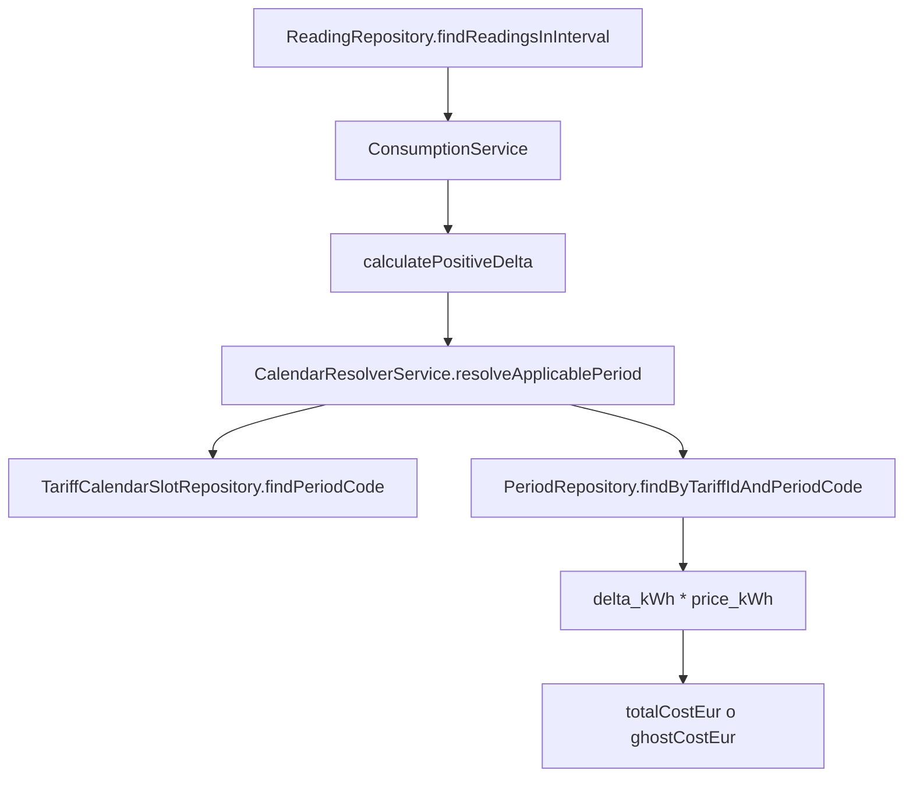

# Anexo D - TimescaleDB y consultas analiticas

## 1. Papel de TimescaleDB en el proyecto

Wattimizer guarda lecturas electricas que crecen de forma continua en el tiempo. Por eso la tabla `readings` no se trata como una tabla relacional normal de CRUD, sino como una serie temporal. El script `backend/src/main/resources/db/dev-seed/01-hypertable.sql` convierte `readings` en una hypertable particionada por la columna `time`.

```sql
SELECT create_hypertable('readings', 'time');
```

La conversion debe hacerse cuando la tabla esta vacia. Si ya tuviera datos, el propio script deja indicada la alternativa con `migrate_data => true`.

## 2. Extension y orden de preparacion

El orden previsto para una base de datos nueva es:

1. Arrancar Spring Boot para que Hibernate cree las tablas.
2. Ejecutar `00-extensions.sql`.
3. Ejecutar `01-hypertable.sql` antes de recibir telemetria.
4. Ejecutar `tariffs-td-schema.sql` para constraints e indices de tarifas.
5. Ejecutar `seed-tariff-calendar-slots.sql` para cargar calendario regulatorio.

La extension se activa asi:

```sql
CREATE EXTENSION IF NOT EXISTS timescaledb;
CREATE EXTENSION IF NOT EXISTS pgcrypto;
```

`pgcrypto` se usa para seeds de usuarios con hashes bcrypt desde SQL. TimescaleDB se usa para la tabla de lecturas.

## 3. Tabla `readings`

Entidad Java: `Reading`
Tabla: `readings`
Tipo de tabla esperado: hypertable TimescaleDB

| Columna | Tipo aproximado | Origen Java | Descripcion |
| --- | --- | --- | --- |
| `time` | `timestamptz` | `Instant time` | Instante UTC de la lectura. |
| `device_id` | `bigint` | `Device device` | Dispositivo que genera la lectura. |
| `power_w` | `numeric(10,2)` | `BigDecimal powerW` | Potencia activa instantanea en vatios. |
| `energy_total_kwh` | `numeric(14,4)` | `BigDecimal energyTotalKwh` | Energia acumulada del odometro en kWh. |
| `is_on` | `boolean` | `Boolean isOn` | Estado logico del interruptor. |

La clave primaria compuesta se define en Java con `@IdClass(ReadingId.class)`:

```java
public class ReadingId implements Serializable {
    private Long device;
    private Instant time;
}
```

La combinacion `device_id + time` evita que dos dispositivos colisionen aunque generen lectura en el mismo instante.

## 4. Tablas relacionales relacionadas

### 4.1. `devices`

| Columna | Descripcion |
| --- | --- |
| `id` | PK heredada de `BaseEntity`. |
| `user_id` | FK nullable a `users`; permite dispositivos auto-provisionados sin propietario. |
| `name` | Nombre visible del dispositivo. |
| `mac_address` | Identificador unico usado para buscar lecturas. |
| `is_on` | Estado logico. |
| `is_simulated` | Indica si lo alimenta el job de simulacion. |
| `simulation_profile` | Perfil sintetico: horno, nevera, standby, etc. |

### 4.2. `users`

| Columna | Descripcion |
| --- | --- |
| `id` | PK. |
| `tariff_id` | FK nullable a la tarifa privada actual. |
| `username` | Email o identificador de acceso, unico. |
| `password` | Hash de contrasena. |
| `role` | `ROLE_USER` o `ROLE_ADMIN`. |
| `active` | Habilita o bloquea la cuenta. |

### 4.3. `tariffs`

| Columna | Descripcion |
| --- | --- |
| `id` | PK. |
| `name` | Nombre de la tarifa. |
| `market` | Mercado libre o regulado. |
| `access_tariff_code` | Peaje: `2.0TD`, `3.0TD`, `6.1TD`, `6.2TD`. |
| `geographic_zone` | Zona espanola usada para resolver calendario. |
| `energy_company` | Comercializadora. |

### 4.4. `periods`

| Columna | Descripcion |
| --- | --- |
| `id` | PK. |
| `tariff_id` | FK a `tariffs`. |
| `period_code` | `P1` a `P6`. |
| `price_kwh` | Precio contractual de energia. |

Indice/restriccion relevante:

```sql
CREATE UNIQUE INDEX IF NOT EXISTS ux_periods_tariff_period_code
  ON periods (tariff_id, period_code);
```

### 4.5. `tariff_contracted_powers`

| Columna | Descripcion |
| --- | --- |
| `id` | PK. |
| `tariff_id` | FK a `tariffs`. |
| `period_code` | Periodo regulatorio. |
| `contracted_power_kw` | Potencia contratada en kW. |

El orden `P1 <= P2 <= ... <= P6` se valida en `TariffService`, no con un `CHECK` SQL, porque compara filas distintas.

### 4.6. `tariff_calendar_slots`

Tabla de dimension regulatoria. No pertenece a ningun usuario ni tarifa concreta. Sirve para convertir:

```text
peaje + zona + mes + tipo_dia + hora_local -> periodo P1-P6
```

| Columna | Descripcion |
| --- | --- |
| `access_tariff_code` | Distingue peajes con calendarios distintos. |
| `geographic_zone` | Zona del contrato. |
| `month_number` | Mes 1-12. |
| `season_code` | Temporada: `HIGH`, `MID_HIGH`, `MID`, `LOW`. |
| `day_type` | Tipo de dia: `A`, `B`, `B1`, `C`, `D`. |
| `period_code` | Periodo aplicable. |
| `start_time` | Inicio del tramo horario. |
| `end_time` | Fin del tramo horario. |

El seed actual cubre `PENINSULA` e `ISLAS_BALEARES` para `2.0TD` y `3.0TD`.

## 5. Consultas existentes en el codigo

### 5.1. Lecturas en intervalo

Repositorio: `ReadingRepository`

```java
@Query("SELECT r FROM Reading r WHERE r.device.macAddress = :macAddress " +
       "AND r.time >= :start AND r.time <= :end ORDER BY r.time ASC")
List<Reading> findReadingsInInterval(
    @Param("macAddress") String macAddress,
    @Param("start") Instant start,
    @Param("end") Instant end);
```

Esta consulta sostiene:

- `GET /api/v1/readings/device/{macAddress}/recent`
- `GET /api/v1/analytics/cost`
- `GET /api/v1/analytics/ghost-consumption`

### 5.2. Ultima lectura

```java
Optional<Reading> findFirstByDeviceMacAddressOrderByTimeDesc(String macAddress);
```

Se usa para obtener el estado reciente de un dispositivo y para calcular el siguiente odometro en simuladores.

### 5.3. Borrado por dispositivo

```java
@Query("DELETE FROM Reading r WHERE r.device.macAddress = :macAddress")
int deleteAllByDeviceMacAddress(@Param("macAddress") String macAddress);
```

Esta consulta se ejecuta antes de eliminar un dispositivo. Es una decision defensiva para no dejar filas hijas que bloqueen la baja por claves foraneas.

## 6. Consultas SQL analiticas sobre la hypertable

Las siguientes consultas estan escritas directamente sobre el esquema real de Wattimizer. No sustituyen al codigo Java, pero sirven para auditoria, depuracion y anexos de analitica.

### 6.1. Verificar que `readings` es hypertable

```sql
SELECT hypertable_name, num_chunks
FROM timescaledb_information.hypertables
WHERE hypertable_name = 'readings';
```

Si la conversion se hizo correctamente, debe aparecer `readings`.

### 6.2. Potencia media y maxima por hora

```sql
SELECT
  time_bucket('1 hour', r.time) AS hour_bucket,
  d.mac_address,
  ROUND(AVG(r.power_w), 2) AS avg_power_w,
  MAX(r.power_w) AS max_power_w
FROM readings r
JOIN devices d ON d.id = r.device_id
WHERE d.mac_address = :macAddress
  AND r.time >= :start
  AND r.time <= :end
GROUP BY hour_bucket, d.mac_address
ORDER BY hour_bucket;
```

Esta consulta resume la potencia por franjas horarias. Es util para detectar horas con carga anomala.

### 6.3. Energia consumida por hora usando odometro

```sql
WITH ordered AS (
  SELECT
    r.time,
    d.mac_address,
    r.energy_total_kwh,
    LAG(r.energy_total_kwh) OVER (
      PARTITION BY d.id
      ORDER BY r.time
    ) AS previous_kwh
  FROM readings r
  JOIN devices d ON d.id = r.device_id
  WHERE d.mac_address = :macAddress
    AND r.time >= :start
    AND r.time <= :end
)
SELECT
  time_bucket('1 hour', time) AS hour_bucket,
  mac_address,
  ROUND(
    SUM(
      CASE
        WHEN energy_total_kwh > previous_kwh
        THEN energy_total_kwh - previous_kwh
        ELSE 0
      END
    ),
    4
  ) AS consumed_kwh
FROM ordered
GROUP BY hour_bucket, mac_address
ORDER BY hour_bucket;
```

Esta consulta reproduce la idea de `ConsumptionService`: usar deltas positivos del odometro. Si el dispositivo reinicia su contador y el delta sale negativo, se ignora.

### 6.4. Coste estimado por periodo tarifario

```sql
WITH ordered AS (
  SELECT
    r.time,
    d.id AS device_id,
    d.mac_address,
    u.tariff_id,
    r.energy_total_kwh,
    LAG(r.energy_total_kwh) OVER (
      PARTITION BY d.id
      ORDER BY r.time
    ) AS previous_kwh
  FROM readings r
  JOIN devices d ON d.id = r.device_id
  JOIN users u ON u.id = d.user_id
  WHERE d.mac_address = :macAddress
    AND r.time >= :start
    AND r.time <= :end
),
deltas AS (
  SELECT
    o.*,
    CASE
      WHEN o.energy_total_kwh > o.previous_kwh
      THEN o.energy_total_kwh - o.previous_kwh
      ELSE 0
    END AS delta_kwh
  FROM ordered o
),
localised AS (
  SELECT
    d.*,
    t.access_tariff_code,
    t.geographic_zone,
    CASE
      WHEN t.geographic_zone = 'CANARIAS'
      THEN d.time AT TIME ZONE 'Atlantic/Canary'
      ELSE d.time AT TIME ZONE 'Europe/Madrid'
    END AS local_time
  FROM deltas d
  JOIN tariffs t ON t.id = d.tariff_id
),
workday_types AS (
  SELECT
    access_tariff_code,
    geographic_zone,
    month_number,
    MIN(day_type) AS workday_type
  FROM tariff_calendar_slots
  WHERE day_type <> 'D'
  GROUP BY access_tariff_code, geographic_zone, month_number
),
resolved AS (
  SELECT
    l.*,
    CAST(EXTRACT(MONTH FROM l.local_time) AS int) AS month_number,
    CAST(l.local_time AS time) AS local_clock,
    CASE
      WHEN EXTRACT(ISODOW FROM l.local_time) IN (6, 7) THEN 'D'
      ELSE wt.workday_type
    END AS resolved_day_type
  FROM localised l
  LEFT JOIN workday_types wt
    ON wt.access_tariff_code = l.access_tariff_code
   AND wt.geographic_zone = l.geographic_zone
   AND wt.month_number = CAST(EXTRACT(MONTH FROM l.local_time) AS int)
)
SELECT
  p.period_code,
  ROUND(SUM(r.delta_kwh), 4) AS kwh,
  p.price_kwh,
  ROUND(SUM(r.delta_kwh * p.price_kwh), 2) AS cost_eur
FROM resolved r
JOIN tariff_calendar_slots cs
  ON cs.access_tariff_code = r.access_tariff_code
 AND cs.geographic_zone = r.geographic_zone
 AND cs.month_number = r.month_number
 AND cs.day_type = r.resolved_day_type
 AND (
      (cs.start_time <> cs.end_time
       AND cs.start_time <= r.local_clock
       AND cs.end_time > r.local_clock)
      OR (cs.start_time = cs.end_time AND cs.day_type = 'D')
      OR (cs.end_time = TIME '23:59'
          AND r.local_clock >= cs.start_time)
 )
JOIN periods p
  ON p.tariff_id = r.tariff_id
 AND p.period_code = cs.period_code
WHERE r.delta_kwh > 0
GROUP BY p.period_code, p.price_kwh
ORDER BY p.period_code;
```

Esta consulta es mas compleja que el servicio Java porque intenta resolver calendario y precio en SQL. En el codigo de produccion se ha preferido resolverlo en Java con `CalendarResolverService`, ya que es mas facil probar reglas de zona horaria y tipo de dia.

### 6.5. Consumo fantasma nocturno

```sql
WITH ordered AS (
  SELECT
    r.time,
    d.mac_address,
    t.geographic_zone,
    r.energy_total_kwh,
    LAG(r.energy_total_kwh) OVER (
      PARTITION BY d.id
      ORDER BY r.time
    ) AS previous_kwh
  FROM readings r
  JOIN devices d ON d.id = r.device_id
  JOIN users u ON u.id = d.user_id
  JOIN tariffs t ON t.id = u.tariff_id
  WHERE d.mac_address = :macAddress
    AND r.time >= :start
    AND r.time <= :end
)
SELECT
  mac_address,
  ROUND(
    SUM(
      CASE
        WHEN energy_total_kwh > previous_kwh
        THEN energy_total_kwh - previous_kwh
        ELSE 0
      END
    ),
    4
  ) AS ghost_kwh
FROM ordered
WHERE EXTRACT(
  HOUR FROM CASE
    WHEN geographic_zone = 'CANARIAS'
    THEN time AT TIME ZONE 'Atlantic/Canary'
    ELSE time AT TIME ZONE 'Europe/Madrid'
  END
) BETWEEN 0 AND 5
GROUP BY mac_address;
```

La ventana coincide con el criterio del backend: 00:00 a 05:59 hora local del contrato.

## 7. Resolver calendario regulatorio

El repositorio `TariffCalendarSlotRepository` contiene dos consultas JPQL importantes.

### 7.1. Periodo aplicable

```java
SELECT cs.periodCode FROM TariffCalendarSlot cs
WHERE cs.accessTariffCode = :accessTariffCode
  AND cs.geographicZone   = :zone
  AND cs.monthNumber      = :month
  AND cs.dayType          = :dayType
  AND (
        (cs.startTime <> cs.endTime AND cs.startTime <= :localTime AND cs.endTime > :localTime)
        OR
        (cs.startTime = cs.endTime AND cs.dayType = 'D')
        OR (cs.endTime = :endOfDay AND :localTime >= cs.startTime)
      )
```

El caso `startTime = endTime` se usa para representar el dia completo de tipo `D` en tarifas con P6. El caso `endTime = 23:59` cubre el ultimo tramo del dia, ya que PostgreSQL `TIME` no permite `24:00`.

### 7.2. Tipo de dia laborable

```java
SELECT DISTINCT cs.dayType FROM TariffCalendarSlot cs
WHERE cs.accessTariffCode = :accessTariffCode
  AND cs.geographicZone   = :zone
  AND cs.monthNumber      = :month
  AND cs.dayType          <> 'D'
```

Los fines de semana se fuerzan a `D` en Java. Para dias laborables, el tipo se lee del seed segun mes, zona y peaje.

## 8. Indices y restricciones importantes

| Elemento | Motivo |
| --- | --- |
| `ux_periods_tariff_period_code` | Evita dos precios para el mismo periodo dentro de una tarifa. |
| `ux_tariff_contracted_powers_tariff_period` | Evita dos potencias para el mismo periodo. |
| `ux_tariff_calendar_slots_lookup` | Acelera busqueda de slot por peaje, zona, mes, tipo y tramo horario. |
| `ix_tariff_calendar_slots_period_code` | Apoya consultas por periodo regulatorio. |
| `mac_address unique` en `devices` | Garantiza que una MAC pertenezca a un unico registro. |
| Hypertable `readings(time)` | Optimiza particion temporal y escalado de lecturas. |

## 9. Relacion entre Java y SQL



El calculo principal no esta dentro de una funcion SQL, sino en servicios Java. Esta eleccion es razonable para el proyecto porque la regla de negocio aun esta evolucionando y resulta mas facil mantenerla con tests de servicio que con funciones PL/pgSQL.

## 10. Posibles mejoras de analitica

- Crear **continuous aggregates** por hora o por dia para no recalcular historicos completos.
- Anadir politicas de retencion si el volumen de lecturas crece mucho.
- Crear indices adicionales sobre `(device_id, time DESC)` si la consulta de ultima lectura se vuelve critica.
- Guardar coste precalculado por tramo cuando la tarifa no vaya a cambiar, evitando recalcular siempre desde lecturas crudas.
