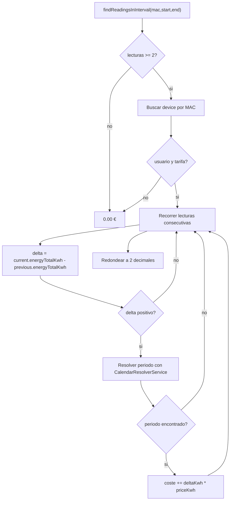

# Anexo D. TimescaleDB y analítica sobre hypertables

## 1. Alcance del anexo

Este anexo documenta la estructura de base de datos relacionada con series temporales y las consultas analíticas implementadas sobre la hypertable `readings`.

Archivos analizados:

- `backend/src/main/java/com/joselumartos/jwtauthbackenddemo/entities`
- `backend/src/main/java/com/joselumartos/jwtauthbackenddemo/repositories/ReadingRepository.java`
- `backend/src/main/java/com/joselumartos/jwtauthbackenddemo/services/ConsumptionService.java`
- `backend/src/main/java/com/joselumartos/jwtauthbackenddemo/services/CalendarResolverService.java`
- `backend/src/main/resources/db/dev-seed/00-extensions.sql`
- `backend/src/main/resources/db/dev-seed/01-hypertable.sql`
- `backend/src/main/resources/db/tariffs-td-schema.sql`
- `backend/src/main/resources/db/seed-tariff-calendar-slots.sql`

## 2. Papel de TimescaleDB en Wattimizer

TimescaleDB se usa para que `readings` funcione como tabla de series temporales. Cada lectura tiene un instante, un dispositivo y medidas eléctricas. Es la tabla con mayor crecimiento previsto porque se alimenta continuamente desde MQTT y desde simuladores.

La aplicación no usa todavía funciones avanzadas como `time_bucket`, continuous aggregates, compresión o políticas de retención. La ventaja actual de TimescaleDB está en el particionado temporal de la hypertable, mientras que los cálculos de negocio se hacen en Java sobre lecturas ordenadas.

## 3. Extensiones y creación de hypertable

### 3.1. Extensiones

El script `00-extensions.sql` activa extensiones necesarias:

```sql
CREATE EXTENSION IF NOT EXISTS timescaledb;
CREATE EXTENSION IF NOT EXISTS pgcrypto;
```

`timescaledb` permite crear hypertables. `pgcrypto` se usa en seeds de usuarios para contraseñas bcrypt.

### 3.2. Conversión de `readings`

El script `01-hypertable.sql` contiene:

```sql
SELECT create_hypertable('readings', 'time');
```

La tabla debe estar vacía cuando se ejecuta. Si ya hubiera datos, el propio script indica usar:

```sql
SELECT create_hypertable('readings', 'time', migrate_data => true);
```

La verificación propuesta es:

```sql
SELECT hypertable_name, num_chunks
FROM timescaledb_information.hypertables;
```

Debe aparecer `readings`.

## 4. Modelo relacional relevante

### 4.1. Tabla `readings`

Entidad: `Reading.java`

| Columna | Tipo conceptual | Detalle |
| --- | --- | --- |
| `time` | `Instant` / timestamp | Parte de la PK compuesta. |
| `device_id` | FK a `devices` | Parte de la PK compuesta. |
| `power_w` | decimal | Potencia activa en vatios. |
| `energy_total_kwh` | decimal | Odómetro acumulado de energía. |
| `is_on` | boolean | Estado de encendido si está disponible. |

La clave primaria se modela con `@IdClass(ReadingId.class)` y está formada por `time` y `device`.

#### Motivo de la clave compuesta

Una lectura no se identifica solo por tiempo, porque varios dispositivos pueden emitir a la vez. Tampoco se identifica solo por dispositivo, porque cada dispositivo genera muchas lecturas. La combinación `(time, device_id)` representa correctamente una muestra concreta de un dispositivo en un instante.

### 4.2. Tabla `devices`

Entidad: `Device.java`

| Columna | Uso |
| --- | --- |
| `id` | Identificador interno. |
| `user_id` | Propietario del dispositivo. Puede ser nulo en algunos flujos de autoaprovisionamiento. |
| `name` | Nombre visible. |
| `mac_address` | Identificador único del equipo o simulador. |
| `is_on` | Estado del equipo. |
| `is_simulated` | Diferencia hardware real de simuladores. |
| `simulation_profile` | Perfil usado por el job de simulación. |

`mac_address` es único y se usa mucho en la API porque es el identificador natural del dispositivo IoT.

### 4.3. Tablas tarifarias

#### `tariffs`

Contiene datos generales de la tarifa:

- `name`
- `market`
- `access_tariff_code`
- `geographic_zone`
- `energy_company`

El código de peaje (`2.0TD`, `3.0TD`, `6.1TD`, `6.2TD`) y la zona geográfica son necesarios para resolver el periodo aplicable.

#### `periods`

Cada fila define el precio de energía de un periodo:

| Campo | Uso |
| --- | --- |
| `tariff_id` | Tarifa propietaria. |
| `period_code` | `P1` a `P6`. |
| `price_kwh` | Precio contractual en €/kWh. |

Hay restricción única por `(tariff_id, period_code)`.

#### `tariff_contracted_powers`

Guarda la potencia contratada por periodo:

| Campo | Uso |
| --- | --- |
| `tariff_id` | Tarifa propietaria. |
| `period_code` | `P1` a `P6`. |
| `contracted_power_kw` | Potencia contratada en kW. |

Sirve para alertas de maxímetro.

#### `tariff_calendar_slots`

Tabla global de calendario regulatorio:

| Campo | Uso |
| --- | --- |
| `access_tariff_code` | Peaje: `2.0TD`, `3.0TD`, etc. |
| `geographic_zone` | Zona: `PENINSULA`, `ISLAS_BALEARES`, etc. |
| `month_number` | Mes del año. |
| `season_code` | Temporada regulatoria. |
| `day_type` | Tipo de día: `A`, `B`, `B1`, `C`, `D`. |
| `period_code` | Periodo final aplicable. |
| `start_time` | Inicio del slot local. |
| `end_time` | Fin del slot local. |

El seed actual cubre `PENINSULA` e `ISLAS_BALEARES` para `2.0TD` y `3.0TD`.

## 5. Constraints e índices definidos por SQL

`tariffs-td-schema.sql` añade restricciones e índices que complementan a Hibernate:

| Tabla | Restricción / índice | Finalidad |
| --- | --- | --- |
| `tariffs` | `chk_tariffs_access_tariff_code` | Limita peajes válidos. |
| `tariffs` | `chk_tariffs_geographic_zone` | Limita zonas válidas. |
| `periods` | `chk_periods_period_code` | Solo `P1` a `P6`. |
| `periods` | `ux_periods_tariff_period_code` | Evita repetir precio por periodo en una tarifa. |
| `tariff_contracted_powers` | `chk_tariff_contracted_powers_period_code` | Solo `P1` a `P6`. |
| `tariff_contracted_powers` | `chk_tariff_contracted_powers_positive` | Potencia mayor que 0. |
| `tariff_calendar_slots` | Checks de peaje, zona, mes, temporada, día y periodo | Garantiza datos regulatorios coherentes. |
| `tariff_calendar_slots` | `ux_tariff_calendar_slots_lookup` | Evita duplicar slots de búsqueda. |
| `tariff_calendar_slots` | `ix_tariff_calendar_slots_period_code` | Ayuda en resolución por periodo. |

No se observan índices SQL específicos adicionales sobre `readings` en los scripts. La clave compuesta y la hypertable son la base actual.

## 6. Consultas sobre `readings`

Repositorio: `ReadingRepository.java`

### 6.1. Última lectura de un dispositivo

```java
Optional<Reading> findFirstByDeviceMacAddressOrderByTimeDesc(String macAddress);
```

Uso:

- Endpoint `GET /api/v1/readings/latest/{macAddress}`.
- Simulación, para obtener el último odómetro `energyTotalKwh`.

### 6.2. Búsqueda por clave compuesta

```java
Optional<Reading> findByTimeAndDeviceMacAddress(Instant time, String macAddress);
```

Uso:

- Endpoint `GET /api/v1/readings/search`.
- Endpoint `DELETE /api/v1/readings/search`.

### 6.3. Lecturas en intervalo

```java
@Query("""
    SELECT r FROM Reading r
    WHERE r.device.macAddress = :macAddress
      AND r.time >= :start
      AND r.time <= :end
    ORDER BY r.time ASC
""")
List<Reading> findReadingsInInterval(String macAddress, Instant start, Instant end);
```

Uso:

- Histórico reciente del dashboard.
- Cálculo de coste en periodo.
- Cálculo de consumo fantasma.

La consulta está escrita en JPQL, no en SQL nativo de TimescaleDB. Aun así, se beneficia del particionado temporal de la hypertable porque filtra por `time`.

### 6.4. Borrado de lecturas

```java
@Query("DELETE FROM Reading r WHERE r.time = :time AND r.device.macAddress = :macAddress")
Long deleteByTimeAndDeviceMacAddress(...)
```

```java
@Query("DELETE FROM Reading r WHERE r.device.macAddress = :macAddress")
int deleteAllByDeviceMacAddress(...)
```

El segundo método se usa al borrar un dispositivo. Es una decisión práctica para evitar conflictos de FK antes de eliminar el equipo.

## 7. Analítica de coste energético

Servicio: `ConsumptionService`

### 7.1. Endpoint

```http
GET /api/v1/analytics/cost?macAddress={mac}&start={isoInstant}&end={isoInstant}
```

Respuesta:

```json
{
  "macAddress": "9070694d3590",
  "totalCostEur": 1.23,
  "start": "2026-10-06T00:00:00Z",
  "end": "2026-10-06T22:00:00Z"
}
```

### 7.2. Algoritmo



La analítica se basa en el odómetro acumulado `energyTotalKwh`. Esta decisión es mejor que integrar potencia instantánea en cada consulta, porque el dispositivo ya entrega energía acumulada y el cálculo por delta resiste mejor a cambios de frecuencia de muestreo.

### 7.3. Reinicios y lecturas inválidas

`calculatePositiveDelta` ignora:

- Lecturas con `energyTotalKwh` nulo.
- Deltas menores o iguales a cero.

Esto evita sumar costes negativos si el Shelly reinicia el contador o si llega una lectura incompleta.

## 8. Analítica de consumo fantasma

### 8.1. Endpoint

```http
GET /api/v1/analytics/ghost-consumption?macAddress={mac}&start={isoInstant}&end={isoInstant}
```

Respuesta:

```json
{
  "macAddress": "9070694d3590",
  "ghostCostEur": 0.17,
  "start": "2026-10-06T00:00:00Z",
  "end": "2026-10-06T22:00:00Z"
}
```

### 8.2. Definición usada

El consumo fantasma se define como coste de consumo entre las **00:00 y las 05:59** en la zona local del contrato.

No se debe confundir con el periodo valle `P6`. Puede coincidir en algunos casos, pero el código lo trata como una ventana funcional de inactividad, no como una regla tarifaria.

### 8.3. Zona horaria

`isGhostWindow` usa:

```java
ZoneId zoneId = calendarResolverService.resolveZoneIdForTariff(tariff);
int hour = instant.atZone(zoneId).getHour();
return hour >= 0 && hour < 6;
```

Esta decisión evita errores con zonas como Canarias, donde el mismo `Instant` puede caer en distinta hora local.

## 9. Resolución de periodos tarifarios

Aunque este anexo se centra en TimescaleDB, la analítica depende de `CalendarResolverService`.

Flujo conceptual:

1. A partir del `Instant`, se obtiene fecha y hora local según zona de la tarifa.
2. Se determina el mes.
3. Se determina el tipo de día regulatorio.
4. Se busca un slot en `tariff_calendar_slots`.
5. El slot devuelve `period_code`.
6. Con `period_code`, la tarifa obtiene el precio en `periods`.

Esta separación evita codificar horarios eléctricos en Java. Los horarios quedan en base de datos, donde se pueden revisar y corregir con scripts.

## 10. Alertas de potencia contratada

Las alertas usan tablas tarifarias distintas:

- `tariff_calendar_slots` para resolver periodo.
- `tariff_contracted_powers` para conocer el límite contratado en ese periodo.
- `readings.power_w` para comparar potencia actual.

La comparación conceptual es:

```text
powerW / 1000 > contractedPowerKw
```

Si se supera el límite, se crea una fila en `alerts` y se publica el aviso por STOMP.

## 11. Seeds de datos

### 11.1. Orden recomendado

| Orden | Script | Función |
| --- | --- | --- |
| 0 | `00-extensions.sql` | Activa TimescaleDB y pgcrypto. |
| 1 | `01-hypertable.sql` | Convierte `readings` en hypertable. |
| 2 | `tariffs-td-schema.sql` | Ajusta constraints e índices tarifarios. |
| 3 | `seed-tariff-calendar-slots.sql` | Carga calendario regulatorio. |
| 4 | `03-seed-users-dev.sql` | Crea usuarios de desarrollo. |
| 5 | `04-seed-device-shelly.sql` | Inserta Shelly físico de desarrollo. |
| 6 | `05-seed-device-simulation.sql` | Inserta simuladores. |

### 11.2. Simuladores

`05-seed-device-simulation.sql` crea nueve dispositivos `SIM...` para `admin@wattimizer.dev`, uno por perfil. Usa `ON CONFLICT (mac_address) DO UPDATE`, por lo que se puede relanzar sin duplicar MAC.

### 11.3. Calendario regulatorio

`seed-tariff-calendar-slots.sql` contiene 336 filas:

- Peajes: `2.0TD`, `3.0TD`.
- Zonas: `PENINSULA`, `ISLAS_BALEARES`.
- 84 filas por combinación peaje/zona.

El propio script documenta una limitación: `TIME` de PostgreSQL no admite `24:00`, por eso el tramo final se representa con `23:59`.

## 12. Consultas SQL útiles para revisión

Estas consultas no son endpoints de la aplicación, pero sirven para comprobar el estado de la base de datos durante pruebas o despliegue.

### 12.1. Verificar hypertable

```sql
SELECT hypertable_name, num_chunks
FROM timescaledb_information.hypertables
WHERE hypertable_name = 'readings';
```

### 12.2. Últimas lecturas por dispositivo

```sql
SELECT d.mac_address, r.time, r.power_w, r.energy_total_kwh, r.is_on
FROM readings r
JOIN devices d ON d.id = r.device_id
WHERE d.mac_address = 'SIM000000001'
ORDER BY r.time DESC
LIMIT 20;
```

### 12.3. Consumo acumulado por intervalo

```sql
WITH serie AS (
    SELECT
        r.time,
        r.energy_total_kwh,
        lag(r.energy_total_kwh) OVER (ORDER BY r.time) AS previous_kwh
    FROM readings r
    JOIN devices d ON d.id = r.device_id
    WHERE d.mac_address = 'SIM000000001'
      AND r.time >= now() - interval '1 hour'
)
SELECT
    sum(GREATEST(energy_total_kwh - previous_kwh, 0)) AS consumed_kwh
FROM serie
WHERE previous_kwh IS NOT NULL;
```

Esta consulta reproduce en SQL la idea principal que el backend aplica en Java: usar deltas positivos del odómetro.

### 12.4. Lecturas candidatas a consumo fantasma

```sql
SELECT d.mac_address, r.time, r.power_w, r.energy_total_kwh
FROM readings r
JOIN devices d ON d.id = r.device_id
WHERE d.mac_address = 'SIM000000008'
  AND extract(hour FROM r.time AT TIME ZONE 'Europe/Madrid') BETWEEN 0 AND 5
ORDER BY r.time ASC;
```

La zona horaria debe ajustarse según la zona de la tarifa, igual que hace `CalendarResolverService`.

## 13. Limitaciones actuales

| Limitación | Impacto | Mejora posible |
| --- | --- | --- |
| No hay `time_bucket` en repositorios. | Las agregaciones se hacen en Java, suficiente para el MVP pero menos eficiente a gran escala. | Añadir consultas nativas Timescale para informes horarios/diarios. |
| No hay continuous aggregates. | Los informes largos recalcularían sobre lecturas originales. | Crear vistas materializadas continuas por dispositivo y periodo. |
| No hay políticas de retención. | La tabla `readings` crecerá indefinidamente. | Definir retención por antigüedad y compresión. |
| No hay índices adicionales explícitos sobre `readings`. | Consultas por MAC+tiempo dependen de PK/FK y planificación de Timescale. | Añadir índice sobre `(device_id, time DESC)` si las consultas crecen. |
| Calendario seed parcial. | Solo cubre ciertas zonas y peajes. | Completar `CANARIAS`, `CEUTA`, `MELILLA`, `6.1TD`, `6.2TD` si el producto lo necesita. |

## 14. Valor técnico para la memoria

La parte de base de datos demuestra que el proyecto no se limita a guardar registros planos. `readings` se modela como serie temporal, se particiona con TimescaleDB y se usa para cálculos de coste. Además, el modelo tarifario separa precios, potencias contratadas y calendario regulatorio, lo que permite explicar de forma razonada cómo se pasa de una lectura eléctrica a una cifra económica.

El diseño actual es suficiente para un MVP de DAW: legible, mantenible y conectado con funcionalidades reales de la aplicación. A la vez, deja una línea clara de mejora si el sistema creciera: agregados continuos, retención, compresión e informes analíticos nativos de TimescaleDB.
