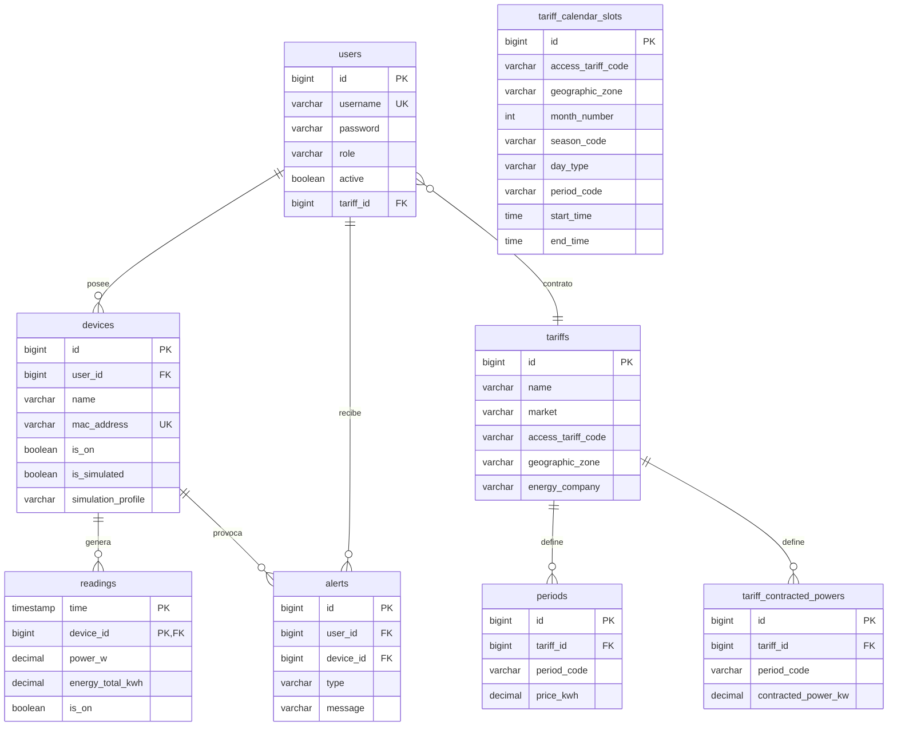

# Anexo D. TimescaleDB, modelo relacional y analitica energetica

## 1. Objetivo de la capa de datos

La base de datos de Wattimizer combina informacion relacional de negocio con lecturas de telemetria. Las entidades de usuarios, dispositivos, tarifas y alertas siguen un modelo relacional clasico. Las lecturas se almacenan en `readings`, una tabla convertida en hypertable de TimescaleDB para trabajar mejor con series temporales.

La aplicacion no usa todavia agregados continuos ni `time_bucket`; las consultas analiticas actuales se hacen desde JPA sobre intervalos ordenados y el calculo se realiza en servicios Java.

## 2. Extension TimescaleDB

El script `backend/src/main/resources/db/dev-seed/00-extensions.sql` activa:

```sql
CREATE EXTENSION IF NOT EXISTS timescaledb;
CREATE EXTENSION IF NOT EXISTS pgcrypto;
```

`timescaledb` habilita hypertables. `pgcrypto` se usa en scripts de seed para hashes compatibles con BCrypt.

## 3. Hypertable `readings`

Script: `backend/src/main/resources/db/dev-seed/01-hypertable.sql`

```sql
SELECT create_hypertable('readings', 'time');
```

El script debe ejecutarse despues de que Hibernate cree la tabla y antes de recibir datos MQTT. Si ya existen filas, el propio archivo indica la alternativa:

```sql
-- SELECT create_hypertable('readings', 'time', migrate_data => true);
```

### 3.1. Entidad Reading

Archivo: `Reading.java`

```java
@Entity
@Table(name = "readings")
@IdClass(ReadingId.class)
public class Reading {
    @Id
    @Column(nullable = false, updatable = false)
    private Instant time;

    @Id
    @ManyToOne(fetch = FetchType.LAZY)
    @JoinColumn(name = "device_id", nullable = false)
    private Device device;

    @Column(name = "power_w", precision = 10, scale = 2)
    private BigDecimal powerW;

    @Column(name = "energy_total_kwh", precision = 14, scale = 4)
    private BigDecimal energyTotalKwh;

    @Column(name = "is_on")
    private Boolean isOn;
}
```

### 3.2. Motivo de la clave compuesta

La clave se compone de:

- `time`: instante de la lectura.
- `device_id`: dispositivo que genera la lectura.

Esto permite que dos dispositivos tengan lecturas en el mismo instante sin colisionar. En los simuladores se anade un pequeno desfase por dispositivo para reducir colisiones si dos ticks se solapan.

## 4. Modelo relacional principal



## 5. Tablas de negocio

### 5.1. `users`

Entidad: `UserEntity`

Representa usuarios autenticables de Spring Security. Campos relevantes:

- `username`: unico y usado como identificador de login.
- `password`: hash de contrasena.
- `role`: `ROLE_USER` o `ROLE_ADMIN`.
- `active`: habilita o deshabilita cuenta.
- `tariff_id`: tarifa privada asignada al usuario.

### 5.2. `devices`

Entidad: `Device`

Campos relevantes:

- `user_id`: propietario. Puede ser nulo si el dispositivo se autoaprovisiona antes de reclamarlo.
- `mac_address`: identificador unico del Shelly o simulador.
- `is_simulated`: diferencia hardware real de simulador.
- `simulation_profile`: perfil sintetico, solo aplicable a simuladores.

Al borrar un dispositivo, `DeviceService.deleteById()` elimina primero sus lecturas y alertas:

```java
readingRepository.deleteAllByDeviceMacAddress(macAddress);
alertRepository.deleteByDeviceId(id);
deviceRepository.delete(device);
```

La decision evita conflictos de claves foraneas al eliminar dispositivos con historico.

### 5.3. `alerts`

Entidad: `Alert`

Relaciona usuario, dispositivo, tipo y mensaje. Actualmente se usa para alertas `OVERPOWER`, generadas cuando una lectura supera la potencia contratada del periodo vigente.

### 5.4. `tariffs`

Entidad: `Tariff`

Guarda contratos y plantillas de tarifa:

- `access_tariff_code`: `2.0TD`, `3.0TD`, `6.1TD`, `6.2TD`.
- `geographic_zone`: `PENINSULA`, `CANARIAS`, `ISLAS_BALEARES`, `CEUTA`, `MELILLA`.
- `periods`: precios de energia por periodo.
- `contractedPowers`: potencias contratadas por periodo.

### 5.5. `periods`

Entidad: `Period`

No guarda rangos horarios. Solo guarda:

- `period_code`: P1-P6.
- `price_kwh`: precio contractual en euros/kWh.

Los horarios se separan en `tariff_calendar_slots` para no mezclar contrato economico con calendario regulatorio.

### 5.6. `tariff_contracted_powers`

Entidad: `TariffContractedPower`

Guarda la potencia contratada en kW por periodo. En tarifas de seis periodos se valida en servicio que:

```text
P1 <= P2 <= P3 <= P4 <= P5 <= P6
```

### 5.7. `tariff_calendar_slots`

Entidad: `TariffCalendarSlot`

Tabla de dimension regulatoria. Traduce:

```text
peaje + zona + mes + tipo de dia + hora local -> period_code
```

El seed actual cubre:

- Peajes: `2.0TD` y `3.0TD`.
- Zonas: `PENINSULA` e `ISLAS_BALEARES`.

Aunque las entidades admiten mas zonas y peajes, no toda la combinatoria esta sembrada todavia.

## 6. Scripts SQL relevantes

| Script | Funcion |
| --- | --- |
| `00-extensions.sql` | Activa TimescaleDB y pgcrypto. |
| `01-hypertable.sql` | Convierte `readings` en hypertable. |
| `03-seed-users-dev.sql` | Crea usuarios de desarrollo. |
| `04-seed-device-shelly.sql` | Inserta Shelly fisico de desarrollo. |
| `05-seed-device-simulation.sql` | Inserta simuladores por perfil. |
| `tariffs-td-schema.sql` | Ajusta columnas, constraints e indices de tarifas TD. |
| `seed-tariff-calendar-slots.sql` | Carga calendario regulatorio por peaje, zona, mes y hora. |
| `prod/99-resync-sequences.sql` | Resincroniza secuencias tras cargas/importaciones. |

## 7. Consultas JPA sobre lecturas

Archivo: `ReadingRepository.java`

### 7.1. Ultima lectura

```java
Optional<Reading> findFirstByDeviceMacAddressOrderByTimeDesc(String macAddress);
```

Uso: endpoint `/api/v1/readings/latest/{macAddress}`.

### 7.2. Busqueda por clave compuesta

```java
Optional<Reading> findByTimeAndDeviceMacAddress(Instant time, String macAddress);
```

Uso: endpoints `/api/v1/readings/search` para consultar y borrar una lectura concreta.

### 7.3. Lecturas por intervalo

```java
@Query("""
    SELECT r FROM Reading r
    WHERE r.device.macAddress = :macAddress
      AND r.time >= :start
      AND r.time <= :end
    ORDER BY r.time ASC
""")
List<Reading> findReadingsInInterval(String macAddress, Instant start, Instant end);
```

Esta consulta se usa en:

- Historico reciente del dashboard.
- Calculo de coste.
- Calculo de consumo fantasma.

La ordenacion ascendente es necesaria para calcular deltas entre lecturas consecutivas.

### 7.4. Borrado por dispositivo

```java
@Query("DELETE FROM Reading r WHERE r.device.macAddress = :macAddress")
int deleteAllByDeviceMacAddress(String macAddress);
```

Se usa antes de borrar un dispositivo, para evitar que queden lecturas apuntando a un `device_id` inexistente.

## 8. Resolucion de periodos tarifarios

Archivo: `CalendarResolverService.java`

El servicio resuelve el periodo aplicable en cuatro pasos:

1. Lee `accessTariffCode` y `geographicZone` de la tarifa.
2. Convierte el `Instant` a hora local.
3. Determina `dayType`: fines de semana son `D`; laborables consultan el seed.
4. Busca `periodCode` en `tariff_calendar_slots`.
5. Busca el `Period` de esa tarifa con ese `periodCode`.

### 8.1. Zona horaria

```java
if ("CANARIAS".equalsIgnoreCase(geographicZone)) {
    return ZoneId.of("Atlantic/Canary");
}
return ZoneId.of("Europe/Madrid");
```

La decision evita calcular mal ventanas nocturnas en Canarias.

### 8.2. Query de calendario

Archivo: `TariffCalendarSlotRepository.java`

```java
@Query("""
    SELECT cs.periodCode FROM TariffCalendarSlot cs
    WHERE cs.accessTariffCode = :accessTariffCode
      AND cs.geographicZone   = :zone
      AND cs.monthNumber      = :month
      AND cs.dayType          = :dayType
      AND (
            (cs.startTime <> cs.endTime AND cs.startTime <= :localTime AND cs.endTime > :localTime)
            OR
            (cs.startTime = cs.endTime AND cs.dayType = 'D')
            OR (cs.endTime = :endOfDay AND :localTime >= cs.startTime)
          )
""")
Optional<String> findPeriodCode(...);
```

El caso `startTime = endTime` representa un dia completo para tipo `D` en `3.0TD`, donde el periodo P6 aplica durante la jornada completa.

## 9. Calculo de coste energetico

Archivo: `ConsumptionService.java`

Metodo:

```java
public BigDecimal calculateCostInPeriod(String macAddress, Instant start, Instant end)
```

Flujo:

1. Consulta lecturas ordenadas con `findReadingsInInterval`.
2. Si hay menos de dos lecturas, devuelve `0`.
3. Recupera dispositivo y tarifa del usuario.
4. Recorre pares consecutivos.
5. Calcula delta positivo de `energyTotalKwh`.
6. Resuelve periodo tarifario del instante actual.
7. Multiplica delta kWh por `priceKwh`.
8. Devuelve total con escala de 2 decimales.

Formula:

```text
coste tramo = (kWh_actual - kWh_anterior) * precio_periodo
```

Solo se aceptan deltas positivos. Si el odometro se reinicia o llega un valor nulo, ese tramo se ignora.

## 10. Calculo de consumo fantasma

Metodo:

```java
public BigDecimal calculateGhostCost(String macAddress, Instant start, Instant end)
```

La ventana de consumo fantasma se define como:

```text
00:00 <= hora local < 06:00
```

No se confunde con el periodo valle regulatorio. Es una decision funcional: Wattimizer considera consumo fantasma el gasto nocturno de equipos que deberian estar apagados, aunque la tarifa tenga otro periodo asociado.

El calculo usa los mismos deltas positivos que el coste total, pero solo suma tramos cuya lectura actual cae dentro de esa ventana.

## 11. Analitica de alertas de potencia

Archivo: `AlertService.java`

El algoritmo de alerta:

1. Recibe una `Reading`.
2. Comprueba que hay dispositivo, usuario, tarifa y potencia.
3. Resuelve periodo tarifario con `CalendarResolverService`.
4. Busca potencia contratada por `tariffId + periodCode`.
5. Convierte `powerW` a kW.
6. Compara lectura contra limite.
7. Si supera, guarda alerta `OVERPOWER`.

Ejemplo de mensaje generado:

```text
ALERTA CRITICA DE MAXIMETRO: el dispositivo ha registrado un pico superior a la potencia contratada.
```

El mensaje real incluye dispositivo, kW registrados, periodo, limite y porcentaje de sobrecarga.

## 12. Consultas SQL utiles para defensa del proyecto

Estas consultas no son endpoints nuevos; sirven para verificar la base de datos durante pruebas o defensa.

### 12.1. Comprobar hypertable

```sql
SELECT hypertable_name, num_chunks
FROM timescaledb_information.hypertables
WHERE hypertable_name = 'readings';
```

### 12.2. Ultimas lecturas de una MAC

```sql
SELECT r.time, d.mac_address, r.power_w, r.energy_total_kwh, r.is_on
FROM readings r
JOIN devices d ON d.id = r.device_id
WHERE d.mac_address = 'SIM000000001'
ORDER BY r.time DESC
LIMIT 20;
```

### 12.3. Consumo acumulado por intervalo

```sql
SELECT
    MIN(r.energy_total_kwh) AS kwh_inicio,
    MAX(r.energy_total_kwh) AS kwh_fin,
    MAX(r.energy_total_kwh) - MIN(r.energy_total_kwh) AS kwh_consumidos
FROM readings r
JOIN devices d ON d.id = r.device_id
WHERE d.mac_address = 'SIM000000001'
  AND r.time >= NOW() - INTERVAL '1 hour';
```

### 12.4. Alertas por usuario

```sql
SELECT a.id, u.username, d.mac_address, a.type, a.message, a.created_at
FROM alerts a
JOIN users u ON u.id = a.user_id
JOIN devices d ON d.id = a.device_id
WHERE u.username = 'admin@wattimizer.dev'
ORDER BY a.created_at DESC;
```

### 12.5. Resolver slots de calendario disponibles

```sql
SELECT access_tariff_code, geographic_zone, month_number, day_type, period_code, start_time, end_time
FROM tariff_calendar_slots
WHERE access_tariff_code = '3.0TD'
  AND geographic_zone = 'PENINSULA'
  AND month_number = 11
ORDER BY day_type, start_time;
```

## 13. Estado actual y limites

- `readings` esta preparada como hypertable, pero el codigo no usa todavia `time_bucket`.
- No hay politicas de compresion ni retencion definidas en scripts.
- No existen agregados continuos para coste por hora/dia/mes.
- El seed de calendario cubre `2.0TD` y `3.0TD` en `PENINSULA` e `ISLAS_BALEARES`.
- Las consultas analiticas actuales cargan lecturas del intervalo y calculan en Java. Es suficiente para el MVP, pero a largo plazo conviene mover agregaciones pesadas a TimescaleDB.

## 14. Mejora propuesta sobre TimescaleDB

Cuando haya mas volumen de datos, una evolucion natural seria crear agregados por hora:

```sql
-- Propuesta futura, no implementada actualmente.
SELECT time_bucket('1 hour', r.time) AS bucket,
       d.mac_address,
       AVG(r.power_w) AS avg_power_w,
       MAX(r.energy_total_kwh) - MIN(r.energy_total_kwh) AS kwh_delta
FROM readings r
JOIN devices d ON d.id = r.device_id
GROUP BY bucket, d.mac_address
ORDER BY bucket DESC;
```

No se incluye como funcionalidad actual porque el repositorio no contiene vista materializada ni continuous aggregate. Se documenta solo como linea futura coherente con TimescaleDB.
