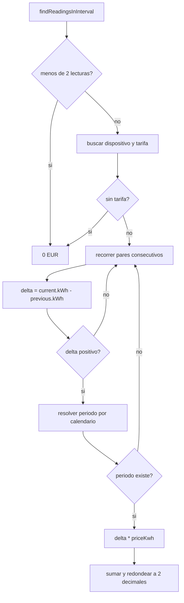

# Anexo D. TimescaleDB, modelo relacional y consultas analiticas

Este anexo documenta la estructura de datos de Wattimizer y las consultas analiticas reales que se ejecutan sobre las lecturas de consumo. La base es PostgreSQL con TimescaleDB, usando `readings` como hypertable.

## 1. Papel de TimescaleDB en el proyecto

El sistema recibe lecturas de consumo cada pocos segundos. Ese tipo de dato es una serie temporal: muchas filas, ordenadas por tiempo y consultadas por intervalos.

Por eso la tabla `readings` no se deja como tabla PostgreSQL normal. El script:

```text
backend/src/main/resources/db/dev-seed/01-hypertable.sql
```

la convierte en hypertable:

```sql
SELECT create_hypertable('readings', 'time');
```

La particion temporal se hace por la columna `time`. TimescaleDB gestiona chunks semanales de forma automatica.

Actualmente no hay en el repositorio:

- `time_bucket`;
- agregados continuos;
- politicas de retencion;
- politicas de compresion.

Por tanto, la analitica actual se basa en consultas JPQL sobre la hypertable y calculo de negocio en Java.

## 2. Tabla `readings`

Entidad: `backend/src/main/java/com/joselumartos/jwtauthbackenddemo/entities/Reading.java`.

| Campo | Tipo Java | Columna | Descripcion |
| --- | --- | --- | --- |
| `time` | `Instant` | `time` | Instante UTC de la lectura. Forma parte de la PK. |
| `device` | `Device` | `device_id` | Dispositivo que genera la lectura. Forma parte de la PK. |
| `powerW` | `BigDecimal` | `power_w` | Potencia activa instantanea en vatios. |
| `energyTotalKwh` | `BigDecimal` | `energy_total_kwh` | Energia acumulada del contador en kWh. |
| `isOn` | `Boolean` | `is_on` | Estado del rele o del simulador. |

La clave compuesta se modela con `ReadingId`:

```java
public class ReadingId implements Serializable {
    private Long device;
    private Instant time;
}
```

### 2.1. Razon de la clave compuesta

Un mismo dispositivo no deberia tener dos lecturas con el mismo instante. La combinacion `device_id + time` representa exactamente esa regla.

En simuladores, `SimulatedTelemetryProcessor` suma un pequeno desfase en milisegundos basado en `device.getId()` para evitar que varios dispositivos compartan exactamente el mismo timestamp en un tick.

## 3. Modelo relacional completo


## 4. Scripts SQL relevantes

### 4.1. Extension TimescaleDB

`00-extensions.sql` habilita la extension necesaria antes de convertir tablas.

### 4.2. Hypertable

`01-hypertable.sql` debe ejecutarse despues de que Hibernate cree `readings` y antes de que entren datos MQTT.

Si ya hubiese filas, el propio script documenta la alternativa:

```sql
SELECT create_hypertable('readings', 'time', migrate_data => true);
```

### 4.3. Esquema tarifario TD

`tariffs-td-schema.sql` ajusta el modelo regulatorio:

- anade `access_tariff_code` y `geographic_zone` a `tariffs`;
- normaliza `periods` a `period_code` y `price_kwh`;
- valida codigos `P1-P6`;
- crea indices en `tariff_calendar_slots`;
- asegura restricciones de zona, mes, temporada y tipo de dia.

Indices importantes:

```sql
CREATE UNIQUE INDEX IF NOT EXISTS ux_tariff_calendar_slots_lookup
  ON tariff_calendar_slots (
    access_tariff_code, geographic_zone, month_number, day_type, start_time, end_time
  );

CREATE INDEX IF NOT EXISTS ix_tariff_calendar_slots_period_code
  ON tariff_calendar_slots (
    access_tariff_code, geographic_zone, month_number, day_type, period_code
  );
```

### 4.4. Seed de calendario

`seed-tariff-calendar-slots.sql` carga periodos de calendario para:

- `2.0TD`
- `3.0TD`
- `PENINSULA`
- `ISLAS_BALEARES`

El propio repositorio permite mas zonas en entidades y constraints, pero el seed actual no cubre todo el mapa regulatorio.

## 5. Consultas reales sobre lecturas

Las consultas viven en `ReadingRepository.java`.

### 5.1. Ultima lectura por MAC

Metodo:

```java
Optional<Reading> findFirstByDeviceMacAddressOrderByTimeDesc(String macAddress);
```

Uso:

- `ReadingService.findByDevice`
- simulacion, para recuperar el ultimo `energyTotalKwh`

Equivalente SQL:

```sql
SELECT r.*
FROM readings r
JOIN devices d ON d.id = r.device_id
WHERE d.mac_address = :macAddress
ORDER BY r.time DESC
LIMIT 1;
```

Esta consulta aprovecha la ordenacion temporal natural de la hypertable, aunque no hay indice especifico documentado en el repositorio para `device_id, time DESC`.

### 5.2. Lecturas en intervalo

Metodo:

```java
@Query("""
    SELECT r FROM Reading r WHERE r.device.macAddress = :macAddress
    AND r.time >= :start AND r.time <= :end ORDER BY r.time ASC
""")
List<Reading> findReadingsInInterval(String macAddress, Instant start, Instant end);
```

Usos:

- `ReadingService.listRecentByMacAddress`
- `ConsumptionService.calculateCostInPeriod`
- `ConsumptionService.calculateGhostCost`

Equivalente SQL:

```sql
SELECT r.*
FROM readings r
JOIN devices d ON d.id = r.device_id
WHERE d.mac_address = :macAddress
  AND r.time >= :start
  AND r.time <= :end
ORDER BY r.time ASC;
```

Es la consulta analitica central del proyecto: de aqui salen tanto la grafica del dashboard como los calculos economicos.

### 5.3. Busqueda por clave compuesta logica

Metodo:

```java
Optional<Reading> findByTimeAndDeviceMacAddress(Instant time, String macAddress);
```

Equivalente SQL:

```sql
SELECT r.*
FROM readings r
JOIN devices d ON d.id = r.device_id
WHERE r.time = :time
  AND d.mac_address = :macAddress;
```

Se expone por:

```http
GET /api/v1/readings/search?time=...&macAddress=...
```

### 5.4. Borrado de una lectura

Metodo:

```java
@Query("DELETE FROM Reading r WHERE r.time = :time AND r.device.macAddress = :macAddress")
Long deleteByTimeAndDeviceMacAddress(Instant time, String macAddress);
```

Equivalente SQL:

```sql
DELETE FROM readings r
USING devices d
WHERE r.device_id = d.id
  AND r.time = :time
  AND d.mac_address = :macAddress;
```

Antes de borrar, `ReadingController` comprueba que el dispositivo pertenece al usuario autenticado.

### 5.5. Borrado masivo por MAC

Metodo:

```java
@Query("DELETE FROM Reading r WHERE r.device.macAddress = :macAddress")
int deleteAllByDeviceMacAddress(String macAddress);
```

Uso:

- `DeviceService.deleteById`

Equivalente SQL:

```sql
DELETE FROM readings r
USING devices d
WHERE r.device_id = d.id
  AND d.mac_address = :macAddress;
```

Este borrado evita que la FK de `readings` bloquee la eliminacion de `devices`.

## 6. Analitica de coste energetico

Servicio: `ConsumptionService.calculateCostInPeriod`.

Entrada:

- `macAddress`
- `start`
- `end`

Salida REST:

```json
{
  "macAddress": "9070694d3590",
  "totalCostEur": 1.23,
  "start": "2026-11-04T00:00:00Z",
  "end": "2026-11-04T22:00:00Z"
}
```

### 6.1. Algoritmo



### 6.2. Por que se usa energia acumulada

El contador `energyTotalKwh` permite calcular energia consumida entre dos lecturas sin depender solo de potencia instantanea. Si una lectura marca 10.0000 kWh y la siguiente 10.0025 kWh, el consumo real del tramo es 0.0025 kWh.

El servicio descarta deltas nulos o negativos porque pueden indicar:

- reinicio del hardware;
- lectura incompleta;
- dato fuera de orden;
- reseteo de simulador o contador.

## 7. Analitica de consumo fantasma

Servicio: `ConsumptionService.calculateGhostCost`.

Usa la misma consulta de intervalo y la misma logica de coste, pero filtra por hora local:

```java
int hour = instant.atZone(zoneId).getHour();
return hour >= 0 && hour < 6;
```

La zona se resuelve en `CalendarResolverService`:

| Zona contractual | `ZoneId` |
| --- | --- |
| `CANARIAS` | `Atlantic/Canary` |
| Resto | `Europe/Madrid` |

Esta decision evita calcular mal la franja nocturna cuando el contrato corresponde a Canarias.

## 8. Resolucion de periodo tarifario

Servicio: `CalendarResolverService`.

El coste no se calcula solo con la hora. Tambien depende de:

- peaje (`2.0TD`, `3.0TD`, `6.1TD`, `6.2TD`);
- zona geografica;
- mes;
- tipo de dia;
- hora local.

### 8.1. Consulta de calendario

Repositorio: `TariffCalendarSlotRepository.findPeriodCode`.

```java
@Query("""
    SELECT cs.periodCode FROM TariffCalendarSlot cs
    WHERE cs.accessTariffCode = :accessTariffCode
      AND cs.geographicZone   = :zone
      AND cs.monthNumber      = :month
      AND cs.dayType          = :dayType
      AND (
            (cs.startTime <> cs.endTime AND cs.startTime <= :localTime AND cs.endTime > :localTime)
            OR
            (cs.startTime = cs.endTime AND cs.dayType = 'D')
            OR (cs.endTime = :endOfDay AND :localTime >= cs.startTime)
          )
""")
Optional<String> findPeriodCode(...);
```

Equivalente SQL aproximado:

```sql
SELECT period_code
FROM tariff_calendar_slots
WHERE access_tariff_code = :accessTariffCode
  AND geographic_zone = :zone
  AND month_number = :month
  AND day_type = :dayType
  AND (
        (start_time <> end_time AND start_time <= :localTime AND end_time > :localTime)
        OR (start_time = end_time AND day_type = 'D')
        OR (end_time = TIME '23:59' AND :localTime >= start_time)
      );
```

La excepcion `start_time = end_time` representa dias completos de tipo `D`.

### 8.2. Tipo de dia

Los sabados y domingos se consideran `D`. Para laborables, el servicio consulta el seed:

```java
calendarSlotRepository
    .findWorkdayType(accessTariffCode, zone, month)
    .orElse("C");
```

Fallback `C` evita que el backend falle si el seed no esta cargado, aunque en ese caso la precision regulatoria baja.

## 9. Consultas sobre catalogo de tarifas

`TariffRepository.findAllCatalog` evita devolver clones privados:

```java
@Query("SELECT t FROM Tariff t WHERE t.id NOT IN " +
       "(SELECT u.tariff.id FROM UserEntity u WHERE u.tariff IS NOT NULL)")
List<Tariff> findAllCatalog();
```

Equivalente SQL:

```sql
SELECT t.*
FROM tariffs t
WHERE t.id NOT IN (
  SELECT u.tariff_id
  FROM users u
  WHERE u.tariff_id IS NOT NULL
);
```

Esto permite reutilizar la tabla `tariffs` para dos conceptos:

- plantillas globales;
- contratos privados clonados y asignados a usuarios.

La separacion se hace por relacion con `users.tariff_id`.

## 10. Consultas sobre alertas

`AlertRepository` define:

```java
List<Alert> findByUserUsername(String username);
int deleteByIdAndUserUsername(Long id, String username);
```

Equivalentes:

```sql
SELECT a.*
FROM alerts a
JOIN users u ON u.id = a.user_id
WHERE u.username = :username;
```

```sql
DELETE FROM alerts a
USING users u
WHERE a.user_id = u.id
  AND a.id = :id
  AND u.username = :username;
```

El borrado incluye username para impedir que un usuario elimine alertas de otro cambiando el `id`.

## 11. Consultas sobre dispositivos

`DeviceRepository` ofrece:

| Metodo | Uso |
| --- | --- |
| `findByMacAddress` | Resolver lecturas, claim y validaciones de propietario. |
| `findByUserUsername` | Listar dispositivos del usuario. |
| `findBySimulatedTrue` | Job de simulacion. |
| `findByMacAddressStartingWith("SIM")` | Generar siguiente MAC sintetica. |

Equivalente del listado por usuario:

```sql
SELECT d.*
FROM devices d
JOIN users u ON u.id = d.user_id
WHERE u.username = :username;
```

## 12. Rendimiento y mejoras futuras

El modelo actual funciona para el MVP, pero se pueden mejorar consultas cuando crezca el volumen:

1. **Indice por dispositivo y tiempo descendente**

   ```sql
   CREATE INDEX IF NOT EXISTS ix_readings_device_time_desc
   ON readings (device_id, time DESC);
   ```

   Ayudaria a `findFirstByDeviceMacAddressOrderByTimeDesc`.

2. **Agregados por bucket temporal**

   A futuro podria usarse `time_bucket('5 minutes', time)` para graficas historicas largas. No esta implementado ahora.

3. **Politica de retencion**

   Podria conservar detalle de segundos durante unas semanas y datos agregados durante meses.

4. **Compresion TimescaleDB**

   Util para historico antiguo de `readings`.

5. **Cobertura regulatoria completa**

   El seed de calendario deberia completarse para todas las zonas y peajes admitidos por las entidades.

Estas mejoras no se documentan como funcionalidad actual, sino como evolucion tecnica razonable sobre la base existente.
