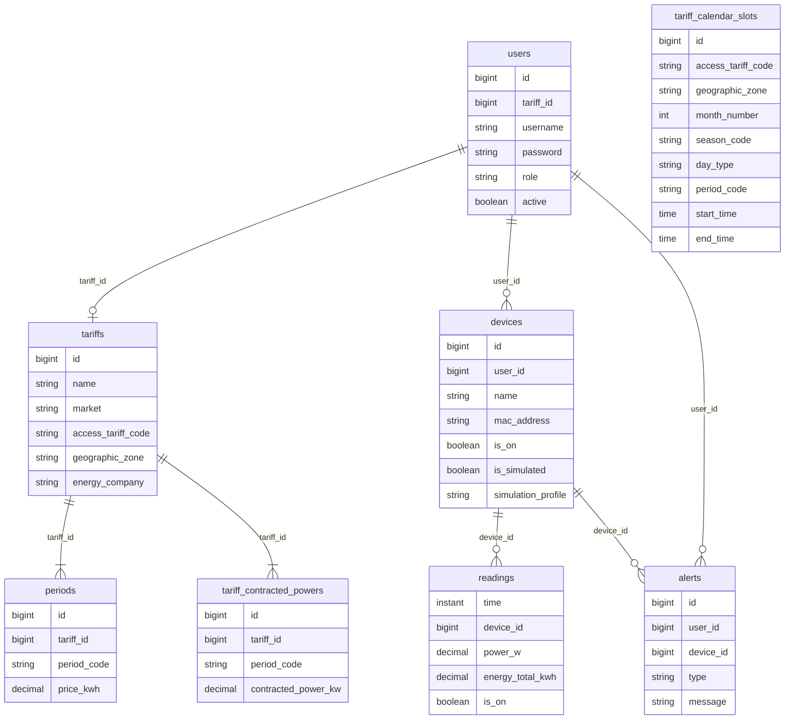
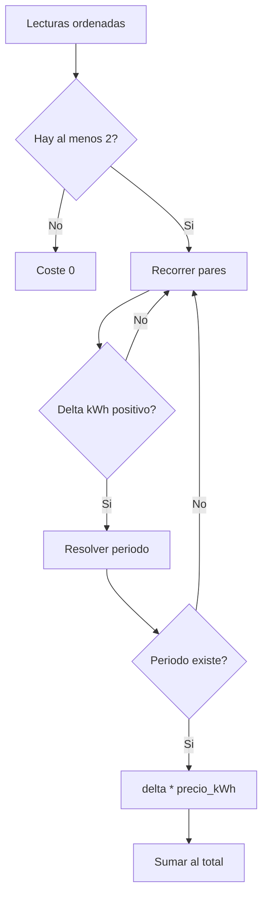

# Anexo D: TimescaleDB, tablas y consultas analiticas

Este anexo documenta el modelo de datos de Wattimizer, la hypertable de TimescaleDB y las consultas que sostienen las analiticas. La base se crea combinando JPA/Hibernate con scripts SQL manuales.

## 1. Enfoque de persistencia

El backend usa Spring Data JPA con `spring.jpa.hibernate.ddl-auto=update`. Esto permite que Hibernate cree y actualice tablas basicas a partir de las entidades. Aun asi, hay elementos que Hibernate no modela bien para este proyecto:

- La conversion de `readings` en hypertable de TimescaleDB.
- Las extensiones `timescaledb` y `pgcrypto`.
- Algunos `CHECK`, indices y restricciones del modelo tarifario TD.
- Seeds regulatorios de calendario.

Por eso existen scripts SQL en `backend/src/main/resources/db/`.

## 2. Tablas principales

| Tabla | Entidad | Clave | Descripcion |
|---|---|---|---|
| `users` | `UserEntity` | `id` | Usuarios, roles y tarifa asignada. |
| `federated_identities` | `FederatedIdentity` | `id` | Identidades externas de OAuth2. |
| `devices` | `Device` | `id`, `mac_address` unico | Dispositivos fisicos o simulados. |
| `readings` | `Reading` | `(time, device_id)` | Serie temporal de telemetria. |
| `alerts` | `Alert` | `id` | Alertas de maximetro por usuario y dispositivo. |
| `tariffs` | `Tariff` | `id` | Catalogo o tarifa privada de usuario. |
| `periods` | `Period` | `id`, unico `(tariff_id, period_code)` | Precio de energia por periodo. |
| `tariff_contracted_powers` | `TariffContractedPower` | `id`, unico `(tariff_id, period_code)` | Potencia contratada por periodo. |
| `tariff_calendar_slots` | `TariffCalendarSlot` | `id` | Tabla regulatoria de peaje, zona, mes, dia y hora. |

Las entidades con auditoria heredan de `BaseEntity`, que aporta campos como fecha de creacion y actualizacion.

## 3. Modelo relacional



## 4. Hypertable `readings`

Script: `backend/src/main/resources/db/dev-seed/01-hypertable.sql`

```sql
SELECT create_hypertable('readings', 'time');
```

La tabla `readings` se particiona por `time`. Esto es adecuado porque las lecturas crecen continuamente y casi todas las consultas se hacen por intervalos de tiempo.

### Requisitos antes de ejecutar

1. Hibernate debe haber creado la tabla `readings`.
2. La tabla debe estar vacia para usar el script tal cual.
3. Si ya hay datos, el propio script documenta la variante con `migrate_data => true`.

### Verificacion

```sql
SELECT hypertable_name, num_chunks
FROM timescaledb_information.hypertables;
```

Debe aparecer la hypertable `readings`.

## 5. Orden de scripts SQL

| Orden | Script | Motivo |
|---|---|---|
| 1 | `db/dev-seed/00-extensions.sql` | Activa `timescaledb` y `pgcrypto`. |
| 2 | `db/dev-seed/01-hypertable.sql` | Convierte `readings` en hypertable. |
| 3 | `db/tariffs-td-schema.sql` | Ajusta modelo tarifario, constraints e indices. |
| 4 | `db/seed-tariff-calendar-slots.sql` | Carga calendario regulatorio. |
| 5 | `db/dev-seed/03-seed-users-dev.sql` | Usuarios de desarrollo, si procede. |
| 6 | `db/dev-seed/04-seed-device-shelly.sql` | Dispositivo Shelly de desarrollo, si procede. |
| 7 | `db/dev-seed/05-seed-device-simulation.sql` | Simuladores de desarrollo, si procede. |
| 8 | `db/prod/99-resync-sequences.sql` | Realinea secuencias tras inserts manuales. |

No hay Flyway ni Liquibase. La inicializacion SQL se ejecuta de forma manual siguiendo las guias del repositorio.

## 6. Tabla `readings`

Entidad: `entities/Reading.java`

Campos:

| Campo | Tipo Java | Tipo logico | Descripcion |
|---|---|---|---|
| `time` | `Instant` | timestamp UTC | Instante exacto de la lectura. |
| `device` | `Device` | FK a `devices` | Parte de la clave compuesta. |
| `powerW` | `BigDecimal` | W | Potencia activa instantanea. |
| `energyTotalKwh` | `BigDecimal` | kWh | Odometro de energia acumulada. |
| `isOn` | `Boolean` | boolean | Estado del enchufe o simulador. |

La clave compuesta `(time, device_id)` evita duplicados exactos para el mismo dispositivo en el mismo instante. En simuladores se suma un pequeno desfase basado en `device.getId() % 1000` ms para reducir colisiones cuando varios dispositivos se procesan en el mismo tick.

## 7. Consultas reales usadas por la aplicacion

### 7.1. Lecturas por intervalo

Archivo: `repositories/ReadingRepository.java`

```java
@Query("SELECT r FROM Reading r WHERE r.device.macAddress = :macAddress " +
        "AND r.time >= :start AND r.time <= :end ORDER BY r.time ASC")
List<Reading> findReadingsInInterval(
        @Param("macAddress") String macAddress,
        @Param("start") Instant start,
        @Param("end") Instant end);
```

Esta consulta sostiene:

- Historico reciente del dashboard.
- Calculo de coste total.
- Calculo de consumo fantasma.

El orden ascendente es imprescindible porque el coste se calcula con diferencias entre lecturas consecutivas.

### 7.2. Ultima lectura por dispositivo

```java
Optional<Reading> findFirstByDeviceMacAddressOrderByTimeDesc(String macAddress);
```

Se usa para:

- Recuperar el ultimo valor de odometro antes de generar una lectura simulada.
- Consultar la ultima lectura por API.

### 7.3. Lectura por clave compuesta

```java
Optional<Reading> findByTimeAndDeviceMacAddress(Instant time, String macAddress);
```

Permite buscar una lectura exacta por `time` y `macAddress`.

### 7.4. Borrados por MAC o lectura concreta

```java
@Query("DELETE FROM Reading r WHERE r.time = :time AND r.device.macAddress = :macAddress")
Long deleteByTimeAndDeviceMacAddress(...)

@Query("DELETE FROM Reading r WHERE r.device.macAddress = :macAddress")
int deleteAllByDeviceMacAddress(...)
```

El borrado por MAC se usa antes de eliminar un dispositivo para no dejar referencias incompatibles.

## 8. Analitica de coste

Archivo: `services/ConsumptionService.java`

El calculo no usa una consulta SQL agregada. La aplicacion trae las lecturas ordenadas y calcula en Java el coste con el odometro `energyTotalKwh`.

### Algoritmo de `calculateCostInPeriod`

1. Obtener lecturas de la MAC entre `start` y `end`.
2. Si hay menos de dos lecturas, devolver cero.
3. Comprobar que el dispositivo tiene usuario y tarifa.
4. Recorrer pares consecutivos.
5. Calcular `delta = current.energyTotalKwh - previous.energyTotalKwh`.
6. Ignorar deltas nulos, negativos o cero.
7. Resolver el periodo tarifario aplicable al instante de la lectura actual.
8. Multiplicar `deltaKwh * priceKwh`.
9. Redondear el total a dos decimales.



Esta forma evita errores cuando el odometro del enchufe se reinicia o llega una lectura incompleta.

## 9. Consumo fantasma

Metodo: `ConsumptionService.calculateGhostCost`

Usa la misma base que el coste normal, pero filtra por una ventana local:

```java
int hour = instant.atZone(zoneId).getHour();
return hour >= 0 && hour < 6;
```

La zona horaria no se fija a Madrid para todos. `CalendarResolverService.resolveZoneIdForTariff` usa:

- `Atlantic/Canary` si la tarifa es de Canarias.
- `Europe/Madrid` para el resto.

La intencion es que un `Instant` se interprete en la zona real del contrato electrico.

## 10. Resolucion de periodo tarifario

Archivo: `services/CalendarResolverService.java`

Pasos:

1. Leer `accessTariffCode` y `geographicZone` de la tarifa.
2. Convertir `Instant` a hora local.
3. Determinar mes, hora y tipo de dia.
4. Consultar `tariff_calendar_slots` para obtener `periodCode`.
5. Buscar en `periods` el precio concreto de esa tarifa y periodo.

Consulta principal en `TariffCalendarSlotRepository`:

```java
@Query("""
        SELECT cs.periodCode FROM TariffCalendarSlot cs
        WHERE cs.accessTariffCode = :accessTariffCode
          AND cs.geographicZone   = :zone
          AND cs.monthNumber      = :month
          AND cs.dayType          = :dayType
          AND (
                (cs.startTime <> cs.endTime AND cs.startTime <= :localTime AND cs.endTime > :localTime)
                OR
                (cs.startTime = cs.endTime AND cs.dayType = 'D')
                OR (cs.endTime = :endOfDay AND :localTime >= cs.startTime)
              )
        """)
Optional<String> findPeriodCode(...);
```

El caso `startTime = endTime` se usa para representar dias completos tipo `D`.

## 11. Semilla del calendario regulatorio

Archivo: `backend/src/main/resources/db/seed-tariff-calendar-slots.sql`

Cobertura actual documentada:

| Elemento | Cobertura |
|---|---|
| Peajes | `2.0TD`, `3.0TD` |
| Zonas | `PENINSULA`, `ISLAS_BALEARES` |
| Filas | 336 |
| Idempotencia | `ON CONFLICT ... DO NOTHING` |

El modelo admite tambien `CANARIAS`, `CEUTA`, `MELILLA`, `6.1TD` y `6.2TD`, pero si no hay filas en `tariff_calendar_slots`, el calendario no podra resolver periodo. En ese caso los servicios degradan a coste cero o no generan alerta, en lugar de inventar datos.

## 12. Alertas de maximetro

Archivo: `services/AlertService.java`

La alerta no se calcula con agregados SQL. Se comprueba lectura a lectura:

1. Convertir `powerW` a kW.
2. Resolver periodo aplicable.
3. Buscar potencia contratada del periodo.
4. Comparar potencia actual con limite.
5. Crear alerta `OVERPOWER` si se supera.

Mensaje generado:

```text
ALERTA CRITICA DE MAXIMETRO: el dispositivo ha registrado un pico por encima de la potencia contratada del periodo.
```

El mensaje real incluye nombre del dispositivo, kW actuales, periodo, potencia contratada y porcentaje sobre el limite.

## 13. Indices y restricciones tarifarias

Script: `db/tariffs-td-schema.sql`

Elementos principales:

- `chk_tariffs_access_tariff_code`
- `chk_tariffs_geographic_zone`
- `chk_periods_period_code`
- `ux_periods_tariff_period_code`
- `chk_tariff_contracted_powers_period_code`
- `chk_tariff_contracted_powers_positive`
- `ix_tariff_contracted_powers_tariff_id`
- `chk_tariff_calendar_slots_*`
- `ux_tariff_calendar_slots_lookup`
- `ix_tariff_calendar_slots_period_code`

Estas restricciones protegen la coherencia minima de los codigos regulatorios. La validacion mas contextual, como periodos exigidos segun peaje o orden de potencias, se realiza en `TariffService`.

## 14. Despliegue de base de datos

En `docker-compose.yml`:

```yaml
timescaledb:
  image: timescale/timescaledb-ha:pg17
  container_name: db_iot
  restart: always
```

El contenedor no expone puerto al exterior en produccion; el backend se conecta por la red interna Docker. Las variables de conexion se inyectan con `SPRING_DATASOURCE_URL`, `SPRING_DATASOURCE_USERNAME` y `SPRING_DATASOURCE_PASSWORD`.

GitHub Actions despliega contenedores, pero no ejecuta migraciones SQL. La inicializacion de la base se mantiene como operacion manual documentada en `docs/deployment/hetzner-production.md`.

## 15. Mejora futura: analitica nativa de TimescaleDB

Actualmente TimescaleDB aporta particionado temporal, pero no se usan funciones como `time_bucket` o agregados continuos. Una mejora razonable seria crear vistas para:

```sql
SELECT
  time_bucket('15 minutes', time) AS bucket,
  device_id,
  avg(power_w) AS avg_power_w,
  max(power_w) AS max_power_w
FROM readings
GROUP BY bucket, device_id
ORDER BY bucket DESC;
```

Este tipo de consulta permitiria historicos largos sin enviar demasiadas lecturas al backend. No se documenta como funcionalidad actual porque no esta implementada en el codigo.
