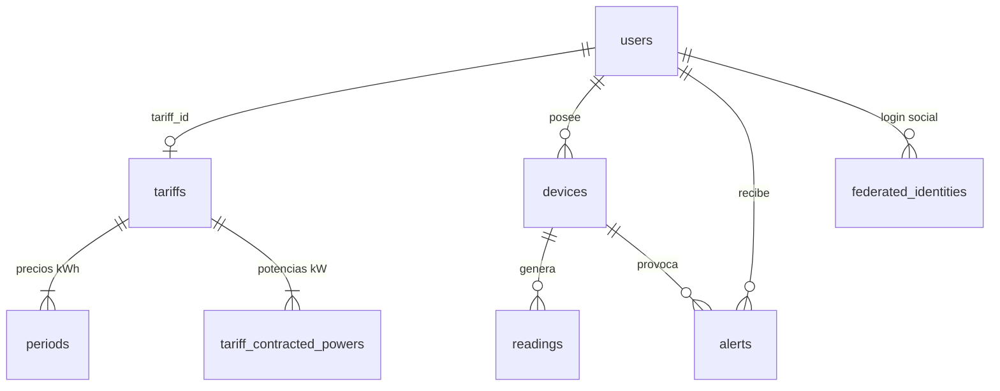
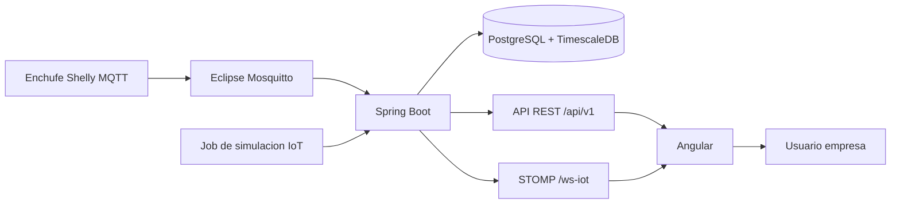

# Memoria final del proyecto DAW: Wattimizer

## 1. Introduccion y justificacion

### 1.1. Titulo del proyecto

**Wattimizer** es una aplicacion web B2B para monitorizar consumo electrico y traducirlo a impacto economico. El proyecto combina una interfaz Angular, una API REST con Spring Boot, ingesta de telemetria IoT por MQTT y almacenamiento de series temporales sobre PostgreSQL con TimescaleDB.

### 1.2. Descripcion del problema

Muchas pequenas empresas conocen el importe final de la factura electrica, pero no entienden que dispositivos provocan picos de potencia, cuanto cuesta el consumo real durante el dia ni que parte del gasto aparece en franjas de inactividad. Esta falta de visibilidad complica tomar decisiones sencillas, como detectar consumos fantasma, revisar la potencia contratada o comprobar si una tarifa esta bien ajustada al uso real.

Wattimizer plantea una solucion practica: capturar lecturas de enchufes inteligentes Shelly y de simuladores IoT, almacenar esas lecturas como serie temporal y calcular costes usando una tarifa configurada por el usuario. La aplicacion no se limita a mostrar vatios; convierte esos datos en informacion que una pyme puede interpretar para ahorrar y evitar penalizaciones de maximetro.

### 1.3. Objetivos

**Objetivo general**

Desarrollar una plataforma web capaz de registrar telemetria electrica en tiempo real, asociarla a usuarios autenticados y calcular metricas economicas basadas en tarifas energeticas espanolas.

**Objetivos especificos**

- Implementar autenticacion con JWT y soporte OAuth2 mediante ticket temporal de intercambio.
- Crear una API REST segura para gestionar usuarios, dispositivos, lecturas, alertas y tarifas.
- Ingerir mensajes MQTT de un dispositivo Shelly mediante Spring Integration.
- Generar telemetria simulada para probar la aplicacion sin depender siempre de hardware fisico.
- Modelar tarifas 2.0TD, 3.0TD, 6.1TD y 6.2TD con periodos de energia y potencia.
- Guardar lecturas en una hypertable `readings` de TimescaleDB.
- Mostrar graficas de consumo en Angular con actualizacion en tiempo real por WebSocket STOMP.
- Calcular coste diario y consumo fantasma a partir del odometro de energia acumulada.
- Desplegar el sistema con Docker Compose en un VPS de Hetzner y automatizar el despliegue desde GitHub Actions.

### 1.4. Tipos de usuarios

| Usuario | Descripcion | Permisos principales |
|---|---|---|
| Visitante | Persona sin sesion iniciada. | Acceso a login, registro y callback OAuth. |
| Usuario empresa | Cuenta autenticada con rol `ROLE_USER`. | Gestion de sus dispositivos, simuladores, tarifa privada, dashboard, alertas y analiticas. |
| Administrador | Cuenta con rol `ROLE_ADMIN`. | Todo lo anterior y mantenimiento del catalogo maestro de tarifas. |
| Sistema IoT | Broker MQTT y jobs internos. | Insercion indirecta de lecturas mediante servicios backend, sin acceso directo a la interfaz. |

## 2. Fase 1: Analisis funcional

### 2.1. Mapa de funcionalidades

| Modulo | Funcionalidades |
|---|---|
| Autenticacion | Registro, login con usuario y contrasena, OAuth2 Google/GitHub, emision de JWT y cierre de sesion. |
| Dispositivos | Alta por reclamacion de MAC, alta de simuladores, pack de demostracion, edicion, encendido/apagado logico y borrado. |
| Telemetria | Lecturas MQTT Shelly, lecturas simuladas, historial reciente y envio STOMP al frontend. |
| Dashboard | Grafica de potencia activa, selector de medidor, coste acumulado diario y consumo fantasma. |
| Tarifas | Catalogo maestro, tarifa privada por usuario, validacion de periodos CNMC y potencias contratadas. |
| Alertas | Deteccion de sobrepotencia frente a la potencia contratada y descarte de alertas. |
| Administracion tecnica | Scripts SQL, despliegue Docker, proxy Nginx, pipeline GitHub Actions. |

### 2.2. Historias de usuario

| ID | Historia de usuario | Criterios de aceptacion | Prioridad |
|---|---|---|---|
| HU-01 | Como usuario, quiero registrarme para acceder a mi panel energetico. | El backend crea el usuario, valida email unico y devuelve `201 Created`. | Imprescindible |
| HU-02 | Como usuario, quiero iniciar sesion para consumir la API de forma segura. | El login devuelve un JWT y el frontend lo adjunta en `Authorization: Bearer`. | Imprescindible |
| HU-03 | Como usuario, quiero asociar un enchufe Shelly por MAC para ver sus lecturas. | `POST /api/v1/devices/claim` vincula la MAC si esta libre o sin propietario ajeno. | Imprescindible |
| HU-04 | Como usuario, quiero crear simuladores para probar la plataforma sin hardware. | `POST /api/v1/devices/simulated` crea una MAC `SIM...` y el job genera lecturas. | Imprescindible |
| HU-05 | Como usuario, quiero anadir un pack de demostracion para evaluar rapido el producto. | `POST /api/v1/devices/simulated/demo-pack` crea un simulador por perfil que falte. | Opcional |
| HU-06 | Como usuario, quiero consultar una grafica en tiempo real para detectar cambios de consumo. | Angular carga lecturas recientes por REST y despues escucha `/topic/readings/{mac}`. | Imprescindible |
| HU-07 | Como usuario, quiero configurar mi tarifa para que el sistema calcule euros, no solo vatios. | La tarifa privada se guarda en `/api/v1/users/me/tariff` sin aceptar IDs de usuario en el body. | Imprescindible |
| HU-08 | Como administrador, quiero mantener un catalogo de tarifas para reutilizar plantillas. | Solo `ROLE_ADMIN` puede crear, editar o borrar `/api/v1/tariffs`. | Opcional |
| HU-09 | Como usuario, quiero ver el coste diario para interpretar el consumo. | `/api/v1/analytics/cost` calcula deltas positivos de `energy_total_kwh`. | Imprescindible |
| HU-10 | Como usuario, quiero detectar consumo fantasma durante la madrugada. | `/api/v1/analytics/ghost-consumption` calcula coste entre 00:00 y 05:59 hora local. | Opcional |
| HU-11 | Como usuario, quiero recibir alertas de maximetro si supero la potencia contratada. | `AlertService` crea alertas `OVERPOWER` y las envia por STOMP. | Opcional |
| HU-12 | Como administrador tecnico, quiero desplegar la aplicacion con Docker. | GitHub Actions compila frontend/backend, reconstruye contenedores y reinicia Nginx. | Imprescindible |

### 2.3. Gestion del trabajo

- **Repositorio:** <https://github.com/joellmar/wattpath-app>
- **Codigo revisado:** repositorio Wattimizer en el estado actual del proyecto.
- **Kanban propuesto para la memoria:** Backlog, Por hacer, En progreso, En revision y Hecho.

No se incluye una captura inventada del tablero. Para la entrega final se recomienda anadir una captura real de GitHub Projects o del tablero utilizado durante el desarrollo.

### 2.4. Planificacion inicial

| Fase | Historias | Dificultad estimada | Observaciones |
|---|---|---|---|
| Fase 1 | HU-01, HU-02 | Media | Base de seguridad y sesion JWT. |
| Fase 2 | HU-03, HU-04, HU-05 | Alta | Gestion de dispositivos fisicos y simulados. |
| Fase 3 | HU-06, HU-09, HU-10 | Alta | Integracion REST, STOMP y analitica por tiempo. |
| Fase 4 | HU-07, HU-08, HU-11 | Alta | Modelo tarifario y alertas con reglas de negocio. |
| Fase 5 | HU-12 | Media | Docker, Nginx, TimescaleDB y CI/CD. |

## 3. Fase 2: Diseno tecnico

### 3.1. Diseno de base de datos

El modelo se genera principalmente con JPA/Hibernate y se completa con scripts SQL para TimescaleDB y reglas tarifarias. Las entidades principales son `users`, `devices`, `readings`, `alerts`, `tariffs`, `periods`, `tariff_contracted_powers`, `tariff_calendar_slots` y `federated_identities`.



La tabla `readings` se convierte en hypertable de TimescaleDB particionada por `time`. Esta decision encaja con el tipo de dato principal del proyecto: lecturas que crecen constantemente y que se consultan por intervalos temporales.

El detalle de tablas, claves y consultas se recoge en [Anexo D: TimescaleDB y analitica](./anexo-d-timescaledb-analitica.md).

### 3.2. Arquitectura del sistema

| Capa | Tecnologia | Responsabilidad |
|---|---|---|
| Frontend | Angular 21, PrimeNG, Chart.js, NgRx Signals y RxJS | Interfaz de usuario, formularios, graficas, estado local y consumo de REST/STOMP. |
| Backend | Spring Boot 4, Spring Security, Spring MVC, Spring Integration MQTT, JPA | API REST, seguridad, reglas de negocio, ingesta IoT y persistencia. |
| Base de datos | PostgreSQL 17 + TimescaleDB | Datos relacionales y lecturas temporales. |
| Mensajeria IoT | Eclipse Mosquitto + MQTT | Entrada de mensajes desde Shelly. |
| Tiempo real | WebSocket STOMP | Envio de lecturas y alertas desde backend a Angular. |
| Despliegue | Docker Compose, Nginx, GitHub Actions, Hetzner VPS | Publicacion y operacion de la aplicacion. |



### 3.3. Diseno de interfaz

Las pantallas principales detectadas en el codigo Angular son:

- **Login:** formulario de credenciales y enlaces OAuth2.
- **Registro:** alta de usuario basica.
- **Dashboard:** selector de dispositivo, grafica de potencia activa y tarjetas de coste.
- **Dispositivos:** alta fisica por MAC, alta simulada, pack demo, tabla, edicion y borrado.
- **Tarifas:** catalogo maestro para administrador y tarifa privada para usuario.
- **Alertas:** tabla de incidencias de maximetro y accion de descarte.

Para una entrega academica, los wireframes pueden representarse con capturas de estas pantallas ya implementadas. El codigo actual no contiene bocetos historicos previos al diseno visual, asi que no se documentan como si existieran.

### 3.4. Relacion entre historias y diseno

| Historia | Tabla principal | Codigo principal |
|---|---|---|
| HU-01, HU-02 | `users`, `federated_identities` | `AuthController`, `AuthRegistrationService`, `JwtTokenService`, `SecurityConfig` |
| HU-03 | `devices` | `DeviceController`, `DeviceService.claimOrRegisterDevice` |
| HU-04, HU-05 | `devices`, `readings` | `CreateSimulatedDeviceRequest`, `IotTelemetrySimulationJob`, `SimulatedTelemetryProcessor` |
| HU-06 | `readings` | `ReadingController`, `TelemetryStore`, `WebsocketService`, `DashboardComponent` |
| HU-07, HU-08 | `tariffs`, `periods`, `tariff_contracted_powers` | `TariffController`, `UserTariffController`, `TariffStore`, `TariffComponent` |
| HU-09, HU-10 | `readings`, `tariff_calendar_slots` | `ConsumptionController`, `ConsumptionService`, `CalendarResolverService` |
| HU-11 | `alerts` | `AlertService`, `AlertController`, `AlertsComponent` |
| HU-12 | Todas | `docker-compose.yml`, `.github/workflows/deploy.yml`, `docs/deployment/hetzner-production.md` |

## 4. Fase 3: Implementacion y desarrollo

### 4.1. Tecnologias utilizadas

| Ambito | Version / herramienta |
|---|---|
| Java | 26 |
| Spring Boot | 4.0.5 |
| MapStruct | 1.6.3 |
| PostgreSQL / TimescaleDB | Imagen `timescale/timescaledb-ha:pg17` |
| Broker MQTT | `eclipse-mosquitto:2.1.2-alpine` |
| Angular | 21.x |
| NgRx Signals | 21.1.x |
| RxJS | 7.8.x |
| PrimeNG | 21.1.x |
| Chart.js | 4.5.x |
| Node | 22 en CI/build de frontend |
| Docker | Compose con servicios `timescaledb`, `mosquitto`, `backend`, `frontend` y `nginx` |

### 4.2. Desarrollo del backend

El backend se organiza alrededor de controladores REST y servicios de negocio. Los controladores no realizan calculos complejos; validan propiedad del recurso cuando hace falta y delegan en servicios como `DeviceService`, `ReadingService`, `ConsumptionService`, `TariffService` y `UserTariffService`.

La seguridad se basa en JWT para las rutas privadas. `SecurityConfig` permite login, registro, OAuth2, exchange de ticket y handshake WebSocket, mientras que el resto de rutas exige autenticacion. Las mutaciones del catalogo de tarifas requieren `ROLE_ADMIN`.

La gestion de errores se centraliza en `GlobalExceptionHandler`, que traduce excepciones habituales a respuestas `ErrorResponse`. Por ejemplo, credenciales invalidas devuelven `401`, recursos inexistentes devuelven `404`, reglas de negocio fallidas devuelven `400` y algunos conflictos con lecturas/alertas se tratan como `409`.

El detalle de endpoints y DTOs esta en [Anexo A: Backend REST](./anexo-a-backend-rest.md).

### 4.3. Desarrollo del frontend

El frontend usa componentes standalone y rutas perezosas. La aplicacion autenticada cuelga de `MainLayoutComponent`, protegido con `authGuard` y `canActivateChild`. La gestion de sesion se concentra en `SessionStorageService` y el interceptor HTTP adjunta el token JWT en las peticiones a `/api/v1`.

El dashboard mezcla dos fuentes: una carga REST de lecturas recientes para no arrancar la grafica vacia y una suscripcion STOMP para recibir nuevos puntos. Las stores de NgRx Signals (`TelemetryStore` y `TariffStore`) mantienen el estado reactivo principal.

El detalle de componentes, servicios y flujos RxJS esta en [Anexo B: Frontend Angular](./anexo-b-frontend-angular.md).

### 4.4. Control de versiones

El repositorio usa Git con una rama principal `main`. Los cambios recientes mas relevantes para la memoria son:

- `feat(devices): perfiles de simulacion de consumo y CRUD simulado`.
- `feat(prod): activar simuladores en demo y pack de demostracion`.
- `fix(simulators): borrado en cascada, telemetria por perfil y panel multi-dispositivo`.
- `fix(deploy): reiniciar nginx tras compose up para evitar 502`.

Estos commits explican por que la documentacion actual debe incluir simuladores, pack demo, historico por dispositivo y reinicio de Nginx en despliegue.

## 5. Fase 4: Pruebas y despliegue

### 5.1. Plan de pruebas

| Prueba | Objetivo | Evidencia en codigo |
|---|---|---|
| Login con credenciales validas | Comprobar emision de JWT. | `AuthService.authentication`, `AuthController.loginUser`. |
| Registro duplicado | Evitar dos usuarios con mismo email. | `GlobalExceptionHandler` sobre `users_username_key`. |
| Crear simulador | Validar perfil y nombre minimo. | `DeviceServiceTest`, `DeviceService.createSimulatedDevice`. |
| Generar telemetria simulada | Comprobar incremento de odometro y potencia por perfil. | `IotTelemetrySimulationJobTest`, `SimulationProfileRegistryTest`. |
| Calculo de coste | Comprobar deltas positivos de energia. | `ConsumptionServiceTest`. |
| Tarifa privada | Clonar/editar tarifa sin mutar catalogo. | `UserTariffServiceTest`. |
| Formulario de tarifas | Validar periodos y potencias en Angular. | `tariff.component.spec.ts`. |
| Dashboard | Verificar carga de lecturas y grafica. | `dashboard.component.spec.ts`. |
| Dispositivos | Validar alta fisica/simulada en UI. | `devices.component.spec.ts`. |

### 5.2. Manual de instalacion y uso tecnico

Resumen para entorno local:

```bash
# Backend
cd backend
./mvnw spring-boot:run

# Frontend
cd frontend
npm install
npm start
```

Para base de datos y broker se usa Docker Compose. En desarrollo local deben arrancarse al menos TimescaleDB y Mosquitto, configurar variables de entorno y ejecutar los scripts SQL en el orden documentado en `GUIA_DESPLIEGUE_LOCAL_WINDOWS.md`.

Orden tecnico de la base de datos:

1. Arrancar backend una vez para que Hibernate cree tablas.
2. Ejecutar `db/dev-seed/00-extensions.sql`.
3. Ejecutar `db/dev-seed/01-hypertable.sql`.
4. Ejecutar `db/tariffs-td-schema.sql`.
5. Ejecutar `db/seed-tariff-calendar-slots.sql`.
6. Cargar seeds de desarrollo si procede.

Manual de usuario resumido:

1. Registrarse o iniciar sesion.
2. Configurar una tarifa desde la seccion **Tarifas**.
3. Anadir un dispositivo fisico por MAC o crear un simulador.
4. Consultar el dashboard para ver potencia, coste y consumo fantasma.
5. Revisar alertas si se supera la potencia contratada.

### 5.3. Despliegue

El entorno de produccion usa un VPS de Hetzner con Docker Compose. Nginx expone HTTP/HTTPS y enruta a frontend y backend dentro de la red Docker. GitHub Actions compila Angular, empaqueta Spring Boot, actualiza el servidor por SSH, reconstruye contenedores y reinicia Nginx para evitar errores 502 causados por IPs internas cacheadas tras recrear contenedores.

Dominio documentado en la guia de despliegue: `https://wattimizer.com`.

## 6. Conclusiones y lineas futuras

### 6.1. Grado de cumplimiento

El MVP esta cubierto en las areas principales: autenticacion, gestion de dispositivos, telemetria, dashboard, tarifas, calculo de costes, alertas y despliegue. Ademas, los simuladores permiten demostrar la aplicacion aunque no haya hardware Shelly disponible en ese momento.

### 6.2. Dificultades encontradas

- **Series temporales:** Hibernate no crea hypertables, por lo que se resolvio con SQL manual sobre TimescaleDB.
- **Tarifas espanolas:** los horarios no debian guardarse dentro de `periods`, sino en una tabla regulatoria `tariff_calendar_slots`.
- **Telemetria en demo:** depender solo del Shelly limitaba la demostracion; se anadio un sistema de simuladores con perfiles de consumo.
- **Proxy en produccion:** Nginx podia mantener IPs internas antiguas tras `docker compose up --build`; se soluciono reiniciando el servicio `nginx` en el pipeline.
- **Estado frontend:** el dashboard necesitaba combinar historico REST y datos WebSocket para no mostrar una grafica vacia al entrar.

### 6.3. Mejoras futuras

- Soportar MQTT sobre TLS/8883 o tunel VPN para el hardware fisico.
- Ampliar el seed de calendario a Canarias, Ceuta, Melilla y peajes 6.x.
- Crear agregados continuos de TimescaleDB para historicos largos.
- Anadir notificaciones push o email para alertas criticas.
- Implementar panel multiempresa para administradores.
- Preparar una aplicacion movil o PWA para consultar consumos fuera del escritorio.
- Automatizar migraciones SQL con Flyway o Liquibase.

## 7. Bibliografia y recursos

- Documentacion oficial de Spring Boot, Spring Security, Spring Integration y Spring Data JPA.
- Documentacion oficial de Angular, RxJS, NgRx Signals y PrimeNG.
- Documentacion de TimescaleDB sobre hypertables.
- Documentacion de Eclipse Mosquitto y protocolo MQTT.
- Circular CNMC 3/2020 para estructura de peajes y periodos tarifarios.
- Documentacion de Docker, Docker Compose, Nginx y GitHub Actions.

## Anexos tecnicos

- [Anexo A: Controladores REST de Spring Boot](./anexo-a-backend-rest.md)
- [Anexo B: Componentes, servicios y estado Angular](./anexo-b-frontend-angular.md)
- [Anexo C: Ingesta MQTT y telemetria asincrona](./anexo-c-telemetria-mqtt.md)
- [Anexo D: TimescaleDB y consultas analiticas](./anexo-d-timescaledb-analitica.md)
- [Canvas documental de arquitectura](../../docs-canvas/arquitectura-wattimizer.md)
