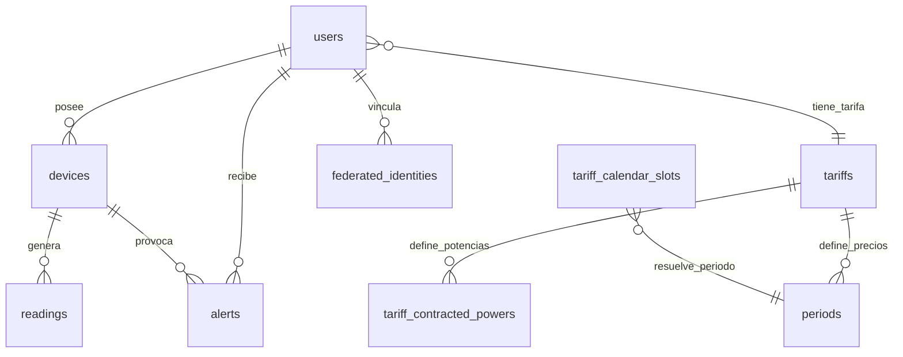
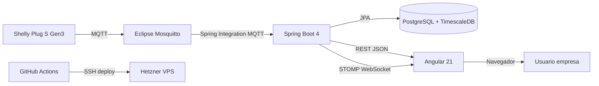

# Memoria tecnica del proyecto Wattimizer

## Indice detallado

1. [Introduccion y justificacion](#1-introduccion-y-justificacion)
2. [Fase 1: Analisis funcional](#2-fase-1-analisis-funcional)
3. [Fase 2: Diseno tecnico](#3-fase-2-diseno-tecnico)
4. [Fase 3: Implementacion y desarrollo](#4-fase-3-implementacion-y-desarrollo)
5. [Fase 4: Pruebas y despliegue](#5-fase-4-pruebas-y-despliegue)
6. [Conclusiones y lineas futuras](#6-conclusiones-y-lineas-futuras)
7. [Bibliografia y recursos](#7-bibliografia-y-recursos)
8. [Anexos tecnicos](#8-anexos-tecnicos)

## 1. Introduccion y justificacion

### 1.1. Titulo del proyecto

**Wattimizer**: plataforma web B2B para monitorizar consumo electrico, estimar coste real en euros y detectar incidencias energeticas mediante telemetria IoT.

### 1.2. Descripcion del problema

Muchas pequenas y medianas empresas reciben la factura electrica como un dato cerrado, cuando el gasto ya se ha producido. Esto dificulta saber que equipo ha generado un pico de potencia, cuanto cuesta mantener dispositivos encendidos fuera de horario o si la potencia contratada encaja con el uso real.

Wattimizer nace para cubrir esa falta de visibilidad. La aplicacion recoge lecturas de enchufes inteligentes Shelly mediante MQTT, guarda la serie temporal en TimescaleDB y la transforma en informacion util: graficas en tiempo real, coste diario estimado, consumo fantasma y alertas cuando una lectura supera la potencia contratada para el periodo tarifario correspondiente.

La decision de usar una arquitectura web separada en backend y frontend responde a una necesidad practica: el backend concentra seguridad, persistencia, reglas tarifarias y telemetria; el frontend ofrece una experiencia clara para usuarios no tecnicos. El sistema tambien incorpora dispositivos simulados para poder demostrar el proyecto sin depender siempre de hardware fisico.

### 1.3. Objetivos

#### Objetivo general

Desarrollar una aplicacion web completa que permita a una empresa registrar dispositivos de medicion, visualizar su consumo electrico en tiempo real y convertir ese consumo en informacion economica comprensible.

#### Objetivos especificos

- Implementar autenticacion mediante email y contrasena, JWT y login social OAuth2 con Google/GitHub.
- Permitir a los usuarios registrar, reclamar, editar y eliminar dispositivos fisicos o simulados.
- Recibir telemetria MQTT de dispositivos Shelly y almacenarla como lecturas historicas.
- Mostrar en Angular una grafica reactiva de potencia activa con datos historicos recientes y actualizaciones por WebSocket.
- Gestionar tarifas electricas con periodos de energia y potencia contratada segun peajes `2.0TD`, `3.0TD`, `6.1TD` y `6.2TD`.
- Calcular coste energetico y consumo fantasma a partir de lecturas reales almacenadas.
- Generar alertas de maximetro cuando una lectura supera la potencia contratada aplicable.
- Preparar el proyecto para despliegue en un VPS Hetzner mediante Docker Compose, Nginx, Mosquitto y GitHub Actions.

### 1.4. Tipos de usuarios

| Tipo de usuario | Uso previsto | Permisos principales |
|---|---|---|
| Usuario empresa (`ROLE_USER`) | Empresa que monitoriza sus equipos | Gestiona sus dispositivos, consulta dashboard, configura su tarifa privada y revisa alertas. |
| Administrador (`ROLE_ADMIN`) | Responsable tecnico o gestor del sistema | Puede mantener el catalogo maestro de tarifas y tambien usar las funciones de usuario. |
| Dispositivo IoT | Enchufe Shelly o simulador interno | Envia telemetria MQTT o genera lecturas sinteticas; no accede a la API REST. |

## 2. Fase 1: Analisis funcional

### 2.1. Mapa de funcionalidades

| Modulo | Funcionalidades |
|---|---|
| Autenticacion | Registro, login con JWT, login social OAuth2, intercambio de ticket OAuth2 por JWT, cierre de sesion en cliente. |
| Dispositivos | Listado por usuario, alta o vinculacion de dispositivo fisico, creacion de simuladores, pack demo, edicion de nombre/estado/perfil, baja con limpieza de lecturas y alertas. |
| Telemetria | Recepcion MQTT, conversion de payload Shelly a entidad `Reading`, historico reciente, emision WebSocket por dispositivo, simulacion programada. |
| Tarifas | Catalogo maestro, tarifa privada de usuario, periodos `P1-P6`, potencias contratadas, validacion regulatoria basica. |
| Analitica | Coste por intervalo, consumo fantasma nocturno, resolucion de periodo por calendario tarifario. |
| Alertas | Deteccion de exceso de potencia contratada, persistencia de alerta, consulta y descarte por usuario. |
| Despliegue | Docker Compose, TimescaleDB, Mosquitto, Nginx, certificados Let's Encrypt y despliegue continuo con GitHub Actions. |

### 2.2. Historias de usuario

| ID | Historia | Criterios de aceptacion | Prioridad |
|---|---|---|---|
| HU-01 | Como usuario, quiero registrarme con mi email para acceder a la plataforma. | El backend valida email, contrasena y confirmacion; si el email ya existe devuelve error controlado. | MVP |
| HU-02 | Como usuario, quiero iniciar sesion para proteger mis datos energeticos. | El login devuelve un JWT con `username` y `authorities`; Angular lo guarda en `sessionStorage`. | MVP |
| HU-03 | Como usuario, quiero entrar con Google o GitHub para no crear otra contrasena. | OAuth2 crea o vincula un usuario local y devuelve un ticket temporal que Angular intercambia por JWT. | Opcional |
| HU-04 | Como usuario, quiero registrar un enchufe fisico para asociarlo a mi cuenta. | El formulario exige nombre y MAC de 12 caracteres hexadecimales; el backend impide reclamar dispositivos de otra empresa. | MVP |
| HU-05 | Como usuario, quiero crear dispositivos simulados para probar la aplicacion sin hardware. | El usuario elige un perfil; el sistema genera una MAC `SIM...` unica y empieza a publicar lecturas. | MVP |
| HU-06 | Como usuario, quiero ver el consumo en tiempo real. | El dashboard carga las ultimas lecturas y se suscribe a `/topic/readings/{mac}` para actualizar la grafica. | MVP |
| HU-07 | Como usuario, quiero configurar mi tarifa para calcular costes reales. | Puede clonar una plantilla del catalogo o guardar un contrato privado con precios y potencias. | MVP |
| HU-08 | Como usuario, quiero ver el coste del consumo del dia. | El dashboard llama a `/api/v1/analytics/cost` con MAC e intervalo y muestra `totalCostEur`. | MVP |
| HU-09 | Como usuario, quiero detectar consumo fantasma nocturno. | El backend calcula coste entre lecturas dentro de la ventana local 00:00-05:59. | MVP |
| HU-10 | Como usuario, quiero recibir alertas si supero la potencia contratada. | Tras guardar una lectura, el backend resuelve el periodo tarifario y crea una alerta `OVERPOWER` si procede. | MVP |
| HU-11 | Como administrador, quiero mantener el catalogo de tarifas. | Solo `ROLE_ADMIN` puede crear, modificar o borrar plantillas del catalogo. | MVP |
| HU-12 | Como desarrollador, quiero desplegar el sistema de forma reproducible. | La rama `main` valida frontend/backend y despliega por SSH al VPS con Docker Compose. | MVP |

### 2.3. Gestion del trabajo

- **Repositorio:** <https://github.com/joellmar/wattpath-app>
- **Flujo Git observado:** desarrollo sobre ramas de funcionalidad y rama `main` como base desplegable.
- **Kanban utilizado:** columnas `Backlog`, `Por hacer`, `En progreso`, `En revision` y `Hecho`. La evidencia visual del tablero debe adjuntarse en la memoria final entregada al centro, ya que no forma parte del codigo fuente.

### 2.4. Planificacion inicial

| Fase | Historias principales | Dificultad estimada | Resultado |
|---|---|---|---|
| Fase 1 | HU-01, HU-02 | Media | Autenticacion local con JWT. |
| Fase 2 | HU-04, HU-06 | Alta | Registro de dispositivos y dashboard inicial. |
| Fase 3 | HU-07, HU-08, HU-09 | Alta | Modelo tarifario, calendario regulatorio y calculo de costes. |
| Fase 4 | HU-05, HU-10 | Media-alta | Simuladores y alertas de maximetro. |
| Fase 5 | HU-03, HU-12 | Alta | OAuth2 y despliegue productivo automatizado. |

## 3. Fase 2: Diseno tecnico

### 3.1. Diseno de la base de datos

El modelo combina tablas relacionales clasicas con una hypertable de TimescaleDB para lecturas de telemetria. La tabla mas importante desde el punto de vista temporal es `readings`, identificada por `(device_id, time)` y convertida en hypertable por la columna `time`.



Resumen de tablas:

| Tabla | Clave principal | Relaciones destacadas |
|---|---|---|
| `users` | `id` | FK opcional `tariff_id` hacia `tariffs`; `username` unico. |
| `federated_identities` | `id` | FK `user_id`; par unico `(provider, provider_subject)`. |
| `devices` | `id` | FK opcional `user_id`; `mac_address` unico. |
| `readings` | `(device_id, time)` | FK `device_id`; hypertable por `time`. |
| `alerts` | `id` | FK `user_id` y `device_id`. |
| `tariffs` | `id` | Datos generales del contrato o plantilla. |
| `periods` | `id` | Unico `(tariff_id, period_code)`; precio en euros/kWh. |
| `tariff_contracted_powers` | `id` | Unico `(tariff_id, period_code)`; potencia en kW. |
| `tariff_calendar_slots` | `id` | Dimension regulatoria zona + mes + tipo de dia + hora. |

Los detalles de TimescaleDB y las consultas analiticas estan en [Anexo D](./anexo-d-timescaledb-analitica.md).

### 3.2. Arquitectura del sistema



- **Backend:** Java 26 con Spring Boot 4.0.5, Spring Security, Spring Data JPA, Spring Integration MQTT, WebSocket STOMP, MapStruct y JWT.
- **Frontend:** Angular 21 con componentes standalone, formularios reactivos, NgRx Signals, RxJS, PrimeNG y Chart.js.
- **Base de datos:** PostgreSQL 17 con TimescaleDB para optimizar series temporales.
- **Mensajeria IoT:** Mosquitto recibe MQTT y Spring Integration enruta los mensajes por topic.
- **Comunicacion:** Angular consume la API REST bajo `/api/v1` y escucha lecturas por `/ws-iot` mediante STOMP.

### 3.3. Diseno de interfaz

Las pantallas principales implementadas son:

| Pantalla | Ruta Angular | Proposito |
|---|---|---|
| Login | `/login` | Entrada con email/contrasena y OAuth2. |
| Registro | `/register` | Alta de usuario con validacion de email y confirmacion de contrasena. |
| Dashboard | `/dashboard` | Grafica de potencia, selector de dispositivo y widgets de coste. |
| Dispositivos | `/devices` | Alta fisica/simulada, pack demo, edicion, encendido logico y baja. |
| Tarifas | `/tariffs` | Catalogo, tarifa privada, periodos y potencias contratadas. |
| Alertas | `/alerts` | Listado y descarte de incidencias de maximetro. |

### 3.4. Relacion entre historias y diseno

| Historia | Tablas principales | Codigo responsable |
|---|---|---|
| HU-01, HU-02 | `users` | `AuthController`, `AuthRegistrationService`, `JwtTokenService`, `LoginComponent`, `RegisterComponent`. |
| HU-03 | `users`, `federated_identities` | `OAuth2AuthenticationSuccessHandler`, `OAuth2LoginTicketService`, `OAuthCallbackComponent`. |
| HU-04, HU-05 | `devices`, `readings` | `DeviceController`, `DeviceService`, `DevicesComponent`, `TelemetryStore`. |
| HU-06 | `readings` | `ReadingController`, `TelemetryBroadcaster`, `WebsocketService`, `DashboardComponent`. |
| HU-07, HU-11 | `tariffs`, `periods`, `tariff_contracted_powers` | `TariffController`, `UserTariffController`, `TariffService`, `UserTariffService`, `TariffComponent`, `TariffStore`. |
| HU-08, HU-09 | `readings`, `tariff_calendar_slots`, `periods` | `ConsumptionController`, `ConsumptionService`, `CalendarResolverService`, `DashboardComponent`. |
| HU-10 | `alerts`, `readings`, `tariff_contracted_powers` | `AlertService`, `AlertController`, `AlertsComponent`. |

## 4. Fase 3: Implementacion y desarrollo

### 4.1. Tecnologias utilizadas

| Capa | Tecnologia | Version/configuracion observada |
|---|---|---|
| Backend | Java | 26 |
| Backend | Spring Boot | 4.0.5 |
| Persistencia | Spring Data JPA + PostgreSQL | Driver PostgreSQL runtime |
| Series temporales | TimescaleDB | Imagen `timescale/timescaledb-ha:pg17` |
| MQTT | Spring Integration MQTT + Eclipse Paho | Paho 1.2.5 |
| Frontend | Angular | 21.x |
| Estado frontend | NgRx Signals | 21.1.0 |
| UI | PrimeNG | 21.1.7 |
| Graficas | Chart.js | 4.5.1 |
| Contenedores | Docker Compose | Servicios `timescaledb`, `mosquitto`, `backend`, `frontend`, `nginx` |
| CI/CD | GitHub Actions | Build frontend, package backend y deploy SSH a Hetzner |

### 4.2. Desarrollo del backend

El backend se organiza por controladores REST, servicios de negocio, repositorios JPA, entidades y mappers MapStruct. La capa REST no trabaja directamente con entidades salvo en casos internos; expone DTOs como `DeviceDto`, `ReadingResponse`, `TariffDto`, `AlertDto` y `LoginUserJwt`.

Puntos relevantes:

- La autenticacion es stateless: el token JWT viaja en `Authorization: Bearer ...`.
- La autorizacion de recursos de usuario se resuelve desde `Principal`, no desde IDs enviados por el cliente.
- Las tarifas privadas se clonan desde plantillas para no modificar el catalogo global.
- Las lecturas MQTT y simuladas pasan por la misma persistencia, broadcaster y detector de alertas.
- Los errores de negocio se centralizan en `GlobalExceptionHandler` con DTO `ErrorResponse`.

El detalle de endpoints y DTOs esta en [Anexo A](./anexo-a-backend-rest.md).

### 4.3. Desarrollo del frontend

Angular usa componentes standalone y carga diferida por rutas. La gestion de sesion se concentra en `SessionStorageService` y el interceptor HTTP anade el JWT a las peticiones `/api/v1` no publicas.

El estado reactivo se apoya en NgRx Signals:

- `TelemetryStore` mantiene dispositivos, MAC seleccionada, historial por dispositivo y conexion WebSocket.
- `TariffStore` mantiene catalogo, tarifa privada, flags de carga y errores.

El detalle de componentes, servicios, RxJS y NgRx esta en [Anexo B](./anexo-b-frontend-angular.md).

### 4.4. Control de versiones

El historial reciente de `main` muestra commits de despliegue, simuladores y configuracion productiva. El flujo seguido es:

- ramas de funcionalidad o correccion para cambios concretos;
- integracion en `main`;
- validacion automatica del frontend y backend;
- despliegue al VPS solo tras pasar las validaciones.

## 5. Fase 4: Pruebas y despliegue

### 5.1. Plan de pruebas

| Prueba | Validacion |
|---|---|
| Registro con email duplicado | Devuelve error de negocio y no crea usuario repetido. |
| Login con credenciales correctas | Devuelve JWT y Angular navega al dashboard. |
| Login con token caducado | El interceptor limpia sesion y redirige a `/login`. |
| Alta de dispositivo fisico | MAC valida, asociacion al usuario y aparicion en listado. |
| Alta de simulador | Genera MAC `SIM...`, perfil asignado y lecturas periodicas. |
| Dashboard con dispositivo | Carga historico reciente y actualiza grafica por STOMP. |
| Tarifa `2.0TD` incompleta | Backend rechaza si faltan periodos obligatorios. |
| Tarifa `3.0TD` con potencias desordenadas | Backend rechaza si no cumple `P1 <= P2 <= ... <= P6`. |
| Calculo de coste | Suma deltas positivos de kWh por precio del periodo aplicable. |
| Consumo fantasma | Solo cuenta lecturas entre 00:00 y 05:59 hora local. |
| Alerta de maximetro | Crea alerta si `powerW/1000` supera potencia contratada del periodo. |
| Borrado de dispositivo | Elimina primero lecturas y alertas asociadas para evitar conflictos FK. |

Pruebas automatizadas detectadas:

- Backend: tests unitarios de servicios de tarifas, consumo, dispositivos y simulacion.
- Frontend: specs de componentes principales, `TariffService` y `SessionStorageService`.
- CI: build Angular de produccion y empaquetado Maven con `-DskipTests` para despliegue.

### 5.2. Manual de instalacion, usuario y administrador

#### Instalacion local

```bash
# Base de datos y broker MQTT mediante Docker, si se desea levantar todo junto.
docker compose up -d timescaledb mosquitto

# Backend
cd backend
./mvnw spring-boot:run

# Frontend
cd ../frontend
npm install
npm start
```

En local, Angular usa `frontend/proxy.conf.json` para redirigir `/api`, `/oauth2` y `/ws-iot` al backend en `localhost:8080`.

Scripts SQL relevantes:

```bash
backend/src/main/resources/db/dev-seed/00-extensions.sql
backend/src/main/resources/db/dev-seed/01-hypertable.sql
backend/src/main/resources/db/dev-seed/03-seed-users-dev.sql
backend/src/main/resources/db/dev-seed/04-seed-device-shelly.sql
backend/src/main/resources/db/dev-seed/05-seed-device-simulation.sql
backend/src/main/resources/db/tariffs-td-schema.sql
backend/src/main/resources/db/seed-tariff-calendar-slots.sql
```

#### Uso basico

1. Registrarse o iniciar sesion.
2. Configurar una tarifa desde `/tariffs`.
3. Vincular un dispositivo fisico o crear un simulador en `/devices`.
4. Consultar el dashboard para ver potencia, coste y consumo fantasma.
5. Revisar `/alerts` si se generan incidencias de maximetro.

#### Administracion

- Crear un administrador mediante `POST /api/v1/auth/register/admin` con cabecera `X-Wattimizer-Admin-Secret`.
- Mantener el catalogo de tarifas desde la pantalla `/tariffs` con rol `ROLE_ADMIN`.
- Controlar la telemetria simulada con `SIMULATION_ENABLED` y `SIMULATION_INTERVAL_MS`.

### 5.3. Despliegue

El despliegue productivo esta preparado para un VPS Hetzner:

- Nginx expone `80` y `443`.
- Backend y TimescaleDB no se exponen directamente al exterior.
- Mosquitto expone `1883` para el Shelly fisico.
- Certbot gestiona certificados Let's Encrypt en el host.
- GitHub Actions reconstruye contenedores y reinicia Nginx tras `docker compose up -d --build` para evitar 502 por cache de DNS interno.

La guia completa esta en [`docs/deployment/hetzner-production.md`](../deployment/hetzner-production.md).

## 6. Conclusiones y lineas futuras

### 6.1. Grado de cumplimiento

El MVP queda cubierto en sus partes principales: autenticacion, gestion de dispositivos, telemetria, dashboard, tarifas, calculo de costes, alertas y despliegue. Ademas, los simuladores permiten demostrar el sistema aunque no haya un Shelly fisico disponible en ese momento.

### 6.2. Dificultades

- **Telemetria asincroma:** se resolvio separando topics MQTT en canales de Spring Integration y normalizando ambos formatos a `Reading`.
- **Series temporales:** se eligio TimescaleDB para que `readings` pueda crecer sin tratarse como una tabla convencional.
- **Tarifas electricas:** se saco la logica horaria a `tariff_calendar_slots` para no mezclar precios contractuales con calendario regulatorio.
- **Edicion de tarifas:** el servicio fuerza `flush()` al reconstruir periodos para evitar conflictos con la restriccion unica `(tariff_id, period_code)`.
- **Demostracion sin hardware:** se anadieron perfiles simulados y un job programado que usa la misma ruta funcional que la telemetria real.

### 6.3. Mejoras futuras

- Incorporar MQTT sobre TLS (`8883`) o VPN para evitar trafico en texto plano.
- Anadir festivos nacionales/autonomicos reales al calendario tarifario.
- Crear agregaciones continuas de TimescaleDB para consultar dias, semanas y meses con menos coste.
- Incorporar predicciones de factura y recomendaciones automaticas de potencia contratada.
- Crear una aplicacion movil o PWA con notificaciones push de alertas.
- Mejorar observabilidad con metricas, logs estructurados y paneles de salud.

## 7. Bibliografia y recursos

- Documentacion oficial de Spring Boot 4.
- Documentacion oficial de Spring Security.
- Documentacion de Spring Integration MQTT.
- Documentacion de Eclipse Paho MQTT.
- Documentacion de Angular 21.
- Documentacion de NgRx Signals.
- Documentacion de RxJS.
- Documentacion de TimescaleDB.
- Circular CNMC 3/2020 sobre peajes de transporte y distribucion.
- Documentacion de Docker Compose, Nginx, Mosquitto y GitHub Actions.

## 8. Anexos tecnicos

- [Anexo A - Backend REST Spring Boot](./anexo-a-backend-rest.md)
- [Anexo B - Frontend Angular, RxJS y NgRx](./anexo-b-frontend-angular.md)
- [Anexo C - Telemetria MQTT con Spring Integration](./anexo-c-telemetria-mqtt.md)
- [Anexo D - TimescaleDB y consultas analiticas](./anexo-d-timescaledb-analitica.md)
- [Canvas documental de arquitectura](../../docs-canvas/arquitectura-wattimizer.md)
