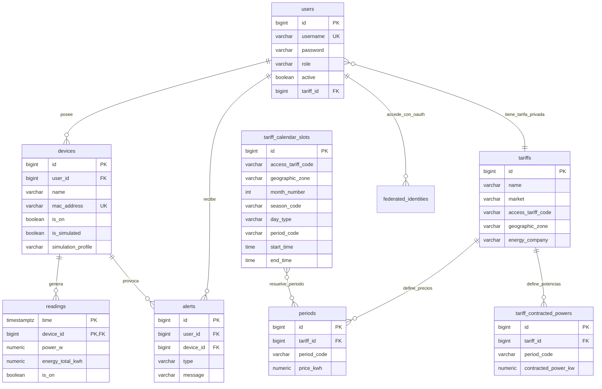
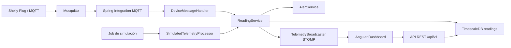

# Memoria técnica del proyecto DAW: Wattimizer

## Índice detallado

1. [Introducción y justificación](#1-introduccion-y-justificacion)
2. [Fase 1: Análisis funcional](#2-fase-1-analisis-funcional)
3. [Fase 2: Diseño técnico](#3-fase-2-diseno-tecnico)
4. [Fase 3: Implementación y desarrollo](#4-fase-3-implementacion-y-desarrollo)
5. [Fase 4: Pruebas y despliegue](#5-fase-4-pruebas-y-despliegue)
6. [Conclusiones y líneas futuras](#6-conclusiones-y-lineas-futuras)
7. [Bibliografía y recursos](#7-bibliografia-y-recursos)
8. [Anexos técnicos](#8-anexos-tecnicos)

---

## 1. Introducción y justificación

### 1.1. Título del proyecto

**Wattimizer**: plataforma web de inteligencia financiera energética para controlar consumos eléctricos, convertirlos en coste económico y detectar incidencias de potencia en tiempo casi real.

### 1.2. Descripción del problema

Muchas pymes tienen acceso a facturas eléctricas, pero no siempre entienden qué ocurre durante el mes. La factura llega tarde, agrupa muchos datos y no permite ver de forma sencilla qué equipo consume demasiado, cuándo se producen picos de potencia o cuánto dinero se está perdiendo durante las horas de inactividad.

Wattimizer nace para cubrir esa necesidad desde una aplicación web. El sistema recoge telemetría de enchufes inteligentes Shelly mediante MQTT, guarda las lecturas como serie temporal en TimescaleDB y las muestra en un panel Angular. Además, cruza esas lecturas con tarifas eléctricas por periodos, de forma que el usuario no ve solo vatios o kWh, sino también una estimación económica en euros.

Durante el desarrollo también se ha añadido un modo de demostración con dispositivos simulados. Esta decisión permite probar el dashboard, las alertas y la analítica sin depender siempre de hardware físico, algo útil para una defensa del proyecto y para entornos de despliegue donde no haya un Shelly conectado.

### 1.3. Objetivos

#### Objetivo general

Desarrollar una aplicación web full-stack que permita registrar dispositivos IoT, recibir telemetría eléctrica, visualizar consumo en tiempo real y estimar el coste económico aplicando tarifas eléctricas españolas.

#### Objetivos específicos

- Implementar una API REST con Spring Boot para autenticación, dispositivos, lecturas, alertas, tarifas y analítica.
- Proteger la API mediante JWT, roles y comprobaciones de propietario sobre dispositivos, lecturas y alertas.
- Ingerir mensajes MQTT de dispositivos Shelly con Spring Integration y persistirlos como lecturas temporales.
- Utilizar TimescaleDB para almacenar la tabla `readings` como hypertable optimizada para series temporales.
- Calcular coste energético y consumo fantasma a partir de lecturas acumuladas y periodos tarifarios.
- Construir un frontend Angular con rutas protegidas, formularios reactivos, stores con NgRx Signals y flujos RxJS.
- Publicar lecturas en vivo al navegador mediante WebSocket STOMP.
- Añadir dispositivos simulados con perfiles de consumo para facilitar pruebas, demostraciones y despliegues sin hardware.
- Preparar documentación técnica suficiente para que el proyecto pueda mantenerse y evaluarse como memoria final de DAW.

### 1.4. Tipos de usuarios

| Tipo de usuario | Descripción | Capacidades principales |
| --- | --- | --- |
| Usuario empresa | Cuenta normal que monitoriza sus propios equipos eléctricos. | Registrar o reclamar dispositivos, crear simuladores, consultar dashboard, configurar su tarifa privada, revisar alertas. |
| Administrador | Usuario con rol `ROLE_ADMIN`. | Mantener el catálogo global de tarifas y usar las mismas funciones de usuario autenticado. |
| Sistema / seed | Usuario técnico usado para datos precargados. | Mantener dispositivos presembrados que después pueden ser reclamados por usuarios reales. |

---

## 2. Fase 1: Análisis funcional

### 2.1. Mapa de funcionalidades

| Módulo | Funcionalidades implementadas |
| --- | --- |
| Autenticación | Login con JWT, registro normal, registro de administrador mediante secreto, OAuth2 con Google/GitHub mediante ticket temporal. |
| Dispositivos | Listado por usuario, consulta de detalle, reclamación por MAC, edición de nombre/estado/perfil, eliminación segura, alta de simuladores y pack demo. |
| Telemetría | Ingesta MQTT de Shelly, persistencia de lecturas, consulta de última lectura, consulta por intervalo reciente, publicación WebSocket al dashboard. |
| Dashboard | Selector de medidor activo, gráfica de potencia, precarga de histórico reciente, coste diario, consumo fantasma y aviso cuando falta tarifa. |
| Tarifas | Catálogo global, tarifa privada por usuario, precios por periodos P1-P6, potencias contratadas y calendario regulatorio por zona. |
| Alertas | Generación automática por exceso de potencia contratada, listado por usuario y descarte individual. |
| Simulación | Perfiles de consumo virtual, job programado, odómetro acumulado, pack de demostración y soporte multi-dispositivo en la interfaz. |
| Despliegue | Contenedores Docker para TimescaleDB, Mosquitto, backend, frontend y Nginx como proxy inverso. |

### 2.2. Historias de usuario

| ID | Historia | Criterios de aceptación | Prioridad |
| --- | --- | --- | --- |
| HU-01 | Como usuario, quiero registrarme e iniciar sesión para acceder a mi panel privado. | El registro valida email y contraseña; el login devuelve JWT; las rutas internas requieren sesión. | Imprescindible |
| HU-02 | Como usuario, quiero vincular un enchufe por MAC para monitorizar un equipo real. | La MAC debe tener 12 caracteres hexadecimales; el backend asocia el dispositivo al `Principal`; un equipo de otra cuenta no se puede reclamar. | Imprescindible |
| HU-03 | Como usuario, quiero ver lecturas de potencia en tiempo real para detectar consumo instantáneo. | El dashboard se suscribe a `/topic/readings/{mac}` y actualiza la gráfica al recibir nuevos mensajes. | Imprescindible |
| HU-04 | Como usuario, quiero consultar el histórico reciente al cambiar de medidor para no ver una gráfica vacía. | Al seleccionar una MAC se llama a `/api/v1/readings/device/{mac}/recent?seconds=120` y se cargan las últimas 20 muestras. | Imprescindible |
| HU-05 | Como usuario, quiero configurar mi tarifa para calcular el coste energético real. | Se puede clonar una tarifa del catálogo y guardarla como tarifa privada en `/api/v1/users/me/tariff`. | Imprescindible |
| HU-06 | Como usuario, quiero ver cuánto dinero llevo consumido durante el día. | El dashboard llama a `/api/v1/analytics/cost` con inicio del día y momento actual; si no hay tarifa, muestra aviso. | Imprescindible |
| HU-07 | Como usuario, quiero detectar consumo fantasma durante la madrugada. | El backend calcula coste entre las 00:00 y las 05:59 en la zona local de la tarifa. | Opcional |
| HU-08 | Como usuario, quiero recibir alertas si supero la potencia contratada. | Cada lectura se compara con el periodo aplicable; si supera el límite se guarda una alerta `OVERPOWER`. | Imprescindible |
| HU-09 | Como administrador, quiero mantener el catálogo de tarifas para que los usuarios tengan plantillas base. | Solo `ROLE_ADMIN` puede crear, editar o borrar tarifas globales. | Imprescindible |
| HU-10 | Como usuario, quiero borrar un dispositivo y sus datos asociados para mantener limpia mi cuenta. | La eliminación comprueba propietario y borra lecturas y alertas relacionadas antes de borrar el dispositivo. | Opcional |
| HU-11 | Como usuario, quiero crear simuladores para probar la aplicación sin hardware real. | Se puede crear un simulador con perfil de consumo o generar un pack demo con perfiles no repetidos. | Imprescindible para demo |
| HU-12 | Como usuario, quiero alternar entre varios medidores desde el dashboard. | El estado global mantiene `selectedMac` y un histórico independiente por MAC. | Imprescindible |

### 2.3. Gestión del trabajo

- **Repositorio GitHub:** `https://github.com/joellmar/wattpath-app`
- **Rama de documentación actual:** `cursor/documentaci-n-t-cnica-del-proyecto-01c7`
- **Flujo usado:** ramas de trabajo por funcionalidad o corrección, commits descriptivos y despliegue automatizado mediante GitHub Actions.

El tablero Kanban del proyecto se debe adjuntar como captura en la memoria final del centro educativo. La organización recomendada de columnas es:

| Columna | Uso |
| --- | --- |
| Backlog | Historias pendientes o mejoras futuras. |
| Por hacer | Historias seleccionadas para el sprint o fase actual. |
| En progreso | Trabajo activo de backend, frontend, base de datos o despliegue. |
| En revisión | Pull requests, pruebas o revisión funcional. |
| Hecho | Historias integradas y verificadas. |

### 2.4. Planificación inicial

| Fase | Historias asociadas | Dificultad estimada | Resultado esperado |
| --- | --- | --- | --- |
| Fase 1 | HU-01, HU-02 | Media | Autenticación y registro básico de dispositivos. |
| Fase 2 | HU-03, HU-04 | Alta | Telemetría en vivo con persistencia temporal. |
| Fase 3 | HU-05, HU-06, HU-07 | Alta | Modelo tarifario y cálculos económicos. |
| Fase 4 | HU-08, HU-10 | Media | Alertas y mantenimiento de datos. |
| Fase 5 | HU-09 | Media | Administración de catálogo global. |
| Fase 6 | HU-11, HU-12 | Media | Simuladores, pack demo y dashboard multi-dispositivo. |
| Fase 7 | Todas | Alta | Despliegue Docker y documentación final. |

---

## 3. Fase 2: Diseño técnico

### 3.1. Diseño de la base de datos

#### Diagrama E/R simplificado



#### Modelo relacional

| Tabla | Clave principal | Relaciones y restricciones principales |
| --- | --- | --- |
| `users` | `id` | `username` único, rol `ROLE_USER` o `ROLE_ADMIN`, FK opcional a `tariffs`. |
| `federated_identities` | `id` | Vincula usuario local con proveedor OAuth. |
| `devices` | `id` | FK opcional a `users`, `mac_address` único, flags `is_on`, `is_simulated` y perfil de simulación. |
| `readings` | `(time, device_id)` | FK obligatoria a `devices`; convertida a hypertable por `time`. |
| `alerts` | `id` | FK a `users` y `devices`; almacena incidencias de maxímetro. |
| `tariffs` | `id` | Plantillas globales o clones privados asociados a usuarios. |
| `periods` | `id` | Único por `(tariff_id, period_code)`; precio `price_kwh`. |
| `tariff_contracted_powers` | `id` | Único por `(tariff_id, period_code)`; potencia contratada por periodo. |
| `tariff_calendar_slots` | `id` | Tabla regulatoria global para resolver zona, mes, tipo de día y hora local. |

La tabla `readings` es la más sensible del sistema, porque crece con cada mensaje MQTT o tick de simulación. Por eso se convierte en hypertable de TimescaleDB con `create_hypertable('readings', 'time')`.

### 3.2. Arquitectura del sistema

| Capa | Tecnología | Responsabilidad |
| --- | --- | --- |
| Frontend | Angular 21, TypeScript, PrimeNG, Tailwind, NgRx Signals, RxJS | Vistas, formularios, navegación, stores reactivos y consumo de API/WebSocket. |
| Backend | Spring Boot 4.0.5, Java 26, Spring Security, Spring Data JPA, Spring Integration MQTT | API REST, seguridad, ingesta MQTT, reglas de negocio, persistencia y cálculo energético. |
| Base de datos | PostgreSQL + TimescaleDB | Datos relacionales y series temporales de lecturas. |
| Mensajería IoT | Eclipse Mosquitto + MQTT QoS 1 | Recepción de telemetría desde enchufes Shelly. |
| Tiempo real web | WebSocket STOMP | Envío de lecturas y alertas desde backend a Angular. |
| Despliegue | Docker Compose + Nginx | Orquestación de servicios y proxy inverso HTTPS. |

#### Flujo general de datos



### 3.3. Diseño de interfaz

La interfaz está construida con componentes standalone de Angular y PrimeNG. Las pantallas principales son:

| Pantalla | Objetivo | Elementos principales |
| --- | --- | --- |
| Login | Acceder con credenciales u OAuth2. | Formulario reactivo, botones Google/GitHub, mensajes de error. |
| Registro | Crear cuenta de usuario. | Email, contraseña, confirmación y validación de coincidencia. |
| Dashboard | Consultar consumo y coste. | Selector de medidor, gráfica de potencia, coste diario, consumo fantasma, aviso de tarifa. |
| Dispositivos | Gestionar equipos físicos y simulados. | Formulario físico/simulado, tabla, diálogo de detalle, edición y pack demo. |
| Tarifas | Configurar contrato energético. | Catálogo, tarifa privada, periodos, potencias contratadas y vista admin. |
| Alertas | Revisar incidencias de potencia. | Tabla de alertas y acción de descarte. |

### 3.4. Relación entre historias y diseño

| Historia | Tablas | Código principal |
| --- | --- | --- |
| HU-01 | `users`, `federated_identities` | `AuthController`, `AuthRegistrationService`, `JwtValidatorFilter`, componentes `login`, `register`, `oauth-callback`. |
| HU-02 | `devices` | `DeviceController`, `DeviceService.claimOrRegisterDevice`, `DevicesComponent`. |
| HU-03 | `readings` | `MqttConfig`, `DeviceMessageHandler`, `TelemetryBroadcaster`, `WebsocketService`, `TelemetryStore`. |
| HU-04 | `readings` | `ReadingController.getRecentReadingsByDevice`, `TelemetryStore.loadRecentReadings`. |
| HU-05 | `tariffs`, `periods`, `tariff_contracted_powers`, `users` | `UserTariffController`, `UserTariffService`, `TariffStore`, `TariffComponent`. |
| HU-06 | `readings`, `tariffs`, `periods`, `tariff_calendar_slots` | `ConsumptionController`, `ConsumptionService.calculateCostInPeriod`, `DashboardComponent`. |
| HU-07 | `readings`, `tariffs`, `tariff_calendar_slots` | `ConsumptionService.calculateGhostCost`, `DashboardComponent`. |
| HU-08 | `alerts`, `readings`, `devices` | `AlertService.checkPowerThreshold`, `AlertController`, `AlertsComponent`. |
| HU-09 | `tariffs`, `periods`, `tariff_contracted_powers` | `TariffController`, `TariffService`, `TariffComponent`. |
| HU-10 | `devices`, `readings`, `alerts` | `DeviceService.deleteById`, `DeviceController.deleteDevice`, `DevicesComponent.onDelete`. |
| HU-11 | `devices`, `readings` | `CreateSimulatedDeviceRequest`, `SimulationProfileRegistry`, `IotTelemetrySimulationJob`, `DevicesComponent.addDemoPack`. |
| HU-12 | `devices`, `readings` | `TelemetryStore.selectedMac`, `historicalReadings`, `DashboardComponent.onSelectedMacChange`. |

---

## 4. Fase 3: Implementación y desarrollo

### 4.1. Tecnologías utilizadas

| Área | Tecnología / versión observada | Uso |
| --- | --- | --- |
| Backend | Java 26 | Lenguaje principal del servidor. |
| Backend | Spring Boot 4.0.5 | Framework de aplicación, seguridad, MVC, JPA y WebSocket. |
| Backend | Spring Integration MQTT | Adaptador de entrada MQTT con canales internos. |
| Backend | MapStruct 1.6.3 | Conversión entre entidades y DTOs. |
| Backend | JJWT 0.12.5 | Generación y validación de tokens JWT. |
| Base de datos | TimescaleDB HA PG17 | PostgreSQL con extensión TimescaleDB. |
| Broker | Eclipse Mosquitto 2.1.2 | MQTT con autenticación por fichero de contraseñas. |
| Frontend | Angular 21 | SPA con componentes standalone. |
| Frontend | NgRx Signals 21.1 | Stores reactivos de telemetría y tarifas. |
| Frontend | RxJS 7.8 | Flujos HTTP, WebSocket y operadores reactivos. |
| Frontend | PrimeNG 21.1 | Componentes visuales: tablas, botones, selects, mensajes y gráficos. |
| Frontend | Chart.js 4.5 | Gráfica de consumo activo. |
| Frontend | Biome 2.4 | Lint y formato del frontend. |
| DevOps | Docker Compose, Nginx | Contenedores y proxy inverso. |

### 4.2. Desarrollo del backend

El backend se organiza alrededor de controladores REST versionados con `/api/v1`, servicios de negocio y repositorios JPA. La seguridad es stateless: el login emite un JWT y `JwtValidatorFilter` reconstruye la autenticación en cada petición.

La decisión más importante de arquitectura es separar las entradas de datos:

- **REST** para operaciones iniciadas por el usuario: dispositivos, tarifas, alertas, lecturas y analítica.
- **MQTT** para telemetría física de Shelly.
- **Job programado** para telemetría simulada.
- **WebSocket STOMP** para devolver lecturas en vivo al frontend.

Esto evita que el dashboard dependa de refrescos constantes por HTTP. HTTP se usa para cargar estado inicial e histórico reciente, y WebSocket se usa para mantener la gráfica viva.

La gestión de errores se centraliza en `GlobalExceptionHandler`, con respuestas estructuradas `ErrorResponse` para 404, 401, 403, 400, 409 y 500. En controladores concretos también se devuelven 403 vacíos cuando el recurso existe pero pertenece a otro usuario.

### 4.3. Desarrollo del frontend

Angular se ha construido con componentes standalone y rutas lazy. El `authGuard` protege el layout principal, y el interceptor HTTP añade el token JWT a las rutas `/api/v1` que no son públicas.

La lógica reactiva está concentrada en dos stores:

- `TelemetryStore`: lista dispositivos, mantiene la MAC seleccionada, guarda histórico por MAC y conecta la suscripción STOMP.
- `TariffStore`: carga catálogo, tarifa privada y estados de carga/error.

El dashboard combina ambos estados. Si hay tarifa, lanza peticiones analíticas; si no la hay, muestra un aviso y evita mostrar costes inventados. Esta decisión es importante porque el coste depende de una tarifa privada y de la resolución del periodo regulatorio.

### 4.4. Control de versiones

El repositorio usa Git con commits descriptivos. Los commits recientes muestran una evolución clara:

| Commit | Finalidad |
| --- | --- |
| `2db18a4` | Añade perfiles de simulación de consumo y CRUD de dispositivos simulados. |
| `eff9456` | Activa simuladores en demo y añade pack de demostración. |
| `d77851b` | Mejora borrado en cascada, telemetría por perfil y panel multi-dispositivo. |
| `ee032fd` | Ajusta despliegue para reiniciar Nginx tras `compose up` y evitar 502. |

La frecuencia de commits indica que se ha trabajado por incrementos pequeños: primero backend y simulación, después interfaz multi-dispositivo y finalmente ajustes de despliegue.

---

## 5. Fase 4: Pruebas y despliegue

### 5.1. Plan de pruebas

| Prueba | Acción | Resultado esperado |
| --- | --- | --- |
| Login correcto | Enviar credenciales válidas a `/api/v1/auth/login`. | Respuesta 200 con JWT. |
| Login incorrecto | Enviar contraseña errónea. | Respuesta 401 con mensaje de credenciales incorrectas. |
| Ruta protegida sin token | Llamar a `/api/v1/devices`. | La API rechaza la petición. |
| Reclamación de dispositivo | Registrar MAC física desde `/devices`. | Dispositivo asociado al usuario autenticado. |
| Creación de simulador | Crear simulador con nombre y perfil. | Dispositivo `SIM...` creado y visible en dashboard. |
| Pack demo | Pulsar acción de pack demo. | Se crean solo perfiles no existentes para el usuario. |
| Cambio de medidor | Seleccionar otra MAC en dashboard. | Se precarga histórico reciente y cambia la suscripción STOMP. |
| Coste diario sin tarifa | Entrar al dashboard sin tarifa privada. | Aparece aviso y no se muestran importes falsos. |
| Coste diario con tarifa | Configurar tarifa y consultar dashboard. | Se consultan `/analytics/cost` y `/ghost-consumption`. |
| Exceso de potencia | Generar lectura superior a la potencia contratada. | Se crea alerta `OVERPOWER`. |
| Borrado de dispositivo | Eliminar dispositivo propio. | Se borran lecturas y alertas asociadas antes del dispositivo. |
| Catálogo admin | Crear/editar/borrar tarifa con `ROLE_ADMIN`. | Operación permitida solo a administrador. |

Hay pruebas automatizadas en backend para servicios de dispositivos, tarifas, consumo y simulación, y en frontend para componentes y servicios principales.

### 5.2. Manual de instalación y uso

#### Requisitos

- Docker y Docker Compose.
- Node.js compatible con Angular 21.
- Java 26 para desarrollo backend local.
- Variables de entorno basadas en `.env.example`.

#### Levantar el entorno con Docker

```bash
cp .env.example .env
docker compose up --build
```

Servicios principales:

| Servicio | Puerto / acceso | Uso |
| --- | --- | --- |
| Nginx | 80/443 | Entrada pública de frontend, API y WebSocket. |
| Backend | Red interna Docker | API Spring Boot. |
| Frontend | Red interna Docker | Angular compilado servido por Nginx interno. |
| TimescaleDB | Red interna Docker | Persistencia. |
| Mosquitto | 1883 | Broker MQTT para Shelly físico. |

#### Backend local

```bash
cd backend
./mvnw spring-boot:run
```

#### Frontend local

```bash
cd frontend
npm install
npm start
```

El frontend usa `proxy.conf.json` para reenviar `/api`, `/oauth2` y `/ws-iot` al backend local en `:8080`.

#### Uso básico de la aplicación

1. Registrar una cuenta o iniciar sesión.
2. Configurar una tarifa privada desde la pantalla de tarifas.
3. Añadir un dispositivo físico por MAC o crear simuladores.
4. Entrar en el dashboard y seleccionar el medidor activo.
5. Revisar consumo, coste diario, consumo fantasma y alertas.

### 5.3. Despliegue

El despliegue está preparado con Docker Compose:

- `timescaledb`: almacén PostgreSQL/TimescaleDB sin puerto expuesto al host.
- `mosquitto`: broker MQTT con puerto 1883 para el Shelly físico.
- `backend`: aplicación Spring Boot con variables de entorno para base de datos, JWT, OAuth2, MQTT y simulación.
- `frontend`: Angular compilado.
- `nginx`: proxy inverso con puertos 80 y 443 y certificados gestionados por Certbot en el host.

La URL de producción indicada en configuración es `https://wattimizer.com`, incluida como origen CORS y callback OAuth2 por defecto.

---

## 6. Conclusiones y líneas futuras

### 6.1. Grado de cumplimiento

El MVP queda cubierto: hay autenticación, dispositivos, telemetría, visualización, tarifas, coste económico, alertas, simuladores y despliegue Docker. La aplicación no se limita a un CRUD, sino que integra datos asíncronos, cálculos de negocio y una interfaz reactiva.

### 6.2. Dificultades encontradas

| Dificultad | Solución aplicada |
| --- | --- |
| Probar sin hardware físico disponible en todo momento. | Incorporar simuladores con perfiles de consumo y pack demo. |
| Evitar mezclar lecturas al cambiar de medidor. | Guardar `historicalReadings` por MAC y cambiar la suscripción con `switchMap`. |
| Calcular coste con periodos regulados. | Separar precios contractuales (`periods`) de calendario regulatorio (`tariff_calendar_slots`). |
| Borrar dispositivos con lecturas y alertas. | Borrado manual de lecturas por MAC y alertas por device antes de eliminar el dispositivo. |
| Despliegue con varios servicios. | Docker Compose con red interna y Nginx como única puerta pública. |

### 6.3. Mejoras futuras

- Sustituir la suscripción MQTT hardcodeada por una gestión dinámica de topics.
- Añadir TLS al broker MQTT o mover el acceso físico a una VPN.
- Implementar agregados continuos de TimescaleDB para informes por hora, día y mes.
- Añadir políticas de retención y compresión para lecturas antiguas.
- Crear panel de administración para usuarios, roles y dispositivos huérfanos.
- Añadir notificaciones por correo o push cuando se genere una alerta crítica.
- Añadir app móvil o PWA para consulta rápida desde el móvil.
- Mejorar la validación backend de simuladores con un handler específico para `IllegalArgumentException`.

---

## 7. Bibliografía y recursos

- Documentación oficial de Spring Boot: `https://spring.io/projects/spring-boot`
- Documentación de Spring Security: `https://spring.io/projects/spring-security`
- Documentación de Spring Integration MQTT: `https://docs.spring.io/spring-integration/reference/mqtt.html`
- Documentación de Angular: `https://angular.dev`
- Documentación de NgRx Signals: `https://ngrx.io/guide/signals`
- Documentación de RxJS: `https://rxjs.dev`
- Documentación de PrimeNG: `https://primeng.org`
- Documentación de TimescaleDB: `https://docs.timescale.com`
- Documentación de Eclipse Mosquitto: `https://mosquitto.org/documentation`
- Circular CNMC 3/2020 usada como referencia para periodos tarifarios españoles.

---

## 8. Anexos técnicos

- [Anexo A. Backend REST Spring Boot](./anexo-a-backend-rest.md)
- [Anexo B. Frontend Angular, RxJS y NgRx Signals](./anexo-b-frontend-angular.md)
- [Anexo C. Ingesta asíncrona MQTT y simulación de telemetría](./anexo-c-telemetria-mqtt.md)
- [Anexo D. TimescaleDB y analítica sobre hypertables](./anexo-d-timescaledb-analitica.md)
- [Canvas documental de arquitectura](../../docs-canvas/arquitectura-wattimizer.md)
