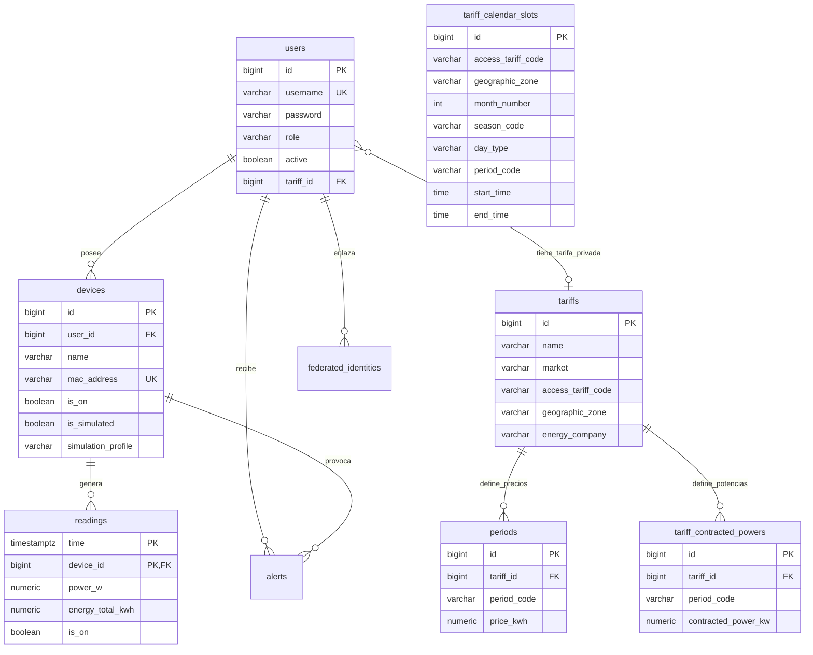
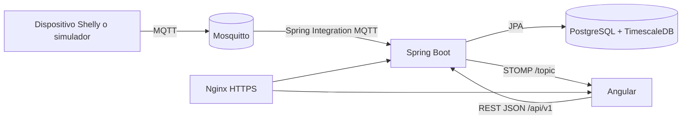

# Memoria final del proyecto DAW: Wattimizer

## 1. Introduccion y justificacion

### 1.1. Titulo del proyecto

**Wattimizer**: plataforma web B2B para monitorizacion IoT y analisis economico del consumo electrico.

### 1.2. Descripcion del problema

Muchas pequenas empresas conocen el importe final de la factura electrica, pero no tienen una lectura clara de que equipos consumen mas, en que momentos se producen los picos de potencia y cuanto dinero se pierde por consumos fantasma fuera del horario productivo. Esta falta de visibilidad dificulta tomar decisiones sencillas, como apagar equipos en reposo, ajustar la potencia contratada o comparar tarifas.

Wattimizer aborda ese problema conectando dispositivos IoT de medida electrica, guardando sus lecturas como serie temporal y traduciendo los kWh acumulados a euros mediante tarifas electricas TD. La aplicacion no se queda en mostrar una grafica tecnica: intenta convertir la telemetria en informacion util para una pyme.

### 1.3. Objetivos

**Objetivo general**

Desarrollar una aplicacion web full-stack que permita registrar dispositivos electricos, recibir lecturas IoT en tiempo real, calcular costes aproximados y avisar cuando se superen umbrales de potencia contratada.

**Objetivos especificos**

- Implementar autenticacion con JWT y OAuth2 para proteger las rutas de usuario.
- Gestionar dispositivos fisicos Shelly y dispositivos simulados desde la interfaz.
- Ingerir telemetria MQTT de forma asincrona mediante Spring Integration.
- Persistir lecturas electricas en PostgreSQL con TimescaleDB para trabajar con datos temporales.
- Permitir la configuracion de tarifas TD con periodos de energia y potencia.
- Calcular coste diario y consumo fantasma a partir de lecturas historicas.
- Emitir lecturas y alertas en tiempo real al frontend mediante WebSocket/STOMP.
- Construir una interfaz Angular reactiva basada en Signals, RxJS y NgRx Signals.

### 1.4. Tipos de usuarios

| Tipo de usuario | Descripcion | Permisos principales |
| --- | --- | --- |
| Usuario empresa | Persona responsable de consultar el consumo de su organizacion. | Ver dashboard, vincular dispositivos, crear simuladores, configurar su tarifa privada y consultar alertas. |
| Administrador | Usuario con rol `ROLE_ADMIN`. | Mantiene el catalogo maestro de tarifas y puede crear cuentas administrativas mediante secreto de alta. |
| Sistema IoT | Dispositivos Shelly o simuladores internos. | Envia telemetria que el backend transforma en lecturas y alertas. |

## 2. Fase 1: Analisis funcional

### 2.1. Mapa de funcionalidades

| Modulo | Funcionalidades |
| --- | --- |
| Autenticacion | Registro, login con JWT, intercambio de ticket OAuth2 y proteccion de rutas Angular. |
| Dispositivos | Listado, vinculacion por MAC, alta de simuladores, pack demo, edicion, apagado/encendido logico y eliminacion segura. |
| Telemetria | Recepcion MQTT, normalizacion de mensajes, guardado de lecturas, emision WebSocket y carga de historial reciente. |
| Tarifas | Catalogo maestro, tarifa privada del usuario, precios por periodo, potencias contratadas y validacion regulatoria. |
| Analitica | Calculo de coste por periodo temporal y coste de consumo fantasma nocturno. |
| Alertas | Generacion de alertas de maximetro y gestion de incidencias por usuario. |
| Despliegue | Contenedores Docker para frontend, backend, TimescaleDB, Mosquitto y Nginx. |

### 2.2. Historias de usuario

| ID | Historia | Criterios de aceptacion | Prioridad |
| --- | --- | --- | --- |
| HU-01 | Como usuario, quiero registrarme e iniciar sesion para acceder a mi panel privado. | El backend devuelve un JWT valido en `/api/v1/auth/login`; Angular guarda el token y protege rutas internas. | Imprescindible |
| HU-02 | Como usuario, quiero vincular un enchufe por MAC para asociarlo a mi cuenta. | El endpoint `/api/v1/devices/claim` asigna el dispositivo si esta libre o pertenece a `SYSTEM`; rechaza dispositivos de otro usuario. | Imprescindible |
| HU-03 | Como usuario, quiero ver el consumo en tiempo real para detectar cambios de potencia. | El dashboard se suscribe a `/topic/readings/{macAddress}` y actualiza la grafica sin recargar la pagina. | Imprescindible |
| HU-04 | Como usuario, quiero consultar el coste estimado del dia para entender el impacto economico. | `/api/v1/analytics/cost` devuelve `totalCostEur` usando lecturas y tarifa asignada. | Imprescindible |
| HU-05 | Como usuario, quiero configurar mi tarifa electrica para que los calculos usen mis precios. | `/api/v1/users/me/tariff` crea o actualiza una tarifa privada sin recibir `userId` desde cliente. | Imprescindible |
| HU-06 | Como administrador, quiero mantener un catalogo de tarifas para reutilizar plantillas. | Solo `ROLE_ADMIN` puede crear, editar o borrar `/api/v1/tariffs`; cualquier usuario autenticado puede leerlas. | Imprescindible |
| HU-07 | Como usuario, quiero recibir alertas si supero la potencia contratada. | Al guardar una lectura, `AlertService` compara `powerW` con la potencia del periodo aplicable y crea una alerta `OVERPOWER`. | Imprescindible |
| HU-08 | Como usuario, quiero eliminar dispositivos sin romper datos relacionados. | `DeviceService.deleteById` borra primero lecturas y alertas asociadas antes de eliminar el dispositivo. | Imprescindible |
| HU-09 | Como desarrollador, quiero simular dispositivos para probar la aplicacion sin hardware fisico. | `/api/v1/devices/simulated` y `/simulated/demo-pack` crean dispositivos `is_simulated=true` con perfiles de consumo. | Opcional util |
| HU-10 | Como usuario, quiero detectar consumo fantasma nocturno. | `/api/v1/analytics/ghost-consumption` calcula euros entre las 00:00 y 05:59 hora local de la tarifa. | Opcional util |

### 2.3. Gestion del trabajo

- **Repositorio:** `https://github.com/joellmar/wattpath-app`
- **Flujo Git observado:** ramas de funcionalidad y documentacion sobre `main`, con commits pequenos de tipo `feat`, `fix`, `ci` y `docs`.
- **Tablero Kanban:** la memoria final puede adjuntar una captura del tablero con columnas `Backlog`, `Por hacer`, `En progreso`, `En revision` y `Hecho`. En esta documentacion se recoge la trazabilidad tecnica que acompana a ese tablero.

### 2.4. Planificacion inicial

| Fase | Historias relacionadas | Dificultad estimada |
| --- | --- | --- |
| Analisis y autenticacion | HU-01 | Media |
| Gestion de dispositivos | HU-02, HU-08, HU-09 | Media-alta |
| Telemetria y tiempo real | HU-03, HU-07 | Alta |
| Tarifas y analitica | HU-04, HU-05, HU-06, HU-10 | Alta |
| Despliegue | Todas | Media |

## 3. Fase 2: Diseno tecnico

### 3.1. Diseno de la base de datos

El modelo combina entidades relacionales clasicas con una tabla de lecturas convertida en hypertable de TimescaleDB. La tabla `readings` usa clave compuesta por instante y dispositivo, porque una lectura no se identifica solo por un contador numerico, sino por el momento exacto en que llega para un equipo concreto.



La documentacion detallada de tablas, claves y consultas esta en [Anexo D - TimescaleDB y analitica](./anexo-d-timescaledb-analitica.md).

### 3.2. Arquitectura del sistema



- **Backend:** Java 26, Spring Boot 4.0.5, Spring Security, Spring Integration MQTT, JPA/Hibernate, MapStruct y WebSocket/STOMP.
- **Frontend:** Angular 21.x, TypeScript, PrimeNG, Chart.js, RxJS y `@ngrx/signals`.
- **Comunicacion:** REST JSON para operaciones de negocio y STOMP sobre WebSocket para lecturas en tiempo real.
- **Base de datos:** PostgreSQL con TimescaleDB para lecturas temporales y tablas relacionales para usuarios, tarifas, dispositivos y alertas.

### 3.3. Diseno de interfaz

Las pantallas principales se organizan alrededor de un layout protegido:

- **Login y registro:** formularios publicos que crean sesion JWT.
- **Dashboard:** selector de dispositivo, grafica de potencia activa, coste estimado y consumo fantasma.
- **Dispositivos:** tabla de dispositivos, alta fisica por MAC, alta simulada por perfil, pack demo, edicion y borrado.
- **Tarifas:** catalogo maestro para administradores y tarifa privada editable para usuarios.
- **Alertas:** historico de incidencias de maximetro y accion de descartar.

### 3.4. Relacion entre historias y diseno

| Historia | Tablas principales | Codigo principal |
| --- | --- | --- |
| HU-01 | `users`, `federated_identities` | `AuthController`, `SecurityConfig`, `AuthService`, `httpInterceptor` |
| HU-02 | `devices` | `DeviceController`, `DeviceService`, `DevicesComponent`, `TelemetryStore` |
| HU-03 | `readings`, `devices` | `MqttConfig`, `DeviceMessageHandler`, `TelemetryBroadcaster`, `WebsocketService`, `DashboardComponent` |
| HU-04 | `readings`, `tariffs`, `periods`, `tariff_calendar_slots` | `ConsumptionController`, `ConsumptionService`, `CalendarResolverService` |
| HU-05 | `users`, `tariffs`, `periods`, `tariff_contracted_powers` | `UserTariffController`, `UserTariffService`, `TariffComponent`, `TariffStore` |
| HU-06 | `tariffs`, `periods`, `tariff_contracted_powers` | `TariffController`, `TariffService` |
| HU-07 | `alerts`, `readings`, `tariff_contracted_powers` | `AlertService`, `AlertController`, `AlertsComponent` |
| HU-09 | `devices`, `readings` | `IotTelemetrySimulationJob`, `SimulatedTelemetryProcessor`, clases de `simulation/` |

## 4. Fase 3: Implementacion y desarrollo

### 4.1. Tecnologias utilizadas

| Capa | Tecnologia |
| --- | --- |
| Backend | Java 26, Spring Boot 4.0.5, Spring Security, Spring Integration MQTT, Spring WebSocket |
| Persistencia | PostgreSQL, TimescaleDB, Spring Data JPA, Hibernate |
| Frontend | Angular 21.x, TypeScript 5.9, RxJS 7.8, NgRx Signals 21.x |
| UI | PrimeNG 21.x, Chart.js 4.x |
| Mensajeria | Eclipse Mosquitto 2.1, MQTT QoS 1, STOMP sobre WebSocket |
| DevOps | Docker Compose, Nginx, Certbot externo, Maven, npm |

### 4.2. Desarrollo del backend

El backend se divide por capas:

- Los **controladores REST** reciben peticiones bajo `/api/v1`, extraen el usuario desde `Principal` en los flujos privados principales y devuelven DTOs.
- Los **servicios** contienen las reglas de negocio: validacion de tarifas, calculos de coste, alta de simuladores, limpieza de datos relacionados y creacion de alertas.
- Los **repositorios** encapsulan consultas JPA y consultas JPQL especificas.
- Los **mappers** convierten entidades a DTOs para no exponer directamente el modelo JPA al frontend.

La seguridad esta basada en JWT. El filtro `JwtValidatorFilter` valida el token y `SecurityConfig` permite solo las rutas publicas de autenticacion, OAuth2 y WebSocket. En las operaciones de usuario principales se evita recibir `userId` por URL o por body; el propietario se obtiene del token. La excepcion en el codigo actual es el alta directa `POST /api/v1/devices`, por lo que la vinculacion recomendada para usuarios finales es `/api/v1/devices/claim`.

La gestion de errores se centraliza en `GlobalExceptionHandler`, que transforma excepciones de negocio y de persistencia en respuestas JSON con estado HTTP, mensaje y fecha.

### 4.3. Desarrollo del frontend

Angular usa componentes standalone y rutas lazy-loaded. El estado compartido se concentra en dos stores:

- `TelemetryStore`: dispositivos, MAC seleccionada, historial de lecturas y conexion WebSocket por dispositivo.
- `TariffStore`: catalogo de tarifas, tarifa privada, estados de carga y mensajes de error.

Los componentes no repiten toda la logica HTTP. En general disparan acciones del store o llaman a servicios concretos cuando necesitan controlar una respuesta puntual, por ejemplo al guardar una tarifa o crear un dispositivo simulado.

### 4.4. Control de versiones

El historial reciente muestra commits de funcionalidad y correccion:

- `feat(devices)`: perfiles de simulacion y CRUD simulado.
- `feat(prod)`: activacion de simuladores en demo y pack de demostracion.
- `fix(simulators)`: borrado en cascada, telemetria por perfil y panel multi-dispositivo.
- `fix(deploy)`: reinicio de Nginx tras `docker compose up` para evitar errores 502.

## 5. Fase 4: Pruebas y despliegue

### 5.1. Plan de pruebas

| Prueba | Validacion |
| --- | --- |
| Login con credenciales correctas | El backend devuelve `LoginUserJwt` y Angular navega a zona privada. |
| Ruta protegida sin token | El interceptor limpia sesion y redirige a `/login` ante HTTP 401. |
| Alta de dispositivo fisico | `DevicesComponent` valida MAC de 12 caracteres hexadecimales y llama a `/api/v1/devices/claim`. |
| Alta de simulador | Se exige perfil de simulacion y se crea un dispositivo `simulated=true`. |
| Pack demo | Si ya existen perfiles, el backend no duplica simuladores del mismo usuario. |
| WebSocket de lecturas | `TelemetryStore.connectTelemetry` escucha `/topic/readings/{mac}` y mantiene las ultimas 20 muestras. |
| Tarifa 2.0TD | El formulario crea P1-P3 en energia y P1-P2 en potencia. |
| Tarifa 3.0TD/6.xTD | El formulario crea P1-P6 y valida potencias ascendentes. |
| Coste diario | `/api/v1/analytics/cost` devuelve cero si faltan lecturas o tarifa, y euros si hay datos suficientes. |
| Eliminacion de dispositivo | Se borran lecturas y alertas antes de borrar el dispositivo para evitar conflictos de FK. |

### 5.2. Manual de instalacion y uso

**Arranque local orientativo**

```bash
docker compose up -d timescaledb mosquitto

cd backend
./mvnw spring-boot:run

cd ../frontend
npm install
npm start
```

**Preparacion de base de datos**

1. Arrancar el backend una primera vez para que Hibernate cree tablas.
2. Parar el backend.
3. Ejecutar `backend/src/main/resources/db/dev-seed/00-extensions.sql`.
4. Ejecutar `backend/src/main/resources/db/dev-seed/01-hypertable.sql` antes de recibir lecturas.
5. Ejecutar `backend/src/main/resources/db/tariffs-td-schema.sql`.
6. Cargar `backend/src/main/resources/db/seed-tariff-calendar-slots.sql`.
7. Cargar semillas de usuarios y dispositivos de desarrollo si se necesita entorno demo.

**Uso basico**

1. Registrarse o iniciar sesion.
2. Crear o vincular un dispositivo.
3. Asignar una tarifa desde el modulo de tarifas.
4. Abrir el dashboard y seleccionar la MAC.
5. Revisar coste diario, consumo fantasma y alertas.

### 5.3. Despliegue

El despliegue se realiza con Docker Compose:

- `timescaledb`: base de datos interna sin puerto publicado al host.
- `mosquitto`: broker MQTT con puerto 1883 publicado para el dispositivo fisico.
- `backend`: API Spring Boot solo accesible por red interna Docker.
- `frontend`: Angular compilado y servido por Nginx interno.
- `nginx`: proxy inverso con puertos 80 y 443, certificados montados desde el host.

El dominio de produccion configurado en el compose es `https://wattimizer.com` y `https://www.wattimizer.com`.

## 6. Conclusiones y lineas futuras

### 6.1. Grado de cumplimiento

El MVP cubre autenticacion, gestion de dispositivos, telemetria, dashboard, tarifas, analitica economica, alertas y despliegue. La parte mas fuerte del proyecto es que une datos IoT reales o simulados con calculo economico, no solo con visualizacion tecnica.

### 6.2. Dificultades

- **Series temporales:** fue necesario usar TimescaleDB para que `readings` se comporte como hypertable.
- **Tarifas TD:** separar calendario regulatorio de precios contractuales evita mezclar horarios con importes.
- **Tiempo real:** MQTT, persistencia y WebSocket debian encajar en el mismo flujo sin bloquear la API REST.
- **Simulacion:** se anadieron perfiles sinteticos para poder demostrar el sistema sin depender siempre del enchufe fisico.
- **Despliegue:** Nginx debe reiniciarse tras levantar servicios para evitar 502 si backend o frontend tardan mas en estar listos.

### 6.3. Mejoras futuras

- Soportar mas zonas y peajes en el seed regulatorio, especialmente Canarias, Ceuta y Melilla.
- Anadir agregados horarios o diarios con continuous aggregates de TimescaleDB.
- Incorporar notificaciones por correo o push ante alertas criticas.
- Crear una app movil ligera para responsables de mantenimiento.
- Anadir comparador de tarifas y recomendaciones de potencia contratada.

## 7. Bibliografia y recursos

- Documentacion oficial de Spring Boot, Spring Security, Spring Integration MQTT y Spring WebSocket.
- Documentacion oficial de Angular, RxJS y NgRx Signals.
- Documentacion de PostgreSQL y TimescaleDB.
- Documentacion de Eclipse Mosquitto y MQTT.
- Circular CNMC 3/2020 para estructura de periodos TD.
- Codigo fuente del repositorio `joellmar/wattpath-app`.

## Anexos tecnicos

- [Anexo A - Backend REST Spring Boot](./anexo-a-backend-rest.md)
- [Anexo B - Frontend Angular, RxJS y NgRx](./anexo-b-frontend-angular.md)
- [Anexo C - Ingesta MQTT y telemetria asincrona](./anexo-c-telemetria-mqtt.md)
- [Anexo D - TimescaleDB y analitica](./anexo-d-timescaledb-analitica.md)
